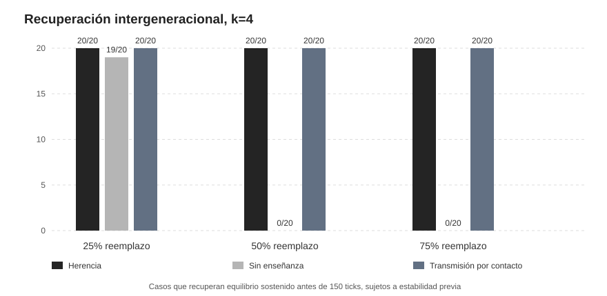
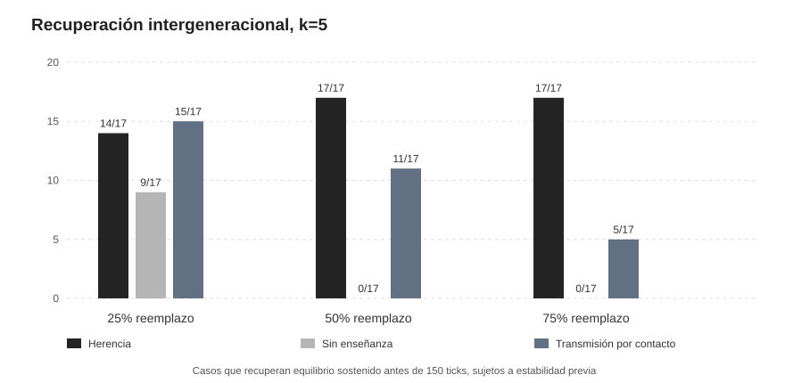

# G0 — Traspaso intergeneracional de una regla de coordinación distribuida

**Fecha:** 9 de noviembre de 2026. **Equipo:** DESKTOP-I4SULKD. **Estatus:** experimento de simulación controlada, con mecanismo explícito de transmisión cultural local. **No** demuestra aprendizaje autónomo de la regla ni grokking colectivo. El diseño quedó fijado en PROTOCOL_TURNOVER_V0.md antes de los ensayos G0.

## Pregunta

Cuando una comunidad ya logró mantenerse equilibrada entre k funciones, ¿puede reconstruir su organización tras reemplazar a parte de sus miembros? ¿Qué papel desempeña conservar la regla local de coordinación frente a transmitirla por comunicación o perderla completamente?

Los 120 agentes se conectan en un anillo de grado4 y pueden conversar con un solo vecino por turno. Una regla preprogramada de elección de función poco observada produce coordinación sin que ninguno conozca el censo global. Se crean episodios base de 140 pasos con k=4 y k=5, y solo se realiza relevo si el último periodo de 10 ticks cumple TV≤0,06 y cambios≤5%. **No se retiran a posteriori las comunidades que recuperen mal**.

Se intentaron **40** comunidades iniciales y **37** cumplieron equilibrio: 20/20 para k4 y 17/20 para k5. Los tres casos k5 que no llegaron a estabilidad antes del relevo están conservados como exclusiones previas. Se evaluaron tres fracciones de reemplazo r∈{0,25;0,5;0,75}. En cada comunidad/fracción, exactamente los mismos nodos y nuevos colores (un shock 70% a función0 entre recién llegados) se aplicaron a los tres tratamientos contrafactuales.

Los tratamientos difieren únicamente en la disponibilidad de una regla diseñada manualmente: **Herencia** hace que todos los nuevos posean inmediatamente la regla; **Sin enseñanza** mantiene novatos que no la conocen y solo conservan su rol; **Enseñanza por contacto** comienza con novatos sin regla pero permite que adopten la de un vecino informado con probabilidad fijada de 0,25 en cada conversación. Quien acaba de recibir la regla solo puede utilizarla a partir del siguiente tick. No existe difusión global instantánea ni conocimiento de los porcentajes del conjunto. El horizonte posterior es de 150 ticks.

## Resultados con cuatro funciones

| Reemplazo | Herencia | Sin enseñanza | Enseñanza local |
|---|---:|---:|---:|
| 25% | 20/20 | 19/20 | 20/20 |
| 50% | 20/20 | 0/20 | 20/20 |
| 75% | 20/20 | 0/20 | 20/20 |

Con el 25% de sustitución, los veteranos que conservaron la regla fueron suficientes para restaurar el equilibrio en 19/20 comunidades incluso sin enseñar a los recién llegados. Con reemplazo del 50% o 75%, la ausencia total de enseñanza produjo **0/20 recuperaciones**, mientras que la transmisión por conversación produjo **20/20**. Esta diferencia se obtiene desde shocks demográficos estrictamente idénticos dentro de cada comunidad.

## Resultados con cinco funciones, una tarea más exigente

| Reemplazo | Herencia | Sin enseñanza | Enseñanza local |
|---|---:|---:|---:|
| 25% | 14/17 | 9/17 | 15/17 |
| 50% | 17/17 | 0/17 | 11/17 |
| 75% | 17/17 | 0/17 | 5/17 |

Con k5, la coordinación posterior resulta menos fiable. A reemplazo del 50%, la enseñanza por contacto recuperó **11/17** frente a **0/17** sin enseñanza; al 75%, **5/17** frente a **0/17**. La herencia inmediata de la regla recuperó **17/17** en ambas fracciones, lo que indica que la tarea no era imposible tras ese choque: el mecanismo de conservación o transmisión de conocimiento marcaba la diferencia dentro del simulador.

## Magnitud y duración del desajuste

Los contrastes no se basan solamente en una fotografía del último tick. Se calculó también la AUC de TV acumulada durante los 150 ticks posteriores. Una AUC menor indica menos desequilibrio temporal. Estos promedios están condicionados a que la comunidad anterior fuera elegible, y la unidad independiente es la cohorte inicial, no los mensajes ni los ticks.

| k | Reemplazo | AUC herencia | AUC sin enseñanza | AUC contacto |
|---|---:|---:|---:|---:|
| 4 | 25% | 3,87 | 8,20 | 4,10 |
| 4 | 50% | 4,61 | 22,87 | 5,59 |
| 4 | 75% | 4,96 | 42,75 | 9,18 |
| 5 | 25% | 7,86 | 10,28 | 7,91 |
| 5 | 50% | 7,84 | 25,99 | 10,76 |
| 5 | 75% | 7,49 | 50,95 | 15,54 |

## Interpretación sociológica y límites

[Inferencia] Este modelo demuestra una forma sencilla de **dependencia de portadores de conocimiento distribuido**. El equilibrio macroscópico puede existir antes del relevo y perderse cuando desaparece la capacidad de corregir desviaciones locales; la supervivencia de otros agentes y de la red física no basta para conservar esa competencia. La posibilidad de enseñar mediante interacción uno-a-uno actúa como un mecanismo de redundancia y reproducción de reglas.

**La regla fue proporcionada por el investigador y se copia con un parámetro de transmisión definido externamente**. Por ello el resultado no demuestra que el conocimiento haya emergido espontáneamente, ni que exista enseñanza social humana análoga. El efecto del tratamiento dentro del simulador sí se identifica causalmente porque se interviene sobre la transferencia de conocimiento preservando colores, nodos, red y choque inicial. Su relevancia para comunidades reales es una hipótesis teórica, no una inferencia empírica.

Una sustitución del 50–75% coloca a los recién llegados en un estado funcional inicial sesgado (70% en el rol0) y les impide corregir desequilibrios si no conocen la regla. La intervención de «sin enseñanza» está diseñada para que puedan permanecer inertes; por ello el fracaso no es sorprendente en sentido teórico general. La comparación permite estimar la importancia del acceso a esa regla en este modelo, pero no descubrir una ley universal de fragilidad generacional.

El test P0/P1 independiente encontró que una política REINFORCE basada en escalado de escasez local consigue cierta extrapolación a k5..8, pero G0 prueba la difusión de una **heurística explícita**. No debe combinarse su tasa de recuperación con una tasa de traspaso de conocimientos aprendidos por agentes; esa sería una nueva simulación G1 con control específico.

## Auditoría, código y registros

El análisis de pares [RESULTS_G0_AUDIT.json](RESULTS_G0_AUDIT.json) informa **PASS** en **333 ramas postrelevo** y 111 shocks emparejados, sin discrepancias de colores iniciales ni nodos reemplazados entre las tres condiciones. Los scripts [turnover_v0.py](turnover_v0.py), [report_turnover.py](report_turnover.py) y el archivo [results_g0/G0_RESULTS.json](results_g0/G0_RESULTS.json) contienen parámetros y resultados. La limitación de un vecino por tick se implementa en el mismo modelo base que pasó diez pruebas automáticas.
