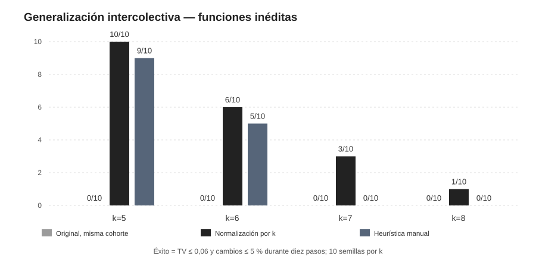
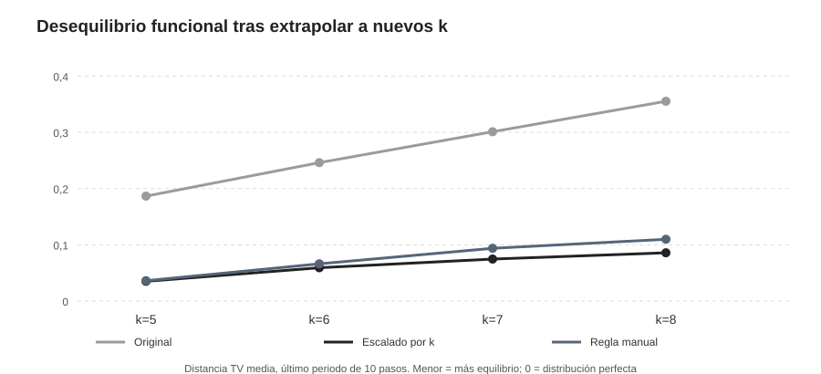

# Coordinación funcional distribuida — P0/P1, factibilidad y extrapolación

**Fecha de experimento:** 9 de noviembre de 2026. **Equipo:** DESKTOP-I4SULKD. **Estado:** experimento de simulación exploratorio sobre tareas sintéticas. No se usaron datos sociológicos observacionales ni se verificó el contenido de los PDF/DOCX que el usuario había mencionado en el texto pegado; el diseño disponible queda en QUEUE.md.

## Problema social modelizado

Cada comunidad está compuesta por 120 agentes que deben cubrir k funciones en proporciones aproximadamente 1/k. Hay una estructura fija de red de anillo con grado4. Un tick permite una conversación con máximo un vecino por agente. Los agentes saben k y su propio estado, y conservan recuerdos locales de las etiquetas de vecinos con quienes han hablado. No observan el censo global; la distancia al equilibrio se calcula fuera del modelo como resultado experimental.

El estado de cada agente corresponde a una función (un color), y cada mensaje comunica un estado de función. La distribución inicial está sesgada: 70% de agentes empiezan en estado0, los demás se distribuyen entre las otras funciones. El éxito estricto requiere distancia de variación total TV≤0,06 y churn≤0,05 durante diez ticks consecutivos, con la evaluación final en esas condiciones. La diversidad funcional local se mide separadamente.

## Dos hechos diferentes: coordinación y aprendizaje

La heurística manually designed **minority** dirige cada agente a favorecer una función poco observada entre sus conversaciones, con pequeña bonificación por conservar su función. Consiguió estabilizar todos los casos conocidos de k2,3,4 (12/12 en cuatro semillas por k), mostrando que la tarea puede resolverse **de forma descentralizada bajo las reglas diseñadas**. No es aprendizaje autónomo de ese algoritmo.

Los agentes de aprendizaje disponen de una política con tres pesos privados por individuo. Se entrena con recompensa de complementariedad LOCAL y REINFORCE, durante 24 episodios (8 por cada k=2,3,4), manteniendo pesos entre episodios. Los pesos no se actualizan en test; sí lo hace la memoria de observaciones. Las características de estado poco observado, permanencia e imitación se diseñaron explícitamente. Por tanto, una eventual generalización es aprendizaje de ponderaciones, no descubrimiento no guiado de conceptos de rareza.

## P0 — primera evaluación y resultado negativo

Con la representación original de frecuencia local `−f_local`, la política aprendida estabilizó 4/4 casos k2, 4/4 k3 y 0/4 k4 en el piloto conocido. Con el primer conjunto de test k5..8, semillas independientes, obtuvo **0/10 casos estables en cada k nuevo**. La regla manual obtuvo 9/10 k5, 4/10 k6, 2/10 k7, 4/10 k8. El éxito de la regla manual confirma parcialmente factibilidad, mientras el aprendizaje P0 falla la extrapolación.

**Hipótesis correctiva registrada después de P0:** al aumentar k, cada color representa menos observaciones locales, pero la bonificación aprendida por conservar el estado no se reescala. Esto podría fijar a los agentes en asignaciones funcionalmente desequilibradas.

## P1 — intervención de escala, cohorte nueva y test separado

Se modificó exactamente una característica de la política REINFORCE: **`−frecuencia_local` pasa a `−k × frecuencia_local`**. El resto de la red, recompensas, interacciones y entrenamiento se mantuvo constante. Se entrenaron de cero P0 y P1 con los mismos episodios/semillas (cohorte seed20261110) y se abrieron otros datos test k5..8 con semillas 10000+100k+s. Ninguna se entrenó con k>4. El test quedó bloqueado por hashes de modelos y pesos antes de ejecutarse.

| Funciones nuevas | P0, misma cohorte | P1 escalado por k | Heurística manual |
|---|---:|---:|---:|
| 5 | 0/10 | 10/10 | 9/10 |
| 6 | 0/10 | 6/10 | 5/10 |
| 7 | 0/10 | 3/10 | 0/10 |
| 8 | 0/10 | 1/10 | 0/10 |

| k | TV P0 original | TV P1 escalado | TV heurística |
|---|---:|---:|---:|
| 5 | 0,187 | 0,035 | 0,036 |
| 6 | 0,246 | 0,059 | 0,066 |
| 7 | 0,301 | 0,075 | 0,094 |
| 8 | 0,355 | 0,086 | 0,110 |

En el conocido k4, P1 pasó del 0/4 del control P0 al 4/4. En el test nuevo k5, P1 obtuvo 10/10 frente a 0/10 de P0; en k6, 6/10 frente a 0; en k7, 3/10 frente a 0; en k8, 1/10 frente a 0. Las tasas se obtuvieron tras haber fijado el factor k, no a partir de una búsqueda de los mejores ejemplos. **El efecto sigue siendo descriptivo de una sola cohorte de entrenamiento por condición**, con diez semillas de episodio por k.

## Interpretación mecanicista

[Inferencia] La intervención demuestra en este simulador que **la escala de la representación local** importa para la generalización a un número nuevo de roles. Una política puede aprender un comportamiento suficiente para k2/3 que no se transporta a k5..8, y mejorar sustancialmente al recibir una característica invariante en escala relativa. Esto no implica la existencia de grokking; no observamos el patrón de memorización temprana, generalización tardía y transición duradera.

La normalización por k es **ingeniería de características introducida por el investigador**, no una generalización conceptual que el sistema descubra por sí mismo. La política conserva otros inductive biases y utiliza una recompensa local de complementariedad que el investigador definió. La extrapolación pierde fiabilidad al elevar k; un grado4 y una conversación por agente/tick limitan la información disponible. Variar el grado o el presupuesto comunicativo sería otra intervención, que necesitaría un nuevo protocolo.

## Controles, auditoría y limitaciones

El modelo pasó diez pruebas automáticas de invariantes, entre ellas restricciones de mensajería, reproducibilidad, cambios de estado legales para k nuevo y ausencia de censo global en la política. Los streams de emparejamiento y acciones son independientes, para que el mismo seed fije las mismas oportunidades de interacción en ambos brazos.

Los resultados P0 y P1 no constituyen replicaciones independientes de muchos entrenamientos; la comparación tiene **una cohorte entrenada por brazo**, y los diez episodios por k solo reflejan variabilidad de condiciones iniciales y emparejamientos de esa política. Se requieren varias cohortes y otra familia de redes/tareas para una conclusión general. Las características de rareza y la recompensa local facilitan la coordinación; distinguir aprendizaje de ejecución de heurística permanece esencial.

## Reproducción y continuación

Archivos model.py, model_p1.py, pilot_known.py, heldout_k.py, experiment_p1.py, test_model.py y report_p1.py; protocolos PROTOCOL_V0.md, PROTOCOL_P1_SCALE.md y QUEUE.md. Datos exactos en results_p0 y results_p1, con hashes de políticas y seeds de test. El estudio G0 se documentará por separado; experimenta difusión intergeneracional de una **regla ya codificada** (PROTOCOL_TURNOVER_V0.md), no aparición emergente de grokking social.
