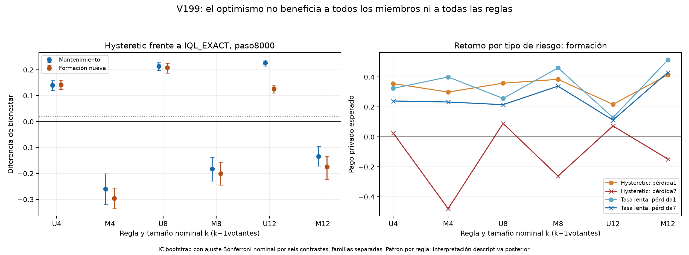
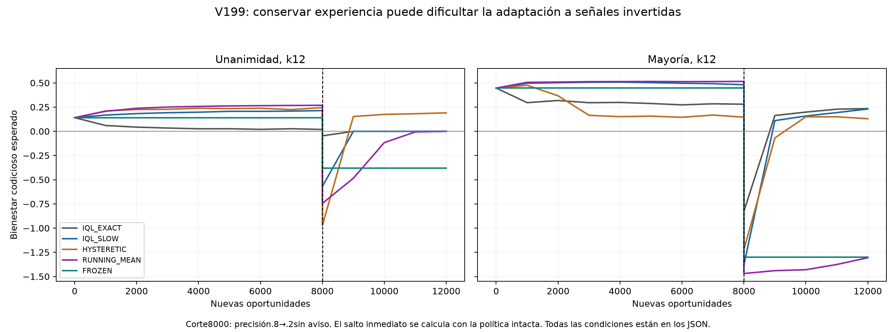
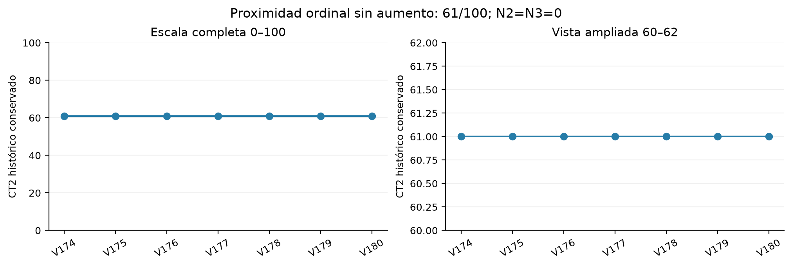

# V199: cooperación privada, ruido y límites de voluntariedad

Campaña completada, dos hipótesis principales fallidas. La conservación sin pulsos sí es posible con controles privados conocidos. El nuevo límite decisivo es sostener adaptación útil y ofrecer una salida real a los miembros expuestos a pérdidas. CT2 histórico61 sin modificar; rama nueva sin puntuación, N2=N3=0.

## Resultados que cambian la decisión

Reducir la tasa simétrica a.01o usar una media acumulada permite conservar>=75%del valor parental en6/6 escenarios, con retornos esperados medios no negativos para ambos tipos de pérdidas. Esos mismos procedimientos producen políticas útiles desde cero sin pulsos colectivos en6/6 escenarios de192 mundos nuevos. Son controles de aprendizaje conocidos, no una institución inventada. Refutan la necesidad general de un programador que fuerce ensayos colectivos para estas condiciones; no prueban suficiencia en todos los entornos o aprendices.

Las hipótesis principales estaban fijadas sobre HYSTERETIC frente a IQL_EXACT: mantenimiento y formación debían pasar al menos4/6 escenarios, con utilidad privada, mejora>=.02e intervalos simultáneos positivos. Ambas pasan3/6 y FALLAN. Los tres positivos corresponden a unanimidad; los de mayoría fallan. La interpretación del patrón opuesto por regla es posterior y descriptiva, no una hipótesis general rescatada por seleccionar subgrupos.

| Método | Mantiene75% | Forma política útil | Se adapta: padres | Se adapta: formación |
|---|---:|---:|---:|---:|
|IQL_JITTER|0/6|3/6|3/6|3/6|
|IQL_EXACT|0/6|3/6|3/6|2/6|
|IQL_SLOW|6/6|6/6|0/6|0/6|
|HYSTERETIC|3/6|3/6|3/6|3/6|
|RUNNING_MEAN|6/6|6/6|0/6|0/6|
|LMRL2|0/6|3/6|0/6|0/6|
|FROZEN|6/6|—|0/6|—|
|IQL_MIN|—|3/6|—|3/6|

Formación útil en esta tabla significa bienestar>=.05 y retornos medios>=0 para pérdida1y7 al paso8000; es un resumen secundario y no equivale a superar la hipótesis inferencial H2. FROZEN no es un aprendiz. Adaptación exige un precursor útil y recuperar>=75%de su valor después de invertir señales, con pagos no negativos para ambos tipos. Ningún método pasa adaptación en>=4/6.

## Formación nueva y pagos privados

| k | Regla | IQL_EXACT | Tasa.01 | Hysteretic | Media acumulada | LMRL2 |
|---:|---|---:|---:|---:|---:|---:|
|4|UNANIMITY|0.04205|0.28069|0.18398|0.27951|0.03135|
|4|MAJORITY|0.20890|0.31600|-0.08683|0.32638|0.16224|
|8|UNANIMITY|0.01157|0.23501|0.21969|0.25145|0.00058|
|8|MAJORITY|0.25949|0.39869|0.05888|0.46414|0.16802|
|12|UNANIMITY|0.01851|0.12042|0.14493|0.14258|0.00020|
|12|MAJORITY|0.31423|0.47282|0.14001|0.52661|0.17251|

Cada celda es bienestar codicioso esperado al paso8000, integrado sobre estados y señales nuevos, no recompensa de un máximo de entrenamiento. Se conservan también conducta nativa mientras exploran y retornos físicos realmente cobrados. Por ejemplo, en formación k12mayoría, RUNNING_MEAN obtiene valor codicioso.52661 y conducta nativa.48117; su retorno realizado medio durante las8000 sesiones es.40862. Al invertir señales, el retorno realizado medio de las4000 sesiones siguientes cae a−1.27379. La estabilidad no evita daño durante un cambio.

No basta contar acuerdos. En formación con mayoría k12, HYSTERETIC tiene bienestar codicioso medio.14001, pero las personas de pérdida7reciben−.14850 y las de pérdida1+.41418, promediando primero dentro de cada mundo. El rendimiento medio positivo oculta un reparto perjudicial para un tipo de miembro. Con tasa.01, los dos tipos reciben+.43053 y+.51320. La regla de mayoría y el método son suministrados; no se atribuye al grupo una preferencia institucional aprendida.

## Conservación y adaptación son pruebas distintas

Las dos cohortes afrontan8000 oportunidades originales y4000después de invertir precisión de señal.8→.2 sin aviso. El contenido informativo disponible y la física no cambian: intercambiar las etiquetas de señal de cualquier política recuperaría exactamente su valor anterior. La inversión es un falsador impuesto por el investigador, no una sorpresa social empíricamente observada.

Tasa lenta y media acumulada retienen experiencia, pero no superan la recuperación registrada en ningún escenario. Hysteretic se adapta en tres escenarios, sin resolver sus daños bajo mayoría. IQL rápido se adapta en tres o dos, según cohorte y desempate, sin pasar la conservación previa. El control congelado conserva antes del cambio y fracasa después. No existe aquí un vencedor global entre los métodos examinados y sus parámetros fijados.

El fracaso original de IQL no se elimina al sustituir el jitter por desempates exactos: ambos pasan0/6 en mantenimiento. Algunas trayectorias y criterios secundarios sí cambian; no se declara irrelevancia universal del desempate. La comparación comparte monedas y mundos, no acciones idénticas cuando las políticas difieren.

## Auditoría posterior: optimismo y ausencia de salida

V199B se diseñó DESPUÉS de ver la campaña y no rescata H1/H2. Con compañeros congelados se calcula el retorno esperado de cada acción propia y la mejor respuesta unilateral. Hay una limitación constitutiva: bajo mayoría, votarNOno permite evitar una decisión ratificada por otros. La tarea no incluye salida, exclusión de costes ni retirada del proyecto. La libertad de votar no equivale a participación voluntaria.

En los perfiles de formación HYSTERETIC con compañeros codiciosos, la siguiente auditoría describe a las personas de pérdida7. Estos valores agrupan personas; no son la media de32medias por tipo usada arriba. No son intervalos confirmatorios.

| k, mayoría | Mejor respuesta unilateral: pago medio | Personas con mejor respuesta de valor negativo |
|---:|---:|---:|
|4|-0.39480|54.65%|
|8|-0.18022|46.66%|
|12|-0.06344|30.44%|

Por tanto, en esos perfiles parte del daño no se corrige cambiando unilateralmente la política binaria con los compañeros fijos. Esto no demuestra imposibilidad de influir en su aprendizaje futuro ni un equilibrio estable. Bajo unanimidad, en cambio, NOgarantiza0 por construcción. La diferencia de poder de rechazo está programada y restringe cualquier afirmación de cooperación voluntaria.

La regla hysteretic también cambia el objetivo estadístico: su deriva escalar con alpha.1/beta.01apunta a un expectil10/11 del retorno, no a su media. La derivación y las1000 comprobaciones de residuo son álgebra conocida, coherente con la pérdida asimétrica de [Rowland y colaboradores2019, sección3.1](https://proceedings.mlr.press/v97/rowland19a.html). No se ejecuta EDRL ni se reclama teorema original. Los rankings expectiles concuerdan mejor con parte de las decisiones observadas bajo unanimidad; esa explicación no mejora el ajuste en todos los perfiles de mayoría. No se fuerza un mecanismo único ni se confunde el cero de deriva con la media estacionaria exacta de Q con ganancia constante.

## Diseño, rivales y validez

MAINTENANCE reutiliza32 mundos parentales por escenario y Q asistidas de V195: no son nuevas raíces. FORMATION incorpora192 raíces nuevas,32 por cada combinación k/regla, con20grupos por mundo. Los métodos están apareados dentro del mundo; los84 brazos de método/escenario/cohorte no son84experimentos científicos independientes. Se guardan384JSONpor mundo, de los que192son registros nuevos y192reutilizan padres. No son datos humanos ni réplicas de laboratorios externos.

Se implementó la actualización [hysteretic de Matignon y colaboradores2007](https://doi.org/10.1109/IROS.2007.4399095) y la regla [LMRL2 de Wei y Luke2016](https://www.jmlr.org/papers/v17/15-417.html), con parámetros publicados y ecuaciones inspeccionadas visualmente. LMRL2 se adapta a decisiones contextuales terminales, gamma0 y sin difusión a futuros estados; usa su selección nativa y Q inicial−L_i. IQL_MIN controla esa inicialización en formación. No es reproducción de sus benchmarks originales ni comparación exhaustiva con parámetros tuneados. Su fracaso por defecto no demuestra inferioridad general frente a un nuevo método nuestro.

RUNNING_MEAN usa9pseudobservaciones de prior por celda, no los verdaderos conteos históricos de los padres, que no se conservaron. Todos los algoritmos, reglas de voto y grupos son exógenos. Se aprende conducta bajo esas instituciones, no su invención. Esta campaña tabular no es una prueba de grokking neuronal ni revoca la falsación de coadaptación continua de V193.

El registro `a0113021889e89b729e4513adafee1081cde48b2` congeló también el código del análisis antes de entrenar. Nueve archivos se verificaron por HTTP y seis padres por hash. La validación técnica comprueba elecciones, actualizaciones, física del kernel, visitas e independencia de grupos. Un motor separado verifica32256 valores, error máximo1.33e-15,336invariantes de memoria y24reconstrucciones de retornos privados a partir de las medias. Son auditorías de cálculo, no confirmación de una contribución social original.

Las hipótesis H1/H2 utilizan20000remuestreos por32 mundos e intervalos bootstrap con ajuste Bonferroni nominal de99.1667%por contraste dentro de seis casos. Las dos cohortes constituyen familias declaradas por separado, sin cobertura95%conjunta prometida. Los contrastes de los otros métodos son secundarios. No se seleccionan máximos ni se cambian umbrales al observar.

## Decisión científica y evaluación AB

Queda refutada una interpretación general de necesidad de pulsos externos: controles privados simples forman y conservan cooperación útil en los seis escenarios originales. La dificultad pendiente combina plasticidad y riesgo distribuido. Antes de nuevas afirmaciones institucionales debe existir opción efectiva de no participar, con costes y compensaciones auditados. Ajustar más tasas sin esa salida mantendría un problema de validez conceptual.

La prueba siguiente debe examinar participación o compromisos realmente rechazables con aprendices competentes y rivales contractuales fuertes. Una opción de salida o un contrato suministrado será una regla programada; habrá que medir por separado su adopción y mantenimiento aprendidos. No se cuenta esa prueba como realizada. La investigación material de profesiones y donaciones y el contraste empírico humano siguen formando parte del objetivo global.

CT2 histórico61permanece intacto. La nueva rama no recibe puntuación; no se adjudica un1/3 por número de semillas ni se acredita2/3. Los resultados negativos y las versiones anteriores permanecen íntegros. El objetivo científico sigue activo.
