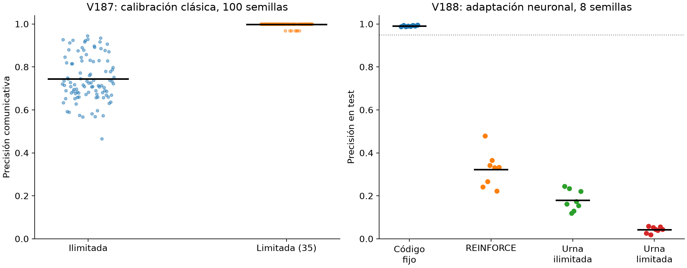
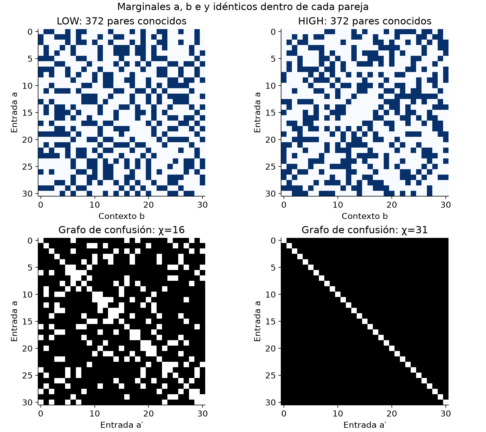
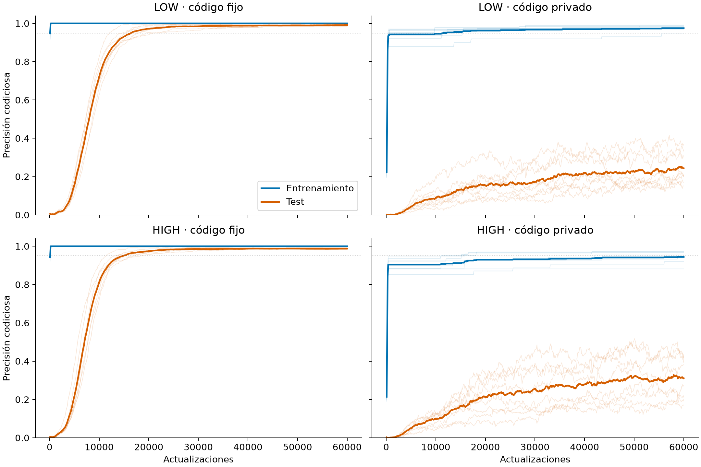

## Convenciones privadas y límites de la generalización colectiva

15 de noviembre de 2026. Informe de resultados del programa de cooperación y organización multiagente. Código, pesos, resultados negativos y prerregistros conservados. Este bloque no acredita una contribución AB2/3.

### Resultado y decisión

V190 no produjo ninguna entrada en memorización perfecta con código comprimido entre las ocho historias LOW. No apareció el régimen previo necesario para estudiar la transición registrada. Se cierra esta arquitectura mínima —emisor tabular con feedback binario y receptor neuronal— como vía de identificación de grokking colectivo; no se concluye que el fenómeno sea imposible con otros agentes o tareas. En las 16 historias privadas V190, el receptor ya alcanza el techo de entrenamiento del código actual y el emisor no obtiene mejora inmediata cambiando una señal frente a ese receptor fijo. El sondeo restringe el cuello de botella a una convención compatible y su posible reorganización; no establece un equilibrio global.

El contraste con un rival clásico fue necesario. La memoria limitada reproduce un efecto conocido en un juego de señales de urnas, pero no mejora su adaptación a nuestro receptor neuronal: el test medio cae del 32,3% con REINFORCE al 4,25% con la urna limitada. La conclusión se refiere a esta adaptación, con su retroalimentación, escala temporal y representación. No refuta el artículo antecedente ni establece que olvidar sea perjudicial en general.

La puntuación histórica 61 corresponde a otra rama y es un juicio ordinal, no una probabilidad ni un porcentaje de descubrimiento. Se conserva sin cambios. La rama de convenciones permanece sin puntuación; N2=N3=0. Más semillas internas, una reproducción o una cota conocida no resuelven la falta de predicción original y confirmación científica independiente.

### V187: comprobar primero un rival competente

Spike, Stadler, Kirby y Smith estudian cómo el refuerzo, el sesgo contra la ambigüedad y la pérdida de información permiten formar convenciones. No sería original atribuir el éxito de señales a esos mecanismos en general. Revisamos sus métodos pertinentes y reconstruimos el juego mínimo: diez agentes intercambiables, cinco significados y cinco señales; emisor y receptor muestrean sus asociaciones y refuerzan ambos cuando la interpretación acierta. No se entrega un diccionario biyectivo.

El enlace de código publicado devuelve 404 por tres vías. Por tanto, V187 es una reimplementación de los métodos, no ejecución del programa de los autores. Una urna vacía se resuelve mediante muestreo uniforme; esta decisión de completado está explícita. El intérprete Python de listas y el núcleo Numba coinciden en 120 comprobaciones con cintas aleatorias compartidas. Esa coincidencia valida una implementación, no confirma una tesis sociológica.

Con cien semillas nuevas y 20.000 interacciones por condición, la memoria limitada a 35 ejemplares logra precisión comunicativa >=.99 en 93/100 historias; la memoria ilimitada, en 0/100. La media es .99776 frente a .743886, una diferencia de .253874. Se supera el criterio registrado de calibración. La precisión se calcula sobre las políticas actuales de todos los pares ordenados de agentes y significados, no por una racha afortunada de aciertos. Es una reproducción cualitativa de un efecto conocido. [Fuente primaria](https://pmc.ncbi.nlm.nih.gov/articles/PMC5412673/).

### V188: el éxito clásico no se transfiere automáticamente

La tarea es y=(a+b) mod 31. El emisor conoce a; envía una señal discreta; el receptor conoce esa señal y b y debe responder y. El emisor recibe únicamente su acierto, sin b, etiquetas ni gradientes ajenos. El receptor dispone de su etiqueta posterior y aprende por entropía cruzada. No hay parámetros compartidos entre agentes ni entre historias. Los intereses comunes, el canal y las dos funciones están programados: una convención aprendida aquí no demuestra una institución material surgida de intereses enfrentados.

Se conservaron 387 pares de entrenamiento y 574 de test del piloto V185; cada par y su inverso están en la misma partición. Todas las entradas marginales y las etiquetas aparecen en entrenamiento. Se compararon ocho bloques de semillas emparejadas, cuatro condiciones y 30.000 actualizaciones completas: diccionario biyectivo fijo, emisor REINFORCE, urna ilimitada y urna limitada. La capacidad de la última fue floor(1.4*31²)=1345, según la escala relativa del antecedente. Se trata de una adaptación a un emisor tabular y receptor neuronal, no del mismo sistema simétrico de diez agentes de V187.

| Método | Train medio | Test medio | Test esperado medio |
|---|---:|---:|---:|
| FIXED_PROTOCOL | 100.00% | 99.11% | 99.11% |
| REINFORCE | 92.83% | 32.27% | 32.27% |
| URN_LIMITED | 88.73% | 4.25% | 4.25% |
| URN_PURE | 92.89% | 17.97% | 17.72% |

La urna limitada no produce ninguna de las ocho historias exigidas por los umbrales de calidad y pierde frente a REINFORCE en las ocho comparaciones emparejadas; la mediana de la diferencia en test es −.289199. Falla el primario prospectivo. Ninguna de las familias privadas entra en el régimen de memorización requerido. Las congelaciones condicionales no se ejecutan; no son experimentos negativos realizados. La concentración final de las urnas limitadas es completa en estas historias —entropía cero—, de modo que no atribuimos el resultado a ruido persistente sin una intervención adicional.

Figura 1. Historias de calibración y resultados por semilla de la adaptación. Las escalas de ambos juegos son diferentes; la figura muestra por qué una calibración exitosa no prueba transferencia. El diccionario fijo es un control de generalización individual con código suministrado.

### V189 y V189B: separar cantidad de datos e información requerida

Una precisión baja puede venir de un código que ya ha perdido la información necesaria. Para una política del emisor pi(m|a), la precisión esperada sobre todos los pares uniformes satisface

`Acc_full <= Bpi = (1/31) sum_m max_a pi(m|a)`.

La razón es elemental: para cada señal y contexto b, el receptor solo puede escoger una respuesta, mientras que a determina una respuesta distinta para cada valor. Por ello, si Ntr y Nte son tamaños de las particiones,

`Ntr*Acc_train + Nte*Acc_test <= 31²*Bpi`.

Las precisiones deben ser ambas esperadas; mezclar una medida codiciosa con otra esperada invalidaría la comprobación. Para un código determinista de K símbolos, B=K/31. Se verificaron las 9600 evaluaciones de V188 sin violaciones. Son controles matemáticos conocidos y una auditoría de datos; no se presentan como teoremas nuevos.

Para permitir memorización perfecta con un código comprimido, construimos soportes de interacción usando su grafo de confusión: dos entradas del emisor son adyacentes cuando comparten algún contexto de entrenamiento y requieren respuestas distintas. Un código sin errores debe colorear ese grafo. Esta conexión entre comunicación, información lateral y coloración tiene antecedentes sólidos. [Fuente primaria sobre el marco](https://www.mdpi.com/1099-4300/26/4/338).

El primer prototipo V189 igualaba los marginales de a y b, pero no los de y. Se conservó y se excluyó como contraste limpio antes de entrenar. V189B corrige el problema: cuatro pares de soportes LOW/HIGH tienen exactamente 372 ejemplos de entrenamiento y 589 de test, doce ejemplos por cada a y b y las mismas frecuencias de y dentro de cada pareja. Se usan cuatro permutaciones para variar la relación entre el grafo y la suma modular. La búsqueda de los controles emplea únicamente restricciones de datos y grafos; no resultados neuronales.

LOW tiene número cromático16, certificado por una coloración y por ausencia de triples independientes. HIGH tiene grafo completo y exige31 colores. Un oráculo LOW de16 símbolos acierta todo el entrenamiento; manteniendo esos aciertos, su máximo en test es (16*31−372)/589=21.05%. Ese límite lo impone el entorno. Los agentes privados no reciben el código ni la coloración. Que la transición sea posible no implica que el algoritmo la aprenda.

Figura 2. Primera pareja de soportes y grafos de confusión. Las frecuencias de entrada y salida coinciden; la estructura conjunta difiere. Se conservan los cuatro pares y sus certificados.

### V190: prueba de una transición aprendida tras memorizar

El protocolo, los datos, el código y las dependencias se registraron antes del entrenamiento en el commit `c918d5b326afb6320d7339b94d24c5f21511fba8`. Se descargaron los17 archivos por HTTPS y se comprobaron sus bytes. La auditoría técnica añadió16 contrastes de métricas e índices por historia y reutilizó el aislamiento de redes comprobado en V188.

Se entrenaron cuatro condiciones LOW/HIGH por diccionario fijo/aprendiz privado, con ocho semillas y 60.000 actualizaciones por condición: 32 historias, distribuidas en cuatro pares contextuales y dos semillas neuronales por pareja. No son32 contextos independientes. Se conservaron el optimizador y los parámetros de V188; cambió el soporte de interacciones. Se evaluó cada100 actualizaciones y se guardaron pesos cada5000. No se escogieron picos ni se prolongó el horizonte al ver el test.

La entrada prospectiva al régimen de interés requería cinco evaluaciones consecutivas sin errores codiciosos de entrenamiento y menos de31 símbolos. Se guardaría su primer checkpoint sin seleccionar por test. El primario exploratorio exigía al menos4/8 historias LOW, procedentes de dos parejas, con esa entrada seguida de generalización test>=.95, retraso de al menos2000 actualizaciones y razón temporal>=5. El punto final también debía mantener entrenamiento perfecto, test>=.95 y31 símbolos. En HIGH, memorizar con menos de31 símbolos es imposible por construcción; su ausencia no es un hallazgo.

| Soporte | Método | Train medio | Test medio | Rango test |
|---|---|---:|---:|---:|
| HIGH | FIXED_PROTOCOL | 100.00% | 98.77% | 98.30–99.49% |
| HIGH | PRIVATE | 94.42% | 31.03% | 17.15–43.46% |
| LOW | FIXED_PROTOCOL | 100.00% | 99.09% | 98.47–99.83% |
| LOW | PRIVATE | 97.51% | 24.30% | 15.11–36.67% |

El primario falla: 0 candidatos. El control fijo supera .95 en test en 8/8 historias LOW y 8/8 HIGH. El aprendiz privado termina LOW con train 97.51% y test 24.30%; en HIGH, 94.42% y 31.03%. Las entradas LOW en el régimen comprimido son 0/8. No se ejecutan congelaciones condicionadas a un candidato ausente. Estos resultados son un negativo del mecanismo y horizonte examinados, no una demostración de imposibilidad general. Igualar marginales controla tamaño y frecuencias; no identifica un efecto puro del número cromático, porque también difieren otras propiedades conjuntas de los soportes. La comparación V188/V190 cambia semillas, horizonte y ejemplos: no se usa como estimación causal aislada del soporte.

Figura 3. Precisión de entrenamiento y test durante el horizonte registrado. Las curvas claras muestran historias; las líneas gruesas, sus medias descriptivas. Las parejas de datos son la unidad contextual. El horizonte completo permite distinguir un fallo de memorización de una generalización posterior a ella.

### Diagnóstico posterior: ¿falta entrenamiento del receptor o un código compatible?

| Condición | Receptor alcanza techo del código | Emisor puede mejorar cambiando una señal | Techo train medio del código |
|---|---:|---:|---:|
| V188 REINFORCE | 8/8 | 0/8 | 92.83% |
| V188 URN_PURE | 8/8 | 8/8 | 92.89% |
| V188 URN_LIMITED | 8/8 | 0/8 | 88.73% |
| V190 LOW PRIVATE | 8/8 | 0/8 | 97.51% |
| V190 HIGH PRIVATE | 8/8 | 0/8 | 94.42% |

Alcanzar el techo del código significa que entrenar mejor la clasificación manteniendo ese código no puede reparar sus errores. No hallar un cambio codicioso rentable significa únicamente que el receptor actual no recompensa esa desviación inmediata. No demuestra un equilibrio de Nash sobre el espacio neuronal, ni descarta exploración estocástica, aprendizaje conjunto o mejoras después de adaptarse. Los estados de agrupación parcial tienen antecedentes clásicos; este diagnóstico no recibe prioridad teórica nueva.

El sondeo enumera, para el receptor ya aprendido, todas las señales alternativas de cada entrada del emisor y calcula su acierto sobre los contextos conocidos. También permite un receptor oráculo para medir el techo de entrenamiento del código actual. El oráculo y la enumeración los usa el investigador para diagnosticar; no se entregan a los agentes. Son comparaciones estáticas posteriores, no nuevas continuaciones de aprendizaje ni una prueba causal registrada de equilibrio global.

### Qué exigiría una afirmación de grokking colectivo

Una curva tardía de todo el sistema no demuestra que varios aprendices tengan que reorganizarse conjuntamente. Aquí solo el receptor es neuronal y todos los valores locales del emisor aparecen en entrenamiento. Las combinaciones nuevas se presentan al receptor. Por eso, aun si apareciera una transición, habría que distinguirla del grokking individual habilitado por un código suficiente.

Congelar un emisor con capacidad insuficiente asegura un mal resultado por información; no demuestra necesidad de coadaptación. Reemplazar su distribución por el argmáximo cambia también la exploración. Un control válido debe fijar el corte antes del resultado, mantener la distribución pertinente y documentar su techo de precisión. Las congelaciones canceladas no autorizan conclusiones causales.

Tampoco sería nueva una relación genérica entre cambios de distribución y generalización neuronal. Lyle y colaboradores conectan grokking, primacía y aprendizaje de representaciones y estudian intervenciones sobre la tasa efectiva de aprendizaje. Se revisó su texto principal; el catálogo conserva una discrepancia entre el registro PMLR 2026 y el encabezado del PDF 2025. [Fuente primaria](https://proceedings.mlr.press/v330/lyle26a.html).

### Integridad, alcance y evaluación AB

Se verificaron las 19200 evaluaciones V190 frente a su cota informacional, además de las 9600 de V188. Un evaluador NumPy separado, que no llama al modelo ni al evaluador de entrenamiento, recalculó los pesos finales de las 64 historias V188/V190: 256 contrastes numéricos, error máximo 6.74e-08, sin fallos; también coincidieron símbolos y cotas. Los cuatro pares de grafos se comprobaron de nuevo por enumeración. Los archivos congelados siguen byte por byte iguales. La auditoría técnica inicial V190 tuvo un error de serialización de un booleano NumPy, corregido antes del registro y sin entrenamiento científico; ambos logs se conservan.

Los tamaños de efecto del simulador no son leyes de cooperación humana. Este bloque no cambia el estimando de los datos humanos existentes ni los convierte en confirmación del nuevo juego. Los controles técnicos independientes verifican cálculos; no equivalen a una confirmación científica independiente de una predicción original. Se conserva la búsqueda bibliográfica como exploratoria, sin inferir prioridad porque no aparezca una expresión exacta en un buscador.

La decisión de continuar o cerrar una arquitectura se toma por su capacidad de resolver la incertidumbre científica, no por acumular versiones. Un TFM puede defender estas auditorías, contrastes registrados y resultados negativos. Una reivindicación 2/3 aún requiere especificar un mecanismo original frente a antecedentes competentes y obtener confirmación independiente pertinente. Este bloque no satisface ese requisito.

Código y evidencia: `REPRODUCE_V187_V190.md`, `results/V187_V190_FINAL_AUDIT.json` y los manifiestos del archivo de investigación. Los programas usan un proceso GPU y recursos limitados para mantener utilizable el ordenador. Se preservan los datos originales, el prototipo descartado y los fallos técnicos anteriores a la congelación del código.
