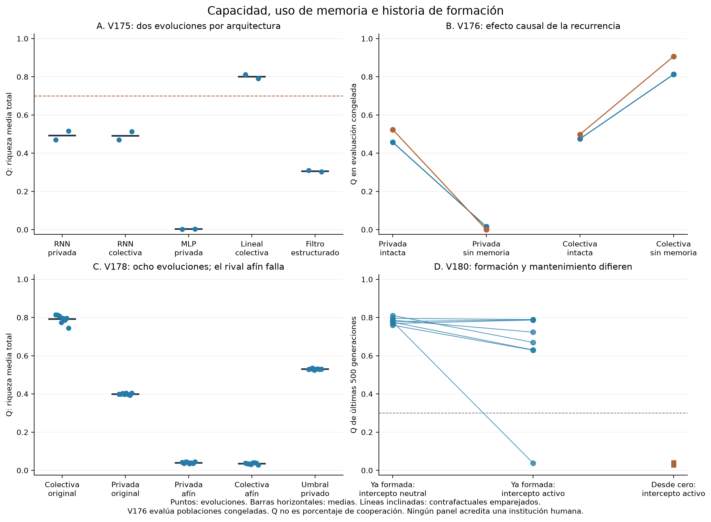
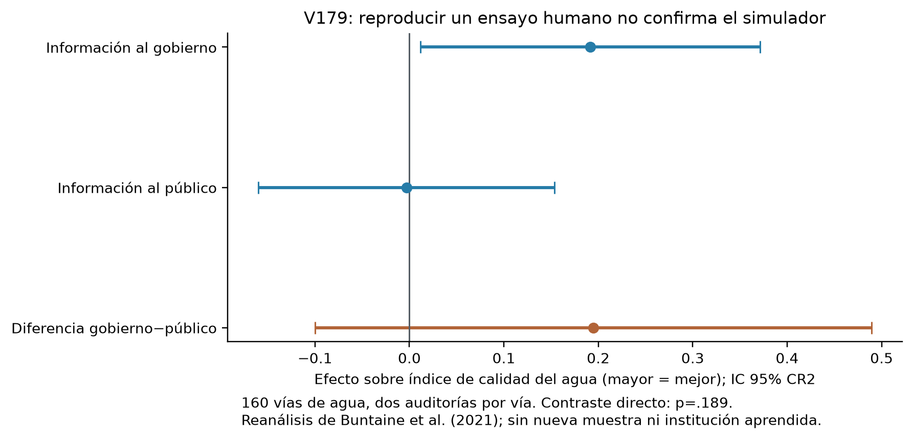

# Memoria, representación y evidencia institucional externa

## Del observador posible al mecanismo efectivamente evolucionado

La posibilidad de reconstruir riqueza colectiva mediante conservación no implica que una población descubra ese cálculo. En V173–V174 el investigador proporcionó una recurrencia escalar cuyas entradas eran observaciones sucesivas del recurso. V175 retiró esos coeficientes y evolucionó políticas privadas con memoria genérica. La distinción es importante: una arquitectura puede contener un estado capaz de representar cierta información y utilizarlo de una manera diferente.

El entorno procede de Itao y Kaneko, en su modelo colectivo de recursos renovables. Se conserva la selección proporcional a riqueza individual, la reagrupación aleatoria y el reinicio ecológico por generación. La unidad independiente de aprendizaje es una evolución completa. Q mide riqueza total media y no la proporción de personas que cooperan. Un criterio de alta eficiencia Q≥0,70 se fijó antes de las ejecuciones; el umbral de sostenibilidad Q>0,30 empleado por el antecedente responde a otra clasificación.

Las redes recurrentes privadas de cuatro unidades alcanzan Q=0,4703 y 0,5160. Superan al MLP privado particular probado, pero fallan el criterio de alta capacidad. Las mismas redes con acceso a riqueza colectiva también fallan, con Q=0,4700 y 0,5132. Un control lineal que reproduce la regla original supera 0,79 en ambas semillas. Por ello, el fracaso de la red privada no identifica que le falte información: la dificultad de selección o representación permanece como explicación rival.

No se amplió el entrenamiento para rescatar el criterio. La comparación de dos semillas sigue siendo un piloto; miles de generaciones no constituyen miles de repeticiones independientes. Un filtro estructurado con coeficientes evolucionados también quedó por debajo de 0,70. Eso no demuestra que ningún agente pueda aprender conservación; falla una implementación concreta bajo un presupuesto definido.

## Intervenir sobre la memoria en ejecución

V176 conserva poblaciones enteras y cambia un componente durante la evaluación, con idénticos genotipos e inicializaciones por grupo. En las redes privadas, borrar el estado recurrente reduce Q de 0,4577 y 0,5237 a 0,0155 y aproximadamente cero. En las redes que observan riqueza colectiva ocurre lo contrario: Q pasa de 0,4753 y 0,4988 a 0,8125 y 0,9066. Es evidencia causal local de una función diferente de la recurrencia en poblaciones particulares; no establece el valor de la memoria en general.

Otra intervención fija la entrada observada de recurso, manteniendo su dinámica física. Las redes privadas conservan Q=0,4948 y 0,5365. Esa entrada variable no resulta necesaria para alcanzar su desempeño en esta evaluación. Al fijar también los demás sensores, Q cae a 0,2051 y 0,1122. No hay evidencia de que las redes hayan aprendido el observador de riqueza colectiva basado en historia del recurso. Su propia riqueza variable, que contiene efectos de ingresos y consumo pasados, continúa siendo una fuente relevante de estado.

Los grupos clonales rinden mucho menos, lo que delimita el papel de heterogeneidad entre genotipos. Este resultado no se interpreta como descubrimiento de división funcional: no hay profesiones diferenciadas en este juego y la diversidad estratégica ya es central en el antecedente. Un invasor que extrae siempre perjudica su propia riqueza, pero su fracaso no identifica castigo deliberado ni estabilidad frente a todas las desviaciones. El agotamiento del recurso puede hacer autodestructiva una conducta excesiva sin que exista una norma contra el infractor.

## Agregación y conflicto distributivo

La mejora de riqueza total al borrar memoria colectiva plantea una pregunta de incentivos. V177 enumera los 32 perfiles de activación de recurrencia de cada grupo. Todos los pesos restantes, sensores y riquezas iniciales permanecen iguales. Es una familia restringida de contrafactuales; los agentes no han aprendido a votar sobre su capacidad cognitiva.

En las poblaciones con información colectiva, todos activos es un equilibrio restringido en aproximadamente el 83–84% de los grupos evaluados. Sin embargo, apagar todas las recurrencias casi nunca mejora a todos los integrantes: solo el 0,39% y el 4,49% de grupos presenta una mejora de Pareto. Una ganancia agregada puede coexistir con pérdidas privadas. Apagarse unilateralmente también reduce la riqueza esperada de la persona focal en estas poblaciones.

La hipótesis fuerte de una trampa de Pareto generalizada, fijada antes de enumerar incentivos, queda refutada. No se relaja después a otro criterio de bienestar para declararla confirmada. La teoría ya estudia competencia entre espacios de estrategia, capacidades de memoria y perjuicios de mayor recuerdo. Schmid y colaboradores ofrecen un antecedente directo de la primera familia; el trabajo de Alqithami sobre rutas, todavía preprint, ilustra la segunda. La contribución local consiste en identificar qué caracterización resiste la prueba, no en apropiarse del principio general.

## Un rival sencillo y la diferencia entre formar y conservar

V178 enfrenta reglas privadas y colectivas de baja dimensión en ocho semillas nuevas. El resultado elimina una explicación intuitiva pero incorrecta: añadir un intercepto a la regla privada no mejora el aprendizaje; Q cae de 0,3996 a 0,0400. La extensión condicionada a grupos mayores se cancela. Una regla todavía más sencilla que compara riqueza propia con un umbral, sin recurso observado ni recurrencia, alcanza Q=0,5301. Por tanto, la ventaja de la RNN sobre un MLP específico no acredita superioridad frente a un rival privado competente.

La familia colectiva original alcanza Q=0,7918, mientras que su extensión afín con intercepto alcanza Q=0,0356 desde inicialización pequeña. La extensión contiene la regla original: capacidad de representación y accesibilidad evolutiva son distintas. La existencia de buenas políticas en una familia no garantiza que el proceso adaptativo las encuentre.

La siguiente hipótesis fue que abrir el intercepto destruiría también una población ya cooperativa. V180 conserva las ocho poblaciones completas, reinicia el gen neutral del intercepto a cero y continúa con nuevas semillas, tanto si ese gen permanece neutral como si se vuelve funcional. Solo una de ocho trayectorias abiertas colapsa; las otras siete conservan Q>0,30, cuatro alcanzan Q≥0,70 y algunas mantienen eficiencia cercana al control. La media abierta es 0,6319 frente a 0,7817 con intercepto neutral. El criterio de destrucción generalizada exigía al menos seis casos y falla.

La selección de mutantes separó cuatro poblaciones para elegir un candidato común y cuatro para comprobarlo. Se contrastó un menú de once interceptos frente a 49 cambios posibles en los dos parámetros originales. El criterio robusto seleccionó intercepto cero y no confirmó invasión destructiva en las poblaciones reservadas. Este resultado acota la búsqueda; no demuestra inexistencia de todo invasor ni que un mutante adaptativo carezca de ventajas.

La matemática ofrece una condición parcial de colapso: con interceptos no nulos, el número de signos positivos fija las acciones cerca del origen. El autovalor del recurso es 2(1−0,9H+/M), además de autovalores de riqueza 0,75. En grupos de cinco, tres signos positivos hacen localmente estable el origen. Esta condición no determina el tamaño de su cuenca ni la evolución desde los reinicios usados. La regla privada de umbral puede satisfacerla y sostener una trayectoria eficiente. Una propiedad local del Jacobiano no basta como explicación de todo el aprendizaje.

## Contraste humano: información y destinatarios institucionales

El ensayo de Buntaine, Zhang y Hunnicutt aleatorizó la difusión de resultados de monitoreo de agua al gobierno, al público o a ambos. Es un contexto pertinente para examinar información e instituciones, pero las autoridades y la organización de monitoreo ya existían. No es un experimento de invención institucional entre aprendices autónomos.

Se recuperó el archivo público de replicación y se auditó su estructura antes de estimar. La muestra principal tiene 160 vías de agua observadas dos veces. La asignación permanece fija por vía; no hay claves vía×auditoría duplicadas. Los brazos incluyen 80 controles, 20 solo gobierno, 20 solo público y 40 ambos. Las 320 filas no son 320 unidades de asignación. Las vías adicionales del archivo previo a la selección experimental no se incorporaron a la muestra aleatorizada.

La reconstrucción Python reproduce coeficientes, covarianza CR2, grados de libertad Satterthwaite e intervalos publicados con diferencias numéricas inferiores a 10^−12 para los intervalos. También reproduce exactamente los p unilaterales de las 10.000 reasignaciones bloqueadas de los autores. No se ejecutó su código R ni se analizaron microdatos domésticos.

El efecto estimado de información al gobierno es 0,1915 unidades del índice de calidad, con IC95% [0,0115;0,3716]. Para información al público es −0,0031, con IC95% [−0,1599;0,1536]. Sería incorrecto concluir superioridad causal probada comparando simplemente cuál de estos dos intervalos excluye cero. El contraste directo añadido gobierno menos público vale 0,1947, con IC95% [−0,0999;0,4893] y p bilateral=0,1891. No establece una diferencia entre los efectos y tampoco establece su equivalencia.

Se detectó una línea incorrecta en la selección de efectos de ciudad, que utiliza la función de distribución F donde corresponde su cuantil. En este resultado concreto ambas reglas eligen la misma especificación; la reconstrucción principal no cambia. Esta comprobación localizada no equivale a auditar todas las conclusiones del artículo.

## Alcance de la contribución

El bloque distingue eficiencia, memoria útil, respuesta a información, incentivos individuales, acceso a una política y conservación de una trayectoria. Varias interpretaciones inicialmente prometedoras fracasan al añadir la prueba que faltaba. Conservar ese fracaso evita construir una explicación de organización sobre un indicador insuficiente.

Los antecedentes limitan las pretensiones generales. Akiyama y Kaneko ya estudiaban cooperación y normas en juegos de sistemas dinámicos; Itao y Kaneko estudian turnos y monitoreo anónimo; Hamon y colaboradores evolucionan forrajeadores recurrentes con observaciones locales. La memoria, la diversidad, los contratos y la dependencia histórica tienen literaturas fuertes. La originalidad de una predicción específica no se obtiene de la combinación verbal de esos mecanismos.

La evidencia humana ampliada verifica un resultado pertinente y muestra por qué debe formularse el contraste entre mecanismos antes de declararlo confirmado. No valida el generador ecológico, la ecuación de renovación funcional o la observabilidad contable. Las dos clases de evidencia conservan sus poblaciones, unidades y supuestos.

La contribución defendible actual al TFM es un programa de identificación generativa y falsación reproducible, con mecanismos condicionados y controles explícitos. La candidata de dependencia de formación respecto al espacio de políticas requiere todavía una predicción discriminante frente a selección y búsqueda, y confirmación independiente. La evaluación AB conserva el registro histórico 61/100 y no acredita 2/3 ni 3/3.
