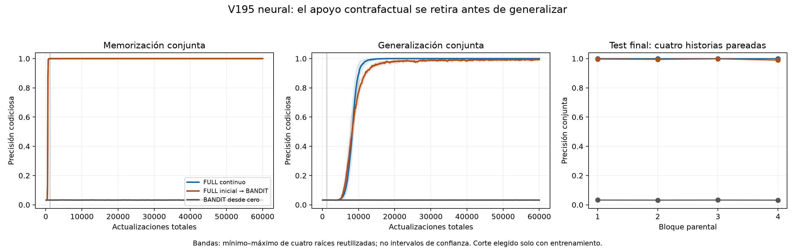
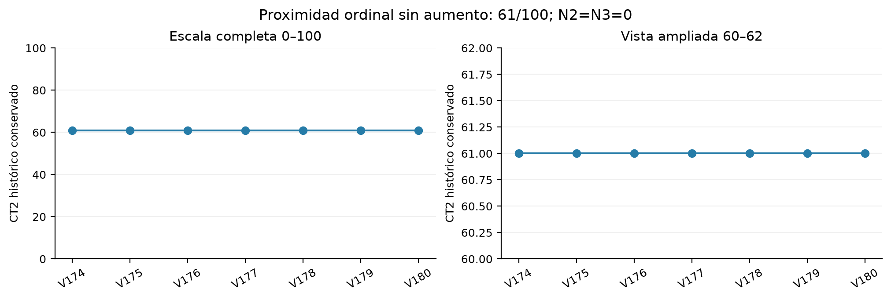

# V195 neural: un apoyo informativo transitorio basta después de memorizar

15/11/2026. Experimento `WITHDRAW_COUNTERFACTUAL`, distinto de V195 de votación privada. Terminado, auditado, cuatro historias parentales reutilizadas. El objetivo científico global sigue abierto. CT2 histórico61sin cambios, rama neuronal sin puntuación, N2=N3=0.

## Resultado y contraste decisivo

Retirar las31recompensas contrafactuales después de la primera memorización permite seguir generalizando con pagos realizados solamente. Ambos agentes conservan aprendizaje y momentos AdamW. El punto final60000alcanza train conjunto1en4/4y test medio0.99480069. Pasa el criterio registrado:4/4con train>=.99/test>=.95y mediana del déficit frente a FULL 0.00433276<=.02. Los dos controles condicionales de compañero congelado se cancelan como NO EJECUTADOS, según protocolo.

| Semilla parental | Corte FULL→BANDIT | FULL continuo | BANDIT desde cero | Apoyo transitorio | Primer test>=.95 sostenido |
|---:|---:|---:|---:|---:|---:|
|192115|1200|1.0000|0.0324|0.9965|14300|
|192116|1100|1.0000|0.0320|0.9948|16000|
|192117|1100|1.0000|0.0324|0.9983|14900|
|192118|1200|1.0000|0.0319|0.9896|15900|

El último campo exige cinco evaluaciones consecutivas cada100pasos. No se utiliza para escoger el resultado principal. La última columna de precisión corresponde al punto final, no al máximo de la curva. El test usa productos cartesianos de577entradas locales retenidas por agente. No es un test formado solo con combinaciones nuevas de entradas locales vistas.

## Qué cambia en la explicación

V192 FULL privado aprendía convenciones compatibles y después generalizaba. V193 conservaba la generalización local al congelar un compañero, incluso con igualdad bit a bit de los estados activos frente a la continuación conjunta. V194 demostraba capacidad del estimador binario frente a compañeros correctos suministrados. Faltaba retirar la información privilegiada de ambos aprendices reales sin reiniciar su historia.

V195 refuta, en este modelo y desde estos padres, la necesidad de mantener FULL durante toda la fase tardía. La dificultad de BANDIT desde cero no se extiende a BANDIT después de una formación asistida. No prueba que cualquier corte temprano funcione, ni qué parte exacta de los primeros1100–1200pasos resulta indispensable. Tampoco prueba necesidad de coadaptación: las políticas parentales ya memorizan las entradas de entrenamiento, por lo que sus compañeros proporcionan un problema local informativo bajo un desfase aprendido. No es una nueva capacidad colectiva demostrada por una curva conjunta.

Los aprendices reciben exclusivamente su pago realizado después del corte. El mundo conserva la función de pago programada; no construye una tabla contrafactual en esa fase. Las reglas, los intereses comunes, los grupos, la arquitectura y el apoyo inicial siguen suministrados externamente. La retirada posterior no convierte la formación en una institución inventada ni en cooperación surgida desde cero bajo información binaria.

## Coste y comparación justa

La arquitectura, epsilon.1, AdamW.001, weight_decay1, betas(.9,.98), datos y presupuesto total son los originales. Se conservan pesos, momentos y estados aleatorios. Los cortes1100requieren100pasos BANDIT registrados para alinear el reloj batch4a1200; las copias técnicas de ese prefijo no son semillas científicas.

Contando entradas de pago reveladas por entrada local de entrenamiento, FULL continuo usa1.860.000y la retirada usa93.000o96.000. Es una reducción contable del94.84–95.00%. No son bits de Shannon ni coste físico de consultas: la tabla one-hot puede codificarse con una etiqueta y el simulador suministra ese vector de forma privilegiada. Esta cifra no establece eficiencia informacional universal. Tampoco iguala las historias tempranas de FULL y BANDIT desde cero.

## Auditoría y originalidad

Registro remoto anterior a entrenar: `7d519eb122a99108955f3f5b105e19e1da998c82`, con20archivos HTTP comparados byte a byte y seis padres binarios fijados por hash. El replay histórico previo5000→10000coincidió bit a bit en pesos, momentos y RNG;408pagos de fixtures coincidieron con enumeración. Son pruebas técnicas, no nuevas réplicas científicas.

El forward NumPy separado y la enumeración cartesiana final verifican48métricas con error máximo5.55e-16. Comprueban también conservación de padres no alineados, relojes del optimizador, consumo aleatorio, criterios y cancelación de controles. Cuatro raíces reutilizadas siguen siendo cuatro raíces; no se reclama confirmación independiente.

La información privilegiada disponible durante aprendizaje tiene antecedentes sólidos: [Vapnik e Izmailov, JMLR2015](https://www.jmlr.org/papers/v16/vapnik15b.html). Ese trabajo estudia mecanismos distintos, no reproduce este experimento. Impide presentar la idea general de ayuda informativa transitoria como nueva. La relación entre grokking y adaptación también tiene antecedentes: [Lyle y colaboradores, PMLR2026](https://proceedings.mlr.press/v330/lyle26a.html). Sus algoritmos no se ejecutan aquí. Se consultaron metadatos/resúmenes de los primeros y las secciones principales del segundo en la campaña anterior; no se afirma una lectura integral de todos sus apéndices.

## Evaluación y continuidad

Este control resuelve una dependencia causal, no el déficit de originalidad2/3. No se modifica la evaluación canónica ni se concede un nuevo1/3por una semilla o una auditoría. La referencia siguiente corresponde a la rama histórica, no puntúa esta línea.

La línea paralela de votación V194–V196 conserva sus propios protocolos y resultados: en ella retirar pulsos de exploración conjunta sí deteriora políticas aprendidas durante adaptación. No son réplicas de este juego. Antes de combinar sus conclusiones se debe comprobar la estabilidad privada y la exactitud de la evaluación de políticas, incluyendo cómo se resuelven empates numéricos. La prioridad es resolver esa incertidumbre y contrastar mecanismos fuertes, sin acumular arquitecturas por acumular experimentos.
