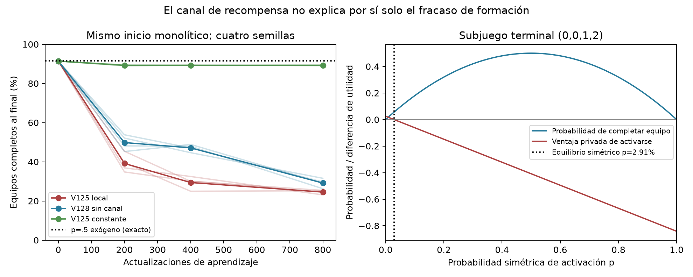
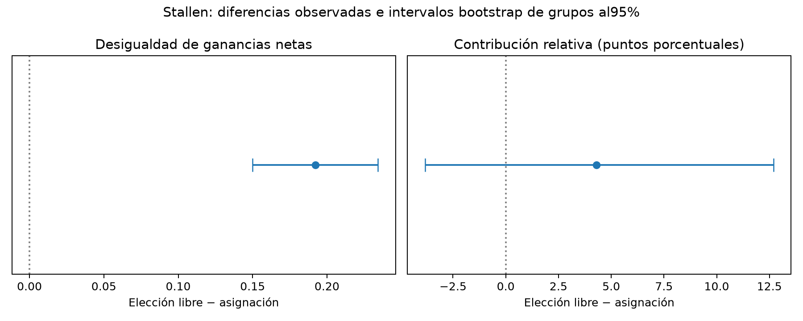
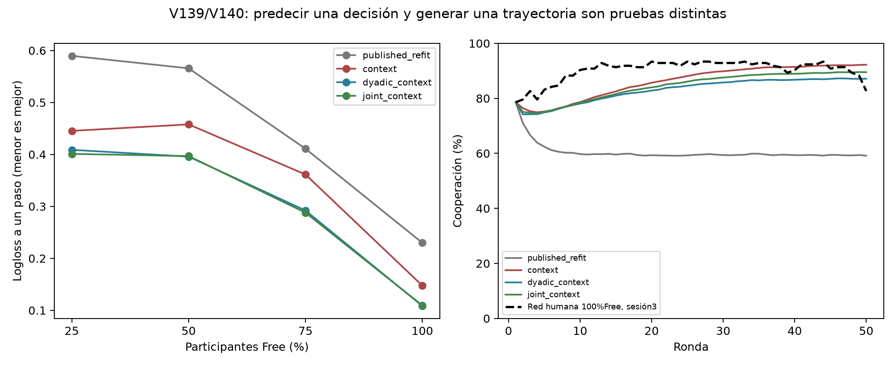
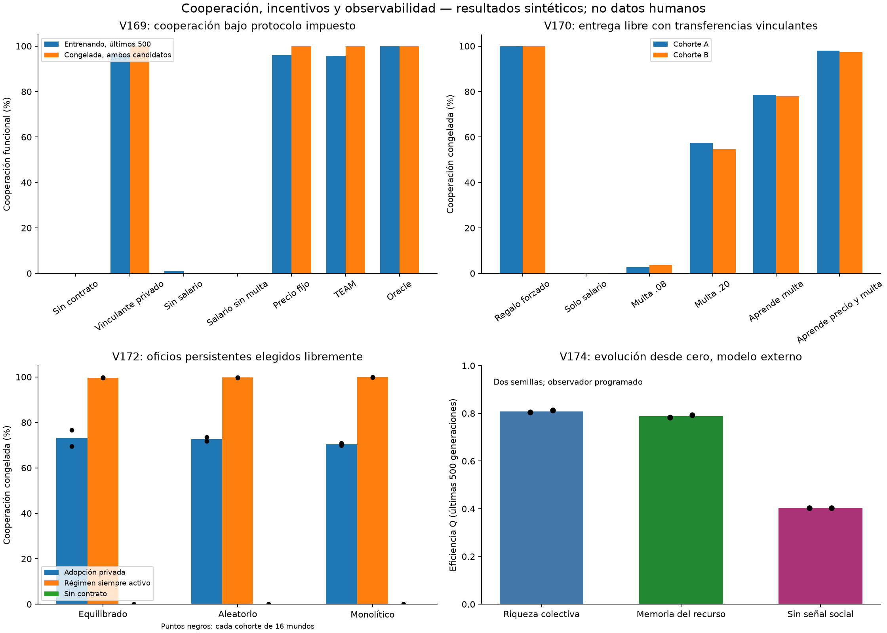
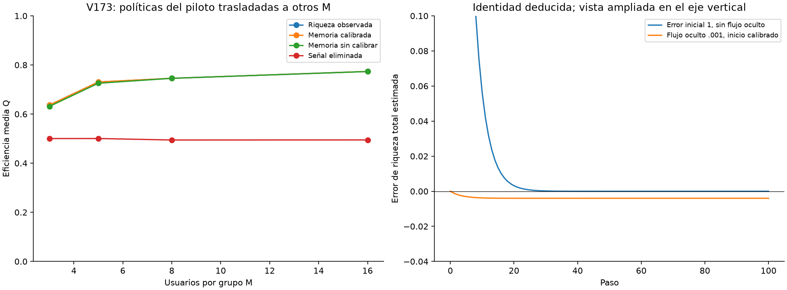
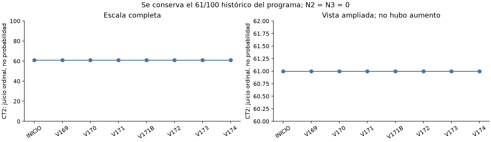
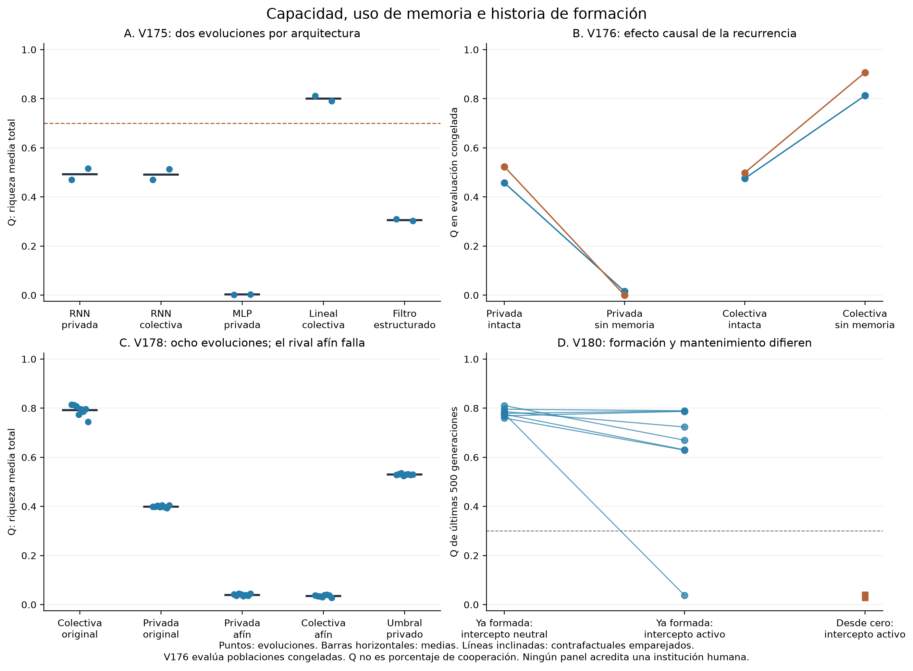
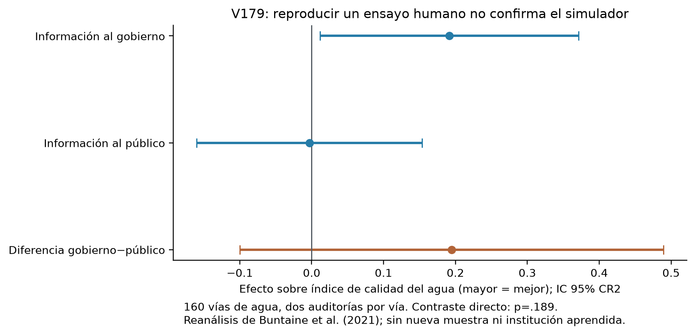

# De la cobertura funcional a la cooperación sostenida

## Mecanismos, aprendizaje y límites de validación en sociología computacional

Manuscrito de trabajo ampliado hasta V180 para un TFM de Ciencia de Datos aplicada a las Ciencias Sociales. Integra las fases V128–V140, la validación posterior V141–V150D, la síntesis de disponibilidad funcional V153–V167 y las campañas V169–V180. Las líneas paralelas de afiliación V150–V154 conservan sus informes y requieren integración más completa. Los identificadores de experimentos reutilizados se desambiguan mediante nombre de archivo y hash. Versión del 15 de noviembre de 2026. Borrador integrado: no se presenta como documento final aprobado ni como aportación original acreditada.

## Resumen

Este trabajo investiga qué permite formar y sostener una división funcional del trabajo cuando agentes con intereses privados afrontan funciones productivas complementarias y cargas individuales desiguales. Combina un laboratorio multiagente, enumeración matemática, intervenciones en políticas aprendidas y análisis de experimentos humanos publicados. La cobertura de funciones, la continuidad individual de los oficios y el intercambio efectivo se tratan como resultados diferentes. En el laboratorio, una compensación ocupacional impuesta permite aprender profesiones sin oracle; retirar el intercambio obligatorio revela que la cobertura puede persistir mientras cae la cooperación material. Un prior de reciprocidad favorece el mantenimiento del intercambio, pero ese mantenimiento no demuestra la aparición autónoma de normas. La auditoría humana corrige una confusión entre diferenciación de acciones y elección de compañeros y reproduce los índices de desigualdad de un experimento publicado. Finalmente, modelos ajustados a decisiones humanas se evalúan tanto mediante predicción a un paso como mediante simulación cerrada: su orden de desempeño difiere en las redes examinadas. Los resultados delimitan mecanismos y criterios de validación, sin establecer leyes sociológicas ni una contribución original con confirmación independiente.

La ampliación institucional distingue contratos conocidos de su adopción privada y elimina la asignación de profesiones preparadas. Una rama en un modelo ecológico externo demuestra que la riqueza colectiva puede reconstruirse mediante memoria de recursos bajo conservación conocida, y prueba evolución desde cero de las decisiones que usan esa estimación. El observador sigue programado y la originalidad científica no está acreditada.

Los nuevos contrastes separan el uso causal de recurrencia de su capacidad de aprendizaje y muestran dependencia de la formación respecto al espacio de políticas: una representación afín que rara vez organiza cooperación desde cero puede conservarla tras una historia cooperativa. Varias hipótesis fuertes fallan sus criterios prospectivos. Un ensayo humano de monitoreo se reproduce numéricamente, pero no establece una diferencia precisa entre destinatarios de información ni confirma el simulador.

**Palabras clave:** cooperación, división del trabajo, aprendizaje multiagente, reciprocidad, desigualdad, validación generativa.

## 1. Introducción y pregunta de investigación

Una colectividad puede disponer de individuos capaces de realizar tareas distintas y, sin embargo, no reproducir materialmente su actividad conjunta. La existencia de funciones complementarias no garantiza que alguien quiera asumir las menos remuneradas. Del mismo modo, asignar todas las funciones no garantiza que circulen los bienes necesarios entre quienes las desempeñan. Esta separación entre capacidad funcional, acción individual y resultado colectivo organiza la investigación.

La pregunta principal es: ¿bajo qué condiciones las decisiones privadas de agentes que aprenden producen, mantienen o destruyen una estructura de funciones complementarias y de intercambio? Una segunda pregunta metodológica pregunta qué evidencia permitiría interpretar esa estructura como organización emergente y qué pruebas bastan para validar un modelo de sus mecanismos.

El enfoque generativo busca explicar cómo decisiones locales pueden producir regularidades colectivas. Un modelo de agentes permite manipular reglas y comparar mecanismos, pero no convierte automáticamente sus resultados en evidencia sobre sociedades humanas. La identificación exige explicitar qué se impone al sistema, qué se aprende, qué se observa y qué queda fuera de la prueba. El programa adopta esa distinción como criterio de interpretación y no como una garantía de originalidad.

La investigación trabaja con hipótesis rivales: insuficiencia de incentivos privados; dificultad de coordinación simultánea; limitaciones de representación o de aprendizaje; y discrepancias entre resultados potenciales y materiales. Los resultados negativos se conservan cuando descartan una explicación. En particular, la retirada de una entrada informativa y la retirada de una obligación de donar responden a intervenciones diferentes y no deben confundirse.

## 2. Diseño general y contrato de evidencia

La fase V128–V140 utiliza grupos de cuatro agentes, cuatro profesiones y episodios de 48 rondas; las ampliaciones posteriores tienen otros horizontes y mecanismos, descritos en su capítulo. Se distingue la red material de los grupos que comparten parámetros. Los experimentos más recientes aíslan decisiones ocupacionales, momento de actualización y regalos. Se introduce una carga privada del oficio crítico y una transferencia de suma cero. La topología, la tecnología, los costes y varias reglas institucionales son exógenos; los capítulos indican cuándo se retira una de esas dependencias.

Las unidades de comparación dependen del diseño: semillas de entrenamiento para actores compartidos y mundos con aprendices separados para las campañas tabulares posteriores. No se usan agentes o rondas como réplicas del algoritmo. Los múltiples agentes, cliques y ambientes permiten estimar cada realización, pero no se multiplican para fabricar tamaño muestral del algoritmo. En los bloques de cuatro semillas los contrastes bilaterales por signos no alcanzan niveles convencionales de significación: las magnitudes se reportan como exploratorias. Las enumeraciones exactas aportan identidades condicionadas a supuestos, no observaciones sociales independientes.

El componente humano emplea datos publicados de Jia y Stallen. Antes de modelar se verifican estructura, claves, solapamiento, pagos y significado de tratamientos. Los archivos originales permanecen intactos. Las redes o grupos, no las filas de persona y ronda, determinan la dependencia relevante para la inferencia. La reproducción de resultados publicados verifica consistencia; no cuenta como una nueva muestra ni como confirmación automática del simulador.

La comparación predictiva de Jia separa sesiones de ajuste, selección y evaluación. Como las estadísticas agregadas ya se habían examinado, esa división no se presenta como muestra confirmatoria virgen. La simulación cerrada añade otra exigencia: los agentes generan su propio historial sin recibir las decisiones humanas futuras. Se reporta por separado incertidumbre de muestreo humano y dispersión interna de las simulaciones.

La metodología AB empleada es un marco de gobernanza provisional. Separa hallazgos exploratorios de predicciones novedosas con confirmación independiente. Su escala ordinal no representa una probabilidad calibrada. Ningún resultado de este manuscrito recibe aquí una acreditación 2/3 o 3/3.

## Incentivos privados y formación de una división funcional del trabajo

**Borrador de capítulo empírico-computacional, 15/11/2026.** Material para integrar en el TFM; no manuscrito final ni reivindicación de descubrimiento. Los resultados numéricos definitivos se citan desde los JSON de cada experimento y sus informes, preservando resultados negativos.

### Pregunta y distinciones analíticas

La pregunta de este capítulo es bajo qué condiciones agentes que aprenden a maximizar su beneficio privado llegan a cubrir funciones productivas complementarias cuando una de ellas impone una carga individual adicional. El explanandum es la formación de cobertura funcional desde una situación incompleta. Se distingue de la estabilidad de un equipo ya formado, de la frecuencia de intercambio y de la emergencia de instituciones que regulen ese intercambio. Esas distinciones evitan tratar un indicador agregado de cooperación como prueba suficiente de organización.

La población computacional se organiza en grupos de cuatro integrantes. Cada integrante puede desempeñar una de cuatro profesiones. La producción depende de los tipos de bienes distintos accesibles y de la completitud de la cesta. Una desutilidad privada penaliza el cuarto oficio. La complementariedad tecnológica y la carga desigual se introducen como supuestos del modelo. Por ello, el mero perjuicio de no cubrir esa función no puede contarse como descubrimiento: es una consecuencia de la tecnología estipulada. La pregunta informativa se refiere a las trayectorias de decisión y aprendizaje que generan o evitan esa ausencia.

### Modelo y estimandos

Con intercambios obligatorios, el pago medio de una fase para el individuo i se expresa como

`r_i = .08 + (11/60)d_i + .25·1[d_i=3] − .5·1[rol_i=3] + beta·(1[rol_i=3] − n_3/4) − (.015/8)·1[cambio_i]`.

Aquí d_i cuenta tipos vecinales distintos del propio y n_3 cuenta integrantes del oficio crítico. Las transferencias suman cero dentro de cada grupo y fase. El parámetro beta altera la distribución individual del pago sin modificar directamente su promedio grupal para una configuración fija. Un cambio posterior del promedio observado puede provenir de conductas distintas.

El estimando principal de los factoriales es la diferencia emparejada entre medias de completitud terminal desde inicio monolítico, promediando primero los ambientes de evaluación de cada semilla de entrenamiento. La unidad de réplica es el entrenamiento completo. Los agentes, cliques y fases contribuyen a estimar cada realización, pero no se tratan como réplicas estadísticas independientes del algoritmo entrenado. Los experimentos V131 y V132 usan cuatro semillas nuevas cada uno, doce ambientes nuevos por semilla y endpoint preestablecido de 800 actualizaciones.

La completitud se complementa con el pago privado medio, la frecuencia de cambio y la proporción del oficio crítico. Maximizar completitud no equivale necesariamente a maximizar bienestar: cambiar con demasiada frecuencia o coordinar mal los cambios puede destruir una cobertura ya existente.

### De estabilidad a accesibilidad

Las enumeraciones exactas anteriores muestran que un equipo completo puede ser estable y, a la vez, inaccesible desde estados incompletos bajo una regla de mejor respuesta simultánea. La implementación independiente V129 confirmó la separación en los parámetros de referencia. La activación independiente con probabilidad .5 rompe ese bloqueo y produce 91,4528% de completitud a seis revisiones desde inicio monolítico. Este resultado depende de conocimiento oracular de los pagos y no establece que individuos aprendan por sí mismos la profesión adecuada.

La referencia a [Ramazi et al. (2016)](https://www.pnas.org/doi/full/10.1073/pnas.1610244113) debe acotar el marco: su formulación binaria y sus resultados sobre actualización parcial no constituyen un teorema automático sobre cuatro profesiones complementarias. La enumeración aporta una caracterización del juego utilizado; la importancia general del calendario tiene antecedentes.

### Un resultado negativo que reorienta la explicación

V125 sugirió que añadir observaciones locales podía producir un peor resultado que aprender una activación constante. V127 elevó el rendimiento al alterar el canal de recompensa en una red congelada. Sin embargo, V128, que eliminó ese canal durante todo el entrenamiento, elevó completitud monolítica solo de 24,56% a 29,16%, muy por debajo de los veinte puntos fijados como mejora relevante.

V129 demostró además que, con los parámetros fijos y las donaciones obligatorias, esa recompensa observada es calculable a partir de profesión, frecuencias vecinales, último cambio y fase. La intervención altera una codificación redundante. La red podría aprovechar esa codificación sin aprender a reconstruirla; eso no convierte el canal en información adicional sobre el entorno. Tampoco es válido interpretar una manipulación de política congelada como una manipulación de toda su historia de aprendizaje. El resultado negativo obliga a reducir la prioridad de la explicación informacional fuerte.

### Incentivo privado de cubrir una función ausente

V130 reduce la última decisión del estado `(0,0,1,2)` a dos agentes potencialmente capaces de ocupar la función ausente. Con beta=.125, el beneficio de cambiar si el otro espera es pequeño, mientras cambiar a la vez que el otro es muy perjudicial. El equilibrio simétrico de activación es 121/4160, aproximadamente 2,91%. La descripción no equivale a un equilibrio del episodio completo y también existen soluciones asimétricas donde cambia una sola persona.

El caso revela un conflicto entre cubrir una necesidad colectiva y evitar soportar la carga cuando otro podría asumirla. El [dilema del voluntario de Diekmann (1985)](https://journals.sagepub.com/doi/10.1177/0022002785029004003) aporta un antecedente conceptual. El juego aquí incluye destrucción de cobertura cuando dos personas cambian, de modo que no se equipara su matriz de pagos a la del modelo clásico.

### Intervención en los incentivos y aprendizaje sin oracle

V131 comparó objetivo privado frente a promedio colectivo y compensación baja frente a alta. La elección de profesión seguía siendo oracular, pero el momento de activación se aprendía. La compensación elevó la completitud privada de 34,78% a 91,57%. Los objetivos colectivos dieron alrededor de 91,5% en ambas compensaciones. El control exhaustivo confirmó que la tabla de mejores respuestas era idéntica con ambos valores de beta. El cambio de pagos, y no un cambio de opciones ofrecidas por el oracle, pudo modificar la trayectoria aprendida.

V132 retira esa dependencia: una política categórica elige directamente profesión en cada fase. Conservar la propia profesión representa retención endógena. El actor recibe información propia y vecinal, sin etiquetas de profesión óptima, sin enmascaramiento de acciones y sin consultar la tabla de mejores respuestas. La tabla histórica se vuelve inaccesible en una prueba de instrumentación y el rollout permanece idéntico. Los resultados de las 16 ejecuciones y sus incertidumbres se presentan en `results/INFORME_V132_20261115.md`; los contrastes internos V132 son los pertinentes para atribuir diferencias a beta u objetivo.

V131 y V132 difieren en espacio de acción, parametrización y semillas. Una diferencia entre campañas no identifica por sí sola el efecto causal de retirar el oracle. La demostración técnica relevante de V132 es la elección ocupacional mediante aprendizaje, condicionada a su arquitectura y presupuesto.

### Del reparto de funciones al intercambio voluntario

V133 retira la obligación de regalar manteniendo congeladas las políticas ocupacionales. Esta intervención separa dos componentes del resultado anterior: qué bienes podrían producirse según la distribución de oficios y qué bienes llegan efectivamente a otros individuos. Bajo las políticas privadas bien compensadas, desde equipos balanceados, la cobertura permanece en100% tanto con donación universal como con ausencia de regalos; el retorno neto medio desciende de aproximadamente .755 a .075. La identidad de cobertura no es una sorpresa sociológica: la política de profesión observa roles, último cambio y tiempo, pero carece de entrada efectiva sobre regalos o resultado material. El contrafactual prueba un límite de la arquitectura y de la métrica.

El motor nuevo de intercambio reproduce la física anterior cuando todos donan y coincide con500fixtures de V115. Una intervención sobre un regalo con origen y destinatario fijados permite medir su consecuencia privada: omitirlo ahorra .04 inmediatamente. Si los demás continúan donando sin responder, ese ahorro no tiene coste privado futuro. Con reciprocidad bilateral impuesta, una omisión temprana puede inducir pérdidas futuras mucho mayores. No se ha descubierto reciprocidad: se ha contrastado que estas reglas producen un incentivo distinto en las trayectorias de profesión aprendidas.

El efecto de la omisión se expresa como retorno acumulado descontado desde la ronda intervenida, no como pago medio por ronda. En equipos balanceados y omisión en t16, la ganancia privada media es+.04 sin respuesta, alrededor de−5.81 con tit-for-tat y−11.26 con grim. Las represalias persistentes contribuyen a esas pérdidas; no equivalen a mecanismos eficientes de restauración. La última ronda permite ganar+.04 con cualquiera de estas reglas, porque no quedan consecuencias futuras dentro del horizonte.

V134 contrasta la representabilidad de reciprocidad con su alcanzabilidad mediante aprendizaje. Las profesiones ya aprendidas permanecen congeladas; un donante con memoria de una ronda aprende cinco probabilidades a partir de retornos privados. Dos inicializaciones preestablecidas comparan propensión inicial de regalar .5 y .9. La propensión alta es una condición inicial conductual favorable, sin regla recíproca preentrenada. El reporte por semilla y el criterio operativo de80% en3/4semillas están en `results/INFORME_V134_20261115.md`. Este diseño secuencial no representa aprendizaje conjunto desde cero ni negociación de obligaciones.

Si una política puede representar reglas recíprocas que hacen rentable cooperar, pero el procedimiento de aprendizaje termina con pocos regalos, no se puede identificar el resultado con falta de capacidad representacional. Tampoco se puede probar imposibilidad de aprender con otro estimador, horizonte o condición inicial. El resultado delimita el procedimiento efectivamente ejecutado. La elección del siguiente experimento debe distinguir esas explicaciones, preservando un rival recíproco competente y la comparación con horizonte conocido.

### Mantenimiento desde priors recíprocos y exactitud del objetivo

V135 enfrenta el mismo aprendiz a tres condiciones iniciales con cinco parámetros cada una: donación plana .99, tit-for-tat con error .01 y win-stay/lose-shift con error .01. Los tres comparten la probabilidad inicial .99 y la respuesta tras cooperación mutua .99. El control plano cae a35,60% de regalos después de400actualizaciones. Los dos priors recíprocos alcanzan99,26% y99,68%, respectivamente, manteniendo cooperación alta en las cuatro semillas de cada brazo. No es emergencia espontánea: las contingencias iniciales de reciprocidad fueron impuestas. El resultado permite distinguir aprender a conservar y ajustar un régimen de aprender a producirlo desde una propensión a regalar sin contingencia.

V136 delimita matemáticamente esa distinción en una díada balanceada, con beneficios y costes derivados de la física. Si el oponente no condiciona su conducta al regalo recibido, el coste privado de dar no se compensa con una respuesta futura en el punto inicial. Los gradientes unilaterales exactos refuerzan la defección en los priors planos y refuerzan componentes cooperativos en los recíprocos. Los otros enlaces, la complementariedad conjunta y la variación de roles se mantienen fuera de ese subproblema; no se atribuye a la reducción capacidad explicativa completa del simulador.

La auditoría también precisa qué actualiza el algoritmo histórico. Descontar el retorno futuro desde cada turno no basta para obtener el gradiente exacto del retorno descontado desde el inicio; falta ponderar la contribución de cada turno por gamma^t exterior. La diferencia está publicada en [Nota y Thomas2020](https://people.cs.umass.edu/~pthomas/papers/Nota2020.pdf). En los cinco puntos deV136, la diferencia relativa de norma del campo es8–13%, con signos iguales. Este control no demuestra igualdad de trayectorias. Se conservan resultados históricos como realizaciones del actualizador documentado, y las nuevas afirmaciones sobre optimización exacta requieren una versión corregida y un contraste propio.

### Alcance sociológico, antecedentes y límites

La relación entre funciones colectivas indispensables y desventaja individual permite formular un problema de acción colectiva con contenido distributivo. El modelo no incluye clases sociales, negociación salarial, poder de veto, movilidad laboral costosa o instituciones humanas observadas. Introducir esos conceptos requeriría variables e intervenciones específicas; no basta cambiar la terminología de las profesiones artificiales.

[Yaman et al., preprint de 2022](https://arxiv.org/html/2208.05568v3), ya combina aprendizaje de roles, sanciones y evolución de normas. Sus sanciones se aplican sin decisión voluntaria individual y sus comparadores alteran preferencias sociales. Es un antecedente directo que limita la novedad del rescate por redistribución. [Haupt et al. (2024)](https://link.springer.com/article/10.1007/s10458-024-09682-5) estudia contratos con propuestas y veto. Un beta fijado externamente no implementa esa gobernanza.

En estas campañas la red física y la compartición de parámetros también son exógenas. Una política compartida puede agregar señales de aprendizaje de distintos individuos; por tanto, beneficio privado en el retorno no equivale a autonomía total del proceso de aprendizaje. Las donaciones obligatorias impiden interpretar la cobertura como prueba de cooperación voluntaria conjunta. La siguiente extensión necesaria consiste en permitir que las decisiones privadas de intercambio y los mecanismos de compromiso también se aprendan, con comparadores fuertes y con costes explícitos.

Los resultados son intervenciones computacionales condicionadas. Ningún dataset humano se usa para confirmar los efectos descritos y no hay todavía validación externa pertinente ni acreditación 2/3 AB. El valor actual para el TFM es una explicación progresivamente mejor identificada del modelo, con errores descartados, un resultado negativo conservado y límites de interpretación explícitos.

Aprendizaje de activación y conflicto privado en un subjuego terminal. Las líneas finas representan semillas; las medias no añaden réplicas independientes.

## Qué permiten contrastar los datos humanos

**Borrador de capítulo del TFM, 15 de noviembre de 2026.** Los análisis de este capítulo son exploratorios. Incluyen una reproducción computacional de resultados publicados y una evaluación de adecuación de fuentes; no constituyen una confirmación de las predicciones del simulador.

### Dos formas distintas de autonomía

Para conectar un modelo de agentes con observaciones humanas hace falta identificar qué decisiones pueden tomar los participantes y qué variables registran los datos. La etiqueta general de autonomía no basta para considerar equivalentes dos tratamientos experimentales.

El estudio de [Jia y colaboradores (2025)](https://www.nature.com/articles/s41562-025-02289-0) permite diferenciar acciones hacia vecinos. El bloque del dilema del prisionero contiene quince redes de cuarenta y nueve personas, observadas durante cincuenta rondas. La inspección de todas las relaciones dirigidas confirma que los vecinos permanecen fijos. La agencia estudiada amplía las acciones que una persona puede dirigir a contactos diferentes; no permite sustituir esos contactos. La interpretación inicial del proyecto, que acercaba ese tratamiento a una elección de compañeros, debe corregirse.

El estudio de [Stallen y colaboradores (2023)](https://www.nature.com/articles/s41467-023-42128-2) sí examina un mecanismo de emparejamiento basado en preferencias por tipos de compañero. Esos tipos combinan dotaciones y productividad altas o bajas. No representan oficios complementarios elegidos durante el aprendizaje. Por ello, los estudios no ofrecen efectos opuestos de un mismo tratamiento ni validan automáticamente las profesiones del simulador.

### Estructura de los datos y unidad de inferencia

En Jia, cada condición del dilema del prisionero dispone de tres redes. Hay 36.750 registros de persona y ronda y 147.000 acciones dirigidas. La abundancia de acciones permite estudiar respuestas temporales, pero no convierte cada acción en una réplica independiente del tratamiento de red. Se verificó la correspondencia entre la acción enviada, la recibida por el vecino y el tipo atribuido a ese vecino. También se reconstruyeron los pagos de las cuatro combinaciones de acciones: cooperación mutua, 4; cooperar frente a defección, −2; desertar frente a cooperación, 6; defección mutua, 0.

En Stallen, las 8.064 filas corresponden a 336 personas durante 24 rondas. Las interacciones ocurren dentro de 42 grupos de ocho personas, con 21 grupos por condición. El segundo archivo, que incorpora preferencias e historial, contiene exactamente las 4.032 filas de la condición de elección libre ya presentes en el primero. Sus columnas compartidas coinciden. Tratarlos como muestras diferentes duplicaría la mitad de las observaciones.

Los campos de preferencias y compañero anterior identifican tipos, no personas. Repetir un tipo de compañero no permite, por sí solo, demostrar persistencia de un vínculo entre dos individuos concretos. Los valores ausentes de historial en la primera ronda se consideran no aplicables y no se sustituyen por ceros.

### Reproducción de la desigualdad y precisión del estimando

La reproducción de una cifra requiere preservar su definición. Calcular desigualdad sobre la riqueza bruta acumulada no reproduce el mismo resultado que calcularla sobre las ganancias generadas por encima de las dotaciones recibidas.

Para cada participante se obtuvo la ganancia neta del juego sumando sus ingresos por ronda y restando las dotaciones de las veinticuatro rondas. El Gini de esas ganancias es 0,2443 con compañero asignado y 0,4364 con elección. Se reproducen así los valores publicados redondeados a 0,24 y 0,44. La diferencia es 0,1921. Un remuestreo exploratorio de grupos, estratificado por condición y plataforma de reclutamiento, da un intervalo percentil del 95 % entre 0,1500 y 0,2343.

Esta operación no es una replicación con participantes nuevos. Comprueba que la fuente descargada y la definición reconstruida permiten recuperar resultados de los autores. Un participante de elección libre presenta una ganancia neta de −25 unidades; se conserva ese valor. Aplicar la fórmula del Gini a una distribución con valores negativos exige explicar que sus límites habituales pueden dejar de cumplirse en general.

La contribución proporcional media al bien público fue del 56,62 % con asignación y del 60,92 % con elección. La diferencia descriptiva es de 4,30 puntos porcentuales; su intervalo de remuestreo de grupos, de −3,83 a 12,69 puntos, incluye cero. Esto no refuta los análisis longitudinales publicados, que estiman otros efectos. Impide presentar esta diferencia global concreta como una mejora promedio precisamente estimada.

### Consecuencias para el programa de investigación

Los datos de Jia permiten estudiar reciprocidad dirigida y restricciones a la diferenciación de acciones. Los de Stallen permiten estudiar preferencias por tipos, emparejamiento y distribución de ganancias. Ninguno contiene las decisiones ocupacionales ni los contratos de nuestro modelo. Son posibles fuentes para preguntas próximas, siempre que se formule un estimando que exista realmente en sus variables.

Una continuación defendible debe consultar los modelos y el código originales antes de reivindicar una explicación nueva. Una comparación predictiva sobre acciones futuras puede separar sesiones de desarrollo y prueba, preservando la dependencia dentro de cada red. Su éxito demostraría capacidad predictiva fuera de la muestra de ajuste, no causalidad de una regla de aprendizaje ni validación directa de los agentes.

Los originales permanecen intactos. Los scripts V137 y V138 conservan cálculos, hashes y controles; el informe técnico documenta límites de acceso, licencia y lectura. El trabajo fortalece la base empírica del TFM, pero la originalidad y la confirmación independiente de un mecanismo propio siguen pendientes.

Diferencias entre condiciones de Stallen e intervalos descriptivos del95% mediante remuestreo de grupos, estratificado por plataforma.

## De la predicción individual a la dinámica colectiva

### Pregunta y antecedente directo

Una regla de decisión ajustada a acciones humanas puede servir para predecir la siguiente acción y, sin embargo, generar una trayectoria colectiva diferente al actuar como política de agentes. La diferencia es relevante para la sociología computacional: la adecuación de una explicación de comportamiento individual no basta para establecer que produzca el proceso colectivo observado.

Los datos del dilema del prisionero de Jia permiten una primera prueba de esa diferencia. Se recuperaron del repositorio original el análisis en R, la simulación en C++, una función teórica de MATLAB y la implementación de la plataforma experimental. El código de simulación ya distingue respuestas al vecino en los participantes libres y al contexto en los restringidos. Por tanto, atribuir a nuestros modelos el descubrimiento de reciprocidad dirigida sería incorrecto.

Se utilizó una variante refitada del mecanismo publicado como comparador de dos parámetros. No se ejecutó toda la simulación original ni se afirma haber reproducido su análisis completo. También se reconstruyeron las 735 frecuencias individuales de cooperación del CSV de los autores a partir de los datos originales: coinciden exactamente. Esta comprobación vincula el archivo de datos con una salida publicada y evita iniciar el modelado desde una fuente mal interpretada.

### Diseño de comparación predictiva

Se seleccionaron las personas con libertad para diferenciar acciones de los tratamientos con 25, 50, 75 y 100 % de participantes libres. La respuesta es la cooperación dirigida a un vecino en las rondas 2–50. La primera ronda aporta historia inicial y no se utiliza como respuesta sin antecedentes.

La sesión 1 se empleó para ajustar candidatos, la sesión 2 para seleccionar penalización y la sesión 3 para evaluar. Después de elegir la penalización se reajustaron los modelos con las sesiones 1 y 2. No se usaron identificadores de personas como predictores ni se aprendieron normalizadores en prueba. Las estadísticas agregadas de las sesiones de evaluación ya se habían inspeccionado en la auditoría: se trata de evaluación separada del ajuste, pero no de una muestra confirmatoria nunca observada.

Se compararon cuatro modelos logísticos regularizados. El primero usa únicamente la acción previa del vecino dirigido, siguiendo la estructura del mecanismo publicado. El segundo añade tiempo, tratamiento, dirección, hábito acumulado de cooperación, acción propia previa, pago previo y recuentos del comportamiento vecinal, pero mantiene anónima la identidad de los vecinos que cooperaron. El tercero incorpora a ese contexto la respuesta previa del vecino concreto y sus interacciones. El cuarto representa flexiblemente la combinación de acción propia, respuesta de ese vecino y número de otros vecinos cooperadores.

El rival contextual flexible es necesario para limitar la interpretación de una mejora del tercer modelo. Vencer a un modelo que ignora deliberadamente información diádica no demuestra por sí solo una superioridad ante alternativas competentes que sí pueden usarla.

La penalización se eligió entre 0,1, 1 y 10 mediante pérdida logarítmica de validación. Los tres modelos ampliados seleccionaron el extremo superior del intervalo. No se amplió la búsqueda después de mirar la evaluación; la sensibilidad a penalizaciones mayores permanece sin probar. La selección pondera acciones; el resultado principal promedia las cuatro pérdidas de red con pesos iguales. Esa diferencia entre criterios se conserva explícita.

### Resultados fuera del ajuste

| Modelo | Coeficientes | Pérdida logarítmica media por red | Brier medio |
|---|---:|---:|---:|
| Respuesta al vecino refitada | 2 | 0,4491 | 0,1379 |
| Contexto vecinal anónimo | 26 | 0,3530 | 0,1091 |
| Memoria dirigida y contexto | 29 | 0,3013 | 0,0907 |
| Contexto conjunto flexible | 41 | 0,2988 | 0,0896 |

Ambas medidas penalizan errores probabilísticos; valores menores indican mejor predicción. La incorporación de memoria dirigida mejora la pérdida frente al contexto anónimo en las cuatro redes de evaluación. La mejora media es 0,0517. El modelo conjunto mejora solo 0,0025 en promedio respecto al dirigido y esa diferencia cambia de signo entre redes. No se realizó una prueba de equivalencia ni se presenta una selección confirmatoria de modelo ganador.

Estos resultados muestran capacidad predictiva de la información diádica, condicionada a las familias utilizadas. No identifican reciprocidad causal: la respuesta dirigida puede reflejar reacción a la experiencia, heterogeneidad persistente, expectativas o factores compartidos. Tampoco prueban que las personas apliquen una actualización de aprendizaje por refuerzo concreta.

### Cerrar la dinámica

La segunda prueba deja que los modelos generen sus propias historias. Se utilizó la red de la sesión 3 compuesta enteramente por participantes libres, evitando añadir una política de personas restringidas que no se había ajustado. Los cuatro modelos conservaron sus parámetros. Cada simulación comenzó con las acciones humanas observadas en la primera ronda y luego generó las rondas 2–50 sin recibir nuevas acciones humanas.

Se simularon 256 poblaciones por modelo con los mismos números uniformes para reducir ruido en la comparación. Se recalcularon acciones recibidas, pagos e historial acumulado a partir de cada población simulada. La independencia condicional de acciones contemporáneas por enlace es un supuesto generador adicional. Las 256 réplicas miden variación interna del simulador; no sustituyen a 256 redes humanas. La comparación empírica de esta prueba dispone de una sola red.

| Modelo | Error absoluto medio de trayectoria, en puntos de cooperación |
|---|---:|
| Respuesta al vecino refitada | 30,34 |
| Contexto vecinal anónimo | 5,05 |
| Memoria dirigida y contexto | 7,46 |
| Contexto conjunto flexible | 6,21 |

La clasificación de modelos cambia. El contexto anónimo, que tenía mayor pérdida a un paso que los modelos dirigidos, reproduce mejor esta trayectoria colectiva. Los modelos dirigidos siguen siendo mucho mejores que el comparador de dos parámetros, pero su ventaja de predicción individual no se traslada automáticamente al error colectivo.

La simulación del comparador restringido admite una comprobación analítica. Con probabilidades refitadas de cooperación de 0,2277 después de defección del vecino y de 0,8449 después de cooperación, la media satisface una recursión lineal y converge hacia 0,5948. La trayectoria Monte Carlo se aparta como máximo 0,0042 de la solución exacta. Su gran discrepancia frente a la trayectoria humana no proviene del ruido de muestreo de las simulaciones.

### Alcance de la evidencia

La inversión de clasificación es un resultado exploratorio en una red y un protocolo concretos. No prueba que los modelos más precisos generen siempre peores dinámicas ni identifica cuál de los supuestos causa aquí la diferencia. Puede intervenir la acumulación de errores, la heterogeneidad no modelada, la dependencia entre decisiones simultáneas o una especificación incompleta del historial.

La siguiente comprobación necesaria es repetir la evaluación cerrada dejando fuera las otras redes completas y seleccionando hiperparámetros sin acceso a su prueba. Después cabe enfrentar hipótesis sobre el origen de la discrepancia. Elegir retrospectivamente un nuevo mecanismo a partir de esta inversión no constituiría confirmación independiente de ese mecanismo.

El capítulo aporta una comparación predictiva y generativa reproducible con datos humanos. Su utilidad actual es metodológica y sustantiva para delimitar qué significa validar un agente social. La originalidad científica frente a los antecedentes sigue sin establecerse y no se acredita un hallazgo 2/3 AB.

A la izquierda, evaluación a un paso en cuatro redes. A la derecha, trayectorias medias generadas y observación de una única red humana100%Free. Los alcances de ambas pruebas difieren.

## Ampliación de la validación generativa y de los rivales humanos

### Tres redes y una diferencia que no es universal

La primera comparación generativa del manuscrito utilizó una red humana completamente libre. V141 amplía el contraste a las tres redes con libertad del 100% del archivo de Jia y colaboradores. Cada red se excluye del ajuste y se generan 256 poblaciones por modelo y red. Las estadísticas globales de esos datos ya se habían visto al formular la investigación; la exclusión de entrenamiento no convierte las redes en una confirmación retrospectivamente virgen.

El modelo mejor en pérdida a un paso difiere del mejor en trayectoria agregada en las tres redes. En la primera, joint_context vence en predicción y dyadic_context en la trayectoria; en la segunda se invierte su orden; en la tercera gana dyadic_context a un paso y context en la trayectoria. Esto no significa que un modelo complejo pierda siempre: promediando las tres redes, joint_context tiene tanto la menor pérdida logarítmica (0,2333) como el menor error absoluto de la curva (0,0810).

La conclusión defendible es que los objetivos no son intercambiables y sus rankings dependen de la unidad evaluada. No se sostiene una ley según la cual mejorar predicción perjudique necesariamente la generación colectiva. La independencia condicional Bernoulli de acciones, la red toroidal fijada y el uso de la primera ronda observada siguen siendo supuestos del generador.

V142 separa algebraicamente error bajo historiales humanos y desviación inducida al cerrar el bucle. El error absoluto agregado con historiales humanos es aproximadamente 0,0184 para dyadic_context y 0,0187 para joint_context, mientras el de la simulación cerrada es 0,0868 y 0,0806. La descomposición de error cuadrático incluye un término cruzado: no debe interpretarse cada sumando como contribución causal independiente. La identidad ayuda a localizar discrepancias; no identifica por sí sola la causa de la exposición a estados nuevos.

### Una segunda fuente humana y la incertidumbre del ranking

V143–V144 incorporan el archivo público de Yamamoto y Goto (2024, OSF d3qpw), con 156 díadas, 312 participantes y cuatro condiciones de interacción. Se excluyen díadas del ajuste en cinco particiones y, después de la primera ronda, no se inyectan decisiones humanas futuras en las simulaciones.

El modelo con historial observable logra la mejor predicción a un paso en las cuatro condiciones. Sin embargo, base_time tiene menor error de la tasa agregada en tres y memory1 en la restante. El modelo rico sigue siendo el mejor para otro resultado, cooperación mutua, en las cuatro. La selección del indicador colectivo forma parte de la pregunta científica; no puede cambiarse después para declarar ganador a un método.

V144B vuelve a muestrear díadas 10.000 veces sin volver a ajustar los modelos. En la condición alternante estándar, el intervalo del cambio de error de cooperación agregada entre el modelo rico y el simple incluye cero, aproximadamente [−0,0327;0,0311]. Los rankings puntuales no autorizan una diferencia confirmada en todas las condiciones. El bootstrap cuantifica incertidumbre condicional a los modelos ajustados, no toda la incertidumbre de su estimación.

Estas pruebas proporcionan una segunda fuente pertinente para la validación de trayectorias de decisión. No miden profesiones complementarias ni confirman las utilidades del modelo ocupacional. La generalización de una observación metodológica no debe confundirse con validación sustantiva de otra economía artificial.

### Pivotalidad, rescate y variables derivadas

La línea V147–V150 analiza contribuciones humanas en tecnologías con umbral. La pregunta era si estar en posición de completar unilateralmente la producción aportaba una explicación específica de la respuesta. Antes de estimar se reconstruyeron parámetros y tablas desde los materiales originales, distinguiendo sesiones con personas ya observadas y grupos emparejados de nuevo.

V148 muestra por qué un rival flexible es necesario. Añadir una señal de pivotalidad a un modelo simple reduce el error cuadrático por díada en aproximadamente 0,000174, con intervalo bootstrap que excluye cero. Pero frente al rival M4, que ya representa de forma flexible las variables físicas relevantes, añadir la señal en M5 cambia el error en +0,0000189, con intervalo [−0,0000237;0,0000620]. La comparación utiliza 277 díadas de la primera sesión como unidades independientes.

La pivotalidad se calcula de las contribuciones previas y de la tecnología. No aporta información nueva a quien ya observa esas variables: puede aportar una representación útil o un sesgo inductivo. La pérdida de ventaja frente al rival limita la reivindicación de un mecanismo adicional. No prueba que las personas ignoren la pivotalidad.

V149 no establece una diferencia del coeficiente de pivotalidad entre grupos de dos y cuatro personas: los intervalos de la diferencia incluyen cero en ambas sesiones. El tamaño no fue aleatorizado para ese contraste y la segunda sesión reutiliza participantes, por lo que no procede interpretarlo como efecto causal ni sumar ambas sesiones como muestras independientes.

V150D conserva también el resultado inicialmente invalidado y la comparación corregida de «rescatador único». Una asociación condicional positiva en parte de los datos no produce una ventaja predictiva estable frente al rival físico flexible. El registro identifica el archivo inválido en lugar de incorporarlo al conjunto favorable.

### Qué se ha validado

La ampliación sostiene una exigencia metodológica concreta: evaluar predicción a un paso, generación cerrada y resultados colectivos distintos, conservando la dependencia de las unidades y la fuerza del comparador. No establece una relación universal entre complejidad y error generativo. Las hipótesis de dependencia contemporánea y choques comunes de V146 se conservan como exploración y no como variables identificadas causalmente.

Los originales de V141, V142, V144, V144B, V148, V149 y V150D contienen las cantidades aquí citadas y las restricciones de sus diseños. Este capítulo sintetiza esos registros anteriores; no ejecuta una nueva cohorte humana ni reestima toda su cadena. El análisis V179 añade después una reconstrucción independiente más estrecha de un ensayo de monitoreo, que conserva su propio estimando y su unidad de asignación.

## Disponibilidad funcional, equilibrio y formación

### Tres problemas que requieren pruebas distintas

La organización colectiva no puede reducirse a una fotografía de la composición del grupo. Conviene distinguir la existencia de una configuración individualmente estable, la posibilidad de alcanzarla mediante un proceso de adaptación y la disponibilidad de sus funciones a lo largo del tiempo. Estas propiedades pueden variar por separado. Una configuración puede existir sin ser accesible desde el estado inicial, y una función puede estar disponible durante gran parte del tiempo aunque las personas que la sostienen tengan motivos para cambiar su conducta.

El programa examinó esta distinción en un juego de ocupaciones complementarias, primero mediante mejores respuestas y después mediante contratos y aprendizaje. Este capítulo sintetiza la línea identificada por los archivos `V153_ENDOGENOUS_OCCUPATIONS_MEMBERSHIP_SEQUENCING.json` a `V167A_EXACT_CERTIFICATION_AUDIT.json`. Algunos números de versión se reutilizaron en una línea paralela: la unidad documental es el nombre completo y su hash, no el número aislado. La auditoría V166 y su verificación posterior de hashes preservan la procedencia de los resultados.

### Incentivos y equilibrio en el juego de ocupaciones

La utilidad material de una persona i en un grupo de k integrantes se define como

u_i = f(d) − δ 1[r_i=c] + β(1[r_i=c]−n_c/k),

donde d es el número de profesiones representadas, c la profesión costosa y n_c el número de personas que la ejercen. La compensación es de suma cero. El término β es una regla diseñada y compartida por el grupo, no una institución descubierta por sus participantes. Cambiar de ocupación tiene coste s.

En el caso de cuatro profesiones, la ganancia material por completar la cobertura es B=f(4)−f(3)=13/30, el coste crítico δ=0,5 y el coste de cambio s=0,015. La enumeración de las 256 configuraciones ordenadas y sus desviaciones permite identificar equilibrios sin depender de una simulación particular. Sin compensación hay 36 estados localmente estables, todos con tres profesiones. Con β=0,125 hay 24, todos completos. La cobertura incompleta no es aquí un fallo de cómputo para encontrar un equilibrio completo: el incentivo privado lo excluye bajo esas reglas.

El coste de reasignación produce dos umbrales:

β_salida = (4/3)(δ−s−B) = 0,068889;

β_entrada = (4/3)(δ+s−B) = 0,108889.

Entre ellos coexisten configuraciones completas e incompletas. En β final=0,09, 64 mundos con historia inicial sin incentivo terminan con 0% de grupos completos; con historia inicial β=0,125 terminan con 100%. Al eliminar el coste de reasignación, ambas historias alcanzan 100%. Es una intervención que identifica el papel del coste en la divergencia histórica dentro del juego. La histéresis, sin embargo, es un fenómeno conocido y no constituye por sí sola una contribución sociológica original.

La remuneración excesiva también puede generar monocultivo de la profesión subvencionada. V158 y V160 muestran una segunda región de coexistencia: con el mismo β final=1,0, una historia moderada conserva grupos completos y una historia de compensación muy alta conserva monocultivos. Este resultado delimita una interpretación lineal de los incentivos: compensar la función menos atractiva y sobrerrecompensarla tienen consecuencias distintas en la misma economía artificial.

### Desde la mejor respuesta hacia el aprendizaje

Las reglas de adaptación modifican qué puede inferirse de una trayectoria. V154 compara una mejor respuesta con contrafactuales de todas las profesiones, un ensayo reversible de una alternativa y un bandit privado sin contexto. Los dos primeros alcanzan cobertura completa; el bandit conserva aproximadamente el 6,6%, cerca del control aleatorio. El resultado no establece una imposibilidad general del aprendizaje privado: los procedimientos tienen información diferente, el bandit mantiene exploración y carece de contexto.

Esta limitación motivó los experimentos posteriores de aprendizaje conjunto, contratos y agentes tabulares contextuales. Su lectura debe conservar el problema de identificación: un algoritmo que recibe la utilidad exacta de cambiar unilateralmente resuelve un problema distinto del de una persona que solo observa el resultado de su acción después de que otros también cambien. Los experimentos de secuenciación son pertinentes, pero sus efectos no pueden atribuirse automáticamente a negociación institucional.

### Compensación voluntaria y disponibilidad sin estabilidad

V159 introduce un protocolo de oferta y aprobación local que reparte el coste de la función crítica. La viabilidad del acuerdo está limitada por el excedente total: si la carga y los costes superan kB, las transferencias internas no pueden crear el beneficio que falta. Con excedente suficiente, un precio moderado permite formar equipos y una pretensión excesiva es rechazada. La propuesta, los derechos de aceptación y el cumplimiento son reglas del investigador.

Retirar la vinculación permite a los donantes revocar el pago. En el corte terminal de V159 aparecen aproximadamente tres cuartas partes de equipos completos. La auditoría exhaustiva de V162 encuentra que ninguno de los grupos simultáneamente completos es localmente estable frente a todas las desviaciones consideradas. La composición final no describe su equilibrio de incentivos.

V163 observa cada instante durante 12.000 oportunidades y 64 mundos nuevos. La disponibilidad funcional media es 72,5015%, similar en ventanas tempranas y tardías. Solo 5,506 de los 30 grupos tienen un contrato activo en promedio, y un 54,149% está completo sin contrato vigente. Es posible sostener disponibilidad por renovación de personas, ocupaciones y acuerdos aun cuando cada configuración actual admita una mejora privada. Eso no demuestra legitimidad, adhesión normativa o autogobierno: el mecanismo de renovación sigue siendo diseñado.

### Un modelo micro–macro que puede comprobarse exactamente

V164 implementa decisiones microindividuales en otra tecnología, manteniendo una estructura reducida de tres clases de estados. I designa un grupo incompleto con dos candidatos capaces de cubrir la función ausente. B designa cobertura completa con contrato vigente y U, cobertura completa tras la revocación, antes de que salga el trabajador crítico. Si se selecciona uniformemente una persona entre N=30k por evento, las probabilidades de transición por evento son

I→B: 2/N; B→U: (k−1)/N; U→I: 1/N.

Las demás selecciones dejan el estado de esa cadena sin cambios. La conservación de flujo iguala π_I·2/N, π_B·(k−1)/N y π_U/N. Al normalizar se obtiene

π_I=(k−1)/(3k−1), π_B=2/(3k−1), π_U=2(k−1)/(3k−1).

La disponibilidad funcional es π_B+π_U=2k/(3k−1). Para k=4 predice 72,7273%, compatible en magnitud con la campaña anterior. Los nuevos experimentos cubren k=2,3,4,5,6,8, con 64 mundos por tamaño y 30.000 decisiones. Los seis valores exactos quedan dentro de los intervalos descriptivos de sus simulaciones.

Este contraste es una verificación entre implementaciones de una estructura probabilística diseñada, no seis observaciones sociales independientes. La duración de un episodio funcional se expresa como N/(k−1)+N eventos globales. El crecimiento de ese número al aumentar k incorpora el crecimiento de N; no puede traducirse en mayor duración de reloj sin definir una escala temporal comparable.

### Consentimiento, correlación y tamaño

Si cada uno de k−1 avisos favorables llega con probabilidad q independiente, la entrada I→B se multiplica por q^(k−1). La disponibilidad pasa a ser

F(k,q) = [1+1/(k−1)] / [1/(2q^(k−1))+1+1/(k−1)].

Para q<1 fijo, F tiende a cero al crecer k. La restricción es una propiedad de la transmisión conjunta exigida por la regla de unanimidad; las preferencias de los donantes no están evolucionando en esta prueba. V165 conserva una discrepancia: en k=8,q=0,8 el valor teórico queda fuera del intervalo bootstrap inicial. V165B, diseñado después de observarla y con 128 mundos nuevos, resulta compatible con la teoría. La segunda campaña no convierte retrospectivamente la primera en confirmación prospectiva.

V167 mantiene q=0,8 pero sustituye parte de los avisos independientes por una señal común. Si ρ es la fracción de encuentros en que todos reciben esa misma señal, la aprobación conjunta vale

P_aprobación=(1−ρ)q^(k−1)+ρq,

y F=2P_aprobación·k/(k−1) / [1+2P_aprobación·k/(k−1)]. Para ρ>0 fijo, la disponibilidad límite es 2ρq/(1+2ρq); para ρ=0 y q<1 desaparece. En k=12, la simulación pasa de 16,04% con avisos independientes a 63,42% con señal totalmente común.

Las nueve celdas fueron verificadas con aritmética racional y sus intervalos contienen las predicciones. La conclusión está condicionada al protocolo: correlacionar mensajes favorables aumenta la entrega simultánea de un paquete requerido. El modelo no contabiliza daños de errores comunes, captura de un canal público ni poder de decisión sobre la señal. Publicar o centralizar información no queda recomendado universalmente por esa identidad.

### Conexión con las nuevas pruebas y alcance sociológico

V169–V172 sustituyen parte de las mejores respuestas por aprendizaje privado y retiran la profesión preparada. V175–V180 añaden un modelo ecológico externo, aprendizaje de políticas recurrentes y apertura de una clase de decisión. Estas extensiones permiten contrastar dependencias que no estaban presentes en el mecanismo exacto de tres estados. Su coincidencia temática no hace que un modelo valide al otro: cambian el recurso, la tecnología, el significado de función y el proceso de adaptación.

La continuidad conceptual es más limitada y más defendible: disponer de una configuración estable, descubrirla, conservarla y mantener una función mediante renovación son preguntas diferentes. Este capítulo ofrece mecanismos exactos y falsadores para separarlas. La aportación al TFM consiste en hacer explícitas esas condiciones y confrontarlas con aprendizaje y evidencia externa. No acredita una ley sociológica original, ni confirma una interpretación de sistemas viables o de instituciones humanas a partir de identidades del simulador.

## Cooperación privada, formación de acuerdos y memoria ecológica

Informe científico V169–V174, 15/11/2026. Evidencia de simulación y deducción matemática. Se conserva **CT2=61/100**, juicio ordinal histórico del programa; **2/3 NO ACREDITADO**, N2=N3=0, N1 histórico sin auditar. Seis estudios sustantivos, una auditoría de reejecución V169B y una reparación V171B; no contar la reparación como nueva idea independiente. Autorización autónoma del investigador vigente, sin cuota numérica nueva. Ningún entrenamiento queda abierto al cerrar este informe.

### Resultado y decisión científica

El cuello inicial era distinguir cooperación obtenida por deberes programados de una división funcional que los agentes aprendan a adoptar. V169 funciona, pero un precio fijo competente lo iguala. V170 muestra que se pueden dejar libres los regalos si el compromiso modifica sus incentivos, aunque eso no garantiza descubrir el acuerdo. V171 falsó nuestro primer control curricular y V171B lo reparó visiblemente. V172 aprendió adopción y las cuatro profesiones sin un cargo crítico asignado: alrededor del70% desde monocultivo, con capacidad cercana al100% si el régimen se activa externamente. Sigue siendo adopción de una gramática diseñada.

La rama con más incertidumbre nueva es V173–V174. En un modelo externo reciente de instituciones evolutivas, un observador de la historia del recurso reconstruye la riqueza colectiva por conservación. Dos evoluciones desde cero alcanzaron eficiencia0.7834/0.7932 sin observar riqueza ajena, frente a0.8041/0.8131 con observación directa y0.4039/0.4034 al eliminar la señal sin esa memoria. El filtro está programado; no se ha aprendido el balance ecológico. Se prioriza investigar esa dependencia informacional y su aprendizaje frente a seguir afinando precios y multas.

### V169: auditoría, ejecución íntegra y márgenes privados

El script original se ejecutó sin modificar sus instrucciones: siete ramas,64mundos de30grupos,4000episodios. Una referencia escalar independiente comprobó2688perfiles de pago y500casos de física V133; errores máximos2.22e−16 y1.11e−16. Los consentimientos privados se producen por las tres decisiones locales; no hay optimización omnisciente en sus Q. El contrato sí impone la entrega y el cambio al oficio crítico tras firma. Los roles0012 y la elección del candidato duplicado se proporcionan externamente.

| Rama | En aprendizaje | Congelada |
|---|---:|---:|
| Sin contrato | 0.00% | 0.00% |
| Vinculante privado | 96.37% | 100.00% |
| Sin salario | 0.97% | 0.00% |
| Salario sin multa | 0.00% | 0.00% |
| Precio fijo | 96.05% | 100.00% |
| TEAM | 95.78% | 100.00% |
| Oracle | 100.00% | 100.00% |

La diferencia principal vinculante−unilateral fue+96.3708pp, bootstrap emparejado64mundos IC95[96.3344,96.4077]pp, durante aprendizaje con exploración. Frente al precio fijo, solamente+0.3174pp. Con políticas congeladas ambos alcanzan100%; no hay ventaja de cooperación del precio aprendido frente al fijo.

El trabajador obtiene.115+P y cada pagador.88−P/3. Contra desacuerdoAllD=.2, las ganancias conjuntas requieren.085<P<2.04; contraAllGive=.446667, requieren.331667<P<1.30. La segunda referencia no es el desacuerdo real aprendido. V169B guardó todas las Q mediante una única inserción al terminar el bucle y reejecutó exactamente los siete endpoints originales. No es réplica independiente. Su evaluación escalar de ambos candidatos por grupo dio precio condicionado a firmas1.405 (2950de3840ofertas a1.6), retorno crítico1.520 y retorno pagador.411667. Los pagadores conservan margen mínimo de veto+.146667 contra su rechazo unilateral con retención óptima del regalo. En4.79% de oportunidades el proponente aún tiene una desviación rentable entre ofertas: cooperación completa no implica equilibrio exacto del conjunto de políticas.

El controlTEAM obtiene100% de cooperación congelada, pero27.86% de votos de pagadores tienen una desviación privada rentable; no acredita consentimiento privadamente óptimo. El precio aceptado original incluía ceros en mundos sin firmas: para negociación se usa ahora el promedio condicionado a contratos. Los pagos son transferencias abstractas de utilidad de suma cero; no se estudian saldos financieros, deuda o límites de liquidez.

### V170: entregar libremente no equivale a carecer de compromiso

Motor nuevo, sin usar V169 para decisiones ni fórmulas de pago. Dos cohortes de32mundos×16grupos,6000episodios, RNGPhilox independiente por mundo y cintas emparejadas por tratamiento. Cada agente tiene tablas propias y aprende solo su retorno realizado. Se mantiene el estado inicial próximo a completitud. Al firmar se compromete salario condicionado a entrega crítica y una multaD por retener el regalo, distribuida entre los otros tres; ninguna acción de entrega se sobrescribe en las ramas libres. No hay multas sin firma. Paridad contra motor escalar en2000casos, error2.22e−16.

| Entrega y contrato | Cohorte A | Cohorte B |
|---|---:|---:|
| Regalo forzado | 100.00% | 100.00% |
| Solo salario | 0.00% | 0.20% |
| Multa .08 | 2.83% | 3.71% |
| Multa .20 | 57.52% | 54.59% |
| Aprende multa | 78.52% | 78.03% |
| Aprende precio y multa | 98.05% | 97.36% |

Para un pagador firmado, donar−retener=D−.12; para el crítico, D+P−.12. Son identidades impuestas por el mecanismo. Con D=.20, retener deja de ser mejor respuesta, pero solamente54.59–57.52% de grupos llega a cooperar congeladamente. El menú rico alcanza97.36–98.05%, sin demostrar por ello superioridad de negociación. La auditoría posterior detecta que los éxitos ocasionales conD=.08 incluyen regalos estrictamente dominados:75% de decisiones de regalo dentro de sus contratos permiten ganar.04 reteniendo. Las políticas finitas no se declaran racionales perfectas por su tasa de éxito.

### V171 y reparación V171B: competencia fuera del acuerdo

Se ejecutó todo el factorial salario×multa en cohortes nuevasC,D. El contrato fijoP=.8,D=.4 alcanza100% desde cero en ambas: refuta que el menú negociador sea necesario para el rendimiento alto deV170. El currículo inicial impuso contratos durante4500episodios para aprender regalos y luego congeló esa conducta para aprender firmas1500episodios. Eso dejó sin experiencias toda la política de desacuerdo. Todos sus valoresQ fuera del contrato seguían empatados: el selector durante negociación donaba50% y el `argmax` final retenía. No se interpreta ese control incompleto como un fracaso general deMOCA.

| P | D | Scratch C | Scratch D | Currículo incompleto C | Currículo incompleto D |
|---:|---:|---:|---:|---:|---:|
| 0.2 | 0.2 | 55.66% | 56.45% | 36.82% | 35.45% |
| 0.2 | 0.4 | 96.68% | 95.12% | 34.86% | 33.30% |
| 0.4 | 0.2 | 58.20% | 58.79% | 65.04% | 62.40% |
| 0.4 | 0.4 | 100.00% | 100.00% | 66.60% | 64.16% |
| 0.8 | 0.2 | 94.34% | 91.89% | 61.23% | 59.08% |
| 0.8 | 0.4 | 100.00% | 100.00% | 62.79% | 61.23% |
| 1.6 | 0.2 | 21.68% | 16.11% | 8.20% | 8.79% |
| 1.6 | 0.4 | 98.73% | 99.02% | 12.01% | 9.18% |

El discriminante preregistradoDiD>.20 falló: .18359/.17773. Además, el currículo redujo el éxito del contrato bajo; unaDiD positiva por perjudicar más al contrato alto no probaría que ayuda al bajo. Esta limitación del estimando se conserva.

V171B añadió exclusivamente muestreo del subproblema nulo durante el currículo, sin imponer la retención. Nuevas cohortesG,H, mismo presupuesto. Todos los agentes aprendieron a retener fuera del acuerdo, sin empates. ParaP=.2,D=.2 el éxito pasó56.45→93.85% y59.08→93.55%. Ganancias+37.40pp(IC95[33.30,41.21]) y+34.47pp([30.66,38.38]);DiD+.39453/.35449, ahora con ganancias absolutas positivas. El criterio secundario todas las celdas≥95% volvió a fallar; no se borra. El fijoP=.8,D=.4 sigue alcanzando100% desde cero, mientras el currículo obtiene97.95/99.02%. No hay un algoritmo uniformemente superior.

Haupt etal.2024 ya trata negociación voluntaria de transferencias y sesgos de aprendizaje de contratos; nuestra adaptación curricular no es suMOCA original. Aprender subproblemas y mejorar un currículo defectuoso no son novedades reivindicadas.

### V172: profesiones realmente libres, institución aún diseñada

Se retiraron la asignación del candidato crítico y las profesiones0012 preparadas. Cualquier persona seleccionada puede escoger cualquiera de los cuatro oficios, que persisten. Todas eligen su regalo, sin deberes físicos. El contratoP=.8,D=.4 no asigna profesiones: remunera entregas de trabajadores críticos, repartiendo ingreso si hay varios, y multa incumplimientos de entrega. EnPRIVATE_OPT_IN oferta y aceptación son privadas;PRIVATE_ALWAYS_ACTIVE elimina la adopción como control de capacidad, no es emergencia institucional.

Dos cohortes de16mundos×16grupos,16000rondas, tres inicios. Son aprendices contextuales miopes de retorno privado inmediato; no planificación óptima descontada ni parámetros compartidos. La evaluación congela todas las tablas y usa2000rondas con nuevas secuencias de oportunidades, midiendo últimas500. Se comprobaron2000casos de pagos contra referencia escalar y1000contra físicaV133 ajustando coste, errores≤2.22e−16.

| Inicialización | Privado E | Privado F | Siempre activo E | Siempre activo F | Sin contrato E/F |
|---|---:|---:|---:|---:|---:|
| BALANCED | 69.58% | 76.66% | 99.82% | 99.61% | 0% / 0% |
| RANDOM | 73.43% | 71.83% | 99.61% | 99.89% | 0% / 0% |
| MONOLITH | 69.84% | 70.93% | 99.87% | 100.00% | 0% / 0% |

DesdeMONOLITH, el déficit de adopción respecto a activación impuesta fue−30.03pp(IC95[−33.85,−25.54]) y−29.07pp([−33.94,−24.66]). No se cumplen los criterios extremos de≥90% privado ni≤50% privado; el resultado es intermedio y no se fuerza a encajar en ellos. Sí se demuestra capacidad de organizar funciones desde un monocultivo bajo esta gramática, muy por encima de la donación nula sin régimen. La física, tamaño, pertenencia, sanciones y calendario de oportunidades son exógenos. No inferir que se aprendieron constituciones, grupos o normas morales.

### V173: observabilidad por conservación en un antecedente externo

Se localizó una continuación deItao/Kaneko, arXiv2507.22555v2(1/11/2026), que ya estudia monitoreo anónimo, turnos, diversidad, ruido e historia demográfica. Se recuperó su código y ejecutó un piloto originalN100,M5,T1000,3000generaciones:Qfinal medio.783963. No se presenta como réplica estadística de todo el artículo. Un motor independiente coincidió exactamente con `play_generation` original en acciones, recurso yfitness de200grupos×500pasos.

SeaZ_t la riqueza total, a=1−κ=.75 yR el crecimiento conocido. Como toda extracción pasa del recurso a la riqueza de los agentes:

**Z_(t+1)=a Z_t+R(x_t)−x_(t+1).**

El observador actualiza la misma ecuación usando solo memoria de un escalar y recurso actual/pasado. Su error cumple **e_t=a^t e_0**. Con estado inicial conocido reconstruye exactamente en aritmética real; sin calibrar, el error inicial decae. No revela identidades ni riqueza individual ajena. La memoria contiene una señal social inferida, por lo que sería incorrecto decir que no existe información sobre otros: desaparece la medición directa de sus riquezas. La ley de actualización está programada.

Treinta pruebas con acciones arbitrarias,M3–64 y distintos estados iniciales verificaron la identidad con error≤7.22e−16. La transferencia de la población evolutiva a32mundos×16grupos porM dio, paraM5, riqueza observadaQ=.730730, memoria calibrada.730730, memoria nominal.725524 y señal eliminada.500538. M8: .745696/.745696/.745649/.494443;M16:.773615/.773615/.773268/.494776. No son cuatro experimentos humanos ni aprendizaje nuevo enM16. La memoria nominal cambia muchas acciones y fases aunque preserve aproximadamente la eficiencia: reconstrucción asintótica no significa trayectorias idénticas.

Se conserva un fallo numérico: enM3/mundo30 hubo850acciones distintas con memoria calibrada, en estados con recurso≤6.79e−22 y diferencias máximas defitness4.94e−43. No se afirma equivalencia bit a bit universal. No se trata de un fracaso de la identidad en aritmética real; sí limita su implementación finita en políticas discontinuas.

Con un flujo ocultoξ=.001, **e_(t+1)=.75e_t−ξ**, sesgo límite−.004. Se verificó en todos los mundos. Informar el flujo al observador restaura igualdad conFULL en las acciones evaluadas. El flujo oculto a veces mejora la eficiencia: perder equivalencia informativa no implica daño absoluto. No convertir la observación en una ley general de beneficios del ruido, que los antecedentes ya exploran.

### V174: formación desde cero con memoria ecológica

La transferenciaV173 no prueba que las reglas puedan aparecer sin riqueza ajena. Se ejecutaron seis evoluciones nuevas desde cero, dos semillas×tres condiciones, con el motor original de reproducción sin cambiar. RESOURCE_MEMORY reemplaza solamente la señal colectiva por el observador de un escalar, inicializado en1 sin consultar el promedio realmente sorteado. FULL conserva código intacto yNO_PEER elimina esa señal sin añadir memoria. Cada individuo reproduce según su propiafitness; la selección y reagrupación introducen la estructura evolutiva descrita por los autores, no racionalidad privada óptima ni retornoTEAM en un gradiente.

| Semilla evolutiva | FULL | Memoria del recurso | Sin señal | Memoria−FULL |
|---|---:|---:|---:|---:|
| 174115 | 0.804078 | 0.783433 | 0.403897 | -0.020644 |
| 174116 | 0.813085 | 0.793187 | 0.403387 | -0.019898 |

Ambas semillas cumplen los criterios puntuales preespecificadosQmemoria≥.70 y diferencia respecto aFULL≤.05. No se ha hecho una prueba de equivalencia poblacional conn2. Los coeficientes de decisión evolucionan desde cero; el observador y la dinámica conocida son suministrados. No se ha aprendido a observar ni se ha descubierto la ecuación ecológica. Un comparador con memoria genérica aprendida sigue pendiente. Tampoco se ha establecido robustez de la formación a leyes desconocidas, heterogeneidad de depreciación o flujos abiertos.

### Originalidad, validez y evaluación AB

La contribución candidata precisa es una restricción de identificación: en este sistema conservativo, comparar una política sin memoria con y sinriqueza colectiva no basta para demostrar necesidad informacional de medirla. Una arquitectura que recuerde el recurso dispone de un canal reconstruible, con error y condiciones de ruptura explícitos. Esto aporta una predicción concreta y una prueba en código publicado; aún puede ser una aplicación conocida de observabilidad. El concepto de observador y la cooperación con señales públicas tienen antecedentes clásicos. No declarar nuevo el mecanismo de turnos deItao/Kaneko ni las transferencias/sanciones deHaupt/Yaman.

**2/3 no acreditado**: faltan prioridad específica contrastada de forma más amplia, rivales con memoria aprendida, validación fuera del ecosistema utilizado para formular la hipótesis y confirmación científica independiente. Dos motores y semillas distintas mejoran trazabilidad interna; no se equiparan a un equipo independiente ni a humanos. Se conserva61/100 sin incremento y no se concede un nuevoN1 por acumular ensayos. Las ramas de contratos y ecología quedan separadas(D2); no trasladar entre ellas validez externa.

Este capítulo de trabajo complementa el manuscrito anterior; requiere integración bibliográfica y revisión académica. Véase el informe completoV169–V174 para fuentes, protocolos y trazabilidad.

## Memoria, representación y evidencia institucional externa

### Del observador posible al mecanismo efectivamente evolucionado

La posibilidad de reconstruir riqueza colectiva mediante conservación no implica que una población descubra ese cálculo. En V173–V174 el investigador proporcionó una recurrencia escalar cuyas entradas eran observaciones sucesivas del recurso. V175 retiró esos coeficientes y evolucionó políticas privadas con memoria genérica. La distinción es importante: una arquitectura puede contener un estado capaz de representar cierta información y utilizarlo de una manera diferente.

El entorno procede de Itao y Kaneko, en su modelo colectivo de recursos renovables. Se conserva la selección proporcional a riqueza individual, la reagrupación aleatoria y el reinicio ecológico por generación. La unidad independiente de aprendizaje es una evolución completa. Q mide riqueza total media y no la proporción de personas que cooperan. Un criterio de alta eficiencia Q≥0,70 se fijó antes de las ejecuciones; el umbral de sostenibilidad Q>0,30 empleado por el antecedente responde a otra clasificación.

Las redes recurrentes privadas de cuatro unidades alcanzan Q=0,4703 y 0,5160. Superan al MLP privado particular probado, pero fallan el criterio de alta capacidad. Las mismas redes con acceso a riqueza colectiva también fallan, con Q=0,4700 y 0,5132. Un control lineal que reproduce la regla original supera 0,79 en ambas semillas. Por ello, el fracaso de la red privada no identifica que le falte información: la dificultad de selección o representación permanece como explicación rival.

No se amplió el entrenamiento para rescatar el criterio. La comparación de dos semillas sigue siendo un piloto; miles de generaciones no constituyen miles de repeticiones independientes. Un filtro estructurado con coeficientes evolucionados también quedó por debajo de 0,70. Eso no demuestra que ningún agente pueda aprender conservación; falla una implementación concreta bajo un presupuesto definido.

### Intervenir sobre la memoria en ejecución

V176 conserva poblaciones enteras y cambia un componente durante la evaluación, con idénticos genotipos e inicializaciones por grupo. En las redes privadas, borrar el estado recurrente reduce Q de 0,4577 y 0,5237 a 0,0155 y aproximadamente cero. En las redes que observan riqueza colectiva ocurre lo contrario: Q pasa de 0,4753 y 0,4988 a 0,8125 y 0,9066. Es evidencia causal local de una función diferente de la recurrencia en poblaciones particulares; no establece el valor de la memoria en general.

Otra intervención fija la entrada observada de recurso, manteniendo su dinámica física. Las redes privadas conservan Q=0,4948 y 0,5365. Esa entrada variable no resulta necesaria para alcanzar su desempeño en esta evaluación. Al fijar también los demás sensores, Q cae a 0,2051 y 0,1122. No hay evidencia de que las redes hayan aprendido el observador de riqueza colectiva basado en historia del recurso. Su propia riqueza variable, que contiene efectos de ingresos y consumo pasados, continúa siendo una fuente relevante de estado.

Los grupos clonales rinden mucho menos, lo que delimita el papel de heterogeneidad entre genotipos. Este resultado no se interpreta como descubrimiento de división funcional: no hay profesiones diferenciadas en este juego y la diversidad estratégica ya es central en el antecedente. Un invasor que extrae siempre perjudica su propia riqueza, pero su fracaso no identifica castigo deliberado ni estabilidad frente a todas las desviaciones. El agotamiento del recurso puede hacer autodestructiva una conducta excesiva sin que exista una norma contra el infractor.

### Agregación y conflicto distributivo

La mejora de riqueza total al borrar memoria colectiva plantea una pregunta de incentivos. V177 enumera los 32 perfiles de activación de recurrencia de cada grupo. Todos los pesos restantes, sensores y riquezas iniciales permanecen iguales. Es una familia restringida de contrafactuales; los agentes no han aprendido a votar sobre su capacidad cognitiva.

En las poblaciones con información colectiva, todos activos es un equilibrio restringido en aproximadamente el 83–84% de los grupos evaluados. Sin embargo, apagar todas las recurrencias casi nunca mejora a todos los integrantes: solo el 0,39% y el 4,49% de grupos presenta una mejora de Pareto. Una ganancia agregada puede coexistir con pérdidas privadas. Apagarse unilateralmente también reduce la riqueza esperada de la persona focal en estas poblaciones.

La hipótesis fuerte de una trampa de Pareto generalizada, fijada antes de enumerar incentivos, queda refutada. No se relaja después a otro criterio de bienestar para declararla confirmada. La teoría ya estudia competencia entre espacios de estrategia, capacidades de memoria y perjuicios de mayor recuerdo. Schmid y colaboradores ofrecen un antecedente directo de la primera familia; el trabajo de Alqithami sobre rutas, todavía preprint, ilustra la segunda. La contribución local consiste en identificar qué caracterización resiste la prueba, no en apropiarse del principio general.

### Un rival sencillo y la diferencia entre formar y conservar

V178 enfrenta reglas privadas y colectivas de baja dimensión en ocho semillas nuevas. El resultado elimina una explicación intuitiva pero incorrecta: añadir un intercepto a la regla privada no mejora el aprendizaje; Q cae de 0,3996 a 0,0400. La extensión condicionada a grupos mayores se cancela. Una regla todavía más sencilla que compara riqueza propia con un umbral, sin recurso observado ni recurrencia, alcanza Q=0,5301. Por tanto, la ventaja de la RNN sobre un MLP específico no acredita superioridad frente a un rival privado competente.

La familia colectiva original alcanza Q=0,7918, mientras que su extensión afín con intercepto alcanza Q=0,0356 desde inicialización pequeña. La extensión contiene la regla original: capacidad de representación y accesibilidad evolutiva son distintas. La existencia de buenas políticas en una familia no garantiza que el proceso adaptativo las encuentre.

La siguiente hipótesis fue que abrir el intercepto destruiría también una población ya cooperativa. V180 conserva las ocho poblaciones completas, reinicia el gen neutral del intercepto a cero y continúa con nuevas semillas, tanto si ese gen permanece neutral como si se vuelve funcional. Solo una de ocho trayectorias abiertas colapsa; las otras siete conservan Q>0,30, cuatro alcanzan Q≥0,70 y algunas mantienen eficiencia cercana al control. La media abierta es 0,6319 frente a 0,7817 con intercepto neutral. El criterio de destrucción generalizada exigía al menos seis casos y falla.

La selección de mutantes separó cuatro poblaciones para elegir un candidato común y cuatro para comprobarlo. Se contrastó un menú de once interceptos frente a 49 cambios posibles en los dos parámetros originales. El criterio robusto seleccionó intercepto cero y no confirmó invasión destructiva en las poblaciones reservadas. Este resultado acota la búsqueda; no demuestra inexistencia de todo invasor ni que un mutante adaptativo carezca de ventajas.

La matemática ofrece una condición parcial de colapso: con interceptos no nulos, el número de signos positivos fija las acciones cerca del origen. El autovalor del recurso es 2(1−0,9H+/M), además de autovalores de riqueza 0,75. En grupos de cinco, tres signos positivos hacen localmente estable el origen. Esta condición no determina el tamaño de su cuenca ni la evolución desde los reinicios usados. La regla privada de umbral puede satisfacerla y sostener una trayectoria eficiente. Una propiedad local del Jacobiano no basta como explicación de todo el aprendizaje.

### Contraste humano: información y destinatarios institucionales

El ensayo de Buntaine, Zhang y Hunnicutt aleatorizó la difusión de resultados de monitoreo de agua al gobierno, al público o a ambos. Es un contexto pertinente para examinar información e instituciones, pero las autoridades y la organización de monitoreo ya existían. No es un experimento de invención institucional entre aprendices autónomos.

Se recuperó el archivo público de replicación y se auditó su estructura antes de estimar. La muestra principal tiene 160 vías de agua observadas dos veces. La asignación permanece fija por vía; no hay claves vía×auditoría duplicadas. Los brazos incluyen 80 controles, 20 solo gobierno, 20 solo público y 40 ambos. Las 320 filas no son 320 unidades de asignación. Las vías adicionales del archivo previo a la selección experimental no se incorporaron a la muestra aleatorizada.

La reconstrucción Python reproduce coeficientes, covarianza CR2, grados de libertad Satterthwaite e intervalos publicados con diferencias numéricas inferiores a 10^−12 para los intervalos. También reproduce exactamente los p unilaterales de las 10.000 reasignaciones bloqueadas de los autores. No se ejecutó su código R ni se analizaron microdatos domésticos.

El efecto estimado de información al gobierno es 0,1915 unidades del índice de calidad, con IC95% [0,0115;0,3716]. Para información al público es −0,0031, con IC95% [−0,1599;0,1536]. Sería incorrecto concluir superioridad causal probada comparando simplemente cuál de estos dos intervalos excluye cero. El contraste directo añadido gobierno menos público vale 0,1947, con IC95% [−0,0999;0,4893] y p bilateral=0,1891. No establece una diferencia entre los efectos y tampoco establece su equivalencia.

Se detectó una línea incorrecta en la selección de efectos de ciudad, que utiliza la función de distribución F donde corresponde su cuantil. En este resultado concreto ambas reglas eligen la misma especificación; la reconstrucción principal no cambia. Esta comprobación localizada no equivale a auditar todas las conclusiones del artículo.

### Alcance de la contribución

El bloque distingue eficiencia, memoria útil, respuesta a información, incentivos individuales, acceso a una política y conservación de una trayectoria. Varias interpretaciones inicialmente prometedoras fracasan al añadir la prueba que faltaba. Conservar ese fracaso evita construir una explicación de organización sobre un indicador insuficiente.

Los antecedentes limitan las pretensiones generales. Akiyama y Kaneko ya estudiaban cooperación y normas en juegos de sistemas dinámicos; Itao y Kaneko estudian turnos y monitoreo anónimo; Hamon y colaboradores evolucionan forrajeadores recurrentes con observaciones locales. La memoria, la diversidad, los contratos y la dependencia histórica tienen literaturas fuertes. La originalidad de una predicción específica no se obtiene de la combinación verbal de esos mecanismos.

La evidencia humana ampliada verifica un resultado pertinente y muestra por qué debe formularse el contraste entre mecanismos antes de declararlo confirmado. No valida el generador ecológico, la ecuación de renovación funcional o la observabilidad contable. Las dos clases de evidencia conservan sus poblaciones, unidades y supuestos.

La contribución defendible actual al TFM es un programa de identificación generativa y falsación reproducible, con mecanismos condicionados y controles explícitos. La candidata de dependencia de formación respecto al espacio de políticas requiere todavía una predicción discriminante frente a selección y búsqueda, y confirmación independiente. La evaluación AB conserva el registro histórico 61/100 y no acredita 2/3 ni 3/3.

## Discusión integrada

Los capítulos convergen en una limitación de los indicadores únicos de organización. La cobertura ocupacional mide qué funciones están representadas, pero no si quienes las desempeñan intercambian bienes ni si conservan su función. En los agentes examinados, la observación de roles y la ceguera al intercambio permiten que los títulos persistan después del deterioro material. Interpretar esa persistencia como cooperación autosostenida sería un error de medición del explanandum.

La diferencia entre aparición y mantenimiento también atraviesa el aprendizaje. Una política capaz de sostener una conducta cuando recibe un prior favorable no prueba que esa conducta sea accesible desde otras condiciones iniciales. El contraste con reglas recíprocas resuelve una limitación técnica concreta y, al mismo tiempo, restringe la pretensión de emergencia: la contingencia estratégica fue incorporada al inicio por el investigador.

La relación entre microdecisión y trayectoria colectiva requiere asimismo más de una prueba. Los modelos humanos evaluados muestran que mejorar una pérdida a un paso puede coexistir con un peor ajuste de la dinámica al cerrar el bucle. Una interpretación sociológica generativa necesita evaluar ambos niveles y explicar qué supuestos conectan uno con otro.

Los antecedentes limitan la originalidad. El aprendizaje de roles incentivado mediante redistribución está directamente relacionado con Yaman y colaboradores; los contratos voluntarios cuentan con resultados más generales en Haupt y colaboradores; la reciprocidad y la reparación de errores tienen una extensa literatura clásica. El código original de Jia ya utiliza una respuesta dirigida al vecino. El valor demostrado del programa está en delimitar dependencias, corregir interpretaciones y construir comparaciones reproducibles, no en reclamar haber descubierto esos mecanismos conocidos.

## Limitaciones y estado del manuscrito

Las profesiones artificiales no incorporan estratificación laboral humana, poder de negociación o instituciones jurídicas. Los datos humanos examinados no miden esas variables. No se establece una correspondencia empírica directa entre funciones artificiales y tipos experimentales humanos. La selección de preguntas posteriores a resultados se identifica como exploratoria.

La arquitectura mantiene parámetros compartidos y compensaciones impuestas en varios experimentos. La fase V128–V140 no aprendió un régimen de propuesta y veto. Los experimentos V169–V174 amplían ese alcance a la adopción privada de una gramática contractual suministrada; no demuestran invención autónoma del cumplimiento ni instituciones humanas. La auditoría del descuento obliga a precisar el objetivo de los actualizadores históricos; un cambio de fórmula requiere un nuevo contraste y no una reparación retrospectiva silenciosa.

La fase inicial solo examinó una red completamente libre; V141 amplió el contraste a las tres redes de ese tratamiento y V144 añadió otra fuente humana. Persisten límites de tamaño, supuestos de dependencia y selección de preguntas tras conocer datos. V179 reconstruye una especificación principal publicada; no toda la cadena de sus autores. La matriz completa de competidores MARL continúa pendiente y los datos humanos no identifican las ecuaciones ocupacionales o ecológicas.

Este documento es un borrador científico integrado. Su conversión en TFM final requiere revisión bibliográfica completa de las afirmaciones centrales, revisión estadística y conceptual del manuscrito, coherencia editorial y adecuación al formato universitario. Esas tareas no se sustituyen por la existencia de este archivo ni por pruebas automáticas.

## Conclusiones provisionales de la fase V128–V140

La evidencia actual distingue cobertura, persistencia, cooperación material y adecuación generativa. Los incentivos privados y las condiciones iniciales modifican el aprendizaje en el laboratorio, pero parte de sus efectos depende de reglas impuestas. Los datos humanos permiten contrastes próximos, con unidades y tratamientos diferentes, y ya han servido para corregir una interpretación del programa. La prioridad científica es someter las explicaciones a rivales y a nuevos tipos de evidencia, evitando convertir reproducibilidad interna en una afirmación de originalidad o validez externa.

## Reproducibilidad

Los informes V128–V140 detallan parámetros, semillas, fuentes, errores corregidos y límites. Los JSON guardan métricas, modelos y hashes; los originales humanos se conservan sin modificación. Las copias de evidencia se validan mediante SHA-256. El corpus bibliográfico canónico y su BibTeX se mantienen por separado. Los protocolosV175–V180 se congelaron en una rama pública separada antes de sus pruebas. Esa publicación proporciona trazabilidad temporal; no es revisión científica independiente. El manuscrito sigue siendo un borrador académico.

## Conclusiones ampliadas hasta V180

Los resultados separan cuatro propiedades que no pueden darse por equivalentes: representar una organización funcional, llegar a ella desde cero, mantener una trayectoria y disponer de una función mediante renovación de microestados. Las identidades de equilibrio y renovación son condicionales al juego diseñado; los agentes que reciben un protocolo de contrato o un observador contable no han inventado esas instituciones.

La evidencia reciente cierra interpretaciones prometedoras que no superaron sus falsadores. La recurrencia privada ayuda frente a un MLP particular, pero no acredita alta eficiencia ni supera de manera demostrada un rival privado sencillo. La ganancia grupal de borrar memoria colectiva rara vez es una mejora de Pareto. Añadir un intercepto perjudica la formación desde cero, pero no destruye de manera generalizada a poblaciones ya organizadas. La búsqueda preespecificada de un sesgo invasor común tampoco confirma esa explicación del fracaso.

La ampliación humana demuestra capacidad de reproducción estadística y obliga a distinguir un efecto detectable de una diferencia entre efectos. El ensayo de monitoreo no valida el generador multiagente por cercanía temática. Las comparaciones de predicción y generación tampoco autorizan una ley universal sobre complejidad: sus rankings cambian por población y por indicador.

El TFM aporta un laboratorio reproducible, mecanismos explícitos, diagnósticos causales y resultados negativos conservados. La afirmación de originalidad queda limitada a candidatas específicas pendientes de contraste frente a antecedentes y de confirmación independiente. CT2 histórico permanece 61/100; no se concede 2/3 ni 3/3. La finalización académica requiere revisión integral de las referencias centrales, unidad editorial y adecuación a las normas universitarias; este archivo no sustituye esos pasos.

## Referencias seleccionadas

Selección del corpus canónico; las fichas distinguen lectura integral de verificación bibliográfica.

Schelling, Thomas C. (1971). *Dynamic models of segregation*. Journal of Mathematical Sociology. https://www.tandfonline.com/doi/abs/10.1080/0022250X.1971.9989794

Ostrom, Elinor (1990). *Governing the Commons: The Evolution of Institutions for Collective Action*. Cambridge University Press. https://www.cambridge.org/core/books/governing-the-commons/7AB7AE11BADA84409C34815CC288CD79

Macy, Michael W.; Willer, Robert (2002). *From Factors to Actors: Computational Sociology and Agent-Based Modeling*. Annual Review of Sociology. https://www.annualreviews.org/content/journals/10.1146/annurev.soc.28.110601.141117

Yaman, Anil; Leibo, Joel Z.; Iacca, Giovanni; Lee, Sang Wan (2023). *The emergence of division of labour through decentralized social sanctioning*. Proceedings of the Royal Society B. https://pubmed.ncbi.nlm.nih.gov/37876187/

Grimm, Volker; Railsback, Steven F.; Vincenot, Christian E.; et al. (2020). *The ODD protocol for describing agent-based and other simulation models: A second update to improve clarity, replication, and structural realism*. Journal of Artificial Societies and Social Simulation 23(2). https://pubs.usgs.gov/publication/70209554

Schelling, Thomas C. (1978). *Micromotives and Macrobehavior*. W. W. Norton & Company. https://wwnorton.co.uk/books/9780393090093-micromotives-and-macrobehavior

Christianos, Filippos; Papoudakis, Georgios; Rahman, Muhammad A.; Albrecht, Stefano V. (2021). *Scaling Multi-Agent Reinforcement Learning with Selective Parameter Sharing*. ICML 2021, PMLR 139:1989-1998. https://proceedings.mlr.press/v139/christianos21a.html

Qin, Haoyuan; Liu, Zhengzhu; Lin, Chenxing; Ma, Chennan; Mei, Songzhu; Shen, Siqi; Wang, Cheng (2025). *GradPS: Resolving Futile Neurons in Parameter Sharing Network for Multi-Agent Reinforcement Learning*. ICML 2025, PMLR 267:50246-50268. https://proceedings.mlr.press/v267/qin25c.html

Haupt, Andreas; Christoffersen, Phillip; Damani, Mehul; Hadfield-Menell, Dylan (2024). *Formal contracts mitigate social dilemmas in multi-agent reinforcement learning*. Autonomous Agents and Multi-Agent Systems 38:51. https://link.springer.com/article/10.1007/s10458-024-09682-5

Stallen, Mirre; Snijder, Luuk L.; Gross, Jörg; Hilbert, Leon P.; De Dreu, Carsten K. W. (2023). *Partner choice and cooperation in social dilemmas can increase resource inequality*. Nature Communications 14:6432. https://www.nature.com/articles/s41467-023-42128-2

Jia, Danyang; Romić, Ivan; Shi, Lei; Su, Qi; Liu, Chen; Liu, Jinzhuo; Holme, Petter; Li, Xuelong; Wang, Zhen (2025). *Social networking agency and prosociality are inextricably linked in economic games*. Nature Human Behaviour 9:2620–2631. https://www.nature.com/articles/s41562-025-02289-0

Ramazi, Pouria; Riehl, James; Cao, Ming (2016). *Networks of conforming or nonconforming individuals tend to reach satisfactory decisions*. Proceedings of the National Academy of Sciences 113(46):12985–12990. https://www.pnas.org/doi/10.1073/pnas.1610244113

Heinrich, Torsten; Jang, Yoojin; Mungo, Luca; Pangallo, Marco; Scott, Alex; Tarbush, Bassel; Wiese, Samuel (2023). *Best-response dynamics, playing sequences, and convergence to equilibrium in random games*. International Journal of Game Theory 52:703–735. https://link.springer.com/article/10.1007/s00182-023-00837-4

Song, Xingyou; Jiang, Yiding; Tu, Stephen; Du, Yilun; Neyshabur, Behnam (2020). *Observational Overfitting in Reinforcement Learning*. ICLR 2020. https://arxiv.org/abs/1912.02975

Diekmann, Andreas (1985). *Volunteer's Dilemma*. Journal of Conflict Resolution 29(4), 605–610. https://journals.sagepub.com/doi/10.1177/0022002785029004003

Nota, Chris; Thomas, Philip S. (2020). *Is the Policy Gradient a Gradient?*. Proceedings of AAMAS 2020. https://people.cs.umass.edu/~pthomas/papers/Nota2020.pdf

Akiyama, Eizo; Kaneko, Kunihiko (2000). *Dynamical systems game theory and dynamics of games*. Physica D147(3–4):221–258. [Fuente primaria](https://www.sciencedirect.com/science/article/pii/S0167278900001573).

Akiyama, Eizo; Kaneko, Kunihiko (2002). *Dynamical systems game theory II*. Physica D167(1–2):36–71. [Fuente primaria](https://www.researchgate.net/publication/239621558_Dynamical_systems_game_theory_II).

Hamon, Gautier; Nisioti, Eleni; Moulin-Frier, Clément (2023). *Eco-evolutionary Dynamics of Non-episodic Neuroevolution in Large Multi-agent Environments*. GECCO2023 Companion. [Fuente primaria](https://arxiv.org/html/2302.09334).

Schmid, Laura; Hilbe, Christian; Chatterjee, Krishnendu; Nowak, Martin A. (2022). *Direct reciprocity between individuals that use different strategy spaces*. PLoS Computational Biology18(6):e1010149. [Fuente primaria](https://pmc.ncbi.nlm.nih.gov/articles/PMC9197081/).

Alqithami, Saad (2026). *Endogenous Information in Routing Games: Memory-Constrained Equilibria, Recall Braess Paradoxes, and Memory Design*. arXiv preprint2604.11733v2,24September2026. [Fuente primaria](https://arxiv.org/abs/2604.11733v2).

Slough, Tara; Rubenson, Daniel; Levy, Ro'ee; others (2021). *Adoption of community monitoring improves common pool resource management across contexts*. PNAS118(29):e2015367118. [Fuente primaria](https://pmc.ncbi.nlm.nih.gov/articles/PMC8307849/).

Buntaine, Mark T.; Zhang, Bing; Hunnicutt, Patrick (2021). *Citizen monitoring of waterways decreases pollution in China by supporting government action and oversight*. PNAS118(29):e2015175118. [Fuente primaria](https://escholarship.org/uc/item/7c94j310).

