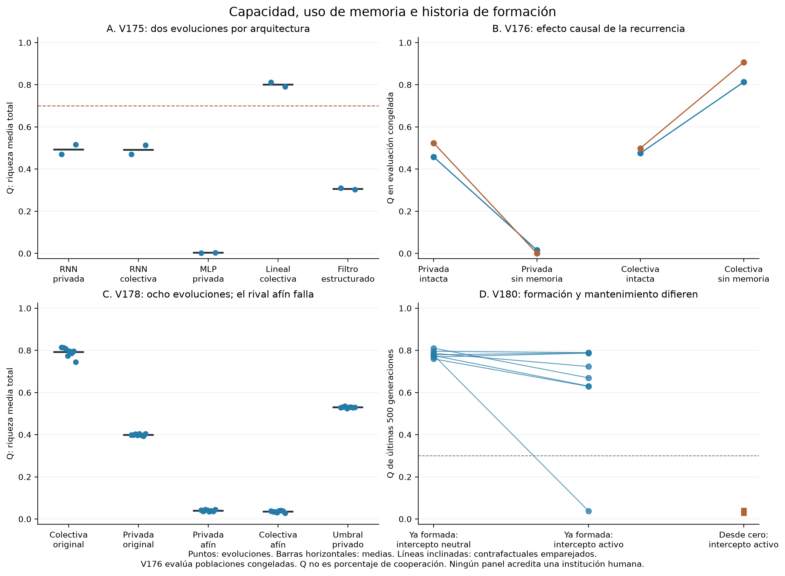
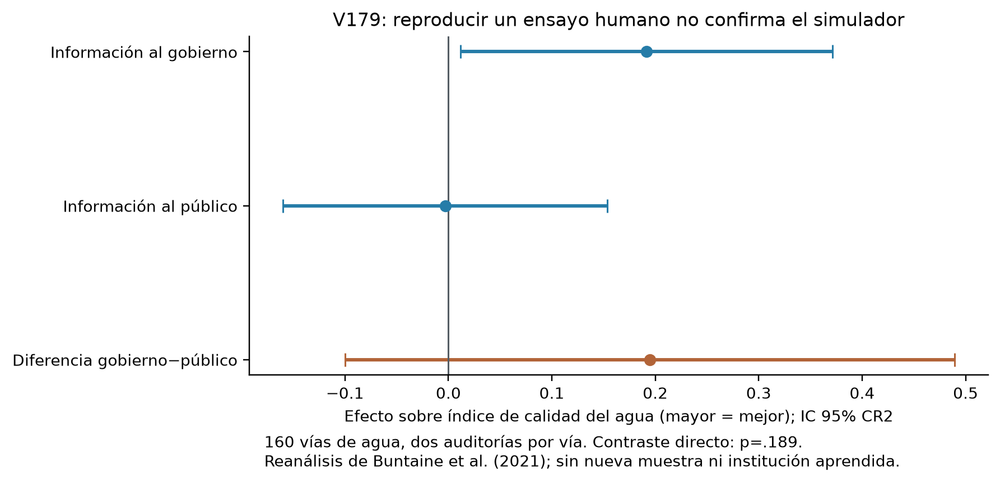
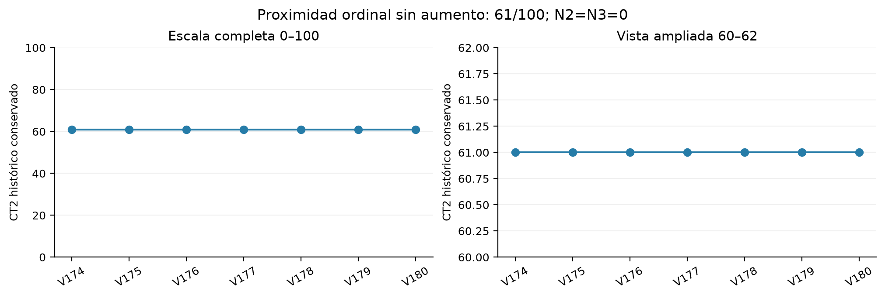

# Memoria, representación y formación de cooperación: V175–V180

15 de noviembre de 2026. Informe de resultados ejecutados. Continúa la auditoría V169–V174; no sustituye sus originales. **CT2 histórico: 61/100, sin incremento. N2=N3=0; N1 histórico sin auditar.** El objetivo científico sigue abierto.

El resultado más sólido de este bloque es la separación experimental entre formación y mantenimiento al ampliar una clase de políticas. Desde cero, un perceptrón con información colectiva alcanza riqueza total media Q=0,792; añadir un intercepto libre reduce Q a 0,036. Pero la hipótesis de pérdida generalizada de mantenimiento queda refutada: al abrir esa dimensión en poblaciones ya cooperativas, solo una de ocho colapsa. Siete conservan Q>0,30 y cuatro Q≥0,70. El efecto depende de la trayectoria de aprendizaje; no demuestra que la cooperación sea imposible con la representación ampliada.

También se cierra una interpretación informacional insuficientemente sustentada. Las redes privadas recurrentes superan a un MLP privado particular, pero fallan el criterio de alta eficiencia y un control de aspiración privada sin estado recurrente alcanza Q≈0,53. Además, fijar la entrada de recurso de las redes recurrentes no reduce su rendimiento en la prueba congelada. No se ha demostrado que descubran el observador contable de V173–V174.

El componente humano reproduce un resultado publicado y sus 10.000 reasignaciones. La diferencia directa entre los dos destinos de información es imprecisa; no confirma una predicción del simulador.

## 1. Preguntas decisivas y condiciones de prueba

V173–V174 demostraron capacidad de un observador PROGRAMADO: bajo conservación conocida, un estado escalar reconstruye riqueza colectiva a partir de historia del recurso. La cuestión siguiente era si evolucionaban políticas privadas con memoria genérica y si esa memoria explicaba una organización robusta. La investigación separó sucesivamente capacidad de aprendizaje, uso causal de memoria, incentivos individuales y elección de comparadores. Los resultados anteriores motivan cada protocolo; no se presentan seis estudios como confirmaciones independientes de una hipótesis fijada desde el inicio.

El juego ecológico procede de Itao y Kaneko, arXiv:2507.22555v2, revisión de noviembre de 2026. Hay 100 grupos de cinco personas, recurso renovable R(x)=2x−x², extracción individual β=0,9/5, consumo proporcional κ=0,25 y 1.000 pasos por generación. La riqueza individual media en pasos 100–999 determina la reproducción. Cada generación reinicia recurso y riqueza, reagrupa individuos y produce 500 descendientes mediante selección proporcional al fitness individual. No se utiliza objetivo de bienestar grupal para elegir progenitores.

Q es la media del sumatorio de riquezas individuales, **no un porcentaje de cooperación**. El máximo estacionario del recurso con estos parámetros normaliza la referencia de eficiencia a 1. El umbral Q≥0,70 es nuestro criterio prospectivo de alta capacidad; el antecedente utiliza Q>0,30 para delimitar sostenibilidad en su comparación de tamaños. No son criterios intercambiables.

Se ejecutaron 66 evoluciones de 3.000 generaciones: diez en V175, cuarenta en V178 y dieciséis en V180. Las evaluaciones congeladas no añaden evoluciones independientes. Los grupos, personas, generaciones y pasos tampoco aumentan el tamaño muestral del algoritmo. V175 es un piloto de dos semillas por arquitectura; V178 y V180 tienen ocho pares por contraste principal. Las políticas se adaptan por selección y mutación; eso no equivale a aprendizaje deliberado de cada individuo durante su vida.

Los kernels nuevos se contrastaron con referencias NumPy y con la física del autor externo. Se verificaron acciones y fitness, además de métricas agregadas. Numba float64 sin fastmath permitió mantener un máximo de dos entrenamientos de tres hilos, prioridad BelowNormal y afinidad limitada a seis CPU. No fue necesario ocupar la GPU. Los límites se leyeron del sistema; se corrigió previamente el problema de firmas Windows de 64 bits de V174, cuyo registro permanece intacto.

## 2. V175: memoria genérica y control de capacidad

Las cinco condiciones comparten 37 genes, igual inicialización y consumo de números aleatorios por semilla; los genes inactivos son neutrales. Esto iguala la cinta de muestreo, pero no iguala la dificultad de optimización de familias con distinto número de parámetros activos.

| Política | Información y estructura | Q, semilla 175115 | Q, semilla 175116 |
|---|---|---:|---:|
| RNN_RESOURCE | Recurso y riqueza propia; cuatro estados tanh | 0,470279 | 0,515990 |
| RNN_FULL | Misma RNN, además riqueza colectiva | 0,469995 | 0,513228 |
| MLP_RESOURCE | Mismos genes; recurrencia inactiva | 0,001536 | 0,003825 |
| LINEAR_FULL | Regla original con dos coeficientes activos | 0,811629 | 0,790513 |
| FILTER_RESOURCE | Filtro de seis coeficientes evolucionados, características cuadráticas diseñadas | 0,309803 | 0,302987 |

El primario exigía RNN_RESOURCE Q≥0,70 y ventaja≥0,15 frente al MLP en ambas semillas. La ventaja se cumple, la capacidad no. El control RNN_FULL también falla Q≥0,70 en ambas. Por tanto, este negativo **no identifica insuficiencia informacional**: el optimizador y la representación neuronal son explicaciones competidoras. El control lineal sí supera 0,70 en ambas.

El filtro estructurado tampoco alcanza alta eficiencia. No se había inicializado con la ley de conservación ni recibido etiquetas de riqueza colectiva. Su fracaso no demuestra que la ley sea imposible de aprender; únicamente falla esta familia y este proceso selectivo. No se prolongaron las corridas ni se escogió un checkpoint favorable.

## 3. V176: la memoria hace cosas diferentes según la población

Se congelaron las poblaciones completas y se sortearon ocho lotes nuevos de 128 grupos por población. Las intervenciones conservaron genotipos y riqueza inicial. Se compararon borrado de estado recurrente en cada decisión, entrada de recurso fija, todos los sensores fijos, grupos clonales y un invasor que extrae siempre.

| Población evolucionada | Q intacta | Q sin recurrencia | Q con recurso observado fijo | Q con todos los sensores fijos | Q en grupos clonales |
|---|---:|---:|---:|---:|---:|
| Privada, 175115 | 0,457743 | 0,015466 | 0,494775 | 0,205062 | 0,127280 |
| Privada, 175116 | 0,523677 | ≈0 | 0,536480 | 0,112230 | 0,066932 |
| Colectiva, 175115 | 0,475324 | 0,812524 | 0,500404 | 0,587020 | 0,104540 |
| Colectiva, 175116 | 0,498794 | 0,906551 | 0,514099 | 0,142543 | 0,148595 |

La recurrencia es causalmente útil en las dos poblaciones privadas y causalmente perjudicial para Q en las dos poblaciones que observan riqueza colectiva. Es una intervención sobre políticas concretas, no una comparación de todas las redes posibles. En MLP_RESOURCE y LINEAR_FULL la lesión neutral es exactamente idéntica al control, como corresponde a su definición.

Fijar únicamente el recurso observado a 0,1 mantiene e incluso aumenta Q en estas poblaciones. No se necesita esa entrada variable en esta evaluación para alcanzar el desempeño observado. Al fijar también riqueza propia y colectiva desaparecen otras contingencias y los resultados se dispersan. La riqueza propia ya contiene historia física de ingresos y consumo; «sin estado recurrente» no equivale a «sin toda memoria del pasado».

Los grupos clonales deterioran el desempeño. La diversidad estratégica ya ocupa un lugar central en el antecedente; no se reivindica ese mecanismo como nuevo. El invasor que siempre extrae reduce su propio fitness privado en las poblaciones RNN privadas, en −0,0462 y −0,0717. Eso descarta explotación por ese invasor concreto, pero no prueba equilibrio frente a cualquier política. Tampoco permite atribuir un castigo deliberado: una extracción excesiva puede dañar al propio extractor mediante el recurso compartido.

Las transferencias a otros tamaños, conservadas en los JSON completos de V176, evalúan poblaciones congeladas del mismo juego. No son aprendizaje en nuevos tamaños ni confirmación social externa.

## 4. V177: los incentivos no permiten llamar a esto una trampa de Pareto

Para cada grupo se enumeraron los 32 perfiles de activación de recurrencia. Apagarla significa poner a cero los 16 pesos recurrentes de una persona, conservando sus restantes pesos y entradas. Se evaluaron 512 grupos nuevos por población, dos poblaciones por arquitectura. Los agentes no aprendieron esta elección binaria: es un diagnóstico contrafactual del investigador.

| RNN con riqueza colectiva | Q todos activos | Q todos apagados | Todos activos: equilibrio restringido | Apagar todos: mejora de Pareto | Trampa fuerte |
|---|---:|---:|---:|---:|---:|
| 175115 | 0,474423 | 0,829895 | 83,40% | 0,39% | 0,00% |
| 175116 | 0,508085 | 0,906197 | 83,79% | 4,49% | 4,30% |

La trampa fuerte exigía que al menos el 50% de grupos, en ambas poblaciones, combinaran equilibrio de todos activos y mejora de Pareto al apagarlos. **Falla.** Aumentar riqueza total suele redistribuirla de modo que alguna persona pierde. Apagarse unilateralmente cuando las demás conservan recurrencia reduce el fitness medio de la persona focal en 0,0793 y 0,0879.

Los equilibrios enumerados solo se refieren a esta elección de activación; no a todas las estrategias de extracción. No se sustituyó el criterio fallado por una mejora de bienestar ex ante para rescatar una etiqueta favorable. La bibliografía ya contiene dilemas entre capacidades de memoria y casos donde espacios de estrategia menores superan a mayores.

## 5. V178: el comparador sencillo cambia la interpretación

Se enfrentaron cinco familias explícitas, todas con tres genes muestreados y mutados; los genes no usados son neutrales. FULL utiliza χ[x+SMy_i+AZ], ORIGINAL_PRIVATE elimina AZ, AFFINE_PRIVATE añade un intercepto libre a la regla privada, AFFINE_FULL lo añade a la regla colectiva y PRIVATE_THRESHOLD utiliza únicamente χ[T−My_i]. Esta última ignora tanto el recurso como la riqueza ajena y carece de estado mental recurrente.

| Familia | Q media de ocho evoluciones | Desviación entre semillas | Mínimo–máximo |
|---|---:|---:|---:|
| FULL | 0,791758 | 0,023553 | 0,744555–0,814821 |
| ORIGINAL_PRIVATE | 0,399606 | 0,004003 | 0,392810–0,404097 |
| AFFINE_PRIVATE | 0,039974 | 0,003875 | 0,035538–0,044923 |
| AFFINE_FULL | 0,035551 | 0,004255 | 0,028691–0,040417 |
| PRIVATE_THRESHOLD | 0,530122 | 0,003168 | 0,524290–0,535206 |

La hipótesis principal de una mejora privada afín falla en las ocho semillas. La extensión condicionada a grupos de 16 no se ejecuta, conforme al protocolo. La política privada de umbral alcanza eficiencia moderada en todas: el contraste de V175 frente a su MLP concreto no acredita superioridad de memoria recurrente frente a un rival privado sencillo y competente. Esta comparación entre campañas no es un test pareado de supremacía entre arquitecturas.

El contraste FULL frente a AFFINE_FULL muestra una caída grande y consistente desde inicializaciones pequeñas. Es un resultado secundario de V178, conocido antes de formular V180. Añadir capacidad funcional no garantiza que un proceso de adaptación descentralizado encuentre las políticas que esa capacidad permite representar. No se ha demostrado todavía qué parte corresponde a búsqueda, cuencas dinámicas, selección o incentivos de las desviaciones.

## 6. V180: falsar la pérdida de mantenimiento

Se tomaron todas las poblaciones FULL finales de V178. Se conservaron S y A y se puso el intercepto a cero en ambos brazos, porque el tercer gen había derivado como neutral y no debía activarse accidentalmente. Con nuevas semillas, LOCKED siguió ignorando ese gen y OPEN pudo usarlo; ambos mutaron los tres genes y tuvieron la misma cinta aleatoria inicial.

| Semilla nueva | Q LOCKED | Q OPEN | Caída ≥0,50 y OPEN<0,30 |
|---|---:|---:|---|
| 180115 | 0,775674 | 0,630426 | No |
| 180116 | 0,810602 | 0,669587 | No |
| 180117 | 0,777889 | 0,037507 | Sí |
| 180118 | 0,778977 | 0,788583 | No |
| 180119 | 0,795898 | 0,789367 | No |
| 180120 | 0,759760 | 0,629035 | No |
| 180121 | 0,768855 | 0,787088 | No |
| 180122 | 0,786184 | 0,723441 | No |

La pérdida generalizada exigía al menos seis casos; aparece uno. El control supera 0,70 en los ocho. OPEN tiene media 0,631879, frente a 0,781730 en LOCKED: hay deterioro medio y heterogeneidad, pero siete trayectorias conservan sostenibilidad. La misma representación afín que desde cero produjo Q≈0,036 puede mantener Q>0,30 tras una historia cooperativa. **La capacidad de mantenerse y el acceso desde cero son propiedades distintas.** Ese principio es conocido; su instancia aquí está causalmente documentada sin convertirla en descubrimiento sociológico general.

La prueba de invasión seleccionó un candidato común en cuatro poblaciones y lo congeló antes de usar las cuatro restantes. El menú BIAS contenía once interceptos; el rival fuerte PLANE, 49 pares de cambios en S y A. La regla minimax seleccionó **b=0**, por lo que no encontró un intercepto fijo común con ventaja privada robusta en las cuatro poblaciones de descubrimiento. El rival escogido ΔS=−1, ΔA=1 tuvo ventajas pequeñas y no mantuvo signo positivo en validación. El criterio de invasión destructiva también falla. Esto no demuestra ausencia de toda desviación rentable, de mutantes distintos por genotipo ni de invasiones con aprendizaje.

Se comprobó además una propiedad local del sistema: con interceptos estrictamente no nulos, H+ de ellos positivos y acciones fijas cerca del origen, los autovalores del Jacobiano son 2(1−0,9H+/M) y 0,75. En M=5, tres interceptos positivos hacen localmente estable el colapso. La comprobación por diferencias finitas pasó las 27 configuraciones M=3,5,16 y todos sus recuentos de signos. Esta linearización no explica por sí sola las trayectorias: PRIVATE_THRESHOLD también puede tener ese atractor y, bajo los reinicios habituales, sostiene Q≈0,53. No se atribuye causalidad completa a una condición local.

## 7. V179: evidencia humana reproducida y límite del contraste

Se descargó el archivo público de replicación de Buntaine, Zhang y Hunnicutt (2021), PNAS, DOI 10.1073/pnas.2015175118, desde OSF 8fzmq. El ZIP original tiene 86.627.168 bytes y SHA256 `e67848f5759d2ed8d3746a4d9dc1ce2192e977b22f0f86ae3ce12e9ec8182ffa`; pasó comprobación CRC. Se conserva intacto. No se ejecutaron los scripts R del archivo ni se analizaron microdatos de hogares.

El panel utilizado contiene 160 vías de agua y dos auditorías, **320 filas y 160 unidades de asignación**. No hay duplicados de la clave vía×auditoría ni cambios de tratamiento entre auditorías. Los brazos tienen 80 controles, 20 solo gobierno, 20 solo público y 40 ambos. El archivo previo a imputación incluye 179 vías; las 19 adicionales no se incorporaron a la muestra aleatorizada. Para las variables de esta regresión no había valores ausentes entre las 320 observaciones: no se introdujo imputación propia ni se necesitó la imputación de los autores en esas variables.

Se reconstruyeron mediante QR los coeficientes OLS, la covarianza CR2 por vía y grados de libertad Satterthwaite. Los intervalos publicados coinciden a menos de 10^−12. Las 10.000 reasignaciones bloqueadas provienen del archivo de los autores; sus p unilaterales se reproducen exactamente: gobierno 0,0189 y público 0,5181.

| Contraste sobre calidad del agua | Estimación | IC95% CR2 | p bilateral CR2 |
|---|---:|---|---:|
| Información al gobierno | 0,191532 | [0,011469; 0,371594] | 0,0375 |
| Información al público | −0,003135 | [−0,159860; 0,153591] | 0,9682 |
| Gobierno menos público, contraste añadido | 0,194667 | [−0,099925; 0,489258] | 0,1891 |

El último contraste es un reanálisis diagnóstico, no una hipótesis preregistrada del estudio original ni una predicción nueva confirmada. Su intervalo incluye cero y diferencias sustanciales en ambas direcciones. Que un tratamiento individual sea detectable y otro no lo sea no establece una diferencia detectable entre ellos. Tampoco se ha probado ausencia de efecto del tratamiento público.

La lectura del código detectó que la función de selección de efectos de ciudad usa `pf(.95,...)` donde corresponde el cuantil `qf(.95,...)`. Para ESTE resultado, F=3,132 supera tanto el umbral incorrecto 0,524 como el correcto 1,969: la especificación elegida y la reproducción principal no cambian. No se ha auditado el impacto de esa línea sobre todos los demás resultados del artículo.

El ensayo concierne a monitoreo organizado externamente y autoridades preexistentes. No mide aprendizaje de una institución entre agentes, riqueza colectiva inferida por conservación ni división ocupacional del simulador. Sirve como evidencia externa pertinente y control de interpretación estadística; **no confirma nuestras ecuaciones**.

## 8. Auditoría adversarial de prioridad

Itao y Kaneko ya estudian turnos, diversidad, señales anónimas, invasión y trayectorias demográficas; su RNN publicado observa riqueza colectiva. Akiyama y Kaneko ya desarrollaban juegos de sistemas dinámicos y normas dos décadas antes. Hamon, Nisioti y Moulin-Frier (2023) evolucionan redes recurrentes con observaciones locales en un entorno de recursos sin reinicios generacionales. Por ello, «memoria privada permite sostenibilidad» no es una novedad general disponible para apropiación.

Schmid y colaboradores (2022) muestran competencia entre espacios de estrategia y dilemas sociales entre capacidades de memoria; Alqithami (2026, preprint) estudia perjuicios de mayor recuerdo en rutas. Estos trabajos no son reproducciones de nuestros mecanismos, pero impiden presentar «más memoria puede perjudicar» como primer hallazgo. Los contratos siguen sujetos a antecedentes fuertes de Haupt, Oechssler, Heitzig y Gürdal. SePS y GradPS son comparadores necesarios para afirmaciones sobre compartir parámetros; este bloque no implementa un benchmark completo frente a ellos.

La revisión es de alcance, con nivel de lectura por referencia, no sistemática ni prueba de prioridad universal. Una contribución defendible del TFM es la cadena de identificación y falsación documentada. La candidata específica de dependencia de formación respecto al espacio de políticas necesitaría una predicción discriminante frente a búsqueda y selección, competidores adicionales pertinentes y confirmación independiente antes de aspirar a 2/3.

## 9. Trazabilidad, decisiones y continuidad

Los protocolos de V175, V176, V177, V178 y V180 se congelaron en una rama remota separada, sin alterar el índice o la rama local del usuario. El manuscrito y las figuras son productos posteriores a resultados. V179 es auditoría y reproducción de evidencia humana existente; no se camufla como un ensayo humano nuevo.

| Congelación | Commit remoto |
|---|---|
| V175 antes de entrenar | `e5dd0826c29f97d246d80d5a8e8f16072e56552b` |
| V176 antes de lesiones | `d78039270b2ca6a86eb044d2d02014bc09234d81` |
| V177 antes de enumerar pagos | `56637552a6304ff9f77ff5caf891c39684a59810` |
| V178 antes de sus cuarenta evoluciones | `459056ca268ac59b1592476a724d8358dcfc8888` |
| V180 antes de mantenimiento y selección | `a99703a14f88d5c544e8ffd2cb3998ddfabafbf7` |
| Candidatos V180 antes de validación | `2766f863cda02bff7cd67eebeb8a682de358065e` |

Rama: [research/aldea-memory-v175-20261115](https://github.com/GalexY3/Metodologia-AB/tree/research/aldea-memory-v175-20261115). Los commits son evidencia temporal del protocolo; no validación científica por GitHub.

`V175_V180_FINAL_AUDIT.json` contiene 464 comprobaciones técnicas, siete criterios científicos fallados o no establecidos y su alcance. Se reprodujeron exactamente los 56 puntos finales de V178/V180; los diez de V175 ya habían sido reproducidos en la auditoría de V176. El archivo anterior V169–V174 y sus fuentes siguen con los mismos hashes. **464 comprobaciones no son 464 ciclos AB ni 464 descubrimientos.**

Se detienen localmente las reivindicaciones de alta eficiencia por memoria genérica, de observador aprendido, de trampa de Pareto general, de mejora por intercepto privado, de destrucción generalizada al abrir la política y de superioridad empírica probada del destinatario gubernamental. Los negativos y la única trayectoria de colapso en V180 se conservan. No se ampliará automáticamente esta campaña con más variantes neuronales o más semillas de los mismos negativos.

El cuello de botella para 2/3 es conceptual y externo: todavía falta una predicción social o algorítmica nueva que sobreviva un rival competente y tenga confirmación independiente pertinente. El trabajo ejecutado mejora la identificación, la reproducibilidad y el TFM, pero no cumple esa condición. Las fórmulas de renovación V164–V167 y los nuevos resultados de formación se integran como mecanismos condicionales, sin convertir un protocolo diseñado en una institución descubierta.

## Fuentes primarias de este bloque

- Itao y Kaneko, [preprint colectivo v2](https://arxiv.org/html/2507.22555v2) y [código original](https://github.com/KenjiItao/ds_game). Lectura de métodos, robustez y código; no auditoría de todas las demostraciones del artículo.
- Hamon, Nisioti y Moulin-Frier, [Eco-evolutionary Dynamics of Non-episodic Neuroevolution in Large Multi-agent Environments](https://arxiv.org/html/2302.09334), GECCO Companion 2023, DOI 10.1145/3583133.3590703. Inspección de arquitectura, observaciones y controles ecológicos.
- Schmid et al., [Direct reciprocity between individuals that use different strategy spaces](https://pmc.ncbi.nlm.nih.gov/articles/PMC9197081/), PLoS Computational Biology 2022. Resumen y resultados pertinentes; no réplica integral.
- Alqithami, [Endogenous Information in Routing Games](https://arxiv.org/abs/2604.11733), v2, 2026. Preprint; revisión del resumen, sin acreditación editorial ni auditoría formal propia.
- Buntaine, Zhang y Hunnicutt, [artículo original depositado por UCSB](https://escholarship.org/uc/item/7c94j310), PNAS 2021; [archivo de datos y código OSF](https://osf.io/8fzmq/). Reconstrucción independiente de la especificación principal de calidad del agua.
- Slough et al., [metaanálisis de monitoreo comunitario](https://pmc.ncbi.nlm.nih.gov/articles/PMC8307849/), PNAS 2021. Contexto y diseño; no nueva estimación de sus seis países.
- [Definiciones matemáticas de estimatr](https://declaredesign.org/r/estimatr/articles/mathematical-notes.html): CR2 y grados de libertad usados como referencia metodológica; la coincidencia con las salidas originales de 2021 es la comprobación numérica efectivamente realizada.
