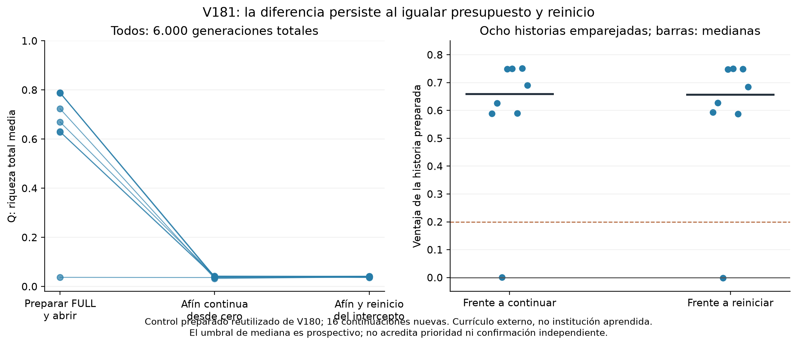

# V181 — Historia con presupuesto total y reinicio controlados

15/11/2026. Control prospectivo motivado por una limitación detectada después de V180. **CT2 histórico61/100 sin aumento;N2=N3=0.** Los originalesV175–V180 y sus paquetes permanecen intactos.

El criterio preregistrado se cumple frente a los dos rivales. Con6000generaciones totales, la historia FULL→OPEN tieneQmedia0.631879, mientras AFFINE_FULL→AFFINE_FULL tiene0.038595 y reiniciar solo el intercepto de AFFINE_FULL tiene0.039610. La diferencia no desaparece por añadir las3000generaciones que faltaban al comparador o por reiniciar ese gen.

## Diseño y alcance

La comparación secundaria anterior mezclaba3000generaciones afines desde cero con3000de preparaciónFULL y otras3000OPEN. Aquí se continúan las ocho poblaciones afines de V178 durante3000generaciones más. CONTINUE conserva sus tres genes;RESET_BIAS pone únicamente el intercepto a0 antes de continuar y después permite que vuelva a mutar. Ambos comparten la cinta aleatoria de continuación de los OPEN correspondientes deV180. El kernel, la física, la selección privada y el número de genes mutados se conservan.

Se reutilizan ocho controles anteriores y se ejecutan dieciséis continuaciones nuevas. Las réplicas son ocho historias originales emparejadas, no24poblaciones independientes. Ninguna ronda, persona o checkpoint se cuenta como réplica del algoritmo. El protocolo y el código se congelaron en `d0962768e2cdb50cedc0476e05481b1a30896809` antes de continuar; se verificaron sus bytes remotos y su fecha frente alFREEZE local.

| Semilla de continuación | Preparada, V180 | Afín continuada | Afín con reinicio de sesgo |
|---|---:|---:|---:|
| 180115 | 0.630426 | 0.041432 | 0.036572 |
| 180116 | 0.669587 | 0.043001 | 0.041869 |
| 180117 | 0.037507 | 0.036679 | 0.038642 |
| 180118 | 0.788583 | 0.039835 | 0.041071 |
| 180119 | 0.789367 | 0.039706 | 0.039655 |
| 180120 | 0.629035 | 0.039178 | 0.042011 |
| 180121 | 0.787088 | 0.036259 | 0.038100 |
| 180122 | 0.723441 | 0.032669 | 0.038958 |

El primario exigía mediana de ventaja≥0,20 y ventaja positiva en al menos6/8pares, frente a AMBOS controles. Las medianas son0.658679 y0.656100;hay8/8y7/8signos positivos. Se conserva la historia180117: la preparación también colapsó y no tiene ventaja frente al reinicio.

Los intervalos bootstrap descriptivos de la ventaja media, remuestreando las ocho historias sin reentrenar, son[0.4108891346352991, 0.7143710723179724] y[0.4099144475548893, 0.7130075466524013]. Se calculan después de la prueba como incertidumbre interna; no equivalen a validación externa.

## Qué descarta y qué no identifica

El resultado descarta que la ventaja observada de esa historia se deba únicamente a disponer de3000generaciones extra o a poner el intercepto a0al comenzar la segunda fase, bajo estas poblaciones y este optimizador. La clase afín puede conservar rendimiento que no alcanza desde cero con igual presupuesto total. No se ha identificado aún una explicación única:trayectoria selectiva, valores deS/A, escalas de mutación y cuencas del sistema siguen vinculados al historial.

La secuencia de clases está impuesta por el investigador. Los agentes NO aprendieron a crear esa secuencia, a restringir su espacio de políticas, a negociar una constitución o a implantar monitoreo. Es un mecanismo de acceso a políticas bajo un currículo externo. Los antecedentes de aprendizaje por etapas y dependencia de espacios de estrategia impiden atribuir novedad general a esa idea. La candidata específica debe discriminarse frente a ellos y confirmarse independientemente antes de aspirar a2/3.

V181 no rescata los criterios fallados deV175,V177,V178oV180:capacidad de memoria genérica, trampa de Pareto, ventaja privada afín, destrucción generalizada de mantenimiento e invasión destructiva siguen fallados. La condición de alta eficiencia0,70tampoco se cumple en todas las historias preparadas. El efecto es de acceso y desempeño condicionado, sin ley sociológica acreditada.

## Evidencia y reproducción

`results/V181_FINAL_AUDIT.json` contiene88comprobaciones, incluidos los16puntos finales reejecutados exactamente. `results/v181_matched_budget` conserva curvas completas, RNG, seis checkpoints por continuación y poblaciones. La primera generación de los ocho controles V180 se reprodujo antes de ejecutar para comprobar la cinta aleatoria. El informe previo y el ensayo humano conservan su alcance.

En una carpeta con los insumos originales: `python v181_matched_budget.py --audit-only`, después `python v181_matched_budget.py --prereg-commit d0962768e2cdb50cedc0476e05481b1a30896809`. No sobrescribir los resultados ya existentes. El nuevo paquete incluye los insumos mínimos de V178/V180 y el kernel congelado;el archivo humano no es necesario.
