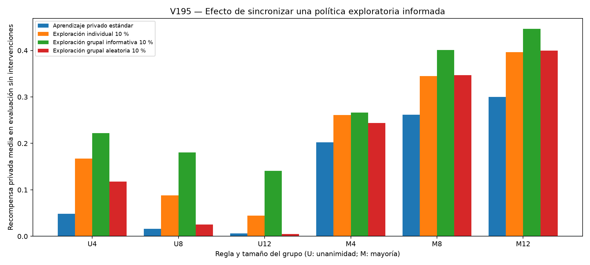
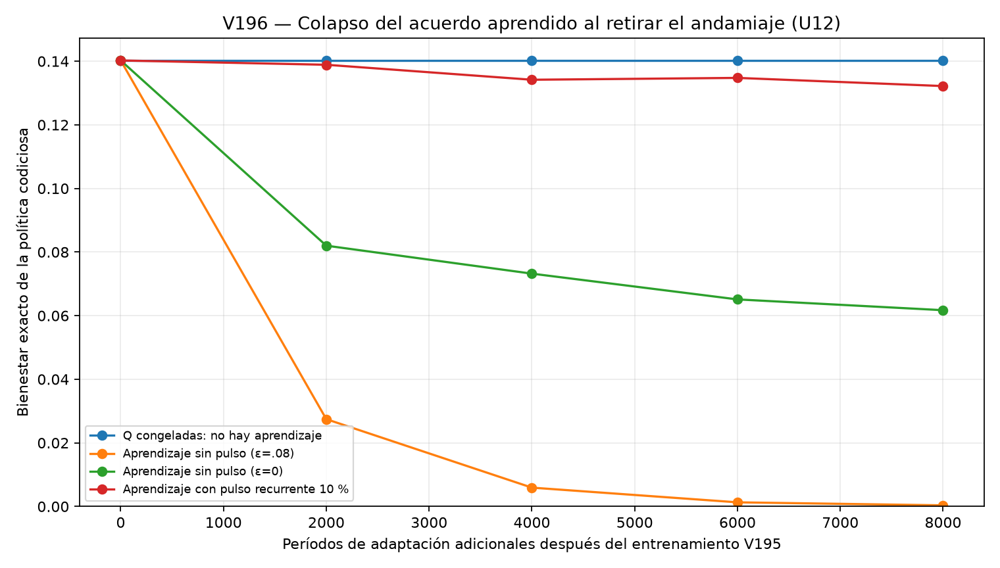

# Información, exploración conjunta y dependencia institucional del aprendizaje privado — V194–V196

**Fecha:** 15 noviembre 2026. **Estado:** campañas V194, V195 y V196 completas, con controles analíticos V194A y V195A. **Pregunta sociológica:** cuándo agentes que maximizan su propia recompensa descubren una convención cooperativa y si pueden mantenerla sin andamiaje coordinador. **Evaluación AB:** CT2 histórico 61/100, N2=0, N3=0. **NO CONSTITUYE NIVEL 2/3**, no hay una organización endógena completa ni prioridad científica confirmada.

## Resumen ejecutivo

Tres experimentos encadenados distinguen **acuerdo**, **aprendizaje de una convención** y **mantenimiento mientras el aprendizaje continúa**. V194 indica que aprender por separado a votar y a elegir el régimen informativo suele dar lugar a acuerdos poco frecuentes, incluso cuando existe una política programada de mayor bienestar. V195 demuestra que hacer explorar ocasionalmente a todo el grupo una misma regla de decisión (cada persona vota según su señal privada) permite a cada actor aprender con su propio retorno una política mucho más cooperativa; la intervención se desactiva completamente al evaluar, y su efecto aparece en cinco de seis escenarios frente a exploración individual de la misma frecuencia marginal. V196 demuestra una limitación importante: **al retirar el pulso grupal y permitir seguir aprendiendo durante 8000 rondas, el rendimiento se reduce en los seis escenarios**; conservar el pulso, en cambio, conserva casi todo el rendimiento. La hipótesis preregistrada de mantenimiento autónomo≥75% falla en las seis condiciones.

La cooperación mejorada es, por tanto, **conducta aprendida bajo entrenamiento asistido**, que puede desplegarse congelada sin asistencia; no se ha acreditado un equilibrio institucional auto-sostenible con plasticidad continua. El mecanismo sigue siendo conocido a nivel general —exploración coordinada y selección de equilibrios—, pero este encadenamiento de pruebas identifica con precisión la diferencia entre adquisición y mantenimiento en el entorno concreto, y proporciona un blanco falsable para diseñar un mecanismo verdaderamente endógeno.

## I. Materialidad de la votación, actores y fuentes de información

Hay 32 mundos computacionales de entrenamiento por condición, con asignaciones iniciales de agentes derivadas de semillas distintas por mundo (se pueden agrupar en dos bloques descriptivos de16), cada uno con20 grupos de k−1 votantes; k={4,8,12}. Los miembros tienen pérdidas privadas fijas L_i∈{1,7}, asignadas aleatoriamente por mundo; sus Q individuales no comparten parámetros, recompensas ni gradientes. El estado ambiental θ∈{GOOD,BAD} se renueva cada reunión, Pr(GOOD)=0.6. Cada votante recibe una señal binaria propia de precisión marginal 0.8 en ambos estados. Ratificar da +1 a cada uno si GOOD y −L_i si BAD; rechazar da0. La regla pública de ratificación exige unanimidad o mayoría, según condición. Los grupos, las reglas, el estado y las consecuencias están diseñados por el investigador; los electores no inventan este sistema.

La recompensa individual es exactamente r_i = 1[aprueba]·(1[GOOD]−L_i1[BAD])−c_i[canal público]. En V194 el canal público tiene coste c=.02 por persona y se selecciona por mayoría de votos de preferencia aprendidos; los electores aprenden también YES/NO según su señal y el canal. En V195 y V196 todos disponen de señales individuales independientes (sin coste), para aislar el efecto de la intervención exploratoria. La regla de pago no impone que votar YES sea racional; la señal no contiene la verdad.

Todas las políticas Q aprenden por experiencia bandit con alpha=.10, horizonte8000 reuniones, epsilon-greedy .30→.08 en entrenamientos V194/V195 y una evaluación de2000 reuniones de entorno nuevo sin actualizar Q. Un agente solo actualiza la Q de la acción que realmente realizó utilizando su propia recompensa. No recibe valores contrafactuales, etiquetas de estado, la utilidad de los demás ni un crítico de equipo.

## II. V194 — La adopción informativa aprendida no soluciona el desacuerdo

Prerregistro PREREG_V194_PRIVATE_ENDOGENOUS_INFORMATION_VOTE.md, entrenamiento v194_learned_information_institutions.py, seis JSON y seis NPZ en results/V194_PRIVATE_INFORMATION_LEARNING. Los controles son política privada con elección aprendida de fuente informativa, ambas fuentes obligatorias, fuente aleatoria, seguir la señal sin aprendizaje y un oráculo con estado perfecto.

| k | Regla | Fuente aprendida, bienestar | Fuente privada fija, bienestar | Fuente pública fija, bienestar | Fracción de reuniones con fuente pública aprendida |
|---:|---|---:|---:|---:|---:|
|4|UNANIMITY|0.04499|0.04615|0.00415|0.1359|
|8|UNANIMITY|0.01292|0.01693|−0.02219|0.0312|
|12|UNANIMITY|0.00537|0.00761|−0.01924|0.0250|
|4|MAJORITY|0.17371|0.20727|0.11265|0.3969|
|8|MAJORITY|0.21615|0.27093|0.08281|0.3391|
|12|MAJORITY|0.23137|0.29659|0.07408|0.3766|

La elección aprendida del canal NO supera a los aprendices con señales independientes fijas en ninguna celda. Las diferencias emparejadas por32 mundos para los tres tamaños con MAJORITY son −.03356 IC95[−.04366,−.02385], −.05479[−.07402,−.03700] y −.06522[−.08294,−.04794]. Para UNANIMITY las diferencias negativas tienen intervalos que incluyen cero. No convertir «6/6 signos» en confirmación estadística de seis efectos distintos.

La auditoría V194A calcula el comportamiento exacto de los Q congelados mediante polinomios Poisson-binomial y lo contrasta con muestras de evaluación; realiza además100 enumeraciones de un núcleo de probabilidad. Con unanimidad, la proporción de grupos ADAPTIVE que casi nunca aprueban un acuerdo favorable (prob<.01) es .8625 (k4), .9234 (k8), .9578 (k12). En k12, haría falta una media de10.2 votantes adicionales que cambiaran a YES para ratificar con todas las señales favorables. Esta evidencia identifica un mecanismo de no-pivotalidad y coordinación; NO concluye que todo rechazo sea irracional, pues L_i es heterogéneo y la información es limitada.

## III. V195 — Aprendizaje privado mediante exploración conjunta de una política

Prerregistro PREREG_V195_CORRELATED_PRIVATE_EXPLORATION.md; código v195_joint_signal_policy_exploration.py y resultados/NPZ en results/V195_CORRELATED_EXPLORATION.

Intervención original del investigador: en el10% de reuniones de entrenamiento seleccionadas mediante una moneda **COMÚN POR GRUPO**, todos los agentes se ven obligados transitoriamente a votar cada uno según su propia señal individual independiente. En el resto de reuniones cada uno usa su Q privada con epsilon-greedy. Las recompensas siguen siendo totalmente individuales y las Q también. La **tasa marginal de exposición** a la regla informativa se iguala con el control en el que cada individuo, de forma independiente y con probabilidad10%, explora la misma regla. Otro control fuerza a todos a votar el mismo YES/NO elegido al azar en10% de reuniones, para distinguir sincronía sin contenido informacional. Otro usa pulsos informativos grupales del2%. Al terminar8000 oportunidades se eliminan completamente pulsos y exploración y se evalúan las Q congeladas durante2000 reuniones nuevas.

| k | Regla | Aprendiz estándar | Pulse individual10% | Pulse conjunto informativo10% | Pulse conjunto aleatorio10% | Seguir señal sin aprendizaje | Efecto conjunto−individual [IC95 pareado] |
|---:|---|---:|---:|---:|---:|---:|---|
|4|UNANIMITY|.04844|.16730|**.22240**|.11797|.29411|+.05510 [.04336,.06699]|
|8|UNANIMITY|.01620|.08810|**.18056**|.02535|.12602|+.09246 [.08316,.10174]|
|12|UNANIMITY|.00637|.04474|**.14063**|.00490|.05175|+.09589 [.08756,.10439]|
|4|MAJORITY|.20251|.26124|**.26628**|.24381|.36591|+.00505 [−.00824,.01730]|
|8|MAJORITY|.26192|.34465|**.40077**|.34685|.52645|+.05613 [.04039,.07259]|
|12|MAJORITY|.30017|.39643|**.44687**|.39985|.57463|+.05044 [.02828,.07264]|

**Resultado prospectivo matizado:** mejora muestral conjunta sobre exposición individual en6/6, pero el IC bootstrap95 excluye cero en **5/6**, NO en k4 MAJORITY. El pulso conjunto informativo supera al pulso conjunto aleatorio en6/6 con intervalos positivos; esto apoya que la coherencia de la política explorada importa, no solo hacer actuar simultáneamente. Las políticas aprendidas en k8/k12 UNANIMITY superan incluso el control exógeno de seguir señales, que no es necesariamente una mejor respuesta privada ni un máximo teórico. El control de estado perfecto ronda0.6 y es informativamente inalcanzable con los mismos sensores.

El valor exacto de las Q aprendidas fue calculado por un auditor distinto v195a_analytic_private_policy_audit.py y comparado con su evaluación nueva: por ejemplo para k12 UNANIMITY, JOINT valor exacto .140242 frente a evaluado .140635; k8 UNANIMITY .180413 vs .180560; k12 MAJORITY .446519 vs .446875. Las diferencias son compatibles con error de Monte Carlo. Se verificaron100 colas binomiales por enumeración escalar (error máximo6.66e−16). La métrica de pulso en EVAL es **cero exacto** en todos los brazos; la de TRAIN está cerca de .1 o .02 según protocolo. Se conservaron las Q y sus hashes.

Bajo unanimidad y pulso conjunto, el porcentaje de agentes que vota YES ante señal favorable, según Q, es .866 (k4), .935 (k8) y .954 (k12), frente a .205, .387 y .451 en STANDARD. Los jugadores de pérdida ALTA también mejoran; en k12 UNANIMITY pasan a YES ante señal favorable en torno al91%, y su retorno esperado congelado es .138, frente a .142 en pérdida baja. No se puede atribuir el resultado únicamente a la explotación de los individuos con mayor pérdida.

**Interpretación formal limitada:** si un grupo de m electores adopta simultáneamente la política de aprobar cuando su señal independiente es positiva, el beneficio PRIVADO esperado de que se ratifique (sin condicionar en la propia señal) es πa^m B−(1−π)(1−a)^mL_i. Es positivo para todo L_i∈{1,7} y m≥3 con π=.6 y a=.8. Estas sesiones generan muestras de acciones conjuntas informadas y seleccionan eventos GOOD de manera muy distinta a la exploración individual. El dato del éxito coordinado pasa a las Q privadas sin que cada agente observe las otras señales. La fórmula es deducción de teoría conocida de señales y voto, no teorema original.

**Problema pendiente:** la evaluación congela Q; el hecho de actuar sin el pulso en evaluación NO prueba que la política pueda sobrevivir si sus miembros siguen modificándola.

## IV. V196 — Falsación: la cooperación congelada depende del andamiaje mientras se sigue aprendiendo

Prerregistro PREREG_V196_PLASTIC_MAINTENANCE_AFTER_EXPLORATION.md (posterior a los seis positivos V195, antes de V196); código v196_plastic_no_pulse_maintenance.py, resultados y Q finales en results/V196_POST_PULSE_PLASTICITY.

Todas las ramas de cada grupo inicializan **exactamente** las mismas Q y el mismo modelo físico del brazo JOINT_SIGNAL_PULSE_10 de V195. Se simulan **8000 reuniones adicionales con nuevas semillas ambientales**, apareadas entre ramas. La métrica principal se obtiene en t=0,2000,4000,6000,8000 mediante integración Poisson-binomial EXACTA del rendimiento de cada política congelada en ese instante. Esta evaluación exacta a lo largo de la vida **no equivale a congelar Q durante el entrenamiento**. Se distinguen cinco tratamientos:
- FREEZE: Q intactas, sin pulso, epsilon=0, sin actualizaciones.
- PLASTIC_NO_PULSE_EPS08: Q continúan aprendiendo de su propio retorno, epsilon=.08, sin pulso.
- PLASTIC_NO_PULSE_EPS02: idem, epsilon=.02, sin pulso.
- PLASTIC_NO_PULSE_EPS00: actualización de Q sí, exploración epsilon=0, sin pulso.
- PLASTIC_KEEP_PULSE_10: actualización de Q y epsilon=.08, manteniendo el pulso grupal informativo en10% de oportunidades.

| k | Regla | Valor inicial exacto | Aprende sin pulso ε=.08 | Valor retenido | Aprende CON pulso10% | Valor retenido | Diferencia CON−SIN [IC95] |
|---:|---|---:|---:|---:|---:|---:|---|
|4|UNANIMITY|.222575|.049715|22.34%|.212330|95.40%|+.162615 [.151605,.173525]|
|8|UNANIMITY|.180413|.005349|2.96%|.177110|98.17%|+.171761 [.163198,.180373]|
|12|UNANIMITY|.140242|.000354|0.25%|.132193|94.26%|+.131839 [.124528,.139272]|
|4|MAJORITY|.267273|.196168|73.40%|.265105|99.19%|+.068937 [.056772,.080625]|
|8|MAJORITY|.400666|.254236|63.45%|.398562|99.48%|+.144326 [.126223,.162294]|
|12|MAJORITY|.446519|.295881|66.26%|.455576|102.03%|+.159695 [.139194,.178941]|

**H1 FALLA**: mantener al menos75% del nivel inicial en cuatro de seis escenarios no sucede en ninguno de ellos (0/6). **H2 SE CUMPLE**: conservar el pulso ofrece una ventaja frente a retirar el pulso en6/6, con intervalos bootstrap pareados de32 mundos estrictamente positivos. **H3 MATIZADO**: reducir epsilon mejora parcialmente la retención en unanimidad k8/k12 cuando se baja a0, pero no universalmente; incluso sin exploración (epsilon=0) las Q continúan cambiando y el valor inicial no se conserva (k4 UNANIMITY .03753; k8 .03514; k12 .06172). **H4 control negativo PASA**: FREEZE conserva matemáticamente todo el valor en los cinco checkpoints.

Con k12 UNANIMITY, la fracción de grupos con Pr(ratificar|GOOD)<.01 aumenta de16.09% a99.69% bajo plasticidad sin pulso ε=.08, mientras con pulso recurrente queda en19.22%. La degradación no es un simple error de muestreo: la auditoría evalúa el valor exacto de políticas efectivamente diferentes.

Estas observaciones delimitan de forma estricta el resultado anterior: **se aprende una política cooperativa a través de asistencia colectiva externa, pero el mecanismo ensayado no constituye una institución autónomamente sostenible mientras los actores continúan aprendiendo**. En este modelo, los ensayos sincronizados periódicos mantienen una distribución de experiencias útil para las decisiones privadas; retirarlos altera la muestra de resultados y los agentes convergen de nuevo hacia no aprobación o equilibrios subóptimos.

## V. Micro-mecanismo y límites de inferencia

El caso separa tres niveles micro-macro:

1. **Niveles personales:** cada agente tiene su pérdida heterogénea y Q independiente. No accede a la verdad del estado ni a Q o recompensas ajenas. La voluntad de votar depende de su propio registro de experiencias, y puede ser racional rechazar cuando la información es insuficiente.
2. **Nivel coordinativo:** la regla de unanimidad o mayoría crea una no linealidad de umbral. Una acción individual deja de ser pivotal cuando muchos otros rechazan, haciendo que las muestras de cooperación grupal resulten muy escasas. La exploración grupal informada altera la distribución de experiencias accesibles y ayuda a descubrir políticas complementarias.
3. **Nivel metaorganizativo:** la programación recurrente de oportunidades conjuntas actúa como mantenimiento de la plasticidad, no solo como entrenamiento inicial. Es un andamiaje impuesto por el investigador. Una posible conexión heurística con la cibernética organizacional (Stafford Beer, coordinación y mecanismos de metagobierno) requiere formular comparadores, costos y estados materialmente observables; NO se ha puesto a prueba el VSM ni se ha demostrado su verdad empírica.

**Amenazas a la validez:** los agentes no eligen libremente seguir la señal en los pulsos (intervención coactiva experimental); los intereses están parcialmente alineados por el pago de la misma decisión pública; la muestra se repite en los mismos grupos; el entorno binario y el signo informativo de las señales están diseñados; el voto es una institución ya definida; no se aprende tamaño/miembros, profesiones, producción de bienes, donación o contrato de compensación. Las Q tabulares sin memoria adicional, entrenamiento α=.10 fijo y los horizontes elegidos no constituyen todas las estrategias cognitivas posibles. El valor inicial congelado no representa un equilibrio privado estable: V195A encontró oportunidades de desviación unilateral positivas en algunos grupos. Las verificaciones matemáticas y los miles de eventos simulados no son replicaciones científicas realizadas por laboratorios independientes. Los bootstrap por32 mundos no convierten modelos simulados en evidencia de sociedades humanas.

**Originalidad:** el dilema de selección de equilibrios y la exploración conjunta en MARL se conocen; también se ha estudiado la relación ambigua entre información pública y acción colectiva, y los compromisos condicionales. Por lo tanto, aunque la cadena de falsación es útil para un trabajo científico, no se reivindica una contribución N2 ni una nueva ley sociológica.

## VI. Referencias primarias verificadas
- Toquebiau, Bredeche, Benamar y Jun (2024). *Joint Intrinsic Motivation for Coordinated Exploration in Multi-Agent Deep Reinforcement Learning*, AAMAS extended abstract. https://aamas.csc.liv.ac.uk/Proceedings/aamas2024/pdfs/p2522.pdf
- Basak, Deb y Kuvalekar (2026). *Similarity of Information and Collective Action*, *American Economic Review* 116(4):1189–1233. https://pubs.aeaweb.org/doi/10.1257/aer.20241056
- *Information pooling through majority-rule voting: Condorcet's jury theorem with correlated votes* (1995), *Journal of Economic Behavior & Organization*, doi10.1016/0167-2681(94)00068-P. https://www.sciencedirect.com/science/article/pii/016726819400068P
- *Voting with endogenous information acquisition: Experimental evidence* (2017), *Games and Economic Behavior*. https://www.sciencedirect.com/science/article/pii/S0899825617300064
- Jiang, Huang y Wang (2024), *Reinforcement learning for encouraging cooperation in a multiagent system*, Information Sciences 120996, doi10.1016/j.ins.2024.120996.
- *Emergent cooperation from mutual acknowledgment exchange in multi-agent reinforcement learning* (2024), doi10.1007/s10458-024-09666-5, antecedente muy importante para pruebas de adopción descentralizada.
- *Inefficient Learning Leads to Efficient Coordination: A Repeated Stag-Hunt Game with Learning Agents* (2026), Games 17(4):39, antecedente de dependencia del régimen de aprendizaje para seleccionar equilibrios.

## VII. Continuidad / siguiente discriminante

**Objetivo del siguiente ciclo:** dejar de imponer la programación de la exploración grupal. Construir una opción **ENDÓGENA de activar y costear oportunidades de coordinación** que los agentes puedan proponer, aceptar y financiar a partir de beneficios privados, con posibilidad real de no activar la coordinación; comparar contra políticas óptimas fijas y mecanismos previos de *mutual acknowledgment*, contratos condicionales y exploración coordinada. Añadir historia, incertidumbre sobre acciones ajenas y heterogeneidad cognitiva, con modificaciones de incentivos verificables, evitando convertir una heurística programada en un «instituto emergente». Exigir sostenibilidad durante aprendizaje continuo, y después intentar transportar ese principio al juego material de V172 con profesiones libres y donaciones voluntarias, no solo a una urna de votación.

No seleccionar parámetros de nuevas pruebas basándose en el resultado de la nueva cohorte. Prerregistrar falsadores y usar nuevas semillas de entrenamiento, evaluación y grupos; validar contra benchmarks fuertes. Una mejora local de Q no justifica incrementar61/100 ni declarar completada la meta. El siguiente ciclo puede explorar mecanismos alternativos si un contrato voluntario fracasa.

**Integridad:** el repositorio conserva fuentes y negativos históricos intactos; no se reescribió score AB ni V194/V195 al diseñar V196. Los seis resultados por campaña y sus pesos se guardaron separadamente; los archivos de protocolo se escribieron antes de sus entrenamientos respectivos. No se hizo commit ni push de estos archivos desde este chat, precisamente para evitar mezclar el gran índice compartido. Ningún experimento queda en segundo plano tras terminar este ciclo.
