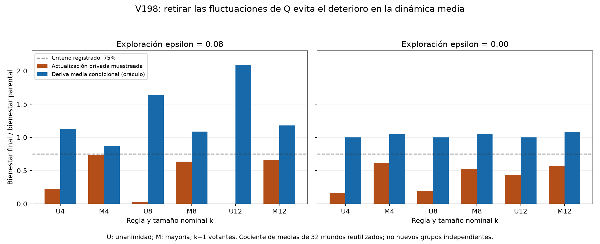
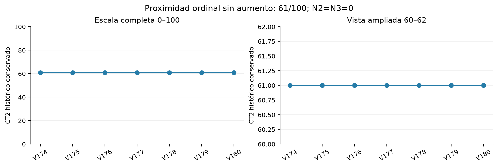

# V198: el deterioro privado no identifica por sí solo incentivos destructivos

15/11/2026. Diagnóstico terminado y auditado. Doce continuaciones deterministas de seis poblaciones existentes;32mundos×20grupos por escenario. No hay nuevas raíces de entrenamiento ni una institución aprendida. CT2 histórico61sin cambios, rama nueva sin puntuación, N2=N3=0.

## Resultado causal que cambia la interpretación

Sustituir cada incremento aleatorio de Q por su esperanza condicional, preservando la frecuencia esperada de visitas y alpha.10, conserva al menos75%del bienestar parental en6/6escenarios con epsilon.08y en6/6con epsilon0. Las actualizaciones privadas muestrales originales, corregidas por V197, conservan75%en0/6para ambas tasas de exploración. El control se registró después de conocer los fracasos muestrales y antes de integrar las dinámicas medias parentales.

| k | Regla | Retención muestral epsilon.08 | Retención con deriva media epsilon.08 |
|---:|---|---:|---:|
|4|UNANIMITY|0.2234|1.1325|
|4|MAJORITY|0.7340|0.8750|
|8|UNANIMITY|0.0297|1.6345|
|8|MAJORITY|0.6345|1.0855|
|12|UNANIMITY|0.0025|2.0852|
|12|MAJORITY|0.6626|1.1774|

Retención es el cociente entre bienestar medio final y bienestar medio inicial, no la media de cocientes por grupo. El punto final es8000, sin selección de máximos. Puede superar1cuando el operador mejora la política. En unanimidad k12, el valor medio pasa de.140297a.292549bajo deriva media epsilon.08; la continuación muestral acaba en.000354. En epsilon0, la dinámica media de ese caso conserva99.82%, frente a43.99%en la muestral. No se usa la ausencia de exploración para afirmar ausencia de ruido en el retorno.

## Intervención y límites de identificación

Para cada estado privado s y acción a se integra el incremento `alpha*Pr(s)*pi_i(a|s)*(E[r_i|s,do(a),pi_-i]−Q_i(s,a))`, con las políticas anteriores a la actualización. Las probabilidades de estado/señal y las acciones ajenas se marginalizan usando la regla de ratificación y las pérdidas individuales. Los valores alternativos no se actualizan con una tasa artificialmente igual: se pondera su cobertura esperada de visitas. Los objetivos de cada individuo conservan su utilidad privada, aunque su cálculo requiere el modelo y los otros perfiles.

El operador es ORÁCULO y contrafactual. No es un agente que pueda calcular esos objetivos usando solo su pago realizado. Iterar esperanzas condicionales tampoco es tomar la esperanza de la trayectoria estocástica completa: el cambio de política es no lineal. El resultado demuestra suficiencia de esta sustitución para evitar el deterioro bajo estas condiciones; no identifica una solución descentralizada realizable ni garantiza un equilibrio estable a horizonte infinito.

V196 demostraba que sus Q concretas no se sostienen sin el pulso mientras continúan actualizándose. V198 restringe una interpretación más fuerte: ese fracaso, incluso con epsilon0, no basta para inferir que los incentivos medios destruyan necesariamente la cooperación, ni que una institución externa permanente sea intrínsecamente necesaria. Al retirar las fluctuaciones de actualización el mismo punto de partida permanece productivo o mejora durante el horizonte fijado. Sigue abierta la interacción entre tamaño de paso constante, discontinuidades de política, no estacionariedad e incentivos privados.

Las oportunidades de desviación unilateral detectadas por V195A no desaparecen de la evidencia. Una política puede durar bajo un algoritmo sin ser un equilibrio bayesiano. Tampoco se confunde estabilidad del perfil codicioso evaluado con bienestar de la conducta que explora.

## Controles, antecedentes y siguiente rival fuerte

El código/protocolo se congeló en GitHub `aef89672df24c52bb39d50a7fa777505d9c9cd9e` antes de integrar las trayectorias; nueve archivos se verificaron mediante bytes HTTP y siete padres/contextos se fijaron por hash. La validación previa comprueba1000objetivos condicionales en50fixtures contra enumeración explícita, error máximo1.78e−15. El evaluador final independiente por convolución reproduce768valores mundo/extremo, error máximo5.55e-17; los doce estados iniciales corresponden exactamente a sus padres. Es independencia técnica de cálculo, no confirmación científica externa.

Los problemas de coordinación entre aprendices y la tolerancia a malos retornos ya se estudian en [Panait, Tuyls y Luke2008](https://www.jmlr.org/papers/v9/panait08a.html). La actualización asimétrica de errores tiene un rival directo en [Matignon, Laurent y Le Fort-Piat2007](https://doi.org/10.1109/IROS.2007.4399095). La selección estratégica por pivotalidad tiene antecedentes clásicos en [Feddersen y Pesendorfer1998](https://doi.org/10.2307/2585926). Se consultaron resúmenes/metadatos y, para el último, introducción y formulación del modelo; no se afirma lectura de todas las pruebas. Sus algoritmos originales no se ejecutaron en V198.

El paso científico siguiente debe enfrentar el mecanismo a aprendices privados competentes, empezando por hysteretic/lenient Q y estimación de menor varianza, con protección contra aprobar acuerdos perjudiciales. Si un algoritmo conocido conserva la cooperación, no hay base para inventar una institución para solucionar ese fallo ni para atribuir originalidad a hacerlo. Si persiste frente a esos rivales, tendría sentido estudiar compromisos y financiación voluntaria bajo incentivos auditados. Ninguna de esas pruebas se cuenta como realizada aquí.

## Evaluación AB y preservación

V197 corrige los extremos de la línea de votación sin borrar sus negativos. V195 neuronal demuestra apoyo contrafactual transitorio suficiente después de memorizar; V198 de votación diagnostica dependencia del procedimiento de actualización. Son tareas distintas, sin una ley social común demostrada. Se preservan fuentes, pesos, momentos, políticas iniciales/finales y fallos, y se prepara un manuscrito nuevo manteniendo las versiones anteriores.

La figura de CT2 corresponde a la rama histórica y no puntúa esta nueva línea. No se añade un hallazgo1/3por una comprobación numérica ni se eleva el61por completar estos controles. La originalidad y la confirmación independiente siguen sin acreditarse. El objetivo global permanece activo.
