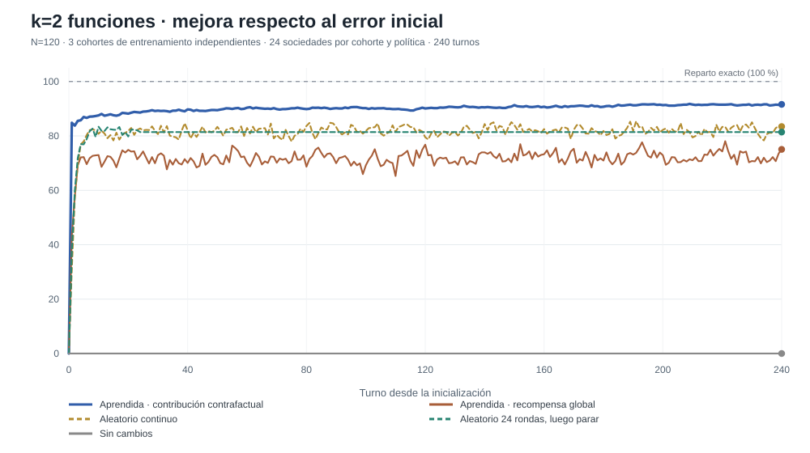
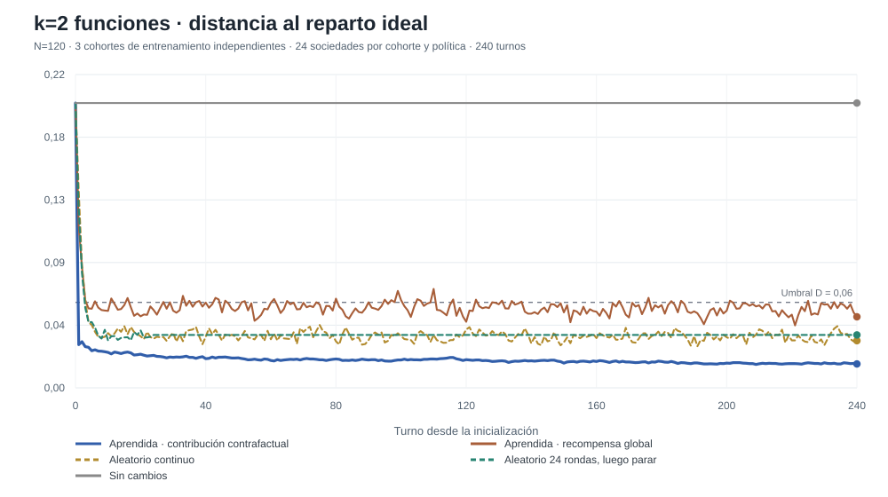
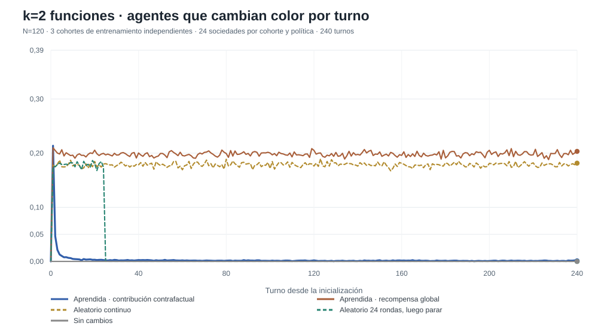
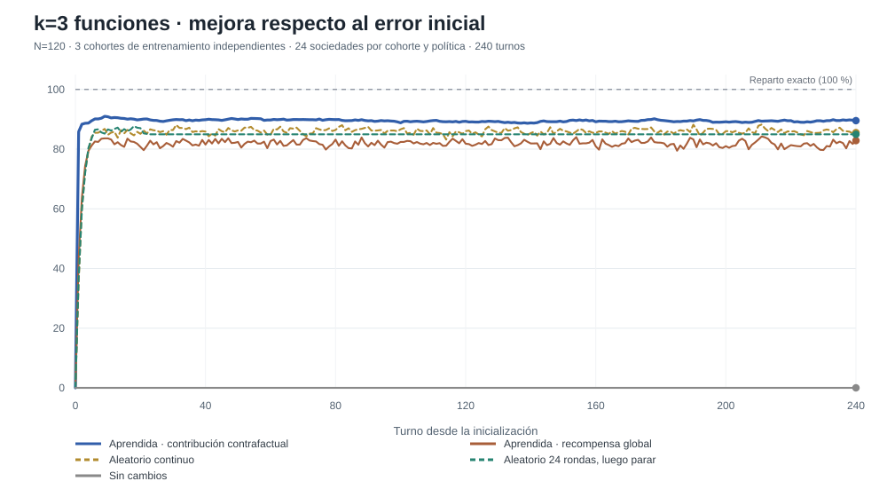
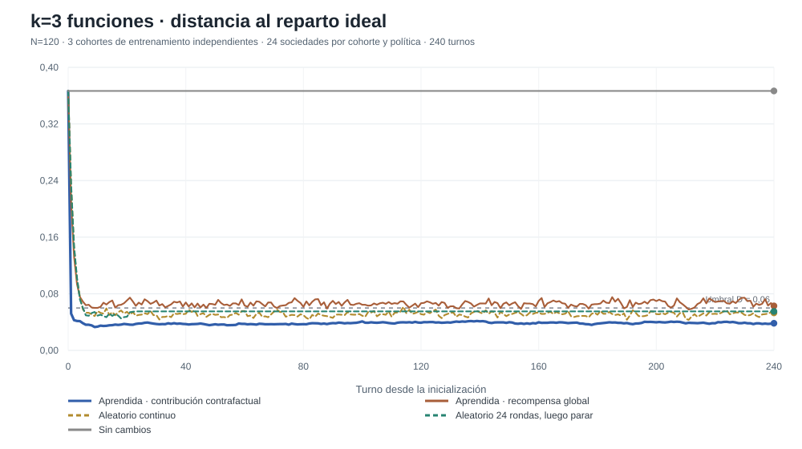
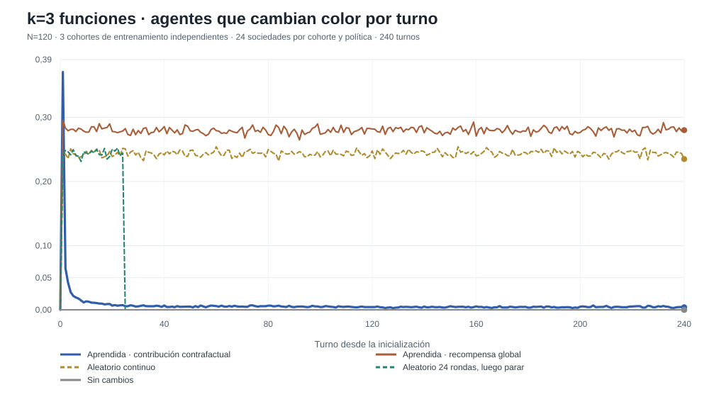
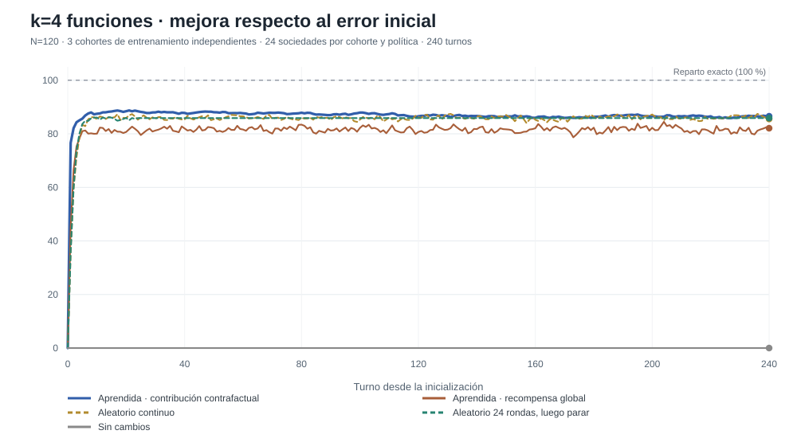
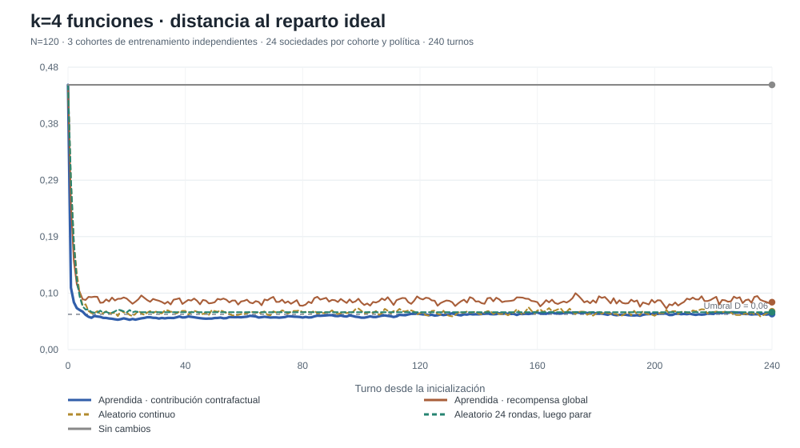
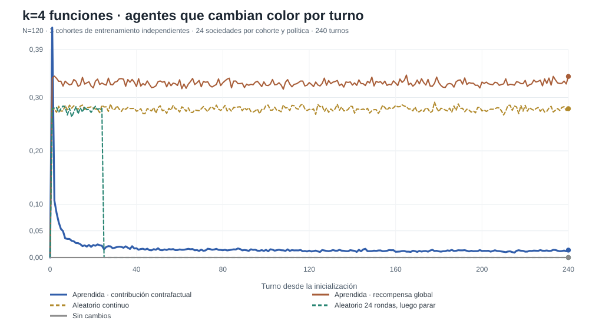

# V2-E — Curvas temporales de coordinación aprendida y aleatoria

**Fecha:** 10 de noviembre de 2026. **Diseño:** [PREREG_LONGITUDINAL.md](PREREG_LONGITUDINAL.md).

Se mide N=120 agentes durante 240 turnos, con k=2,3,4 funciones, mediante 3 cohortes de aprendizaje independientes y 24 sociedades nuevas por cohorte. Todas comienzan con 70% de los agentes en un mismo color, cuyo nombre se aleatoriza. Los modelos están congelados (sin aprendizaje en test).

**Eje «progreso».** La variable P(t)=100·[1−D(t)/D(0)] es el **porcentaje de reducción de error desde el inicio**, con D la distancia de variación total al reparto 1/k. P=100 significa equilibrio exactamente perfecto. P=80 NO significa 80% de agentes correctamente asignados ni 80% de aciertos en una clasificación; solo que se redujo un 80% el desequilibrio inicial.

**Criterio de estabilidad distinto del progreso.** Además de una buena D final, se exige D≤0,06 y ≤5% de agentes cambiando por turno durante los últimos 10 turnos. Un aleatorio que continúa actuando puede presentar P alto pero 0% de estabilidad. El aleatorio que se detiene tras 24 turnos es un control diseñado con reloj externo, no una política adaptativa.

## 2 funciones

| Condición | Reducción del error al turno 240 | D al turno 240 | Estables /72 | Churn final | Cambio D promedio 200–240 vs160–200 |
|---|---:|---:|---:|---:|---:|
| Aprendida · contribución contrafactual | 91,6% | 0,017 | 72/72 | 0,001 | -0,0007 |
| Aprendida · recompensa global | 75,1% | 0,050 | 0/72 | 0,200 | 0,0007 |
| Aleatorio continuo | 83,4% | 0,033 | 0/72 | 0,179 | -0,0001 |
| Aleatorio 24 rondas, luego parar | 81,4% | 0,037 | 57/72 | 0,000 | 0,0000 |
| Sin cambios | 0,0% | 0,200 | 0/72 | 0,000 | 0,0000 |

## 3 funciones

| Condición | Reducción del error al turno 240 | D al turno 240 | Estables /72 | Churn final | Cambio D promedio 200–240 vs160–200 |
|---|---:|---:|---:|---:|---:|
| Aprendida · contribución contrafactual | 89,6% | 0,038 | 56/72 | 0,004 | 0,0002 |
| Aprendida · recompensa global | 82,9% | 0,063 | 0/72 | 0,282 | 0,0006 |
| Aleatorio continuo | 85,5% | 0,053 | 0/72 | 0,242 | 0,0002 |
| Aleatorio 24 rondas, luego parar | 85,0% | 0,055 | 48/72 | 0,000 | 0,0000 |
| Sin cambios | 0,0% | 0,367 | 0/72 | 0,000 | 0,0000 |

## 4 funciones

| Condición | Reducción del error al turno 240 | D al turno 240 | Estables /72 | Churn final | Cambio D promedio 200–240 vs160–200 |
|---|---:|---:|---:|---:|---:|
| Aprendida · contribución contrafactual | 86,6% | 0,060 | 31/72 | 0,013 | 0,0001 |
| Aprendida · recompensa global | 82,1% | 0,081 | 0/72 | 0,331 | 0,0008 |
| Aleatorio continuo | 85,5% | 0,065 | 0/72 | 0,279 | -0,0001 |
| Aleatorio 24 rondas, luego parar | 85,9% | 0,064 | 42/72 | 0,000 | 0,0000 |
| Sin cambios | 0,0% | 0,450 | 0/72 | 0,000 | 0,0000 |

## Auditoría e interpretación

Todos los puntos temporales proceden de los archivos completos en [longitudinal_v2e](longitudinal_v2e), 45 archivos por condición/cohorte/tarea y curvas de 241 observaciones. [SUMMARY.json](longitudinal_v2e/SUMMARY.json) contiene medias agregadas calculadas sin seleccionar las cohortes exitosas. Las primeras 24 actualizaciones de random_T24 son aleatorias; desde la 25 no hay mensajes ni cambios y por eso su curva se vuelve estrictamente horizontal. No es aprendizaje.

Las tres cohortes de actores con crédito contrafactual aprendieron estrategias bajo supervisión global del **entrenador**, mientras los actores solamente vieron colores locales, solicitudes y el feedback global escalar anterior. Por ello es aprendizaje descentralizado en ejecución, **pero no** aprendizaje con refuerzo global puro exclusivamente. El control credit0 sí usa solamente refuerzo común en gradiente, con crítico global durante entrenamiento.

No afirmar convergencia matemática a un punto fijo por observar una meseta en media de 240 turnos: el comportamiento puede variar entre sociedades, y el promedio aleatorio puede ser plano mientras cada sociedad sigue cambiando. La prueba causal social no se ha realizado.
