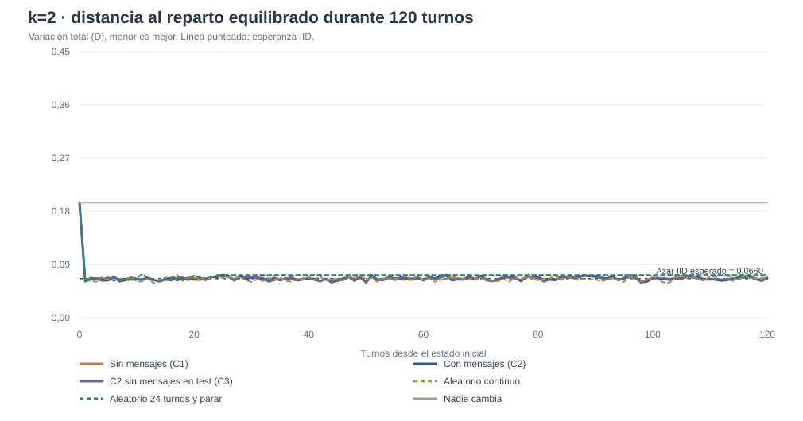
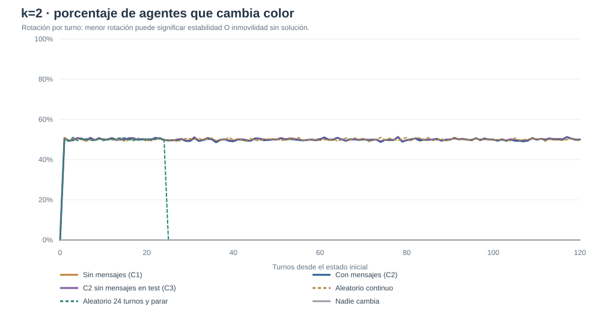
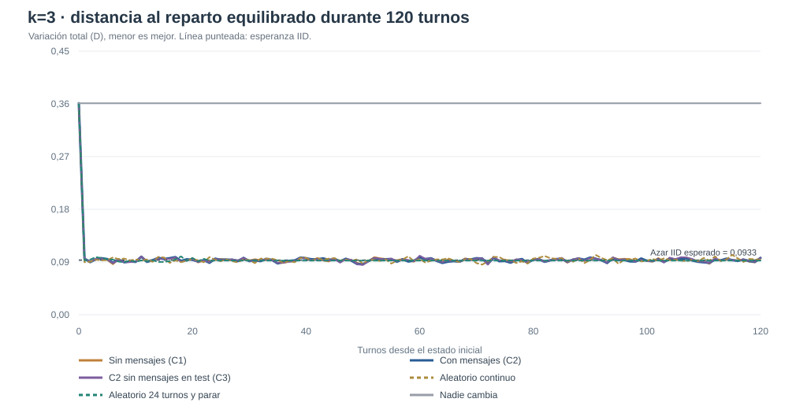
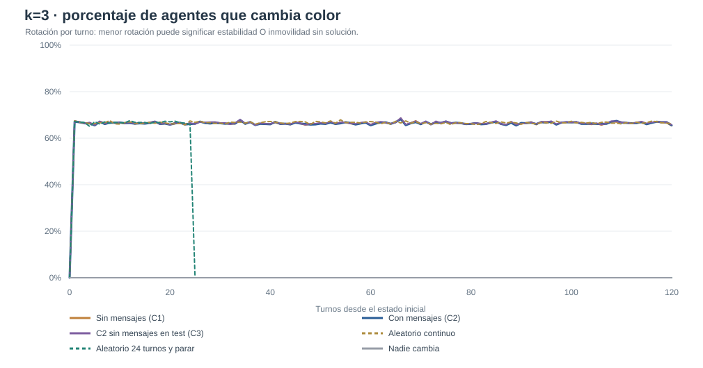
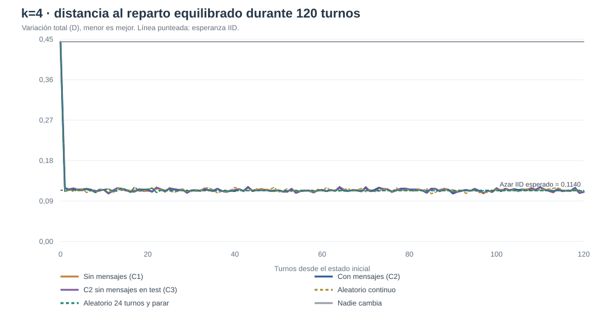
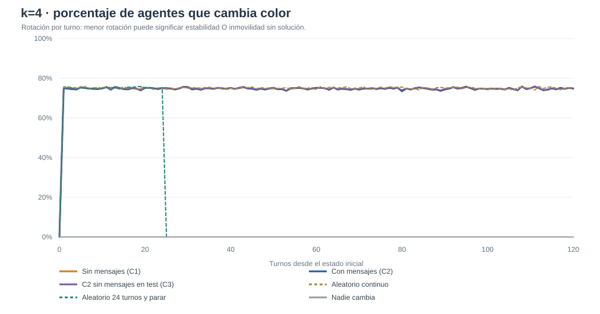

# V3B — Agentes individuales con recompensa colectiva: primera evaluación reservada

**Fecha:** 10/11/2026. **Protocolo anterior al entrenamiento:** [PREREG_V3B_C1C2.md](PREREG_V3B_C1C2.md). **Código del test:** [evaluate_v3b.py](evaluate_v3b.py).

## Resumen

Se entrenaron seis poblaciones (3 semillas 311–313 × C1 sin mensajes/C2 con mensajes) mediante **120 actualizaciones, 12 mundos y 24 turnos por actualización** (1.440 episodios por población, 8.640 entre todas). Cada agente de cada población posee su propia política neuronal, entrenada sin compartir pesos ni gradientes con otros y sin premio específico por sus decisiones. La única recompensa es r=N(D_t−D_{t+1}), igual para todos los agentes del mundo. Todos pueden cambiar su propio color incluso sin recibir mensajes. Los mensajes de C2 incluyen color sugerido y snapshot del vecindario del emisor.

Se bloquearon hashes de código y de los seis checkpoints finales en [holdout_v3b/LOCK.json](holdout_v3b/LOCK.json) ANTES de evaluar. Se emplearon 100 sociedades nuevas por semilla de entrenamiento, k y condición; por tanto hay 300 sociedades test por k×condición, pero **solo tres inicializaciones independientes del aprendizaje**.

**Resultado principal: no se observó estabilidad sostenida en ninguna de las sociedades C1, C2 o C3** (0/300 por k), mientras el control aleatorio con parada programada al turno 24 sí consiguió estabilidad parcial. La diferencia C2–C1 en distancia es pequeña, varía de signo y no muestra ventaja consistente de comunicación bajo esta configuración. La distancia final se mantiene alrededor de la referencia aleatoria IID. No se ha demostrado emergencia de cooperación.

## Comparación íntegra al turno 120

| k | Condición | Distancia D | D / E[D_IID] | Estables (sobre 300) | D=0 exacta | Churn últimos 10 |
|---|---|---:|---:|---:|---:|---:|
| 2 | Sin mensajes (C1) | 0,0661 | 1,001 | 0/300 | 38/300 | 50,3% |
| 2 | Con mensajes (C2) | 0,0669 | 1,012 | 0/300 | 37/300 | 50,2% |
| 2 | C2 sin mensajes en test (C3) | 0,0683 | 1,035 | 0/300 | 33/300 | 50,4% |
| 2 | Aleatorio continuo | 0,0695 | 1,053 | 0/300 | 38/300 | 49,8% |
| 2 | Aleatorio 24 turnos y parar | 0,0723 | 1,095 | 162/300 | 31/300 | 0,0% |
| 2 | Nadie cambia | 0,1944 | 2,945 | 0/300 | 0/300 | 0,0% |
| 3 | Sin mensajes (C1) | 0,0964 | 1,033 | 0/300 | 8/300 | 66,5% |
| 3 | Con mensajes (C2) | 0,0970 | 1,040 | 0/300 | 9/300 | 66,5% |
| 3 | C2 sin mensajes en test (C3) | 0,0974 | 1,044 | 0/300 | 8/300 | 66,7% |
| 3 | Aleatorio continuo | 0,0939 | 1,007 | 0/300 | 8/300 | 66,7% |
| 3 | Aleatorio 24 turnos y parar | 0,0924 | 0,991 | 109/300 | 11/300 | 0,0% |
| 3 | Nadie cambia | 0,3611 | 3,872 | 0/300 | 0/300 | 0,0% |
| 4 | Sin mensajes (C1) | 0,1109 | 0,973 | 0/300 | 0/300 | 74,7% |
| 4 | Con mensajes (C2) | 0,1103 | 0,967 | 0/300 | 0/300 | 74,8% |
| 4 | C2 sin mensajes en test (C3) | 0,1102 | 0,966 | 0/300 | 1/300 | 74,8% |
| 4 | Aleatorio continuo | 0,1137 | 0,997 | 0/300 | 1/300 | 75,0% |
| 4 | Aleatorio 24 turnos y parar | 0,1131 | 0,992 | 58/300 | 4/300 | 0,0% |
| 4 | Nadie cambia | 0,4444 | 3,898 | 0/300 | 0/300 | 0,0% |

## Evolución temporal

Las curvas son medias descriptivas de tres cohortes y 100 sociedades por cohorte. Cada curva incluye el instante 0 y 120 turnos; no selecciona solo sociedades exitosas. Churn ≈ 50%, 67%, 75% en k2/3/4 es compatible con volver a elegir uniformemente entre k colores cada turno, una señal de que aún no se ha aprendido a conservar la distribución.

### k=2

### k=3

### k=4

## Interpretación estricta

Los sujetos C1 no disponen de canal de peticiones, pero observan los colores de sus vecinos y pueden cambiar voluntariamente su color. C2 añade información y propuestas dirigidas a un único vecino por emisor, con recepción múltiple. C3 reutiliza los pesos de C2 al bloquear mensajes en test, permitiendo siempre cambios voluntarios. Una diferencia de C3 respecto a C2 sería dependencia de entrada bajo cambio de distribución; no una prueba universal de necesidad de mensajes.

El «0% aleatorio continuo» no implica que la asignación numérica sea mala: el control no deja de cambiar. El control aleatorio que se detiene en t=24 incorpora una regla temporal escrita por el investigador, distinta de aprendizaje. Por su parte, el objetivo D/E[D_IID]<1 no significa óptimo físico ni hiperuniformidad espacial. Evitar atribuir diferencias de 0,001 en D a una mejora replicada con tres cohortes.

El entrenamiento REINFORCE se construyó con baseline leave-one-out de otros mundos del mismo k, igual para todos los individuos del mundo. No hubo crítico central entrenable ni atribuciones individuales de mérito. El código de los actores aplica un mismo scorer por candidato de color dentro de cada persona, pero cada persona tiene θ_i distinto. En este primer estudio se usa memoria W1: estado actual más último escalar de feedback, NO memorias recurrentes de varias rondas. Estudiar el crédito temporal y la memoria podría constituir otro experimento prospectivo, no una corrección retrospectiva de estos resultados.

## Limitaciones y próximos contrastes

El fracaso es específico del número de actualizaciones y el diseño de tarea, no demuestra imposibilidad teórica. La escasa variación del gradiente y el comportamiento estocástico casi uniforme sugieren una señal de aprendizaje débil, pero habría que probarlo con mediciones directas. Ya se registró un aumento del presupuesto a 600 actualizaciones [PREREG_V3B_LONGRUN.md](PREREG_V3B_LONGRUN.md), como análisis exploratorio posterior al resultado negativo.

**Reproducibilidad:** resultados individuales en [holdout_v3b](holdout_v3b) con las 54 condiciones×cohorte×k; [SUMMARY.json](holdout_v3b/SUMMARY.json) y [AGGREGATES.json](holdout_v3b/AGGREGATES.json), pesos finales de seis experimentos en runs/v3b_seed{311,312,313}_{C1,C2}_updates120, cada uno con TRAINING_LOG.json y CONFIG.json.
