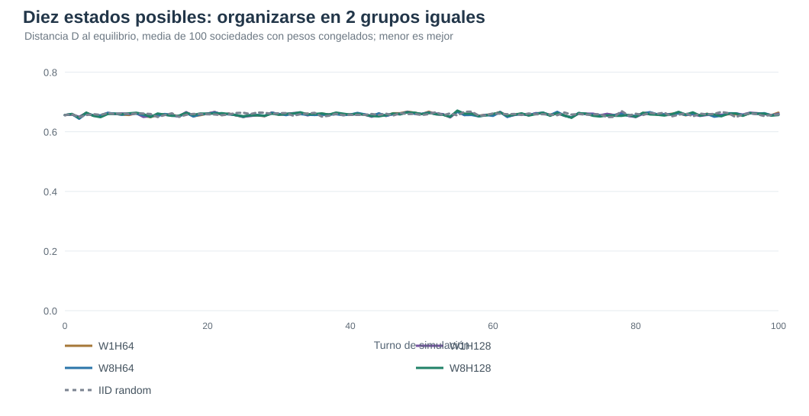
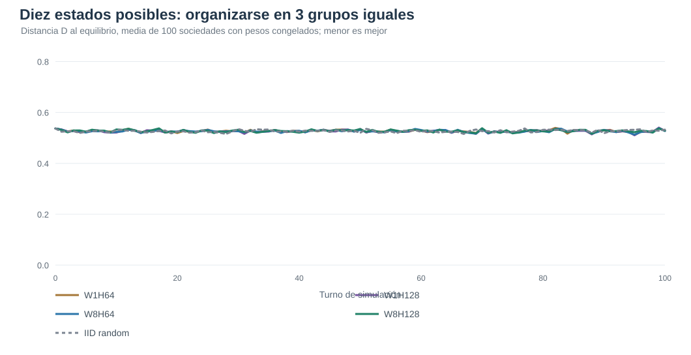
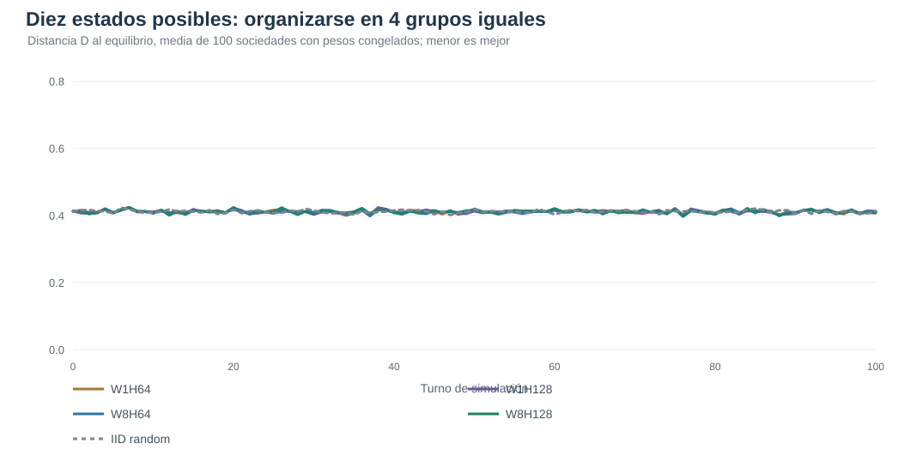

# V5 — Memoria temporal y capacidad neuronal en cooperación multiagente

**Experimento exploratorio de 10/11/2026**, posterior a los resultados V4. Protocolo congelado en [PREREG_V5.md](PREREG_V5.md), implementación en [agents_memory.py](agents_memory.py), entrenamiento en [train_v5.py](train_v5.py), y evaluación con bloqueo de pesos/código en [evaluate_v5.py](evaluate_v5.py).

Los cuatro modelos tienen N=36 políticas individuales distintas, diez estados disponibles y objetivo k=2/3/4 estados seleccionados espontáneamente a cuotas iguales, con comunicaciones locales permitidas y recompensa exclusivamente colectiva. Solo se cambian memoria de 1 u 8 turnos y ancho H64/H128 de dos capas neuronales ocultas, sin planificación explícita ni acceso al censo mundial. Un único entrenamiento seed521 por arquitectura, 150 actualizaciones ×12 mundos ×32 turnos. Evaluación con pesos congelados en 100 sociedades nuevas por k, 100 turnos por sociedad. Los mundos de test NO son 100 replicaciones independientes de entrenamiento.

## Evaluación principal: comportamiento estocástico entrenado

| k | Memoria | Hidden | Distancia D | D / referencia IID10 | Estados usados, media | Exactos | Estables | Churn último tramo |
|---:|---:|---:|---:|---:|---:|---:|---:|---:|
| 2 | 1 | 64 | 0,6642 | 1,008 | 9,69 | 0/100 | 0/100 | 89,1% |
| 2 | 1 | 128 | 0,6608 | 1,003 | 9,67 | 0/100 | 0/100 | 89,4% |
| 2 | 8 | 64 | 0,6581 | 0,998 | 9,71 | 0/100 | 0/100 | 89,7% |
| 2 | 8 | 128 | 0,6561 | 0,996 | 9,73 | 0/100 | 0/100 | 89,8% |
| 3 | 1 | 64 | 0,5286 | 1,004 | 9,85 | 0/100 | 0/100 | 89,3% |
| 3 | 1 | 128 | 0,5272 | 1,001 | 9,85 | 0/100 | 0/100 | 89,6% |
| 3 | 8 | 64 | 0,5278 | 1,002 | 9,83 | 0/100 | 0/100 | 90,0% |
| 3 | 8 | 128 | 0,5283 | 1,003 | 9,82 | 0/100 | 0/100 | 90,0% |
| 4 | 1 | 64 | 0,4122 | 1,003 | 9,78 | 0/100 | 0/100 | 88,9% |
| 4 | 1 | 128 | 0,4106 | 0,999 | 9,78 | 0/100 | 0/100 | 89,2% |
| 4 | 8 | 64 | 0,4089 | 0,995 | 9,78 | 0/100 | 0/100 | 89,5% |
| 4 | 8 | 128 | 0,4067 | 0,989 | 9,79 | 0/100 | 0/100 | 89,3% |
Azar uniforme continuo (k=2): D=0,6578, estados ocupados=9,78, estabilidad=0/100.
Azar uniforme continuo (k=3): D=0,5325, estados ocupados=9,85, estabilidad=0/100.
Azar uniforme continuo (k=4): D=0,4133, estados ocupados=9,83, estabilidad=0/100.

## Comparación con los mismos modelos SIN entrenar (selección greedy)

| k | Memoria | Hidden | D sin entrenar | D entrenado | Soluciones exactas entrenadas |
|---:|---:|---:|---:|---:|---:|
| 2 | 1 | 64 | 0,4953 | 0,5789 | 0/100 |
| 2 | 1 | 128 | 0,5217 | 0,4975 | 0/100 |
| 2 | 8 | 64 | 0,6383 | 0,6208 | 0/100 |
| 2 | 8 | 128 | 0,6394 | 0,6400 | 0/100 |
| 3 | 1 | 64 | 0,3108 | 0,4464 | 0/100 |
| 3 | 1 | 128 | 0,3783 | 0,3356 | 0/100 |
| 3 | 8 | 64 | 0,5050 | 0,4819 | 0/100 |
| 3 | 8 | 128 | 0,5033 | 0,5000 | 0/100 |
| 4 | 1 | 64 | 0,2264 | 0,3375 | 0/100 |
| 4 | 1 | 128 | 0,2539 | 0,2597 | 0/100 |
| 4 | 8 | 64 | 0,3825 | 0,3714 | 0/100 |
| 4 | 8 | 128 | 0,3881 | 0,3964 | 0/100 |

## Ablación de memoria con los pesos W8 congelados

La intervención no_history borra el historial de W8 antes de cada turno, manteniendo arquitectura, pesos y comunicaciones intactos. Una diferencia demuestra dependencia funcional de esa entrada en una política concreta, con posible cambio de distribución; no prueba necesidad universal de memoria.

| k | Hidden | D W8 normal | D W8 sin historial | Diferencia sin−con |
|---:|---:|---:|---:|---:|
| 2 | 64 | 0,6581 | 0,6619 | 0,0039 |
| 2 | 128 | 0,6561 | 0,6614 | 0,0053 |
| 3 | 64 | 0,5278 | 0,5314 | 0,0036 |
| 3 | 128 | 0,5283 | 0,5297 | 0,0014 |
| 4 | 64 | 0,4089 | 0,4133 | 0,0044 |
| 4 | 128 | 0,4067 | 0,4136 | 0,0069 |

## Curvas 0..100 turnos

Los gráficos incluyen todas las sociedades de cada grupo, no seleccionan una submuestra favorable. D=0 expresa la cuota exacta con solo k estados ocupados.

### Objetivo 2 estados

### Objetivo 3 estados

### Objetivo 4 estados

## Interpretación y límites

La distancia D mide el desajuste de los diez conteos con el mejor subconjunto de exactamente k colores. D bajo no demuestra estabilidad si el churn continúa elevado. El control sin entrenamiento detecta sesgos arquitectónicos que producen repartos aparentes sin aprendizaje. W1/W8 es memoria temporal explícita y no GRU/LSTM ni deliberación o planificación simbólica.

Un solo entrenamiento por condición y un presupuesto corto de 150 actualizaciones impiden concluir universalmente sobre la capacidad de aprender estrategias. Si existe una señal favorable, hace falta replicar sobre varios seeds de pesos e intervenir sobre la memoria manteniendo fija la política y las condiciones iniciales. C1 sin mensajes no está incluido en este factorial, por lo que no se atribuye ninguna diferencia a la comunicación.

Todos los JSON individuales, las curvas y los hashes de cierre están disponibles en [holdout](holdout). Los pesos y registros integrales se encuentran en runs/W{1,8}_H{64,128}_C2_seed521_u150.
