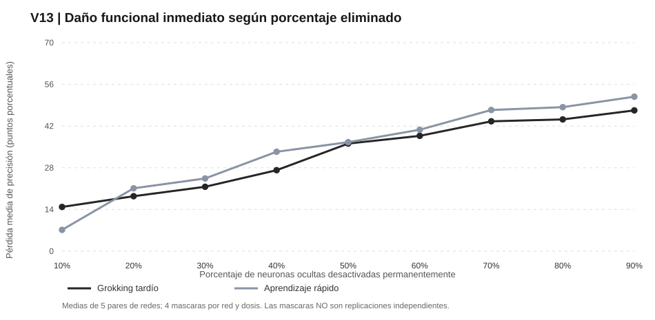
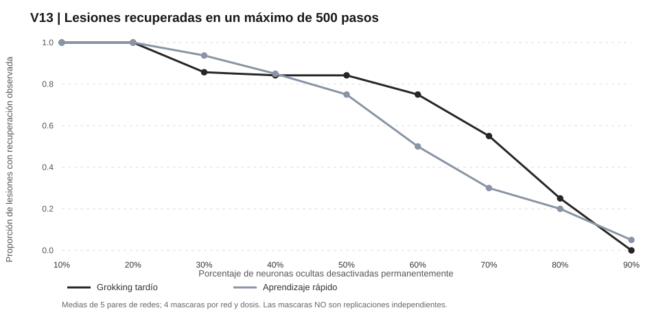
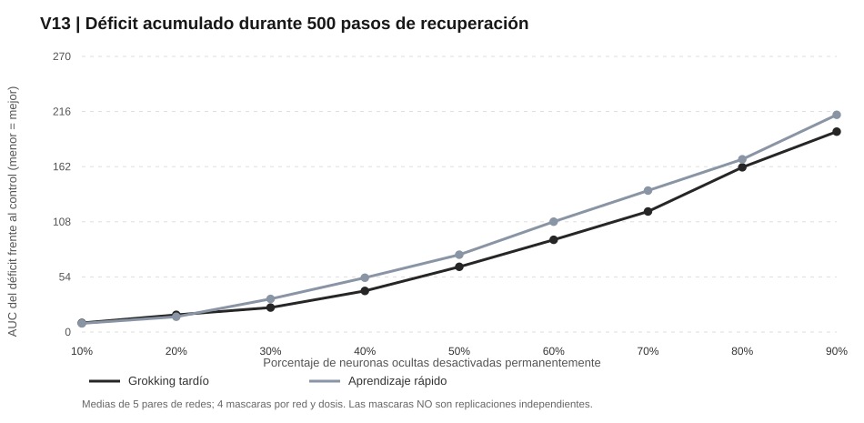

# V13 — Curva de dosis de ablación neuronal y recuperación funcional

**Equipo:** GALEXY_TRAVEL. **Fecha:** 9 de noviembre de 2026. **Estado:** exploratorio, condicionado por el diseño V10–V12. No constituye un experimento causal del grokking.

## La pregunta

Si dos redes llegan al 100% de acierto mediante trayectorias diferentes y posteriormente comparten el mismo régimen de regularización, ¿cómo cambian su resistencia y su capacidad de recuperación al eliminar porcentajes cada vez mayores de neuronas ocultas?

Se entiende por **eliminación** fijar permanentemente a cero la contribución de las neuronas dañadas. El aprendizaje posterior actualiza pesos **supervivientes**: no crece ninguna neurona nueva. Esta es una simulación de reorganización funcional tras ablación, no de regeneración biológica.

## Diseño auditable

Cinco parejas de modelos elegibles heredadas de V12 (semillas 11, 12, 13, 14 y 18), tarea de paridad de 3 bits relevantes entre 30 y MLP con 300 neuronas ReLU. El brazo A muestra grokking tardío con L1 inicial 1e-5; el B alcanza el 100% más rápidamente con L1 inicial 0,001. Ambos fueron después entrenados durante 4.000 actualizaciones con L1 común 0,0001, terminando con 100% de precisión en validación. **La regularización histórica desigual sigue siendo confusora de cualquier efecto causal de grokking.**

Se predefinieron nueve dosis, 10–90% en intervalos del 10%, y cuatro máscaras anidadas por red y dosis, compartidas dentro de cada pareja. En total 360 reconstrucciones con AdamW nuevo LR 0,001, WD=0, CE + L1=0,0001, horizonte fijo de 500 actualizaciones, más controles intactos. Se midió train/val; no se consultó el test de V13. Protocolo en [PREREG_V13_DOSE.md](PREREG_V13_DOSE.md), código en [v13_dose.py](v13_dose.py), registros y auditoría en [V13_ANALYSIS.json](V13_ANALYSIS.json).

Las máscaras son observaciones anidadas; la unidad independiente es el **par de redes** (n=5). Máscaras mayores contienen los índices de dosis menores dentro de cada semilla, favoreciendo comparaciones longitudinales de dosis.

## 1. Robustez inmediata

| Neuronas destruidas | Daño A, tardío (pp) | Daño B, rápido (pp) | Diferencia A−B (pp) |
|---|---:|---:|---:|
| 10% | 14,9 | 7,2 | 7,7 |
| 20% | 18,5 | 21,1 | -2,7 |
| 30% | 21,6 | 24,4 | -2,8 |
| 40% | 27,2 | 33,4 | -6,2 |
| 50% | 36,1 | 36,6 | -0,5 |
| 60% | 38,7 | 40,8 | -2,1 |
| 70% | 43,6 | 47,4 | -3,8 |
| 80% | 44,2 | 48,4 | -4,1 |
| 90% | 47,3 | 51,9 | -4,6 |

El daño medio aumenta con el número de neuronas eliminadas, pero **dos máscaras con la misma dosis pueden producir efectos muy diferentes**. Algunas destruyen gran parte del rendimiento incluso al 10% y otras apenas lo alteran. Los porcentajes nominales no son equivalentes a una intensidad de daño funcional igual. Por interacciones entre unidades, el acierto de una red particular tampoco tiene que ser monótono al ampliar una máscara.

## 2. Recuperación observada hasta 500 actualizaciones

| Dosis | Recuperaron A / lesión efectiva A | Recuperaron B / lesión efectiva B |
|---|---:|---:|
| 10% | 11/11 | 6/6 |
| 20% | 12/12 | 16/16 |
| 30% | 12/14 | 15/16 |
| 40% | 16/19 | 17/20 |
| 50% | 16/19 | 15/20 |
| 60% | 15/20 | 10/20 |
| 70% | 11/20 | 6/20 |
| 80% | 5/20 | 4/20 |
| 90% | 0/20 | 1/20 |

Para distinguir robustez de reconstrucción, se consideran como **lesionadas efectivamente** las ejecuciones cuya precisión cayó inicialmente más de dos puntos porcentuales. La recuperación exige dos observaciones consecutivas con precisión de validación ≥99%. Las ramas que no llegaron dentro de 500 pasos se consideran **censuradas**: eso no es prueba de irreversibilidad absoluta.

Con 80% de neuronas eliminadas, solo 5/20 casos efectivos en A y 4/20 en B recuperaron. Con 90%, 0/20 en A y 1/20 en B. La evidencia describe un régimen de recuperación difícil bajo estas restricciones temporales y de optimización, no un umbral general de muerte irreparable. Un seguimiento V13B con máscaras nuevas y 2.000 pasos fue registrado después de observar este resultado, y se documenta aparte.

## 3. Déficit acumulado durante la reparación

| Dosis | AUC A | AUC B | A−B | Redes favorables A / B |
|---|---:|---:|---:|---:|
| 10% | 8,9 | 8,5 | 0,4 | 1 / 4 |
| 20% | 16,8 | 14,9 | 1,9 | 2 / 3 |
| 30% | 24,0 | 32,4 | -8,4 | 4 / 1 |
| 40% | 40,2 | 53,2 | -13,0 | 3 / 2 |
| 50% | 63,9 | 75,7 | -11,8 | 3 / 2 |
| 60% | 90,3 | 108,1 | -17,7 | 3 / 2 |
| 70% | 118,0 | 138,5 | -20,5 | 3 / 2 |
| 80% | 161,4 | 169,2 | -7,8 | 3 / 2 |
| 90% | 196,3 | 212,7 | -16,4 | 3 / 2 |

La AUC integra el déficit de acierto de la red dañada respecto a su propio control intacto desde 0 hasta 500 pasos; **menor significa menor déficit acumulado**. Combina magnitud del daño inicial y velocidad de reparación; para valorar recuperabilidad condicional también se registró AUC normalizada por daño en máscaras que efectivamente lesionaron ambos brazos.

**No emerge una ventaja uniforme por trayectoria.** Para ninguna de las nueve dosis se repite el mismo signo A−B en las cinco semillas. Todas las pruebas exploratorias exactas de inversión de signos arrojan p≥0,25; tampoco corrigen multiplicidad entre las nueve dosis. En dosis de 60–70% se recuperan más lesiones del brazo A, pero esa diferencia varía por red y no demuestra un efecto propio del grokking.

## Dictamen principal

**La dosis de destrucción y la identidad funcional de las unidades dañadas tienen una asociación clara con la recuperabilidad.** Redes con 100% inicial pueden quedarse sin recuperar el 99% en 500 pasos cuando pierden 80–90% de las unidades. La distinta distribución interna de funciones explica por qué el mismo porcentaje puede representar daños muy diferentes, aunque para atribuir mecanismos concretos harían falta intervenciones adicionales.

**No se acredita que el grokking mejore o empeore causalmente la recuperación.** Hay cinco parejas independientes, resultados mixtos por dosis, L1 histórica diferente y una tarea artificial específica. Tampoco se ha probado ausencia de todo efecto de trayectoria ni equivalencia entre modelos.

**Siguiente falsador:** [PREREG_V13B_LONG_RECOVERY.md](PREREG_V13B_LONG_RECOVERY.md) fija una extensión exploratoria a 2.000 pasos ante 90% de ablación, con otras máscaras. Si algunas redes tardan más pero sí se recuperan, la escasa recuperación V13 a 500 pasos refleja en parte un límite temporal; si no, solo puede concluirse que no recuperan bajo las condiciones y horizonte estudiados.

## Evidencias y reproducción

Datos crudos en la carpeta v13_dose_runs, con CSV de los 51 estados temporales y JSON por lesión, controles por red y listado completo de neuronas enmascaradas. Scripts: v13_dose.py, v13_analyze.py, v13_figures.py y v13_make_report.py. **Auditoría automática local PASS, 360/360 lesiones, máscaras emparejadas y anidadas, ningún error de cardinalidad, no finitos ni metadatos detectado**. No equivale a auditoría científica independiente.
