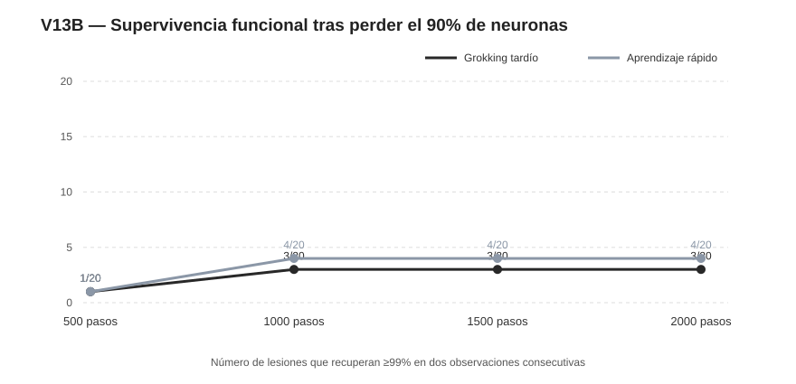

# V13B — ¿Basta con entrenar más para recuperarse de una lesión del 90%?

**Equipo:** GALEXY_TRAVEL. **Fecha:** 9 de noviembre de 2026. **Estudio exploratorio definido después de observar V13**, utilizando máscaras nuevas 4201..4204 y horizonte de 2.000 actualizaciones, en lugar de reutilizar las máscaras del barrido original. **No es un ensayo confirmatorio independiente** de V13.

## Diseño

Cinco parejas de redes idénticas en arquitectura y datos iniciales, con 300 neuronas ocultas, 100% validación antes del daño y L1 final común 0,0001. Se destruyen permanentemente 270 de 300 unidades (90%) con las mismas cuatro máscaras para cada pareja. Total 40 reconstrucciones y controles intactos bajo AdamW LR 0,001, CE+L1=0,0001, hasta 2.000 pasos, medidas cada25. El test no se consulta. Protocolo [PREREG_V13B_LONG_RECOVERY.md](PREREG_V13B_LONG_RECOVERY.md).

## Resultado principal

| Horizonte | A: grokking tardío | B: aprendizaje rápido |
|---|---:|---:|
| 500 pasos | 1/20 | 1/20 |
| 1000 pasos | 3/20 | 4/20 |
| 1500 pasos | 3/20 | 4/20 |
| 2000 pasos | 3/20 | 4/20 |

La pérdida inmediata media de validación fue A=49,65 puntos porcentuales y B=50,39. Tras 2.000 actualizaciones, únicamente 3/20 A y 4/20 B alcanzaron dos veces consecutivas el umbral de 99% de validación. La mayoría de las lesiones graves no se recuperó dentro de este horizonte. En cuatro de las cinco semillas hubo al menos una diferencia A/B de AUC, pero no hay una ventaja de signo estable: dos pares favorecen A y tres B.

El déficit acumulado de validación entre 0 y 2.000 pasos (AUC, menor mejor) fue A=748,35 y B=697,96. Diferencia media pareada A−B=50,39; p bilateral exacta exploratoria por inversión de signos=0,75. AUC mezcla daño inicial y duración de déficit; no identifica velocidad pura de reparación.

**Con más tiempo sí aparecieron algunas recuperaciones adicionales**, de manera que la falta de recuperación a 500 pasos no equivale a imposibilidad definitiva. No obstante, entre 1.000 y 2.000 pasos no se añadieron recuperaciones en estas cuarenta trayectorias. Tampoco se puede deducir un umbral estructural universal de muerte de redes: otros optimizadores, tareas, arquitecturas, inicializaciones o horizontes podrían modificarlo.

## Interpretación y controles

Esta es una prueba de **recuperabilidad funcional restringida**, no regeneración física. Las neuronas destruidas mantienen una máscara cero y las supervivientes deben reorganizarse para resolver la paridad. Incluso conservar 30 neuronas, suficiente en principio para representar una función de paridad sencilla, no garantiza llegar a una solución mediante el procedimiento de optimización estipulado.

El diseño conserva el confusor del L1 histórico y solo tiene cinco pares independientes de modelos; las cuatro máscaras por red están anidadas. Las 40 curvas no son cuarenta repeticiones independientes del fenómeno de aprendizaje. La prueba es post hoc frente a V13 y debe informarse como sensibilidad, no como descubrimiento preregistrado anterior.

## Reproducción

Datos por máscara y curvas CSV en v13b_long_runs; scripts v13b_long_recovery.py, v13b_analyze.py, v13b_make_report.py. [V13B_ANALYSIS.json](V13B_ANALYSIS.json) conserva la auditoría local PASS (40 trayectorias, máscaras emparejadas, 270 índices distintos por lesión, controles y AUC coherentes). El estudio amplio de dosis se presenta en [REPORT_V13.md](REPORT_V13.md).
