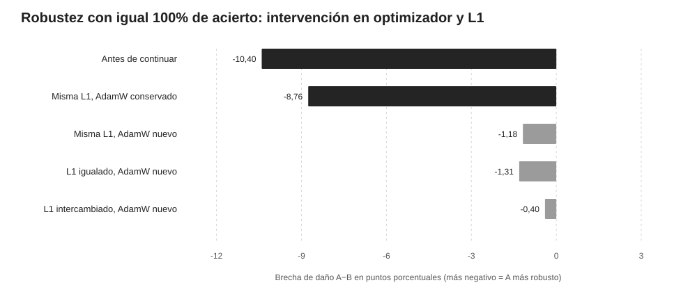

# V14 y V14B — La importancia de conservar el estado del optimizador

**Fecha:** 9 de noviembre de 2026. **Equipo:** GALEXY_TRAVEL. **Estado:** seguimiento exploratorio bajo controles experimentales de optimización. Ninguna comparación identifica aisladamente el efecto de «tener grokking»; la historia A/B está inducida por diferentes penalizaciones L1 iniciales.

## Objeto

Los modelos V10–V13 alcanzaron 100% de precisión y presentaron vulnerabilidades distintas a la eliminación neuronal. Tras 4.000 pasos con regularización L1 común se redujo fuertemente la diferencia, inicialmente atribuida a la regularización. Se diseñó un experimento factorial para comprobar si también se reduce simplemente con **el mismo tiempo de entrenamiento bajo L1 sin cambios**, y un control que restaura el **estado de AdamW** original en lugar de reiniciarlo.

## V14: tres tratamientos finales, todos con AdamW nuevo

Cohorte fija: cinco parejas V12 (semillas 11,12,13,14,18), MLP 300 unidades, tarea de paridad 3 de 30 bits, 100% validación en el checkpoint 6000. Cada red se clonó y prolongó exactamente 4.000 actualizaciones con L1 final 1e-5, 1e-4 o 1e-3; AdamW nuevo para cada clon, mismo LR0,001, WD0. Los **30 clones** mantuvieron 100% de validación, por lo que el contraste no está afectado por diferencias en número de respuestas correctas en el conjunto observado. Se aplicaron 100 máscaras nuevas de 90/300 unidades (30%), idénticas para todos los contrafactuales por semilla.

| Tratamiento tras paso 6000 | Brecha de daño A−B (pp) |
|---|---:|
| Antes de prolongar (mismas máscaras nuevas) | -10,40 |
| Manteniendo cada L1 original y reiniciando AdamW | -1,18 |
| Compartiendo L1=0,0001 y reiniciando AdamW | -1,31 |
| Intercambiando L1 entre grupos y reiniciando AdamW | -0,40 |

Todas las brechas se acercaron a cero. Esto refuta la explicación fuerte de que **igualar el L1 sea una condición necesaria** para observar la convergencia. Sin embargo, todos los tratamientos V14 reiniciaron el estado de AdamW, por lo que «4.000 pasos más» y «reiniciar el optimizador» todavía eran operaciones confundidas.

## V14B: el control que cambia la interpretación

Se repitió la continuación de 4.000 pasos preservando **exactamente los momentos y contadores del AdamW original** desde paso6000, manteniendo sin cambios la L1 de adquisición de cada modelo. Las diez ramas se conservaron al 100% en validación. Se aplicaron las mismas 100 máscaras físicas y se comparó con las ramas V14 de AdamW nuevo.

| Situación | Brecha A−B (pp) |
|---|---:|
| En el paso6000 | -10,40 |
| Paso10000 con AdamW original conservado | -8,76 |
| Paso10000 con AdamW nuevo, L1 original idéntica | -1,18 |

La diferencia media atribuible a cómo se manejó el optimizador en las comparaciones de brechas fue de **7,58 puntos porcentuales**. Es una intervención directa: los dos tratamientos parten de los mismos pesos, utilizan la misma L1 y realizan el mismo número de actualizaciones. En el grupo con AdamW original, la brecha pasa de -10,40 a -8,76; el cambio es pequeño y heterogéneo entre cinco semillas (prueba exploratoria bilateral de cambio, p=0,5). Con AdamW reiniciado, la brecha se reduce mucho más.

**Interpretación revisada:** la convergencia previamente observada no puede atribuirse sin más ni a igualar L1 ni al mero número adicional de actualizaciones. El tratamiento **reiniciar AdamW** es un factor explicativo importante dentro de estas trayectorias. Eso incluye sus momentos adaptativos y el contador de pasos, que influyen en la dirección y escala de las próximas actualizaciones. La magnitud del efecto cambia entre redes; no es una regla universal.

## Qué permanece sin demostrar

El experimento V14B no prueba que el grokking cause o impida resiliencia. Los grupos A/B siguen diferenciándose por L1 inicial, aunque la comparación con/reseteo del optimizador se hace dentro de un mismo checkpoint y es una intervención computacional controlada. También se necesita separar el mecanismo de márgenes, geometría y distribución de contribuciones neuronales. La precisión del 100% sobre validación no implica igual representación interna ni prueba sobre todas las entradas posibles.

Las 100 máscaras por modelo son dependientes de la red de origen; hay solo cinco pares independientes de adquisición. La evidencia es exploratoria, con múltiples comparaciones y una serie de correcciones que se conservan explícitamente para evitar seleccionar solo resultados favorables. Tampoco es comparable directamente el reinicio del optimizador durante una continuación intacta con un posible efecto durante la **reparación postlesión**.

## Próxima prueba directa

Precisamente por esta última limitación, [PREREG_V15_OPTIMIZER_REPAIR.md](PREREG_V15_OPTIMIZER_REPAIR.md) establece comparar reparación de **la misma red con la misma máscara permanente** bajo AdamW conservado versus reiniciado, usando CE+L1 y dosis de 30%,60%,90%. Eso permitirá medir el efecto del estado del optimizador en la recuperación y distinguirlo de la historia clasificatoria grokking/rápida.

## Evidencias reproducibles

V14 preregistro y scripts: [PREREG_V14_FACTORIAL.md](PREREG_V14_FACTORIAL.md), [v14_factorial_train.py](v14_factorial_train.py), [v14_factorial_robustness.py](v14_factorial_robustness.py), [v14_temporal_control.py](v14_temporal_control.py). Datos: [V14_ANALYSIS.json](V14_ANALYSIS.json), [V14_TEMPORAL_CONTROL.json](V14_TEMPORAL_CONTROL.json), carpeta v14_factorial con checkpoints y métricas.

V14B preregistro y scripts: [PREREG_V14B_OPTIMIZER.md](PREREG_V14B_OPTIMIZER.md), [v14b_optimizer_resume.py](v14b_optimizer_resume.py), [v14b_optimizer_analysis.py](v14b_optimizer_analysis.py), [V14B_ANALYSIS.json](V14B_ANALYSIS.json) y carpeta v14b_original_adam_moments.
