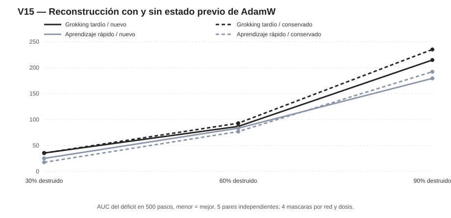

# V15 — Efecto del estado de AdamW sobre la recuperación tras la misma lesión

**Equipo:** GALEXY_TRAVEL. **Fecha:** 9 de noviembre de 2026. **Estado:** experimento computacional exploratorio, con protocolo fijado antes de reconstruir y lesionar. El efecto de conservar o reiniciar AdamW está intervenido **dentro de un mismo modelo**; no se ha intervenido causalmente en la entidad abstracta grokking.

## Pregunta y criterio de causalidad computacional

¿Si un modelo ya resuelve el 100% de los ejemplos evaluados y sufre exactamente la misma ablación permanente, cambia la recuperación por conservar el estado adaptativo de su optimizador en lugar de inicializarlo desde cero? Esto separa un componente del **mecanismo de aprendizaje** de la competencia y pesos neuronales, que permanecen idénticos al inicio de cada par.

Se reconstruyeron los diez checkpoints finales de V12 desde step6000 hasta step10000 con L1 común 0,0001, conservando ahora los momentos AdamW. **Los diez coincidieron exactamente con los tensores de pesos originales, con máxima diferencia absoluta cero.** Este control de exactitud impide atribuir el efecto a un cambio de pesos antes de la lesión.

El estudio compara cinco pares de historias (A: generalización tardía bajo L1 inicial 1e-5; B: aprendizaje más rápido bajo L1 inicial .001), 300 neuronas ocultas, tarea de paridad 3 de 30 bits, 100% de validación, tres dosis fijas 30%,60%,90% y cuatro máscaras nuevas compartidas por pareja y dosis. En cada red lesionada se crean dos brazos: AdamW **nuevo** y AdamW **con momentos y contador restaurados** desde el checkpoint10000. Ambos realizan 500 actualizaciones bajo CE+L1=0,0001, lr0,001, wd0; hay controles intactos para ambos modos. Los datos de test no se utilizan. El total es **240 reconstrucciones**, con máscaras anidadas y solo cinco pares independientes de adquisición.

## Auditoría de integridad y errata

La **primera ejecución de V15 fue descartada completamente** al detectar memoria compartida entre estados AdamW de experimentos consecutivos. Se detuvieron procesos, se aislaron sus archivos fuera del repositorio y se corrigió el cargador mediante copia profunda y comprobación de punteros. La prueba de regresión confirmó 12 tensores compartidos en carga directa frente a **cero** con copia profunda. El archivo [V15_ALIAS_ERRATUM.md](V15_ALIAS_ERRATUM.md) detalla la decisión. Ningún resultado de esa primera ejecución inválida se incorpora a las estadísticas.

En la repetición válida, la auditoría [V15_ANALYSIS.json](V15_ANALYSIS.json) informa **PASS**: 240 trayectorias, iguales pesos, índices de lesión y daño inicial entre versiones del optimizador. Esto controla un componente de la recuperabilidad que los experimentos anteriores habían mantenido fijo en AdamW nuevo.

## Daño y recuperación por dosis

| Dosis | AUC A, nuevo | AUC A, restaurado | AUC B, nuevo | AUC B, restaurado |
|---|---:|---:|---:|---:|
| 30% | 35,6 | 35,3 | 25,2 | 17,7 |
| 60% | 86,8 | 92,9 | 83,4 | 76,8 |
| 90% | 214,7 | 234,9 | 179,3 | 192,0 |

Menor AUC significa menor déficit de precisión en relación con el control intacto a lo largo de 500 pasos. En este contraste de **mismos pesos y misma máscara**, la diferencia entre AdamW nuevo y restaurado no puede explicarse por una gravedad inicial distinta: el daño ocurre antes de actualizar los pesos.

### Recuperaciones entre lesiones con caída inicial superior a 2 puntos

| Dosis | Grupo A, nuevo → restaurado | Grupo B, nuevo → restaurado |
|---|---|---|
| 30% | 13/16 → 13/16 | 16/16 → 15/16 |
| 60% | 14/20 → 12/20 | 11/18 → 12/18 |
| 90% | 0/20 → 0/20 | 1/20 → 3/20 |

Estas cuentas describen eventos de recuperación a ≥99% de validación en dos observaciones consecutivas; los no recuperados a 500 pasos quedan **censurados**, no declarados irrecuperables. Las máscaras son repeticiones dentro de una misma red y no réplicas independientes del grupo.

## Efecto del optimizador dentro del mismo modelo

En cada dosis, la diferencia AUC_nuevo − AUC_restaurado mide el efecto de conservar AdamW **para una red fija**; valores positivos favorecen restaurar momentos. Las diferencias entre historias A/B se analizan por separado y continúan confundidas por L1 inicial. La comparación utiliza solo cinco semillas independientes y tres dosis, por lo que las pruebas de signo son exploratorias y múltiples.

| Dosis | Efecto AdamW en A (nuevo−restaurado) | Efecto AdamW en B (nuevo−restaurado) | Semillas favorables a restaurar A/B |
|---|---:|---:|---|
| 30% | 0,3 | 7,5 | 2/5 y 4/5 |
| 60% | -6,1 | 6,6 | 3/5 y 4/5 |
| 90% | -20,2 | -12,7 | 0/5 y 2/5 |

## Interpretación y límites

**La conclusión sobre el estado de AdamW es causal dentro del montaje:** dos ramas del mismo checkpoint con la misma lesión, datos y función de pérdida tienen trayectorias distintas por una intervención explícita sobre el estado del optimizador. El tamaño y consistencia de ese efecto dependen de la dosis y la semilla; las observaciones de una muestra finita no prueban una ley universal.

Esto no identifica causalmente el efecto de haber experimentado grokking. Los dos grupos iniciales difirieron en L1 durante la adquisición y sus momentos, geometrías y estrategias internas pueden ser mediadores. El ordenador no simula neuronas que vuelven a crecer: reparan la función los pesos de las unidades supervivientes.

El test original V12 constaba de 2.000 ejemplos reservados y se auditó una vez después de fijar los criterios V12; V15 trabaja exclusivamente con train y validación. Solo cinco pares independientes y cuatro máscaras por dosis no permiten afirmar equivalencia ni ausencia de diferencias pequeñas. El horizonte de 500 pasos no permite extrapolar a tiempos ilimitados.

## Procedencia y continuidad

Los protocolos y scripts completos están en [PREREG_V15_OPTIMIZER_REPAIR.md](PREREG_V15_OPTIMIZER_REPAIR.md), [v15_rebuild_optimizer.py](v15_rebuild_optimizer.py), [v15_optimizer_repair.py](v15_optimizer_repair.py), [v15_analyze.py](v15_analyze.py), [v15_check_optimizer_alias.py](v15_check_optimizer_alias.py), el directorio v15_optimizer_states con pesos y momentos reproducidos, y v15_repair con curvas CSV/JSON para cada dosis, máscara, semilla y modalidad. Informe V13/V14 disponible en REPORT_V13.md, REPORT_V13B.md y REPORT_V14.md.
