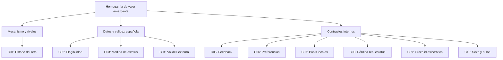

# Mercados de pareja: homogamia emergente sin preferencia por semejanza

**Proyecto AB-R (autoría de investigación: Alejandro Panera Pascual)**. Proyecto hermano de `proyectos/politics-fantasy-league/`, deliberadamente más ligero. **Estado: piloto exploratorio, sin hallazgo 2/3 ni calibración empírica.** Rama de trabajo: `research/ab-r-mercados-pareja-20261028`. Corte: 28/10/2026.

## Pregunta
¿Puede aparecer similitud en valor relacional de los integrantes de una pareja a partir de búsqueda individual de la mejor opción alcanzable, aceptación bilateral y salida del mercado, aunque nadie prefiera directamente la semejanza? ¿En qué condiciones la búsqueda, el estatus dinámico, la población elegible y la fragmentación modifican esa estructura?

**Valor**: deseabilidad según el sexo opuesto. En el piloto las mujeres ponderan estatus 0,6 y belleza 0,4; los hombres, estatus 0,4 y belleza 0,6. Son **supuestos**; los agentes son binarios y heterosexuales en este prototipo, nunca una descripción exhaustiva de España. `Status` y `looks` sintéticos están en [0,1]; no se emplean datos personales reales.

## Orientación metodológica
- [Contrato previo, 10 ciclos](research/ABR_MATE10_20261028/PREREG.json): `3fce00eb`, antes del código/resultados.
- [Código congelado antes de ejecutar](research/ABR_MATE10_20261028/experiment.py.gz.b64): commit `a5ca4215`; SHA-256 del **Python descomprimido** `ca792b6c685beb075153659b862475425ed9a4ead74ad4e36e65729ceef6df7e`.
- [Resultados por condición](research/ABR_MATE10_20261028/SUMMARY.csv), [ledger A–J](research/ABR_MATE10_20261028/LEDGER.json), [informe](research/ABR_MATE10_20261028/REPORT.md), [estado](CURRENT.md).
- Contrato AB 3.2.1 R1–R5, O2 freeze-run y O4 niveles 0–3. Cuatro ciclos `PLANNING_AB_ONLY` basados en fuentes; seis `EXPERIMENTAL_AB` sintéticos; **no se intercambian**.
- Es imprescindible contrastar contra la literatura, especialmente Hitsch et al. (2010), que ya documenta sorting derivado de preferencias. Originalidad aún **NO_ACREDITADA**.

## Reproducir
El archivo congelado es gzip + base64 debido a la interfaz de conservación remota. Descifrarlo y ejecutar desde el directorio de la campaña:
```bash
base64 -d experiment.py.gz.b64 | gzip -dc > experiment.py
sha256sum experiment.py  # esperado: ca792b6c685beb075153659b862475425ed9a4ead74ad4e36e65729ceef6df7e
python -m pip install numpy pandas scipy
python experiment.py
```
Produce `RUNS.csv`, `SUMMARY.csv` y `NULLS.csv`. `CLEAN_CLONE_NOT_VERIFIED`; la ejecución comprobada se realizó en un contenedor local, no en un clon limpio. El script implementa swipes **simultáneos**, no Tinder asincrónico; los candidatos pueden reaparecer entre rondas. La regla de pérdida de estatus `delta` se aplica solo después de rechazo unilateral y es globalmente visible a todos los candidatos.

## Mapa de preguntas

Las relaciones son de agenda/investigación, **no** de causalidad demostrada.

## Límites éticos y epistémicos
Las ponderaciones de género son convenciones experimentales sin validación normativa ni empírica. «Belleza» no se aplica a seres humanos reales. Las simulaciones sintéticas no identifican efectos sociales causales ni justifican puntuación individual de personas. Antes de probar sectores españoles, definir usuarios elegibles, consentimiento, cohortes y variables con fuente, sesgos y restricciones.

## Segunda campaña · BRANCH8 (28/10/2026)

**Autorización expresamente concedida, ocho ciclos completos A–J en sus alcances**, de los cuales cinco fueron experimentos sintéticos exploratorios y tres ciclos documentales/de planificación. Informe [BRANCH8](research/ABR_BRANCH8_20261028/REPORT.md), [ledger](research/ABR_BRANCH8_20261028/LEDGER.json), [contrato previo](research/ABR_BRANCH8_20261028/PREREG.json), [métricas por semilla](research/ABR_BRANCH8_20261028/RUNS_COMPACT.csv), [gráficas CT2](research/ABR_BRANCH8_20261028/CT2_TRAJECTORY.svg). Las dos implementaciones observadas se diferencian por hashes y no se cuentan como campañas adicionales. El resultado N03 sobre tamaño local fue inconcluso por baja cobertura; N08 no ejecutó una confirmación humana. Ningún nuevo hallazgo 2/3.

**Prioridad actual**: baseline Gale-Shapley con paridad, similitud de oportunidades de exposición, calibración sociodemográfica por población elegible y observación reputacional bajo condiciones éticas. [Estado vigente](CURRENT.md). [Próximos 6 ciclos propuestos, sin autorización](NEXT_6_PROPOSAL.md). El visor HTML es una vista estática del mapa piloto, no un replay canónico certificado; consultar `ab_atlas/seed.json` para el grafo más reciente.

## Tercera campaña autorizada · EVIDENCE6

[Prerregistro](research/ABR_EVIDENCE6_20261028/PREREG.json), [informe N15–N20](research/ABR_EVIDENCE6_20261028/REPORT.md), [ledger A–J](research/ABR_EVIDENCE6_20261028/LEDGER.json), [fuente Python congelada](research/ABR_EVIDENCE6_20261028/experiment.py) y [CSV por semilla](research/ABR_EVIDENCE6_20261028/RUNS.csv). Se cerraron **6 ciclos** con alcance limitado (2 pruebas sintéticas, 3 documentales y 1 planificación), sin 2/3 y sin calibración humana externa. La equivalencia exacta de sincrónico/asíncrono con q fijo es un control negativo construido, no un descubrimiento sociológico. Se conserva la no-derivación de población soltera desde censos y el bloqueo de acceso a las tablas 59583 y 60268. [Estado canónico](CURRENT.md), CT2 [escala 0–100 y ampliada](research/ABR_EVIDENCE6_20261028/CT2_TRAJECTORY.svg). R5 detiene nuevos ciclos sintéticos hasta evidencia externa pertinente.

## Quinta campaña · EVIDENCE20: siete ciclos ejecutados, trece no iniciados por R5

El investigador autorizó **hasta 20 ciclos BRANCHING AB-R**. Se realizaron **siete ciclos A–J** N21–N27 (dos revisiones documentales de fuentes y una adicional sobre rechazo, una prueba formal, un experimento sintético, un reanálisis y una planificación), sin invalidaciones registradas. Los trece restantes **no fueron ejecutados ni consumidos**, en aplicación de R5; la autorización no equivale a resultados. [Estado](CURRENT.md), [informe](research/ABR_EVIDENCE20_20261028/REPORT.md), [ledger](research/ABR_EVIDENCE20_20261028/LEDGER.json), [prerregistro](research/ABR_EVIDENCE20_20261028/PREREG.json), [código Python](research/ABR_EVIDENCE20_20261028/audit.py), [CSV sintético 5 semillas](research/ABR_EVIDENCE20_20261028/SEGMENT_NULLS.csv), [CT2 doble escala](research/ABR_EVIDENCE20_20261028/CT2_TRAJECTORY.svg).

Hallazgos de corrección: (1) rankings comunes implican matching estable rank-rank bajo condiciones especiales y no requieren homofilia; (2) la mera segmentación puede generar r≈.92 global incluso si el apareamiento intragrupo es aleatorio, por lo que los nulos deben preservar el grafo de oportunidad; (3) Funcas publica datos ESS 2024 de educación de convivientes españoles, **no swipes ni valor romántico**; (4) la ficha pública del experimento de citas de Essex 2018 declara un Excel anonimizado pero la descarga y columnas permanecen sin verificar. Ningún descubrimiento 2/3 ni validación causal real.

## Sexta fase · REALDATA13, primera evidencia diádica observada (28/10/2026)

Se reanudaron las **13 plazas restantes ya autorizadas de EVIDENCE20**, sin ampliar el cupo total de 20. Se cerraron diez ciclos N28–N37 de alcance limitado, con un intento instrumental inválido sobre ingresos reparado y **3 plazas sin iniciar bajo R5**. [Informe](research/ABR_REALDATA13_20261028/REPORT.md), [ledger A–J](research/ABR_REALDATA13_20261028/LEDGER.json), [prereg](research/ABR_REALDATA13_20261028/PREREG.json), [código de análisis](research/ABR_REALDATA13_20261028/analyze_mixmosa.js), [resultados empíricos agregados](research/ABR_REALDATA13_20261028/AGGREGATE_RESULTS_REPAIRED.json), [nulidad de popularidad](research/ABR_REALDATA13_20261028/N33_N35_EXTRA_RESULTS.json), [fuentes alternativas y acceso](research/ABR_REALDATA13_20261028/SECOND_SOURCE_AUDIT.md), [CT2 completo/ampliado](research/ABR_REALDATA13_20261028/CT2_TRAJECTORY.svg).

La fuente pública [Mixmosa](https://github.com/dankras/mixmosa-anonymized-data) permitió analizar realmente 1.895 citas rápidas presenciales completas en 30 eventos, 410 personas y 259 aceptaciones recíprocas. En la submuestra de decisiones mutuas, una popularidad leave-one-focal-date-out produjo r≈−0,016, compatible con control de permutación condicionado al evento. La fuerza de la asociación positiva con atractivo evaluado independientemente fue mayor que con categorías de ingreso autodeclarado, sin ajuste causal. **No** se valida una diagonal de homogamia como en los agentes sintéticos, ni una caída automática de estatus ante terceros por un rechazo. No se rehostean personas identificadas por pseudónimos ni datos brutos del repositorio de origen. La segunda muestra independiente quedó bloqueada. [Estado canónico](CURRENT.md), `CLEAN_CLONE_NOT_VERIFIED`, CT2=17/100 ordinal. Esta fase no constituye un experimento de usuarios españoles de Tinder.

## Puerta N38 · Réplica externa, sin datos procesados todavía

Nueva auditoría [N38](research/ABR_REPLICATION_GATE_20261028/GATE_REPORT.md), [ledger A–J](research/ABR_REPLICATION_GATE_20261028/LEDGER.json) y [matriz de fuentes](research/ABR_REPLICATION_GATE_20261028/SOURCE_ACCESS_AUDIT.json). Tras la continuación autorizada: **EVIDENCE20 = 18/20 válidos**, un intento instrumental inválido reparado, **2 autorizados sin iniciar (N39–N40)**. R5 detenido por ausencia de una segunda muestra con ambas decisiones de pareja accesibles y verificadas. Essex XLSX/eHarmony gzip sin bytes; original Columbia CVS sin contenido legible desde conector; derivado de Columbia 8.378 filas pero sin contraparte/evento/reciprocidad; Parquet limpio Columbia accesible como Base64 pero no procesado. **No se afirma réplica independiente**. Consulte [CURRENT.md](CURRENT.md).

## N39–N40 · Segunda muestra empírica finalmente procesada (Columbia)

El usuario aportó directamente `speed_dating_clean.parquet`, resolviendo la falta de acceso a binarios y evitando Codex/Work. La auditoría [Columbia + Mixmosa](research/ABR_COLUMBIA_N39_N40_20261028/REPORT.md) procesó 8.368 registros dirigidos, 121 columnas y **4.184 encuentros únicos** con decisiones de ambas personas verificadas, 21 sesiones, 551 participantes, 690 encuentros con aceptación mutua. Popularidad estimada sin la cita focal entre 690 mutuas: **r=+0,1244**, nulo por permutación del match dentro de sesión media `−0,03865` (cuantiles 95% [−0,1022,+0,0283]); Mixmosa anterior (259 mutuas) `r=−0,0159`, sin evidencia de diagonal fuerte. [Ledger N39/N40](research/ABR_COLUMBIA_N39_N40_20261028/LEDGER.json), [agregados](research/ABR_COLUMBIA_N39_N40_20261028/AGGREGATES.json), [prerregistro](research/ABR_COLUMBIA_N39_N40_20261028/PREREG.json), [freeze hash](research/ABR_COLUMBIA_N39_N40_20261028/SOURCE_FREEZE.json). Fuente original usuario preservada fuera del repo, código completo entregado como ZIP de conversación, clonado limpio no verificado.

**EVIDENCE20 20/20 ciclos AB válidos; ninguna plaza restante; R5 STOP.** Los hallazgos son observacionales descriptivos, no confirman ausencia de homofilia, ni efecto causal de rechazo sobre estatus real, ni generalización a España. CT2=17/100 ordinal. [CURRENT.md](CURRENT.md) es el estado canónico.

## N41–N46 · Popularidad y homofilia en dos muestras observadas (28/10/2026)

**Seis ciclos BRANCHING AB-R nuevos autorizados y ejecutados, saldo 0.** [Informe N41–N46](research/ABR_BRANCH6_SOCIAL_20261028/REPORT.md), [ledger A–J](research/ABR_BRANCH6_SOCIAL_20261028/LEDGER.json), [PREREG](research/ABR_BRANCH6_SOCIAL_20261028/PREREG.json), [resultados Columbia](research/ABR_BRANCH6_SOCIAL_20261028/COLUMBIA_SUMMARY.json), [resultados Mixmosa](research/ABR_BRANCH6_SOCIAL_20261028/MIXMOSA_N46_RESULTS.json), [CT2 escala completa y zoom](research/ABR_BRANCH6_SOCIAL_20261028/CT2.svg) y [ledger 1/3 local](research/FINDINGS_1_3/LEDGER.json).

En Columbia, modelos por actor demuestran que popularidad observada en otros encuentros se asocia mucho más al sí que aproximaciones sencillas de semejanza por edad o campo académico; sin embargo, se observa una contribución modesta de similitud de disciplina y, en hombres, edad. **El control por actor y evento** muestra un exceso de cercanía de edad de −0,156 años entre mujeres y −0,202 entre hombres, mientras Mixmosa da −0,210 y +0,117 respectivamente. **La diferencia masculina de signo entre mercados** recibe un único reconocimiento local **1/3 exploratorio**, no 2/3 científico ni resultado causal. Los datos son citas presenciales de diferentes épocas y países, no Tinder español. CT2 sigue **17/100**, ordinal, con `CLEAN_CLONE_NOT_VERIFIED`. [Estado canónico](CURRENT.md).
