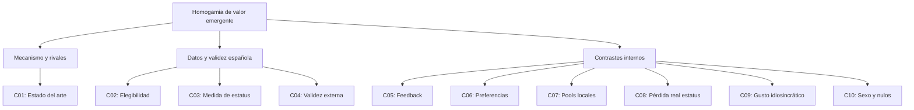

# Mercados de pareja: homogamia emergente sin preferencia por semejanza

**Proyecto AB-R (autoría de investigación: Alejandro Panera Pascual)**. Proyecto hermano de `proyectos/politics-fantasy-league/`, deliberadamente más ligero. **Estado: piloto exploratorio, sin hallazgo 2/3 ni calibración empírica.** Rama de trabajo: `research/ab-r-mercados-pareja-20261028`. Corte: 28/10/2026.

## Pregunta
¿Puede aparecer similitud en valor relacional de los integrantes de una pareja a partir de búsqueda individual de la mejor opción alcanzable, aceptación bilateral y salida del mercado, aunque nadie prefiera directamente la semejanza? ¿En qué condiciones la búsqueda, el estatus dinámico, la población elegible y la fragmentación modifican esa estructura?

**Valor**: deseabilidad según el sexo opuesto. En el piloto las mujeres ponderan estatus 0,6 y belleza 0,4; los hombres, estatus 0,4 y belleza 0,6. Son **supuestos**; los agentes son binarios y heterosexuales en este prototipo, nunca una descripción exhaustiva de España. `Status` y `looks` sintéticos están en [0,1]; no se emplean datos personales reales.

## Orientación metodológica
- [Contrato previo, 10 ciclos](research/ABR_MATE10_20261028/PREREG.json): `3fce00eb`, antes del código/resultados.
- [Código congelado antes de ejecutar](research/ABR_MATE10_20261028/experiment.py.gz.b64): commit `a5ca4215`; SHA-256 del **Python descomprimido** `ca792b6c685beb075153659b862475425ed9a4ead74ad4e36e65729ceef6df7e`.
- [Resultados por condición](research/ABR_MATE10_20261028/SUMMARY.csv), [ledger A–J](research/ABR_MATE10_20261028/LEDGER.json), [informe](research/ABR_MATE10_20261028/REPORT.md), [estado](CURRENT.md).
- Contrato AB 3.2.1 R1–R5, O2 freeze-run y O4 niveles 0–3. Cuatro ciclos `PLANNING_AB_ONLY` basados en fuentes; seis `EXPERIMENTAL_AB` sintéticos; **no se intercambian**.
- Es imprescindible contrastar contra la literatura, especialmente Hitsch et al. (2010), que ya documenta sorting derivado de preferencias. Originalidad aún **NO_ACREDITADA**.

## Reproducir
El archivo congelado es gzip + base64 debido a la interfaz de conservación remota. Descifrarlo y ejecutar desde el directorio de la campaña:
```bash
base64 -d experiment.py.gz.b64 | gzip -dc > experiment.py
sha256sum experiment.py  # esperado: ca792b6c685beb075153659b862475425ed9a4ead74ad4e36e65729ceef6df7e
python -m pip install numpy pandas scipy
python experiment.py
```
Produce `RUNS.csv`, `SUMMARY.csv` y `NULLS.csv`. `CLEAN_CLONE_NOT_VERIFIED`; la ejecución comprobada se realizó en un contenedor local, no en un clon limpio. El script implementa swipes **simultáneos**, no Tinder asincrónico; los candidatos pueden reaparecer entre rondas. La regla de pérdida de estatus `delta` se aplica solo después de rechazo unilateral y es globalmente visible a todos los candidatos.

## Mapa de preguntas

Las relaciones son de agenda/investigación, **no** de causalidad demostrada.

## Límites éticos y epistémicos
Las ponderaciones de género son convenciones experimentales sin validación normativa ni empírica. «Belleza» no se aplica a seres humanos reales. Las simulaciones sintéticas no identifican efectos sociales causales ni justifican puntuación individual de personas. Antes de probar sectores españoles, definir usuarios elegibles, consentimiento, cohortes y variables con fuente, sesgos y restricciones.
