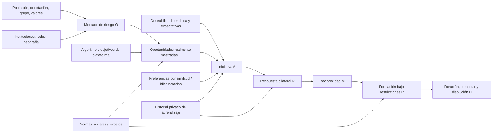

# ESBM · Modelo de Ecología de Selección Bilateral Multinivel

**Autor del programa:** Alejandro Panera Pascual; diseño integrador exploratorio 28/10/2026. **Objetivo:** explicar cómo preferencias, contextos, instituciones, algoritmos y reciprocidad producen una estructura de parejas observadas. **No se reclama originalidad del mecanismo genérico**: Kalmijn (1998), Belot–Francesconi, Hitsch (2010), Topinkova–Diviak (2025) y Chen–Hsieh–Lin (2023) ya cubren partes sustantivas. El objetivo de una explicación «mejor que nadie» debe convertirse en **predicciones incrementales comprobables**, no en superlativo autorreferente.

## 1. Causación multietapa: el objeto no es una única correlación

**Variables:**
- `I_i(t)`: identidad, preferencias de género/orientación y objetivos relacionales, y pertenencias culturales (no inferirlas por fenotipo).
- `X_i(t)`: edad, educación/ocupación, recursos, idioma, geografía, valores, salud y situaciones personales, medidos voluntariamente bajo gobernanza.
- `Q_i(t)`: *índice hipotético* de cualidad percibida, no estatus humano total, ni renta, ni una jerarquía moral. Unidimensionalidad es una simplificación técnica examinable.
- `O_{ij}(t)`: pertenencia al mercado de riesgo compatible, mutualizada por orientación, consentimiento, edad, intención, posición geográfica, etapa vital, barreras institucionales.
- `E_{ij}(t)`: oportunidad **realmente mostrada/experimentada**, no simplemente perfil registrado. Puede ser generada por círculo social, universidad/trabajo, app y política de intermediación.
- `A_{ij}(t)`: iniciativa positiva del actor hacia j condicionada a E=1; en apps puede ser swipe o primer mensaje.
- `R_{ji}(t)`: respuesta de j a la propuesta de i cuando realmente la recibe; no equivalente a la iniciativa que j habría tomado sin recibir la propuesta.
- `M_{ij}(t)=A_{ij}(t)R_{ji}(t)`: interés mutuo; no implica pareja exclusiva.
- `P_{ij}(t)`: relación formada bajo capacidad, consentimiento y restricciones de emparejamiento; un individuo no puede pertenecer a varias parejas exclusivas simultáneas bajo ese submodelo.
- `D_{ij}(t+Δ)`: duración, calidad, continuidad, bienestar y disolución: desenlaces posteriores que requieren otra instrumentación.
- `H_i(t)`: historial privado de rechazos y expectativas; `V_{ik}(t)`: información pública sobre i disponible para el observador k (requiere mecanismo de transmisión), distintos de Q.

El resultado agregado `Corr(Q_i,Q_j | P_ij=1)` condiciona en varios filtros que actúan como **selectores/colisionadores**; no identifica por sí mismo utilidad intrínseca por semejanza, calidad compartida, composición del mercado o regla del algoritmo.

**Cadena causal conceptual:**

El diagrama es una **hipótesis estructural**, no un DAG estimado causalmente. Si una exposición depende de popularidad medida en ese mismo período hay circularidad temporal, no predictor ex ante.

## 2. Dimensiones, controles y observabilidad

| Familia | Cómo podría operar | Estado a 28/10/2026 | Qué faltaría medir |
|---|---|---|---|
| Demografía, densidad y desequilibrio | tamaño de pools compatibles, edad, sexo, migración, geografía | parcialmente en simulador binario equilibrado y estudios previos | población activa no conviviente por segmentación real |
| Homofilia y heterofilia | edad, campo académico, idioma, etnia, religión, valores, proyectos | edad/grupo simplificado, Columbia y Mixmosa observacionales | encuesta voluntaria de valores e intenciones y co-exposición |
| Aspiración/deseabilidad y preferencias heterogéneas | cualidades consensuales y gusto idiosincrático | Q toy con decisiones estocásticas | índices previos, independientes, repetidos de atractivo/deseabilidad |
| Segregación de oportunidades | escuela, empleo, clase, barrio, amigos, idioma | experimento sintético con igual grado por ambos extremos | logs de encuentros offline y perfiles realmente mostrados |
| Intermediario/algoritmo | ranking, nudges, filtros, anuncios, pagos | toy de ranking hacia Q y literatura de experimentos de campo | algoritmo real, exposición A/B, criterio de asignación |
| Búsqueda, límites cognitivos | fatiga, atención, ancho de oferta, recursos de decisión | sensibilidad k=6/12/24 como exposición, **no cognición medida** | rastros de atención, tareas aleatorizadas |
| Retroalimentación y expectativas | rechazo privado, aprendizaje, señales comparativas de popularidad | literatura Shi 2025, **NO implementado como modelo causal dinámico validado** | tiempo de exposición, señal y respuesta adaptativa |
| Reputación pública tras rechazo | terceros conocen rechazo y revisan valoración | **sin medir en humanos ni en el toy actual** | tratamiento consentido de información a terceros |
| Reciprocidad y estabilidad | dos decisiones, congestión de candidatos, capacidad de emparejar | etapas simuladas y datos de speed dates | seguimiento longitudinal de relaciones, exclusividad y disolución |
| Diversidad de orientaciones e identidades | grafo arbitrario de compatibilidad y relaciones no binarias | **NO SIMULADO**: caso heterosexual binario aislado | modelo general de compatibilidad, muestras éticas diversas |
| Normas culturales y valores | guiones sociales, edad de salida, expectativa familiar, religiosidad | mapa conceptual con referencias, no parámetros calibrados | multigrupo/país, historia contextual, instrumentos de valor |
| Macrosociología y consecuencias | reproducción social, movilidad, estratificación, bienestar | hipótesis derivadas, no resultado del modelo | parejas reales, ingresos/educación e hijos longitudinalmente |

## 3. Módulo sintético realmente implementado
Población: 160 personas de grupo compatible L y 160 R, 4 categorías de grupo social abstractas, edad artificial 18–45 y calidad `Q~U(0,1)` **independiente** de edad y grupo. El submodelo **L/R heterocompatible binario** es un caso de prueba limitado, no representación de todas las orientaciones. El entorno ofrece 12 encuentros a cada integrante de ambos lados en dos políticas de grafo **k-regular**; en una tercera política cada integrante de L recibe 12 impresiones pero el grado de R es desigual por diseño.

Decisiones sobre cada arista expuesta:
[
p_{i\to j} = \operatorname{logit}^{-1}[-0.35 + 2w_Q(Q_j-0.5) + w_H\mathbf{1}(g_i=g_j) - 0.7\lambda(Q_i-0.5)].
]
`w_Q` = preferencia por calidad del otro, `w_H` = preferencia explícita por compartir grupo; `\lambda` = umbral de exigencia creciente con calidad del propio actor (hipótesis artificial, NO medida). Los dos votos se generan con uniformes diádicos fijados **para todos los escenarios del mismo seed** (potenciales resultados acoplados para comparación experimental). Reciprocidad = ambos votos positivos; parejas exclusivas = **maximum-cardinality bipartite matching** en red de reciprocidad, sin afirmar equilibrio estable ni maximización de bienestar. No se simula vida en pareja ni feedback temporal.

**Crucial:** la misma homofilia de grupo puede proceder de `w_H>0` con oportunidades aleatorias, o de `P(E_{ij}=1|g_i=g_j)` elevado con `w_H=0`. La correlación de calidad puede cambiar incluso de signo con selección, umbrales y máximos bipartitos. El modelo es un *argumento de no identificabilidad a partir de parejas observadas*, no un estimador social.

## 4. Identificación: qué comparadores son competentes
1. **Nulo:** calidad y homofilia desactivadas, oportunidades regulares; no debe aparecer sorting fuerte sistemático; con seis semillas solo prueba de sanidad limitada.
2. **Preferencias de calidad sin rango endógeno:** `w_Q=1,λ=0,w_H=0`.
3. **Calidad + umbrales propios crecientes:** `w_Q=1,λ=1.8,w_H=0`; mismo grafo y uniformes, identifica **efecto del parámetro impuesto dentro del código**, NO su existencia en la sociedad.
4. **Preferencia explícita de grupo:** `w_H=1.1` sobre exactamente el mismo grafo regular aleatorio y seed.
5. **Segregación de exposición sin homofilia:** rewiring conserva grados de ambos extremos; `w_H=0`. Comparar share en **exposición** y **parejas** para no atribuir el segundo al gusto.
6. **Algoritmo de popularidad:** conserva 12 oportunidades por usuario L pero no por R; informar **Gini y exclusión de candidatos**, así como reciprocidad y cobertura, evitando falso reclamo de paridad total.
7. **Número de oportunidades:** `k=6/12/24` cambia directamente el presupuesto y no se interpreta como preferencia individual.

## 5. Pruebas discriminantes para una explicación realmente superior
- **D1. Descomposición por etapas** del exceso de homogamia contra contrafactuales de oportunidades, iniciativas, reciprocidad y vínculos con denominadores consistentes (exposición, contactados, reciprocados, parejas), idealmente por cohorte y app.
- **D2. Elección ex ante:** predecir quién contactará a quién en **perfiles nunca vistos previamente**, usando popularidad de fecha anterior e historial público controlado. Predecir fuera de muestra y comparar con modelo que incluye semejanza explícita e instituciones.
- **D3. Intervención institucional/algorítmica:** aleatorizar información o exposición con consentimiento sin afectar la seguridad; estimar efectos sobre distribución de oportunidades, número de mutuas y exclusión (no solo porcentaje de likes).
- **D4. Rechazo y terceros:** separar información privada de rechazo de información *revelada a terceros*, con outcomes de reputación medidos repetidamente; sin eso no usar `Q(t+1)=Q(t)-delta` como realidad.
- **D5. Vínculo y duración:** medir transición reciprocidad→cita→relación→disolución, no colapsar likes y matrimonio.
- **D6. Diversidad:** predefinir modelos compatibles con orientaciones y contextos no binarios, diferencias culturales y valores/planes no reducibles a status; evitar imponer preferencias heteronormativas como universales.
- **D7. Rival independiente:** comparar contra Kalmijn 1998, Hitsch 2010, Belot-Francesconi 2006, Topinkova-Diviak 2025, Chen 2023, Fuhse-Gondal 2024, Shi 2025 y Wang 2026. No convertir literatura previa en hipótesis propia.

**Criterio para reclamar una explicación superior:** incremento de poder predictivo **fuera de muestra y en otra población**, reducción verificable de sesgos por exposición/selección, robustez a comparadores competentes, predicción nueva prerregistrada que los modelos anteriores fallen, y separación de alternativas causales. En ausencia de esos datos, esta teoría es un **marco de síntesis comprobable**, no un resultado 2/3.
