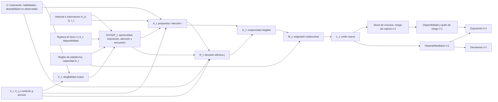

# ESBM v2 — Mapa de identificabilidad y protocolo de falsación

**Tipo:** plano metodológico y de decisiones, **NO_AB_CYCLE / NO_EXECUTION / NOT_PREREGISTERED / NO_EXTERNAL_VALIDATION**. **Fecha:** 2026-10-29. **Rama:** `research/ab-r-mercados-pareja-20261028`. **HEAD de partida verificado:** `f6d0587cd1cc31afa14acdca3e4884314170795f`. **Objeto:** transformar mecanismos computacionales existentes en afirmaciones observables, estimandos y pruebas potencialmente falsadoras antes de gastar plazas. No se ha ejecutado simulación ni se han analizado nuevos microdatos humanos al producir este plano.

**Decisión vinculante de alcance:** `STOP_R5_EXTERNAL`; `26/40` ciclos válidos **históricos**, `0` nuevos (también `0` inválidos y `0` de planificación), `N93–N106` **14 reservados y no liberados**, `CT2=7/100` **ordinal, no probabilidad**, madurez ponderada subjetiva `41.20%` **sin cambios**, `100 SOURCES / 30 PRIORS / 150 UPDATES` **sin modificaciones**. Ningún nuevo hallazgo 1/3–3/3, ninguna predicción confirmada, ninguna reforma retrospectiva de los contratos N83/N88–N92. El presente texto propone diseños, no los aprueba, preregistra ni realiza.

## 1. Pregunta científica, no una historia elegante

Pregunta general: ¿qué proporción de las diferencias entre uniones observadas puede atribuirse, bajo una población y horizonte definidos, a **eligibilidad y oportunidades**, **atención/exposición**, **preferencias/elección unilateral**, **aceptación bilateral**, **regla de asignación**, **información y aprendizaje**, y **permanencia o salida del mercado**? Ningún porcentaje está estimado hoy. Una respuesta causal exige intervenciones o supuestos de identificación adicionales; una comparación predictiva no resuelve automáticamente la atribución causal.

*Hipótesis integradora de trabajo, no originalidad acreditada:* la composición final de parejas es una función de oportunidades estructuradas, secuencias de decisiones, restricciones de reciprocidad y mecanismos institucionales/de duración. La explicación genérica tiene fuerte **prior art** (Kalmijn `SRC030`, Hitsch et al. `SRC002`, Fisman et al. `SRC016`, Bruch–Newman `SRC003/SRC075`, Rios et al. `SRC054`, Chen et al. `SRC032`, Joel et al. `SRC084`). Las reclamaciones originales deben surgir de una **predicción adicional preespecificada** que supere esos competidores, no de combinar conceptos conocidos.

### 1.1 Implementación real consultada

`research/ABR_ESBM20_20261028/esbm_dynamic.py` (blob Git `5fc9f63fd44ff81ce9ff6c900ba6bf24153356f2`; SHA256 texto original `f7e6b84000720cbdf2ee0800c2b10d136185facd00e4622756cbb5f8d8254d0b`) define **144 agentes ficticios**, 16 ticks, máximo 7 recomendaciones dirigidas por agente soltero y tick, seis seeds `101,211,307,401,503,601`, diez escenarios. Atributos arbitrarios: 60 F /60 M /24 X, scopes `all/same/other`, norma 0–2, edad 19–50 y deseabilidad latente `q∼U(0,1)`; no son frecuencias de población ni una teoría universal de sexo, género u orientación. La compatibilidad exige **scope mutuo**; `FM_only` es restricción contrafactual con exclusión artificial.

El flujo efectivo importa más que los nombres: disolución **al inicio** de tick → personas sin pareja → candidatos compatibles → Gumbel top-`K` con shocks por `(t,i,j)` y política de exposición → propuestas Bernoulli → respuesta positiva Bernoulli **solo si hubo propuesta** → aristas elegibles de reciprocidad confirmada → `networkx.max_weight_matching(maxcardinality=True)` sobre el grafo de aristas positivas con desempate artificial → relaciones activas/rupturas futuras. Una respuesta no es una segunda exposición independiente; dos respuestas individuales simultáneas recogidas en un speed-date real requerirían un **puente de medición**, no identifican automáticamente el `R_{ji}|A_{ij}` de ESBM. Una arista recíproca no garantiza unión cuando compite con otras aristas por exclusividad.

Escenarios implementados: `mixed_random`, `heterosexual_restricted`, `institutional_segregation`, `explicit_norm_preference`, `popularity_ranking`, `visibility_balancing`, `private_rejection_learning`, `public_rejection_signal`, `longer_partnerships`, `shorter_partnerships`. Los coeficientes `same_norm +1.7` en exposición, `same_pref +1.3`, `popular +3.5(q-.5)`, `balance -1.4 log1p(seen)`, `private_bias +=.08` (cap .8) y `public_score -=.08` (suelo -1.8) **están impuestos**, no estimados. La disolución estipula `h=min(.90,(.12+.065*[norm distinta]+.004*|edad_i-edad_j|)*factor)`, con factores de duración `0.40/1/1.75`. Los límites de duraciones terminadas y censura se registran, pero no se ha estimado un hazard humano ni bienestar.

**Invariantes internos**: `formed−dissolved=active`, `positive_responses≤proposals≤impressions`, máximo una pareja activa por persona, compatibilidad de cada unión y cardinalidad del matching no mayor que el número de aristas recíprocas. Estos son tests del programa, no validación sociológica.

## 2. Vocabulario causal, unidades y puente entre medidas

Definir siempre **población objetivo, evento, tiempo, tratamiento, riesgo elegible, denominador, outcome y régimen de interferencia**. Variables para individuos `i≠j`, evento `g`, orden intrasesión `k`, tiempo `t`:

- `X_i`: atributos previos; `U_i/U_g`: deseabilidad, motivación, reglas y shocks no observados; `H_{i,t-1}`: historial anterior, nunca etiquetas reconstruidas de outcomes futuros.
- `C_{ij,t}`: compatibilidad/consentimiento y elegibilidad verdaderos **previos al encuentro**, potencialmente asimétricos; `S_{i,t}`: disponibilidad (single y participante); `D_{ij,t}`: disolución previa que puede devolver a ambos al riesgo.
- `O_{ij,t}`: oportunidad **ofrecida/asignada** y fechada por un sistema; `V_{ij,t}`: perfil realmente presentado en pantalla; `Q_{ij,t}`: atención/verificación efectiva de visualización; `F_{ij,t}`: encuentro cara a cara verificado. No colapsar `O,V,Q,F`: un perfil ofrecido puede no ser visto y una foto vista puede no resultar en una cita.
- `A_{ij,t}`: acción unilateral de i (solicitud, sí posterior a la cita o propuesta), con protocolo explícito; `R_{ji,t}`: aceptación/contestación de j condicionada al mensaje si ese es el diseño de la app. En speed-date recoger `Y_{i→j}` y `Y_{j→i}` **separadamente**, incluidas negativas reales; `B_{ij}=Y_{i→j}Y_{j→i}` mide reciprocidad de intención, **no relación duradera**.
- `G_t`: grafo de aristas elegibles y respuestas; `M_t`: política de asignación excluyente entre las aristas; `L_{ij,t}`: unión iniciada, `Z_{ij,t+1}`: permanencia/ruptura posterior y `T_{ij}`: tiempo a ruptura con censura.
- `I_t`: información privada/testifical/pública disponible **en ese instante**, `K_{g,t}`: capacidad, reglas culturales, cupos, emparejador e incentivos. El número de imágenes `seen[j]` es historial computacional de exposición recibida, no atención humana medida.

**NO IDENTIFICABLE POR NOMBRAR UNA VARIABLE.** Si no existe registro original de una variable, no reemplazarla por un proxy del resultado (p. ej. visibilidad inferida de «likes» recibidos) sin explicar selección, leakage y error de medida. `q` de ESBM es exógeno artificial: popularidad construida de respuestas del mismo período provoca circularidad.

## 3. Grafo causal temporal, no circular

**Lectura:** es un *esquema causal candidato*, no un DAG identificado a partir de datos. `O/V/Q/F` aparecen agrupados solo por legibilidad: son variables con flechas causales y mecanismos de selección diferenciados. `P` puede afectar directamente decisiones (información/normas) además de exposiciones. `U` puede causar `S`, elegibilidad y tratamiento; el gráfico simplifica esas aristas, por lo que **no** autoriza ajuste por back-door a priori. Se evita un ciclo aparente separando `t` y `t+1`; ESBM contiene también **actualización dentro del mismo tick**, que exige un índice intratick `k`. El rechazo emitido por j puede cambiar `A_{i,k+1}` (N90) y `seen[j]` puede cambiar la exposición del siguiente i **en el mismo tick** (N91). La causalidad de políticas puede producir **interferencia entre personas** a través de exposición, disponibilidad, competencia y matching.

**Colisionadores y supervivientes:** condicionar en «hubo perfil visto», «hubo cita», «hubo solicitud», «hubo unión» o «seguían juntos al final» puede introducir selección porque estas etapas son causadas por preferencias y oportunidades simultáneamente. No estimar efectos sobre `P(R=1|A=1)` como si fueran efectos totales sobre todo el mercado. Para efectos de política usar estimandos ITT por participante/sesión/mercado sobre una población fijada antes de asignar tratamiento, sin controlar por exposición post-tratamiento salvo estimando mediacional y supuestos expresos.

## 4. Estimandos anidados (R1) y límites de interpretación

| ID | Variable, población y comparación | Denominador observable imprescindible | Tipo de afirmación permitida |
|---|---|---|---|
| E1 | `Pr(V=1|O=1, elegible)`: entrega de la plataforma (no atención) | Todas las ofertas originales asignadas, incluidas no vistas | Descriptiva, salvo asignación exógena verificable |
| E2 | `Pr(Q=1|V=1)` y `Pr(F=1|O=1)`: atención/encuentro | Registros de vistas y citas, con ausencias/missingness | Descriptiva de transición, no psicología latente |
| E3 | `Pr(A=1|V/Q/F)`: elección i | Todas las oportunidades con decisión nativa sí/no; NA separado | Predicción condicional; causal solo con diseño |
| E4 | `Pr(R=1|A=1,V/F)`: respuesta de j a solicitud i | Solicitudes entregadas a j, incluidas no respuestas y exposición correspondiente | Conversión condicionada, **no** tasa global de interés j |
| E5 | `Pr(B=1|F=1)`: **dos sí nativos** tras cita realizada | Todas las parejas que realmente se encontraron, ambos cuestionarios enlazados | Reciprocidad de interés, no unión; faltantes no son no |
| E6 | `Pr(L=1|B=1,\mathcal{G})`: unión bajo regla M y competencia | Conjunto completo de aristas B y resultado de asignación | Solo identificable si se observa M y el grafo, no solo parejas finales |
| E7 | `Pr(T>τ|L=1)` y riesgos de ruptura | Cohorte de uniones al inicio, tiempos, censura y pérdidas | Supervivencia **condicional** a formarse, no bienestar general |
| E8 | `E[Y_g(z=1)-Y_g(z=0)]`: efecto ITT de política por **grupo de mercado g** | Grupos asignados ex ante y todos sus elegibles, incluidos no beneficiarios | Causal solo bajo randomización válida, exposición/missingness e interferencia explícitas |

La relación `Pr(L)=Pr(O)Pr(A|O)Pr(R|O,A)Pr(M=1|O,A,R)` es una **regla de cadena para una misma secuencia de acontecimientos** con soporte e indicadores correctamente definidos, no una independencia causal ni una identidad exacta para todas las políticas y observaciones posibles. Si la formación exige múltiples aristas y compite por exclusividad, `Pr(M=1|...)` depende de `G_t` completo. Para supervivencia multiplicar adicionalmente `Pr(T>τ|L,\mathrm{historial})` solo en un horizonte y cohorte claramente definidos. En un speed-date de decisiones simultáneas usar otra factorización; no forzar equivalencia estructural a una solicitud/respuesta de app.

## 5. Matriz de identificabilidad y falsadores de medición

`OBS` = descripción/predicción posible condicionada; `CAUSAL` exige intervención o supuestos adicionales y competencia/inferencia válidas; `NO` = no recuperable del indicador indicado.

| Mecanismo | Variable o parámetro ESBM | Observación mínima | Qué se puede y NO se puede identificar | Rival / falsador prioritario |
|---|---|---|---|---|
| Elegibilidad mutua y exclusión | `compatibility`, scopes; `FM_only` | Consentimiento/alcances opcionales, disponibilidad previa y pares potencialmente compatibles por evento | `OBS` red registrada; **NO** «preferencia» de quien nunca fue elegible. Ausencia de unión no prueba incompatibilidad | Separar composición de oportunidades de preferencias; simetría de scopes; grupos no excluidos por construcción |
| Exposición administrada | `policy`, `K`, `u_expose`, `seen` | Slates originales, orden/posición, destinatarios, timestamps y sujetos no mostrados | `OBS` probabilidad de oferta; `CAUSAL` orden/cupo solo con variación exógena, interferencia controlada | Ranker con preferencias y congestión frente a asignación aleatoria a mismo slate |
| Atención verdadera | No representada directamente | Registro confiable de impresiones visibles/foco o cita efectivamente realizada; error de medida | **NO** identificar atención de un log de recomendaciones; `seen` computacional ≠ visualización | Ofrecido vs visible vs visto; test de calibración de instrumentación |
| Propuesta e interés | `sigmoid(-.85+1.6(q_j-.5)+same_pref*same-.012*agegap+private_bias)` | Todas las decisiones voluntarias sí/no tras exposición, incluida no propuesta distinguible de fallo de entrega | `OBS` elección; **NO** recuperar `q` psicológico universal de un sí agregado | Intercepto + efectos actor/target, edad, similitud y saturación de opciones |
| Respuesta y reciprocidad | `u_reply`, `reply_util`, `B` | Ambas decisiones nativas por díada o solicitudes+respuestas genuinas con orden | `OBS` ambas tasas; **NO** inferir dos sí a partir de mensajes mutuos o supuesto sí predicho | SRM actor/partner/díada, selección de quienes solicitan, tasa de no respuesta |
| Matching exclusivo | `max_weight_matching(maxcardinality=True)` | Todas las aristas recíprocas antes de asignar, capacidad y pares seleccionados | `OBS` operador si documentado; **NO** deducirlo a partir de stock final | Greedy peso/prioridad, stable matching cuando sea pertinente, alternativas con igual info |
| Estatus/deseabilidad ex ante | `q` y ranking popular | Variable medida **antes** de las decisiones del lote, con procedencia | `OBS` asociación; **NO** q universal, ni causalidad por jerarquía inferida de likes contemporáneos | Efectos fijos y heterogeneidad target; evaluación out-of-time |
| Normas culturales/afines | `norm`, `same_pref`, `same_norm` | Identidad/grupo autodeclarados y riesgo por grupo, si legítimo y voluntario | `OBS` homofilias en cada estadio; **NO** identificar preferencia directa de homogamia de parejas finales | Composición, segregación institucional, assortative-mating convencional |
| Rechazo/aprendizaje privado | `private_bias`, actualización inmediata | Log fehaciente de rechazo **conocido** y acción posterior, reloj intrasesión | `OBS` adaptación; **NO** atribuir cambio a autoestima ni causalidad sin exogeneidad | Feedback diferido/ausente, tendencias temporales, fatiga, posición de cita |
| Reputación pública | `public_score`, exposición global vs testigo | Quién supo qué rechazo, cuándo y mediante qué canal verificable | **NO** difusión por inferir rechazo de i; N89 muestra que global es institución codificada | Solo testigo, sin señal; no compartir datos dañinos para crear tratamiento |
| Disolución y permanencia | `h`, hazard_mult, `T` | Inicio de relación, periodos en riesgo, evento, censura, exclusión de uniones ya formadas | `OBS` hazard sujeto a seguimiento y selección; **NO** transportar yes/yes a matrimonio | Riesgos competidores, frailty, curvas KM/Cox/multinivel según supuestos |
| Interferencia y feedback del mercado | `partner`, `available`, `H_t` | Todos los miembros del mercado/evento, historial, políticas y actores fuera del tratamiento | **NO** efecto individual SUTVA en un mercado donde la pareja de A excluye B | Aleatorización por mercado o partial interference justificada; evaluar spillovers |

**Cuidado con el identificador `OBS`:** ni siquiera una tasa predictiva puede generalizar fuera de una muestra selectiva sin supuestos de muestreo/transportabilidad. Priorizar estimandos observables antes de imaginar coeficientes para las columnas que faltan.

## 6. Contraejemplos matemáticos adversariales (ninguno es evidencia humana nueva)

### 6.1 No inyectividad de tasas finales: exposición vs aceptación

Por pura regla de cadena, para la **misma díada candidata y un solo intento**, `Pr(match)=Pr(exposición)×Pr(mutual|exposición)` si la definición de `match` es reciprocidad bilateral y no hay otro operador. Modelo A: `0.5×0.4=0.20`. Modelo B: `1.0×0.2=0.20`. Idéntico resultado final observado, distinta oportunidad y selectividad. No es un teorema sobre cardinalidad máxima o formación longitudinal; es un **contraejemplo marginal ilustrativo** que demuestra por qué solo el match no identifica sus factores.

### 6.2 Homogamia sin necesidad de preferencia explícita — y viceversa

Dos clases de pares potenciales, `same` y `different`, con **igual número de oportunidades base**. Mundo A: exposición `e_same=.80`, `e_diff=.20`; elección bilateral `b_same=b_diff=.25` (sin preferencia por semejanza *condicionada en exposición*). Mundo B: `e_same=e_diff=.50`, `b_same=.40`, `b_diff=.10` (preferencia directa). En ambos, por oportunidad elegible base, parejas recíprocas esperadas `(.20,.05)` y **80%** de resultados son `same`, suponiendo sin competencia/matching ni heterogeneidades. Incluso el **número** por clase coincide; observar solo parejas finales **no distingue estructura de oportunidades de homofilia de decisiones**. El riesgo real puede ser desigual, y hay que observarlo. Idea clásica, no innovación del proyecto.

### 6.3 N83, contraejemplo exacto existente de causalidad, NO reprobarlo

La prueba formal **ya preregistrada y ejecutada** en `research/ABR_BATCH5_N83_IDENTIFIABILITY_20261029/REPORT_N83.md` construye dos DGP con el mismo `P(E,Y_i,Y_j)` completo en **ocho celdas positivas** y `P(E=1)=.5`. Ambos muestran `Pr(Y_i=Y_j=1|E=0)=.16`, `Pr(...|E=1)=.40`; diferencia asociativa **+.24**. Pero en DGP-A, `U` causa oportunidades y decisiones y `do(E)` tiene **efecto 0**; en DGP-B la oportunidad se asigna aleatoriamente y `do(E)` tiene **+.24**. Todo el joint observacional coincide; el efecto de oportunidades **no está identificado sin intervención o supuestos adicionales**. Contraste original ya contabilizado como N83, formal y negativo, 0/3 social, no se cuenta de nuevo.

### 6.4 El matching es una función muchos-a-uno

Cuatro personas `1,2,3,4`. El grafo elegible de aceptaciones `G_1` contiene solo `(1,2),(3,4)`; el grafo `G_2` contiene además `(1,3),(1,4),(2,3),(2,4)`. Un asignador de cardinalidad máxima puede producir las mismas parejas finales `(1,2),(3,4)` en ambos cuando los desempates favorecen estas aristas. **El mismo matching no identifica las aristas bilaterales rechazadas por el operador**. No inferir `G` ni preferencias únicamente de parejas observadas.

### 6.5 Stock y duración no identifican sus componentes

En un horizonte de una cohorte y bajo el ejemplo simplificado `active=formed×survival`, Mundo A forma 100 vínculos y retiene .40 → 40 activos; Mundo B forma 50 y retiene .80 → 40 activos. El mismo stock no identifica formación ni permanencia. En el proceso real, cohortes de inicio distintas, reentradas, riesgos competidores y censura hacen todavía más importante medir formación/disolución y tiempos. **La media de vínculos terminados en ESBM no es estimador de la duración poblacional** por truncar los aún activos.

### 6.6 Identificabilidad parcial con límites

Si solo se conoce `p=Pr(recíproco)`, `e=Pr(expuesto)` y se postula explícitamente `recíproco⇒expuesto`, entonces `Pr(recíproco|expuesto)=p/e` para `e>0`, **si** ambos tienen mismo universo de oportunidad y no hay clasificación errónea. Pero eso **no** identifica `Pr(recíproco|do(expuesto))`. Con desconocimiento de `e` y `0<p≤e≤1`, la tasa condicionada puede estar entre `p` y `1`; incorporar cotas honestas es preferible a fabricar puntos estimados. La selección en exposición sigue siendo un obstáculo causal.

## 7. Competidores verdaderamente capaces y paridad informativa (R2)

El benchmark debe contener rivales que puedan explicar correctamente patrones por mecanismos distintos, **con exactamente los mismos campos pre-outcome disponibles**, split, tiempo, presupuesto de tuning y reglas de missingness. No comparar ESBM calibrado sobre outcomes completos contra un nulo ciego o permutaciones globales que rompen elegibilidad/actividad.

| Rival operativo | Estructura y predicción | Qué derrota o limita una supuesta victoria de ESBM |
|---|---|---|
| `B0` composición + riesgo | Tasas por grupo/evento/edad/sesión con offset de oportunidades compatibles y encuentros; exposición endógena modelada | Homogamia explicada íntegramente por composición/riesgo |
| `B1` logit jerárquico bilateral/SRM | Efectos de emisor, receptor, díada/encuentro y sesión, con interceptos y shrinkage; modelar dos votos conjuntamente | Aparente `q`, popularidad y «compatibilidad» colapsan en heterogeneidad actoral |
| `B2` homofilia directa | Preferencia por semejanza, distancia de edad, valores e interacción; mismo riesgo y atributos que ESBM | Encaje de semejanza sin mecanismo emergente especial |
| `B3` formación por etapas estándar | Exposición → solicitud → respuesta → matching, con enlaces empíricos flexibles y sin feedback artificial | Multietapa de ESBM no añade predicción o mejora solo por parametrización |
| `B4` ranking/congestión | Modelo de ranking con posición, capacidad, saturación y efectos dependientes de historia **ex ante** | Efectos «dinámicos» son artefactos de orden de presentación o popularidad |
| `B5` asignadores | Misma red bilateral y shocks, greedy por pesos, greedy por prioridad, máxima cardinalidad, equilibrio estable *solo bajo supuestos pertinentes* | La «mayor formación» se debe al asignador, no a motivaciones |
| `B6` historia temporal | Markov/estado previo, event history con dependencia en el tiempo y observación de rechazos/notificaciones | Aprendizaje ESBM no gana a orden temporal/fatiga sin mecanismo psicológico |
| `B7` supervivencia | Kaplan–Meier descriptivo, Cox/frailty, riesgos discretos y competidores según datos; riesgos por cohorte | Duración estipulada no transporta a uniones humanas |
| `B8` rival saturado diagnóstico | Distribución empírica conjunta de `(E,Y_i,Y_j)` para diagnosis dentro de soporte | Contraejemplo N83: ambos mundos con igual ajuste predictivo y diferentes efectos causales |

**Rivales bibliográficos obligatorios:** Hitsch et al. `SRC002`, Fisman et al. `SRC016` (misma Columbia, NO nueva cohorte), Topinkova–Diviak `SRC021`, Joel et al. `SRC084`, Pronk–Denissen `SRC086`, Rios et al. `SRC054`, Fong `SRC042`, Chen et al. `SRC032`, Jung et al. `SRC098`, originales McMaster `SRC094/SRC096`. No confundir un estudio publicado con acceso a microdatos replicables ni duplicar cohortes. Comparar siempre muestras, outcomes y mecanismos realmente homólogos. `P-COMPETENT_NULL`, `P-NOVELTY`, `P-RECIPROCITY` y `P-OPPORTUNITY` conservan sus estados actuales.

## 8. Predicciones potencialmente discriminantes, **candidatas**, no preregistradas

Cada ficha siguiente es **DISEÑO NO EJECUTADO**; antes de un contraste, restringir a **una** hipótesis primaria con signo/magnitud mínima justificados por piloto y utilidad, población, familia de hipótesis, nivel de error, presupuesto, método de ajuste y contraste independiente precongelados. Los contrastes exploratorios deben etiquetarse como tales. Si ESBM pierde contra el control competente, registrar resultado negativo sin cambiar la hipótesis después.

| ID hipotético | Contraste que podría distinguir mecanismos | Datos mínimos / comparador fuerte | Regla adversarial de falsación |
|---|---|---|---|
| `H-POS` | Un cambio *aleatorio* de posición/orden manteniendo fijo el mismo slate altera actos posteriores o tasa bilateral; estimar ITT por mercado y distinguir efecto posición de composición | Slates ordenados, impresión verdadera, votos nativos, seeds/arm y mercado; `B1+B4`; Jung `SRC098` como antecedente | Si un ranking/posición simple explica igual la ganancia, **no** atribuir adaptación social novedosa; N91–N92 no identifican efecto humano |
| `H-RISK` | La segregación en encuentros explica parte de la homogamia aun cuando la preferencia condicionada es homogénea; diferenciar exposición restringida vs homofilia en decisión | Riesgo compatible y encuentros **incluidos negativos**, rasgos recogidos lícitamente, `B0+B2`, posible asignación aleatoria de mesas | Si modelo de homofilia y composición produce la misma predicción en holdout, **no identificada** la atribución; N83 veta el salto causal |
| `H-BILAT` | El conjunto de decisiones sí/sí más el operador observado predice parejas reales mejor que un puntaje unilateral | Ambos votos tras encuentro, aristas completas, reglas de matching, `B1+B3+B5` | Si los pares finales pueden reconstruirse igual por competidor con misma información, no hay mejora estructural |
| `H-TIME` | La historia temporal de rechazo **conocido por el receptor de la señal** predice cambios de decisión más allá de fatiga/posición y efectos de actor | Timestamps, entrega/conocimiento, secuencia y respuestas posteriores; `B1+B6` | Si se pierde tras controlar orden, fatiga, actividad y efectos individuales, no atribuir aprendizaje; N90 solo demuestra dependencia del código |
| `H-INFO` | Información testifical de una interacción afecta respuesta posterior distinta de reputación universal hipotética | Información realmente conocida con consentimiento, tiempos, red de transmisión; `B6` | Si no hay difusión observable, `public_score` global NO es mecanismo humano estimable; N89 es advertencia |
| `H-DUR` | Diferencias en uniones activas provienen de tasas de inicio y supervivencia diferenciables, no de número bruto de matches | Inicio, fin, último contacto y censura por cohorte, `B7` | Si la diferencia desaparece al comparar supervivencia condicionada o no se observan uniones, no reivindicar estabilidad |
| `H-TRANSPORT` | Modelo congelado y baselines compiten **sin reajuste por outcome** en eventos/geografías independientes | Cohortes con variables y definiciones homologables, split por evento/sede/tiempo | Si falla calibración o signo cambia sistemáticamente, restringir alcance o refutar transporte |

**Precisión sobre predicciones:** `H-POS` no basta para confirmar ESBM: el efecto de orden puede ser puramente psicológico, de interfaz o experimental. Una victoria predictiva de `H-BILAT` podría ser consecuencia mecánica de observar más etapas que el rival; todos reciben **paridad de campos** o se declara que el estimando es «valor incremental de medir respuestas», no superioridad teórica. `H-RISK` no es una intervención causal por condicionar ex post en oportunidades.

## 9. Diseño mínimo de evidencia humana — dos vías, solo propuestas

### Vía A: eventos de citas rápidas con parejas adultas y asignación programada

**Riesgo observado:** participantes voluntarios elegibles **adultos**, sesión/mesa/turno registrados; cada cita físicamente realizada se comprueba con check-in bilateral o supervisor, no mera asignación. Antes del evento, definir conjunto elegible por reglas y consentimiento de ambas personas, accesibilidad y adaptaciones, no por etiquetas de identidad impuestas. El esquema puede incluir encuentros por turnos aleatorizados *entre personas ya consentidas*, con capacidad equitativa; no aleatorizar consentimiento, ni imponer encuentros con personas vetadas, ni manipular rechazos dañinos. Registrar todas las oportunidades programadas, realizadas, ausentes/canceladas y decisiones faltantes por separado.

**Medición:** formular pregunta no coercitiva, secreta, `¿te gustaría recibir una invitación mutua a otro encuentro?` `sí/no/prefiero no responder`, contestada por **cada participante después de cada cita**, sin acceso a la respuesta de la otra persona y sin divulgar la respuesta unilateral; `predicción_de_si_del_otro` solo si se mide como variable adicional totalmente separada. La aceptación bilateral habilita contactar **solo con nueva autorización apropiada**; «sí/sí» no autoriza divulgar decisiones a terceros. Registrar también que ausencia de respuesta no es rechazo, y quién completó preguntas sin datos identificativos en el archivo analítico.

**Exposición causal mínima:** orden y programación de encuentros aleatorios dentro de cada grupo de compatibilidad, con calendario congelado y eventos reales comprobados; estimar ITT de orden con aleatorización a nivel de sesión/mercado si hay interferencia significativa, o justificar partial interference, y evaluar spillovers. Balance, compliance, no-shows y abandonos son outcomes/problemas a reportar; no excluir post-asignación para mejorar resultados. Randomizar solo orden puede identificar efecto de orden **de encuentro**, no de ranking de una app.

**No proporciona** automáticamente duración, «mercado completo» ni orientación psicológica; tampoco resuelve la falta de elegibilidad observable si un grupo entero no asiste. Para duración haría falta seguimiento **opcional, independiente y consentido**, con derecho de no responder y análisis de pérdidas; jamás interpretar la no respuesta como ruptura.

### Vía B: plataforma real cooperante, sin scraping ni perfiles privados

Necesitaría autorización legal específica del operador y un protocolo de investigación seguro, con logs fuente de *candidate eligible → offer/slate → render/view/attention proxy → unilateral action → message delivery → native counterpart response → matching*, IDs seudónimos, timestamps y política/propensión de asignación si procede. La variable `render` no es necesariamente atención visual, `swipe` no equivale a mensaje, chat mutuo no es necesariamente una pareja. Si el operador ya ha optimizado recomendaciones con estos datos, sería necesario un **holdout verdaderamente virgen** y evaluación de sesgos de selección, acceso y drift. La licencia pública de un artículo sobre esa plataforma **no** autoriza esos logs. Sin acuerdo y acceso verificables, esta vía sigue bloqueada.

**Mínimo puente identificador:** el experimento de cita rápida puede confirmar `E5` (interés bilateral), `H-RISK` (conocer oportunidades observadas) y eventualmente el efecto de orden, pero **no valida automáticamente** el módulo de «propuesta → respuesta a solicitud» de apps ni la formación estable. Necesitaríamos instrumentos que midan por separado esas transiciones o aceptar transporte parcial.

## 10. Diccionario mínimo de datos, procedencia y privacidad

| Tabla / unidad original | Campos mínimos, todos bajo protocolo | Regla de QA |
|---|---|---|
| `person_event` (participante×sesión) | `event_id, person_pseudonym, eligibility_status, consent_scope_version, entry_time, exit_time` | Único pseudónimo por persona/evento; la tabla de reidentificación queda **separada** bajo custodia, sin adjuntar a Git |
| `opportunity` (emisor×candidato×instante) | `opportunity_id, event_id, actor_id, target_id, assigned_at, arm, slate_id, rank, source_policy, eligible_at_assignment, was_rendered, was_confirmed_seen, was_met, missing_reason` | Nunca sustituir `was_seen=NA` por `false`; ledger de asignación y no-ofertas |
| `choice` (respuesta individual×díada) | `opportunity_or_meeting_id, respondent_id, counterpart_id, actual_native_yes_no_optout, completed_at, instrument_version, nonresponse_reason` | Parear solo **dos respuestas reales** con encuentro verificado; predicciones de respuesta ajena son otra columna |
| `assignment` (evento×turno) | `market_id, event_id, assigned_arm, unit_randomized, allocation_time, eligibility_snapshot_hash, planned_order, realized_order, deviations` | Separar ITT y adherencia; auditoría de interferencia, no usar outcomes para inferir brazo |
| `union_followup` (vínculo×tiempo; opcional) | `dyad_id, union_start_reported, last_known_together, dissolution_observed_at, censored_at, reason_missing` | Censura a derecha, pérdidas informativas y riesgos competidores; sin etiquetas de bienestar inferidas |
| `data_provenance` (dataset/release) | DOI, licenciamiento **del archivo** y restricciones, consentimiento/autorización, hash de bytes, codebook, derivación, cambios de versión, custodio | Si derechos, diccionario, unidades o integridad no verifican: `NOT_RESEARCH_READY` |

**Privacidad y ética como restricciones de identificación y daño:** revisión ética previa según institución/competencia, evaluación jurídica de base de tratamiento y GDPR con DPO cuando corresponda (no suponer que «consentimiento informado» basta para cualquier finalidad), minimización, colectivos adultos voluntarios, lenguaje accesible, no obligación de declarar orientación/identidad/creencias sensibles, no recopilar fotografías, geolocalización ni mensajes privados si no estrictamente necesarios, evitar identificadores cruzables, controles de acceso/retención/borrado, cifrado y separación de la clave de enlace. Plan de derechos, retirada y eliminación compatible con obligaciones de conservación documentadas; evaluación de riesgos de reidentificación (grafo de citas es especialmente sensible). Nunca publicar microdatos personales ni posibles rutas de reidentificación; resultados agregados con supresión por celdas pequeñas e incertidumbre. Validación ética y permiso de contacto **antes** de reclutar; este documento no autoriza reclutar ni contactar a nadie.

No representar como evidencia empírica porcentajes artificiales F/M/X; cubrir poblaciones y normas diversas **en la teoría**, pero solo afirmar transporte a grupos representados ética y estadísticamente en los datos; analizar disparidades de exposición, exclusión y daños sin recodificar identidades personales como «atractivo».

## 11. Protocolo prospectivo de evaluación fuerte (todavía no activado)

1. **Puerta legal + de integridad:** originalidad y no duplicación de cohorte, licencia del fichero, consentimiento/uso permitido, bytes SHA256, codebook, variables nativas, fechas y ámbito. Dejar `STOP_R5` si falta un requisito imprescindible. No usar SSJY ni rutas previamente agotadas, no aceptar licencias ni contactar autores sin aprobación específica.
2. **Puerta de estimando:** predefinir población objetivo, elegibilidad, unidad (díada/persona/evento/mercado), exposición/selección, tratabilidad, comparación, outcome primario, ventana, reglas de missingness, daño y supuestos de interferencia. Si solo se tiene `yes/yes`, reivindicar **interés mutuo**, nunca unión estable.
3. **Preinspección sin outcome:** documentar schema y QA de columnas; separar explícitamente fase exploratoria y confirmatoria; registrar cualquier examen previo de outcomes y que «nuevo modelo» no hace holdout independiente de una muestra ya reutilizada.
4. **Comparadores con paridad:** mínimo `B0` composición/riesgo, `B1` SRM/logit jerárquico, `B2` homofilía directa, `B3` transición multietapa, `B4` ranking/posición y `B5` matching si hay operador observado. Reportar baseline por objetivo exacto; no obligar rivales a usar información que ocurre después del outcome.
5. **Separación y leakage:** split **por evento/cohorte/sede** según dependencia; todos los votos de una misma díada y participantes repetidos en el mismo fold; holdout de actores/candidatos nunca vistos cuando se reclame generalización individual y holdout temporal cuando se reclame predicción futura. Estadísticos de popularidad, normativas y umbrales construidos **solo con datos anteriores/entrenamiento**; cualquier elección adaptativa sobre test invalida su condición de confirmatorio.
6. **Métricas:** log-loss/Brier y calibración para probabilidad nativa, error de predicción de recíprocos y cobertura en conjunto de oportunidades, tasas y diferencias de matching con denominadores, fairness/daño definidos, **KM y curvas de riesgo** si hay duración. Reportar intervalo por **cluster independiente** (evento/mercado y persona/díada de dependencia cruzada cuando corresponda); N-díadas no es automáticamente N independiente. Para aleatorización por clusters, inferencia por asignación/randomization inference y grados de libertad realistas; no CI ingenuo de millones de filas correlacionadas.
7. **Multiplicidad y regla de parada:** definir **antes** del test si existe una sola afirmación primaria con holdout independiente, o familia de múltiples hipótesis con control apropiado del error (R3). Preespecificar manejo de nulos y eventos raros, regiones de irrelevancia práctica, heterogeneidad y cualquier análisis no previsto. No inventar tamaños de efecto o `n` de potencia; calcular potencia a partir de piloto independiente/escenarios realistas y número de mercados, no contar díadas como iid.
8. **Ablaciones fuertes (R4):** retirar `seen` intratick, invocar rival snapshot, alternar difusión global/testigo/no señal, aprender inmediato/diferido/no señal, eliminar q o same_pref **una pieza cada vez**. No decir que un signo emergió libremente si se programó mediante coeficiente. Mantener mismo calendario/shocks para comparaciones sintéticas, y no confundirlos con randomización humana.
9. **Reproducción:** contrato completo A–J y fuente + script SHA256 congelados en commit **anterior a resultados**; registrar inputs/entorno/seeds/software, todos los failures, negativos, violaciones de invariantes, resultados por semilla y auditoría adversarial. Un reproducible código sintético no implica reproducibilidad de cohortes; exigir clon limpio y permisos declarados; registrar `CLEAN_CLONE_NOT_VERIFIED` si no se hizo.
10. **Clasificación I/J y STOP:** dictaminar por separado validez interna, causalidad, transporte, originalidad frente a `SRC002/SRC021/SRC054`, costo, ética y daño. Sólo una prueba independiente genuina justificaría reexaminar R5; completar este plano, obtener un DOI o registrar un nuevo source no libera ciclos.

## 12. N83 y N88–N92: contraevidencia que debe sobrevivir a futuros modelos

| Ciclo pasado, sin repetirlo | Evidencia delimitada | Qué NO permite afirmar |
|---|---|---|
| `N83` formal | Joint observacional `(E,Yi,Yj)` idéntico pero efecto `do(E)` diferente (0 vs +.24); prueba exacta registrada | «Oportunidad + dos sí nativos identifica causalidad» |
| `N88` técnica | Matching central cardinalidad máxima supera dos greedies por grafo en el mismo tick, **pero** en escenario `heterosexual_restricted` obtuvo **menos** uniones acumuladas (−1 vs greedy peso, −3.67 vs greedy prioridad) | «Máxima cardinalidad local maximiza formaciones longitudinales» |
| `N89` técnica | Difusión global de rechazos vs solo testigo vs silencio: 209 vs 224 vs 226.67 formadas (seis seeds en contexto principal); deltas heterogéneos | «Todos conocen cada rechazo humano» o reputación causal medida |
| `N90` técnica | Aprendizaje inmediato vs próximo tick vs sin señal: 247 vs 243.33 vs 226.67 formadas; diferencias emparejadas de signo mixto; 14.053 oportunidades de actualización intratick, **no** 14.053 decisiones cambiadas | «Rechazo necesariamente eleva aspiraciones reales» |
| `N91` invariancia | Permutar IDs dejó cinco políticas invariantes en formaciones (90/90 controles), pero `visibility_balancing` cambió 18/18; ± último bit en algunos flotantes | «El algoritmo es neutro al orden de identidad» |
| `N92` reparación interna | Snapshot `seen_tick_start` restituye 0/18 alteraciones de salida bajo permutación, 12/12 sham negativos exactos; **cambia** formaciones vs original [8,−16,−13,−30,13,−22], media −10 | «Snapshot produce más parejas o es mecanismo de seres humanos» |

Todos son resultados **dentro del problema matemático/programa**, no replicaciones externas. N92 es una respuesta **seleccionada después de N91**, no holdout virgen. La igualdad numérica de un código después de permutar etiquetas es propiedad necesaria (bajo equivarianza supuesta), no evidencia de validez externa. Mantener código original y todos los hashes/ledgers: no aplicar snapshot retroactivamente a informes preexistentes.

## 13. Decisión, valor de información y plan NO-CYCLE

**Bloqueo crítico** = ausencia de datos originales de un mercado independiente con licencia de reutilización, oportunidad efectivamente observable, dos decisiones efectivas pareadas y evaluación fuera de muestra. `SRC096` McMaster sí contiene 357 encuentros bilaterales nativos ya inspeccionados (dos sesiones; no nuevo holdout). `SRC100` Roth/DataverseNL documenta por artículo las decisiones sí/no y el DOI, pero **licencia y filas no inspeccionables**. `SRC098` Jung documenta aleatorización de orden/perfiles en campo, pero no se dispone de microdatos reutilizables. `SRC099` conjoint no contiene aceptación recíproca real. No reabrir fuentes agotadas ni interpretar licencia del artículo como licencia de datos. El inventario 100 SOURCES/30 PRIORS/150 UPDATES se mantiene.

**Árbol de decisión de valor de evidencia:**
- ¿Hay nuevo dataset con **derechos específicos verificables**, hash, diccionario y encuentros/decisiones originales? **No → STOP_R5**, conservar saldo y solo documentación necesaria.
- **Sí**, ¿las dos respuestas por encuentro son **nativas**, la exposición es realmente observada y existe una cohorte no gastada/independiente? **No → diagnóstico de medición**, no confirmar ESBM ni liberar ciclos.
- **Sí**, ¿existe **predicción nueva discriminante**, rivales B0–B4 con paridad, estimando ético y un solo protocolo A–J/code SHA congelable antes de inspeccionar outcomes? **No → preparar protocolo**, ninguna plaza gastada.
- **Sí**, tras decisión humana específica sobre créditos ya reservados, elegir la prueba mínima y ejecutar con auditoría; **no** afirmar de antemano mejora, 2/3 ni CT2.

**Entregables útiles no-experimentales posteriores, si el investigador lo solicita:** (i) esquema JSON mínimo y especificación de QA **sin datos humanos**; (ii) ficha comparativa de R1/R2/selección por etapa y DAG estimando-específico; (iii) revisión ética/pre-reclutamiento **sin contactar participantes**; (iv) matrix de estimandos de una cohorte autorizada, solo cuando se verifiquen derechos. No fabricar commits o programas de más para consumir cupo.

**Resultado de este documento:** única nueva pieza conceptual es una *organización falsable* de mecanismos y pruebas, **no** un hallazgo 1/3, no un ciclo A–J y no una inferencia desde nuevos datos. Tipo `RESEARCH_BLUEPRINT_DOCUMENTARY_NO_AB_CYCLE`; valor principal: evitar pruebas no identificables, falsos holdouts y equivalencias de outcome. **AB-DECIDE = STOP_R5_EXTERNAL; PLAN_ONLY**. Preservar CT2 ordinal 7, madurez 41.20, 26/40 válidos, 14 créditos reservados y ninguna activación de CI costosa ni fusión a `main`.

## 14. Fuentes internas, control y localización (vinculadas, no nuevas)

- Metodología: `../../../AGENTS.md` y `../../../docs/METODO_AB_3_2_1.md`, anexos O1–O7 (R1–R5, separación AB-R/AB-P/AB-H, contabilidad CT2 y resultados 0–3).
- Modelo implementado y contrato teórico: [esbm_dynamic.py](ABR_ESBM20_20261028/esbm_dynamic.py), [THEORY_V2.md](ABR_ESBM20_20261028/THEORY_V2.md). El script original es la autoridad sobre su implementación real.
- Contraejemplo de identificación previamente ejecutado: [N83](ABR_BATCH5_N83_IDENTIFIABILITY_20261029/REPORT_N83.md), [resultados racionales N83](ABR_BATCH5_N83_IDENTIFIABILITY_20261029/RESULTS_N83.json).
- Auditorías y limitaciones: [N88](ABR_BATCH2_N88_MATCHING_MECHANISM_20261029/REPORT_N88.md), [N89](ABR_BATCH2_N89_REPUTATION_VISIBILITY_20261029/REPORT_N89.md), [N90](ABR_BATCH2_N90_PRIVATE_LEARNING_TIMING_20261029/REPORT_N90.md), [N91](ABR_BATCH2_N91_ACTOR_RELABEL_ORDER_20261029/REPORT_N91.md), [N92](ABR_BATCH2_N92_VISIBILITY_SNAPSHOT_CAUSAL_20261029/REPORT_N92.md).
- Estado y fuentes versionados: [CURRENT.md](../CURRENT.md), [scorecard](ABR_PROGRESS_SCOPE_BATCH5_20261029/PROGRESS_SCORECARD.json), [SOURCES.json](PRIORS/SOURCES.json), [PRIORS.json](PRIORS/PRIORS.json), [UPDATES.json](PRIORS/UPDATES.json). No se añade una fuente bibliográfica ni se modifica un prior porque no se ha producido **nueva evidencia documental externa**: se usan y sintetizan las ya verificadas, sin falsificar fecha de descubrimiento.
- Estado reproducible al elaborar este archivo: todos los documentos citados se leyeron **desde el HEAD de partida** señalado al inicio. Es un **nuevo archivo Markdown** sin código ejecutado, outcomes ni claims causales humanos.

