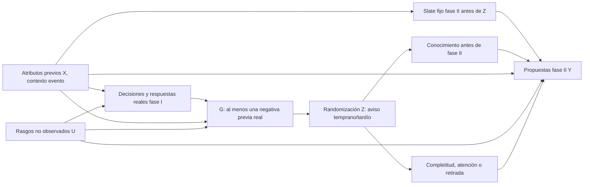

# ESBM — Falsador humano mínimo de aprendizaje privado: temporización de avisos reales

**Carácter:** `NONCYCLE_ANALYTICAL_DESIGN` · fecha 2026-10-29 · rama `research/ab-r-mercados-pareja-20261028` · HEAD precedente `71e72c77191efd5c844a3df19db8fbf0051820f5`. **Se documentan diez iteraciones analíticas adversariales RA01–RA10: no son ciclos A–J, ni PLANNING_AB_ONLY ni experimentos ni ejecuciones.** Una nueva hipótesis de diseño se propone; no hay prerregistro confirmatorio, sujetos, datos nuevos ni simulaciones nuevas. La orden de diez ciclos se satisface únicamente como **diez revisiones intelectuales**, pues el bloqueo R5 y la ausencia de plazas liberadas prohíben fingir diez AB-R válidos.

**Estado a conservar:** 26/40 ciclos AB-R válidos acumulados; N93–N106 = 14 reservados/no liberados, 0 plazas actualmente abiertas; 0 ciclos consumidos en este documento, 0 invalidaciones, 0 planning, 0 hallazgos originales nuevos; CT2 ordinal 7/100, madurez ponderada 41.20%, 100 SOURCES /30 PRIORS /150 UPDATES, `STOP_R5_EXTERNAL`. Ningún registro de resultados/scorecard/priors cambia.

## 1. Elección: una sola hipótesis, no todo ESBM

**H-FB-TIME (candidata y NO PRERREGISTRADA):** entre adultos que ya enviaron solicitudes reales y recibieron al menos un **rechazo explícito** antes de aleatorizar, ¿recibir información veraz y privada de ese rechazo **antes**, en lugar de **después**, de una segunda tanda de candidatos verdaderamente elegibles y preasignados **aumenta las nuevas propuestas emitidas**?

En el código original `research/ABR_ESBM20_20261028/esbm_dynamic.py`, una respuesta negativa a una propuesta activa `private_bias[i]=min(.80, private_bias[i]+.08)`, y `send_util` incluye `+ private_bias[i]`. A igualdad de candidatos, shocks y demás condiciones, `sigmoid(send_util)` **sube estrictamente para agentes no saturados** al aumentar el sesgo: `σ'(x)=σ(x)(1−σ(x))>0`. Esta es **predicción dirigida y mecánica del simulador**, no una afirmación sobre respuestas psicológicas de personas. N90 comparó aprendizaje inmediato, diferido y silencio solo en agentes sintéticos: las seis semillas tuvieron **diferencias de formación de signos mixtos**. Por ello, la prueba candidata se limita al efecto proximal en propuestas, **no** promete más parejas ni duración.

**No se reivindica originalidad.** Lenton–Francesconi (SRC038), Pronk–Denissen (SRC086) y otros ya investigan abundancia/opciones/rechazo. Un ITT positivo podría deberse a saliencia, creencias, fatiga, información racional o estrategias distintas de `private_bias`. El modelo temporal flexible B6 puede explicar el mismo dato. El propósito es poner a prueba **una implicación falsable de signo** y cuantificar claramente lo no identificable.

## 2. Diez revisiones adversariales internas, completadas como razonamiento documental

| Revisión NO_AB | Primera idea | Falsador / objeción | Corrección irreversible del diseño |
|---|---|---|---|
| **RA01 — outcome** | Medir parejas finales | Matching, disponibilidad y supervivencia confunden el mecanismo; N90 muestra heterogeneidad | Outcome único: propuestas afirmativas por oportunidad preasignada |
| **RA02 — confusión** | Comparar personas rechazadas contra no rechazadas | Deseabilidad, preferencias y características no observadas influyen en ambos | Randomizar **momento del aviso** entre quienes ya tienen un no verdadero, nunca rechazo en sí |
| **RA03 — secuencia** | Comparar votaciones en orden libre | Ranking, fatiga, indexado y selección de candidatos; N91/N92 demuestran fragilidad interna | Congelar slates de segunda fase antes de Z y aleatorizar su orden independientemente |
| **RA04 — denominador** | Analizar solo vistas/completadas | Condicionar en vista o respuesta postratamiento produce sesgo | ITT por participante y número fijo de oportunidades planificadas; missing y abandono aparte |
| **RA05 — autenticidad** | Usar predicción del rechazo del otro | El otro puede contestar otra cosa; no respuesta no equivale a no | Exigir respuesta negativa **nativa y real**, con solicitud original entregada y hora |
| **RA06 — rivales** | Comparar con permutaciones globales o baseline ingenuo | Modelo ESBM tendría más información sobre historia y selección | B0, B1/SRM, B2, B3, B4, B6 reciben campos y presupuesto comparables |
| **RA07 — interferencia** | Randomización individual incondicional | Candidatos compartidos y mensajes de una persona cambian oportunidades de otras | Antes de medir fase II, bloquear respuestas/contacto de fase II y congelar disponibilidad; si no, randomizar mercados y reevaluar diseño |
| **RA08 — inferencia** | Contar cada voto como n independiente | Dependencia entre votaciones del mismo actor, candidatos y mercados; leakage | Estadístico ITT a nivel actor/unidad de randomización; inferencia permutacional/cluster y holdout protegido |
| **RA09 — seguridad** | Notificar rechazos sin más | Daño emocional, divulgación, coerción, datos íntimos | Nunca provocar/fingir rechazos; avisos verdaderos, consentidos y minimizados; comité ético y DPO; si no apto, STOP |
| **RA10 — ciencia** | Interpretar τ positivo como victoria ESBM | Positivo también compatible con rivales flexibles; módulo sintético impuesto | Resultados positivos solo consistentes; negativos refutan signo contextual; ausencia de evidencia deja STOP; no 2/3 |

**Dictamen de las diez revisiones:** 10 objetos de crítica metodológica registrados; **0 ciclos AB realizados**. El número de revisiones **no** se transfiere a `cyclesGranted`, `N93–N106`, ledger A–J ni CT2.

## 3. Objeto causal, variables, diseño y problema ético

Una propuesta futura necesitaría un grupo **adulto, voluntario y lícitamente autorizado**, de personas que expresan interés romántico genuino. **Fase I:** cada `i` tiene oportunidades reales con candidatos previamente elegibles `j`. Registros nativos `O_ij` de oferta vista/entregada, `A_ij` de propuesta sí/no de i, y `R_ji` de decisión sí/no de j **solo tras A=1**; silencios, ausencia y opt-out se conservan separados. Para entrar al subgrupo experimental `G_i=1`, `i` tuvo al menos un `R_ji=0` real antes de asignación `Z`, ha dado consentimiento específico para estudiar notificaciones, y existe una segunda lista de candidatos nuevos elegibles en una fecha fija. Este subgrupo seleccionado no representa todo el mercado ni todas las orientaciones.

**Aleatorización propuesta:** después de cerrar todas las respuestas de fase I, randomizar `Z_i=1` (comunicar **antes** de fase II la **cantidad mínima** de negativas auténticas a i, sin revelar identidad de quienes dijeron no) frente a `Z_i=0` (comunicar exactamente la misma información **después** del segundo bloque). La información positiva y reglas de contacto siguen idéntico calendario en ambos brazos. **No introducir engaño**, rechazos artificiales ni obligación de recibir información potencialmente dañina. Si una notificación anónima puede permitir deducir quién rechazó, evaluarlo como riesgo significativo y modificar o **cancelar** diseño. La demora de mensajes reales requiere consentimiento y aprobación, no se puede asumir admisible.

**Fase II:** asignar **antes de Z** a cada participante `m` candidatos nuevos, realmente elegibles y dispuestos a recibir propuestas, con `m`, orden y tiempo de decisión congelados; la posición se randomiza dentro de la asignación. No revelar al público ninguna respuesta bilateral durante esta fase; mantener disponibilidad del slate fijo hasta medir propuestas. Los receptores contestarían después mediante respuestas nativas separadas para poder auditar reciprocidad; sin contacto automático ni exposición de un rechazo.

Definir `Y_i(z)=m^{-1}Σ_{ℓ=1}^m I{\text{propuesta efectivamente enviada antes del límite a candidato asignado ℓ bajo }z}`. **Outcome conductual de envío, NO preferencia psicológica.** Una oportunidad sin propuesta registrada suma cero en el evento de envío (no implica preferencia negativa); por separado se publica proporción de pantallas entregadas, realmente mostradas, abandonos y datos faltantes. Si la oportunidad no fue presentada correctamente, reportar desviación y cotas sin reducir artificialmente denominador postratamiento.

**Estimando primario** en la subpoblación `G=1` predefinida antes de Z:

```text
τ_ITT = E[Y_i(1) − Y_i(0) | G_i = 1].
```

`τ_ITT` mide **efecto de avisar antes vs después** entre personas ya rechazadas, no efecto de recibir un rechazo, ni de formar pareja, ni de prestigio. Requiere randomización íntegra, consistencia, tratamiento realmente entregado cuando corresponde y régimen sin interferencia suficiente para ITT individual. No controlar por «vistas realmente realizadas» o «continuó en el estudio» si son posteriores a Z: son posibles mediadores/colisionadores.

**Hipótesis candidatas excluyentes para la dirección:** `H_ESBM: τ>0` (a igualdad de slate y de rechazo real, activación positiva tipo `private_bias`); `H_static: τ=0` (composición, homofilia y efectos de actor sin sensibilidad a aviso); `H_withdrawal: τ<0` (desánimo/mayor selectividad); `H_alt: τ>0` por motivos que **no** son `private_bias` (saliencia/creencias/sesgo de demanda). Las dos primeras son distinguibles con suficiente variación exógena; `H_ESBM` y `H_alt` **no son distinguibles por τ solo**. Esa frontera debe constar en cualquier artículo.

## 4. DAG de identificación y selección



**Nota:** el DAG expresa supuestos de diseño hipotéticos, no causalidad verificada. `G` depende de resultados **previos** a Z, por lo que la randomización identifica `τ` condicionado en G, no transporta al resto. `M` es postratamiento. Desincronización de respuestas, conversación entre participantes y competencia por candidatos pueden añadir flechas de interferencia que invaliden el análisis individual; verificar **antes** de ejecutar, o randomizar eventos completos y obtener suficiente número de eventos para inferencia.

## 5. Matriz de rivales competentes del blueprint B0–B8

| Rival | Relación con el outcome primario | Requisito |
|---|---|---|
| `B0` composición/riesgo | H0 estático; con slates fijos y Z aleatoria, no predice ITT por composición | Igual elegibilidad y lista de oportunidades |
| `B1` actor-target/SRM | Controla heterogeneidad de envío/recepción y dependencias | Mismos atributos pre-Z, clustering adecuado |
| `B2` homofilia directa | Puede explicar afinidades pero no aviso aleatorio sin canal adicional | Variables ex ante con paridad informativa |
| `B3` modelo secuencial de referencia | Rival fuerte de transición propuesta/respuesta sin `private_bias` | Observar ambas etapas y no imputar R si A=0 |
| `B4` ranking, fatiga, saturación | Competidor fuerte de orden temporal | Mismos slates, posiciones aleatorizadas, ventanas y deadlines |
| `B5` institución de matching | **Fuera del outcome proximal**: no se prueba aquí formación | No atribuir victoria contra asignador |
| `B6` historial y feedback flexible | **Rival más fuerte**: notificación con efectos psicológicos libres | Puede reproducir τ>0; comparar predicción temporal no tautológica con nuevos datos |
| `B7` duración | **Fuera del outcome**: no hay seguimiento de uniones | No afirmar estabilidad ni bienestar |
| `B8` saturado diagnóstico | Reproduce joint observado pero no mediación | Diagnóstico, no explicación causal exclusiva |

**Regla R2:** para evaluar ESBM vs B6, imponer misma información previa, mismo presupuesto de entrenamiento, mismo número de participantes independientes y holdout fuera de cohorte. No comparar una relación determinista del simulador contra un control ciego a Z. El signo ITT por sí solo NO demuestra superioridad sobre B6.

## 6. Falsadores, análisis e inferencia; NO se fija tamaño ficticio

- **Estimación causal:** diferencia de medias ITT por unidad de randomización `i` con balance y estimación estratificada prevista; análisis de aleatorización/permutación cuando viable. Si hay dependencia cruzada por targets, eventos y actores, inferencia multinivel/cluster en número **real** de unidades independientes; ni m votos ni N díadas son m×N sujetos iid. No confiar en robustez por cluster con apenas dos eventos.
- **Primario único:** número de propuestas enviadas sobre m oportunidades fijadas. Un solo contraste causal primario de dirección, intervalo e hipótesis se preregistraría en trabajo **posterior** al acceso legal. Diagnósticos de reciprocidad, heterogeneidad por número de negativas de fase I, tiempos y posición son secundarios y requieren planificación de multiplicidad antes de ser confirmatorios.
- **Resultado adverso:** intervalo adecuado totalmente por debajo de cero, si la intervención se entregó, es evidencia contraria a la predicción positiva del operador en esa población/contexto, **no** refutación de todas las teorías de emparejamiento. Intervalo por encima de cero implica consistencia de signo pero **no identificación** de `private_bias` frente a `H_alt` ni 2/3. Intervalo que incluye cero es inconcluso, no confirmación ni refutación. Si se exige relevancia práctica `δ`, fijarla con evidencia independiente pre-resultados; equivalencia en `[-δ,+δ]` requiere método y potencia adecuados.
- **Comportamiento social:** monitorizar abandono, distress comunicado voluntariamente, reportes de daño y retirada. Cualquier señal de daño que traspase umbral de seguridad predefinido exige detener la recogida, aun si perjudica la estimación.
- **Tamaño y potencia:** establecer a priori con tasa base de propuestas, probabilidad de elegibilidad G, prevalencia de rechazo real, número de eventos, correlación intrapersona/mercado, cumplimiento, diferencias mínimas útiles y datos piloto legalmente separados; no inventar N. Un investigador que ya examinó outcomes de una muestra no puede llamar «holdout nuevo» al mismo archivo.

## 7. Diccionario mínimo de datos y gates éticos

`participant_event(event_id, actor_pseudonym, adult_consent_version, eligible_pre_Z, phaseI_history, dropout_time)` · `phase1_offer(offer_id, sender, receiver, offered_at, delivered_at, sent_yes_no_optout, responder_actual_yes_no_optout, responded_at)` · `phase2_slate(event_id, sender, offer_id, target_pseudonym, eligibility_snapshot, m, order, frozen_before_Z)` · `randomization(event_id, sender, Z, allocated_at, strata_pre_Z, arm_probability)` · `feedback(notice_id, sender, authentic_negative_count, scheduled_at, delivered_at, noncompliance)` · `phase2_action(offer_id, shown, seen_proxy, submitted_yes_no_optout, action_sent_at, missing_reason)` · `phase2_reply(offer_id, receiver_native_yes_no_optout, actual_response_time)` · `provenance(file_license, participant_use_authorization, original_sha256, codebook_version, access, retention_and_deletion_policy)`.

Las personas autorizadas que acepten solicitudes deben poder rechazar y retirarse; ningún «sí» implica obligación de encuentro. La tabla de reidentificación nunca se deposita en GitHub y las pseudónimas tampoco se publican si su grafo permite reconstrucción. Mantener cifrado, retención mínima, acceso limitado, supresión de celdas pequeñas y auditoría de privacidad. Requerir **autorización expresa** de operador/institución, evaluación ética y revisión DPO/GDPR del tratamiento de datos íntimos. No se autorizan notificaciones reales, reclutamiento, modificación de productos ni contacto con autores o participantes mediante este documento.

## 8. Plantilla A–J futura, expresamente NO PRERREGISTRO

**A** pregunta temporal; **B** hipótesis H_ESBM/H_static/H_withdrawal/H_alt y rivales B0–B8 relevantes; **C** población G=1, estimando τ y denominador; **D** aleatorización, estratos, medición y QA; **E** `NOT_FROZEN` — futura especificación/código SHA y commit **antes** de outcomes; **F** `NO_RESULTS`; **G** controles de igualdad slates, randomización, avisos reales y no difusión; **H** multiplicidad/holdout y clustering por unidad real; **I** grados separados de predicción, causalidad local, mediación no identificada, transporte, novedad y ética; **J** STOP_R5 hasta fuente legal y evidencia discriminante, nunca consumir créditos para completar lista.

**Negativos históricos intactos:** N83 mostró un joint `P(E,Y_i,Y_j)` idéntico con efectos `do(E)` 0 vs +.24. N88 indicó que cardinalidad máxima en cada grafo no asegura máxima formación acumulada. N89 mostró que reputación global codificada difiere del conocimiento del testigo. N90 mostró sensibilidad al calendario del aprendizaje, no aprendizaje humano. N91 falló invariancia a permutar IDs en política balanceadora 18/18. N92 recuperó 0/18 cambios con snapshot pero alteró formaciones con signos mixtos. Ninguno confirma aquí `H_ESBM`.

**Regla final:** la fase inicial de acceso a evidencias humanas continúa bloqueada. Una hipótesis conceptualmente clara no libera automáticamente N93–N106. Sin cohortes nuevas autorizadas con oportunidades verdaderas, decisiones nativas, licencias verificadas, exposición temporal, privacidad, controles y preregistro por commit **previo**, la decisión permanece `STOP_R5_EXTERNAL`. Este documento debe permanecer exploratorio, no se renombra retroactivamente a A–J congelado. Las 10 rondas RA01–RA10 **no se contabilizan como ciclos científicos**.

**Referencias canónicas del repositorio:** [blueprint](ESBM_IDENTIFIABILITY_AND_FALSIFICATION_BLUEPRINT.md); [ESBM v2](ABR_ESBM20_20261028/esbm_dynamic.py); [teoría](ABR_ESBM20_20261028/THEORY_V2.md); [N83](ABR_BATCH5_N83_IDENTIFIABILITY_20261029/REPORT_N83.md); [N90](ABR_BATCH2_N90_PRIVATE_LEARNING_TIMING_20261029/REPORT_N90.md); [N91](ABR_BATCH2_N91_ACTOR_RELABEL_ORDER_20261029/REPORT_N91.md); [N92](ABR_BATCH2_N92_VISIBILITY_SNAPSHOT_CAUSAL_20261029/REPORT_N92.md); [SOURCES](PRIORS/SOURCES.json); [PRIORS](PRIORS/PRIORS.json); [UPDATES](PRIORS/UPDATES.json); [método AB 3.2.1](../../../docs/METODO_AB_3_2_1.md).

