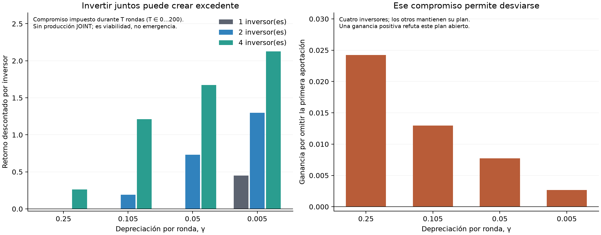

# V201-R: auditoría de Hydrogen y controles constructivos

16 de noviembre de 2026. Estado: **POST_HOC_THEORY_AUDIT**, con cálculos y controles ejecutados. No es una campaña MARL confirmatoria ni una institución aprendida. La CT2 histórica de la rama anterior permanece en **61**; esta propuesta nueva sigue **sin puntuación**. No se concede un nuevo 1/3, 2/3 o 3/3. N2 = N3 = 0.

La reconstrucción de Hydrogen mejora el borrador V201: elimina transferencias automáticas y condiciona correctamente las probabilidades a la señal privada. Pero **su declaración de viabilidad exacta no se sostiene**. La banda de depreciación propuesta mezcla un stock autárquico no resuelto, un perfil de participación que permite desviaciones y una amenaza cuyo cumplimiento no se ha demostrado. Los controles permiten rescatar preguntas precisas, no la demostración original.

## Procedencia y alcance

Se leyeron íntegramente los dos textos aportados por el investigador y se preservaron sus bytes. El texto revisado tiene SHA-256 `82592df070764a5889df4227536fd24bdaf935512de5965aa02aa77197eda411`; la crítica anterior, `384a59baf12c15723ca64ed6a6d4b1158b8b88953caf070a956dc931139e7672`. Son propuestas y críticas de asistentes, no artículos publicados ni evidencia empírica independiente.

Se implementaron cinco controles: enumeración de incentivos, Bellman individual, trayectorias de inversión conjunta, certificados relacionales a capital fijo y una segunda cota de Bellman con transiciones optimistas. El análisis y la figura ensamblan sus salidas. Los seis procesos se ejecutaron también en una carpeta nueva y reprodujeron todos los valores de los seis JSON científicos. No hay semillas, intervalos de confianza o significación estadística: son problemas deterministas y desigualdades bajo supuestos explícitos. No se disfrazan de experimentos preregistrados.

Se consultaron también los informes y resultados de V200 ya existentes. No se repite aquí su experimento de derecho de salida ni se presenta como una nueva réplica. Tampoco se modifica la evidencia archivada de V199.

## 1. Bayes correcto; la política propuesta no es un equilibrio

Los posteriores `p+ = 52/59` y `p− = 13/41` son correctos. Las 40 comparaciones de pagos condicionales con una enumeración independiente de estados y señales discrepan como máximo en **1,39 × 10⁻¹⁶**.

Sin embargo, cuando todos los demás siguen su señal y se mantienen los tres pagos prometidos:

| Contraste | JOINT menos AUTARKY |
|---|---:|
| Ordinario L=1, señal negativa, S=0,8903152455 | **+0,0297029012** |
| Ordinario L=7, señal negativa, S=1,5 | **+0,0210041905** |

El primer caso contradice que todos sigan su señal en la región propuesta. El segundo contradice la cota negativa declarada para L=7 hasta S=1,5. Estas son desviaciones individuales dentro de un control con roles y capital fijados; no son una refutación de toda posible organización con capital.

## 2. Tres pagadores y umbral dos dejan una desviación gratis

Si tres ordinarios prometen pagar 0,25 y al crítico le bastan dos pagos para continuar, cualquiera puede omitir su pago: conserva 0,25 y siguen quedando dos pagos. La continuación descrita no cambia. Una paciencia mayor no elimina esa desviación.

Dos pagadores designados con umbral dos, o tres con umbral tres, hacen pivotal al pagador. **Ser pivotal es necesario para esa amenaza concreta, no suficiente para un equilibrio secuencial.** Todavía hay que comprobar las rentas futuras, la información y la credibilidad del castigo.

La memoria tampoco está definida completamente. Si el recuento se reinicia en cada ronda sin producción GOOD, la probabilidad de renovar la relación bajo la política original es 0,26624 y la duración media hasta interrumpirla es 1,36284 rondas. Si solo se actualiza en la última oportunidad exitosa, se trata de otra política. Con memoria inicial cero y activación exclusivamente cuando el recuento previo alcanza dos, el estado inicial queda bloqueado salvo que se introduzca una regla de arranque o exploración.

## 3. El arranque privado falla en los valores intermedios

Con trabajo opcional, el retorno operativo autárquico es

`g(S) = max{0, 0,25(1−exp(−S)) − 0,05}`.

Solo es positivo si `S > −ln(0,8) = 0,2231435513`. Una inversión de 0,04 produce como máximo 0,00980264 de producto bruto en la ronda siguiente, por debajo del coste de trabajar. El cálculo marginal de Hydrogen presupone que se trabaja y omite esta opción de descanso. Además, usa una aproximación infinitesimal para una inversión finita.

Esto no basta para descartar una secuencia rentable de inversiones. Por ello se resolvió el problema dinámico completo **de un agente autárquico**:

`V(S) = g(S) + max{β V((1−γ)S), −0,04 + β V((1−γ)S+0,04)}`, con `β=0,95`.

La inversión se interpreta favorablemente como esfuerzo costoso sin restricción de financiación. No hay renta conjunta, transferencias o inversión de otros agentes. El stock máximo usado no limita ningún estado alcanzable desde cero por un solo inversor. No se afirma haber resuelto el juego de cuatro agentes.

| γ | V(0), aproximación por interpolación | Cota superior independiente del valor de invertir primero | Dictamen individual desde cero |
|---:|---:|---:|---|
| 0,25 | 0 | −0,03999999998 | Descansar es óptimo |
| 0,105 | 0 | −0,03999999998 | Descansar es óptimo |
| 0,05 | 0 | −0,03999999998 | Descansar es óptimo |
| 0,005 | 0,44945838 | +0,45853547 | Existe una política rentable |

El primer método usa tres mallas, una cota de interpolación y el residual de Bellman. El segundo redondea todas las transiciones de stock hacia arriba, comienza en una cota global y utiliza guardas positivas de 10⁻¹²: es otro algoritmo, sin interpolación. La monotonía de la producción lo convierte en un control optimista. Si incluso su valor de invertir primero es negativo, en S=0 queda `V(0)=βV(0)=0`. Las desigualdades tienen margen amplio frente al error numérico; no se presenta el código como una biblioteca de aritmética de intervalos formalmente verificada.

Para γ=0,005, una política evaluada sobre el estado continuo obtiene **0,4494601648**. La suma se trunca en 2.000 rondas y puede completarse dejando de invertir: las recompensas posteriores son no negativas. Es un testigo de viabilidad, no una prueba de optimalidad continua por convergencia de malla.

La fórmula `S_aut(γ)` del texto no es un equilibrio dinámico de cuatro inversores. Con producción conjunta, sus incentivos de inversión cambiarían. No se puede fijar ese stock para excluir todos los equilibrios relacionales de una depreciación.

## 4. Invertir juntos sí puede ser rentable, pero el compromiso no se sostiene solo

Se evaluó una familia transparente: n inversores aportan cada uno 0,04 durante T rondas y después paran; cada uno cobra únicamente su producción autárquica. Se examinó T de 0 a 200 y se verificó la trayectoria mediante dos cálculos diferentes, con discrepancia máxima **2,45 × 10⁻¹⁵**. No hay un planificador aprendido, negociación ni reciprocidad en este control.

| γ | Mejor testigo con 1 inversor | Con 2 | Con 4 | Ganancia de omitir la primera aportación, con 4 |
|---:|---:|---:|---:|---:|
| 0,25 | 0 | 0 | 0,263379 | **+0,024243** |
| 0,105 | 0 | 0,192803 | 1,211541 | **+0,012987** |
| 0,05 | 0 | 0,732790 | 1,671868 | **+0,007720** |
| 0,005 | 0,448332 | 1,299077 | 2,127035 | **+0,002670** |

Los valores son retornos descontados por inversor, no medias de réplicas. Las trayectorias suponen que no se alcanza un límite físico de stock; S_max no fue especificado por Hydrogen. Cuando el T seleccionado es 200, solo se ha alcanzado el borde de la familia examinada, no un óptimo global.

En γ=0,05, por ejemplo, un agente solo no arranca, mientras dos agentes comprometidos obtienen excedente. Omitir una contribución puede ser rentable si los demás mantienen su plan. **El capital introduce un problema propio de coordinación e incentivos; no demuestra que se haya resuelto el arranque autónomo.** La desviación refuta ese compromiso abierto, no todos los posibles acuerdos contingentes.

## 5. Control constructivo: un acuerdo válido exige cambiar política e información

Para comprobar que el problema no es una imposibilidad algebraica total, se construyó otro juego: capital y roles fijos, pérdidas conocidas, estados y señales IID, y **recuento de pagos públicamente observado**. Después de un impago insuficiente todos pasan permanentemente a AUTARKY; una ronda sin producción exitosa no reinicia la memoria. En el castigo, AUTARKY es un equilibrio débil de etapa por unanimidad. Se eliminan inversión, depreciación, salida y cambio de rol del control.

Las restricciones de participación y pago son afines en `f=1−exp(−S)`. Se resolvieron exactamente con fracciones para las 16 asignaciones de pérdidas. Hay **164 intervalos** de perfiles certificados en esta familia; no son 164 descubrimientos ni réplicas. Una enumeración separada verificó 656 rentas con error máximo **1,11 × 10⁻¹⁶**.

Para pérdidas por rol `[1,1,7,7]` existe este ejemplo:

- Los dos ordinarios L=1 eligen JOINT con ambas señales y son los únicos pagadores, 0,25 cada uno.
- El ordinario L=7 y el crítico L=7 siguen su señal.
- El umbral de pagos es dos; la memoria pública se conserva entre oportunidades exitosas.
- El perfil satisface las restricciones si **f ≥ 400/797**, es decir, **S ≥ 0,6969183981**.

En el stock de referencia 0,8903152455, las rentas adicionales por ronda son `[0,07611368; 0,07611368; 0,09611368; 0,12711368]`. Cada pagador pierde 1,44616 de renta futura descontada si incumple, por encima del ahorro inmediato 0,25.

**Este certificado corresponde al juego reparado y a una estrategia impuesta. No es la prueba del modelo privado original ni evidencia de emergencia.** Si únicamente el crítico castiga y los ordinarios siguen sus políticas y pagos previos, al crítico le resulta rentable volver a JOINT ante señal positiva: gana **0,2154469224** en la etapa actual. No se ha demostrado una imposibilidad general con observación privada; se rechaza esa amenaza concreta.

## 6. El bloqueo por capital obsoleto necesita resolver la salida

En el control individual con γ=0,005, acceso garantizado a tierra nueva y coste de salida 0,12, abandonar permite un retorno factible **≥ 0,3294601648**. Esperar pasivamente las 455 rondas necesarias para que el stock de referencia baje a 0,15 da una cota superior **≤ 3,61 × 10⁻¹¹** bajo las condiciones del control.

Por tanto, el bloqueo no se deduce solo de que el capital sea poco depreciable. Esto no resuelve una migración colectiva con capacidad: los 64 agentes ya ocupan las 16 sedes de capacidad cuatro de la propuesta. Hay que especificar vacantes, creación de sedes, acceso y coordinación del traslado.

Tampoco son equivalentes un único choque programado y choques Poisson que pueden reiniciar una reconstrucción. Las fracciones funcionales `1/(1+σB)` y `exp(−σB)` pertenecen a procesos diferentes. Faltan S_max, σ, el tiempo de reconstrucción y la definición de financiación y derechos de uso. El brazo S=0 elimina también toda prima productiva conjunta, de modo que su fracaso no identifica la durabilidad por separado.

## 7. Antecedentes que limitan la originalidad

La revisión es dirigida y declara su alcance; no pretende haber leído íntegramente todos los trabajos ni resolver la prioridad mundial.

| Fuente primaria | Relevancia y lectura realizada |
|---|---|
| [Brown y Taddei, 2007](https://doi.org/10.1371/journal.pone.0000593) | Dinámica de bienes públicos duraderos separada de la frecuencia de cooperadores. Se consultaron resumen, planteamiento y métodos. La memoria material por sí sola tiene antecedente. |
| [Baker, Gibbons y Murphy, 2002](https://doi.org/10.1162/003355302753399445) | Propiedad de activos e incentivos para incumplir contratos relacionales. Resumen, introducción y proposición principal; no todos los apéndices. |
| [Halac, 2015](https://doi.org/10.1111/1756-2171.12080) | Inversión específica previa que puede mejorar incentivos relacionales y efectos de observar sus retornos. Se consultaron resumen e introducción del original de autora y metadatos editoriales. Es un antecedente especialmente cercano al supuesto anclaje material. |
| [Battaglini, Nunnari y Palfrey, 2016](https://doi.org/10.1257/mic.20150126) | Experimento humano de inversión voluntaria en bienes públicos duraderos, reversibilidad e historia. Se leyeron las primeras cinco páginas del PDF original y se localizó su paquete de replicación. La relación entre acumulación y free riding ya está estudiada. |
| [Halonen-Akatwijuka y Pafilis, 2020](https://doi.org/10.1016/j.jebo.2020.10.002) | Mantenimiento repetido de bienes comunes, propiedad y cumplimiento de sanciones. Resumen, introducción y descripción del modelo del manuscrito aceptado; no todos sus resultados. |
| [Harstad, Lancia y Russo, 2019](https://doi.org/10.1093/jeea/jvy055) | Inversión tecnológica repetida y acuerdos autocumplidos. Resumen e introducción del original. Relacionar inversión con cumplimiento tampoco es una clase nueva de mecanismo. |
| [Smith y Wen, 2017](https://doi.org/10.1007/s40881-017-0033-2) | Inversión votada en productividad y contribuciones voluntarias posteriores. Se consultó el resumen editorial, no el artículo de pago completo. |
| [Yamamoto y Goto, 2024](https://doi.org/10.1038/s41598-024-73353-4) | Decisiones alternas/simultáneas con/sin opción de no participar. Se revisaron texto, resultados y métodos; no contiene capital local ni demuestra el mecanismo de Hydrogen. Los datos y auditorías V143–V144 ya existían en el proyecto y no se cuentan otra vez como confirmación. |

No se redistribuyen estos PDFs. El artículo humano de 2024 tampoco autoriza la conclusión general «alternancia más salida produce la institución»: los resultados dependen del juego y ya existe una discrepancia documentada entre 394 participantes completados declarados y 312 registros humanos publicados. No se adopta como confirmación externa del modelo propuesto.

## Dictamen y decisión

**REPAIR del argumento; STOP_LOCAL de la campaña larga V201-R tal como está formulada. El programa científico continúa.** El criterio de subir CT2 no es haber escrito más código: faltan una predicción novedosa frente a estos antecedentes, un modelo completo con incentivos creíbles y evidencia independiente pertinente.

La reparación útil es separar adquisición de capital, participación productiva y cumplimiento. Hay controles positivos concretos contra los que medir aprendizaje. Antes de añadir simultáneamente movilidad, roles, inversión y obsolescencia, cualquier siguiente experimento de institución aprendida debe permitir que los agentes adquieran o rechacen las reglas y debe superar intervenciones de impago, perdón y cambio de información. El certificado público proporciona un rival fuerte; no debe instalarse como si fuese el resultado emergente.

Las comprobaciones computacionales independientes pertenecen al mismo programa y autor. No sustituyen la confirmación externa exigida para 2/3. No se pide otro cupo: el investigador ya autorizó la continuación autónoma.

Los scripts, JSON y sus hashes constan en `V201R_SCIENTIFIC_SYNTHESIS.json`, `V201R_AB_AUDIT_LEDGER.json` y `REPRODUCE_V201R.md`. El ledger preserva los intentos y borradores previos. La trayectoria CT2 anterior se conserva como historia sin añadir puntos artificiales a una rama aún sin puntuación.
