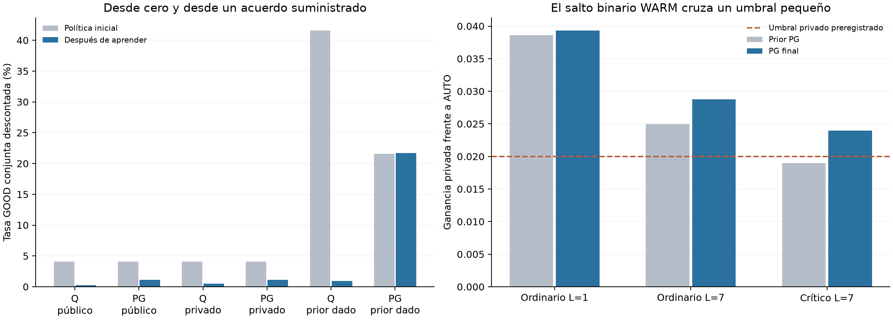

# V202: adquisición privada de pagos relacionales

16 de noviembre de 2026. **Resultado primario: FAIL.** Campaña ejecutada y terminada correctamente, 32 raíces de entrenamiento × seis brazos × ocho grupos × 60.000 rondas: **192 corridas y 92.160.000 rondas de grupo**. Son 32 raíces independientes emparejadas, no 1.536 réplicas independientes. CT2 histórica 61 sin cambio; la rama nueva sigue sin puntuar. N2=N3=0, ningún N1 nuevo concedido. El objetivo científico global permanece activo.

## Qué incertidumbre resolvía

V201-R dejó un acuerdo viable con capital y roles fijos, observación pública y pagos contingentes. Faltaba comprobar su adquisición. V172 ya había conseguido profesiones y adopción bajo una gramática con salarios y multas ejecutados por el simulador. V202 retira ese cumplimiento automático: producir conjuntamente y pagar son decisiones privadas que se pueden rechazar. No hay multa, sanción, transferencia automática ni norma de castigo incorporada durante entrenamiento.

El contraste no estudia aún formación de grupos, profesiones o infraestructura: esos elementos están fijados para aislar el cumplimiento aprendido. El menú y calendario de pagos, la tecnología y la información siguen siendo diseño externo. Un resultado positivo habría sido una puerta hacia el programa completo, no una institución social inventada ni evidencia suficiente para 2/3.

## Registro anterior a las corridas

Protocolo, motor, evaluación exacta, análisis primario y auditorías técnicas quedaron congelados en [358df109](https://github.com/GalexY3/Metodologia-AB/commit/358df109d6e0fefdded66b9c68751665393ac3c5). Los 11 archivos se descargaron y sus hashes se verificaron antes de crear el directorio científico. El recibo y FREEZE conservan esa secuencia. No se ajustaron tasas, arquitectura, presupuesto ni umbrales tras observar los resultados.

Se preservó un error previo del auditor: supuso que la primera oportunidad GOOD llegaba en t=0. Llega geométricamente; la expectativa correcta de su tasa descontada es `0,05×0,416 / [1−0,95(1−0,416)]`. Se corrigió el test antes del registro, sin cambiar el motor para satisfacerlo. Los ensayos técnicos de semillas 90000–90002 no son resultados científicos. La serialización del RNG Philox también fue comprobada antes de registrar.

## Modelo y aprendices

Cuatro agentes de roles fijos, pérdidas ordinarias [1,1,7] permutadas por grupo y crítico L=7. El stock S=0,8903152455 es una condición experimental, no un equilibrio de inversión. El estado favorable tiene probabilidad 0,65; señales privadas de fiabilidad 0,8. La producción requiere unanimidad JOINT; cualquier AUTO la bloquea y cobra su producto autárquico. Este último domina estrictamente el descanso al stock examinado. El crítico paga preparación 0,30 si intenta JOINT, aunque el grupo no complete.

Solo después de producción conjunta GOOD los ordinarios eligen pagar 0 o 0,25 al crítico. Son transferencias abstractas de utilidad de suma cero; no se modelan liquidez o riqueza financiera. Los agentes no observan retornos, pérdidas ni parámetros ajenos.

En PUBLIC todos observan el recuento de la última oportunidad exitosa. En PRIVATE el receptor conoce ese recuento y los pagadores recuerdan solo su propio pago. Ambos regímenes permiten recordar el último resultado físico y la señal propia. No hay memoria de identidad de otros. La cadena global del evaluador tiene 27 estados; enumerarlos para calcular pagos no los revela al actor privado.

Cada individuo tiene tablas propias, sin compartir experiencias o parámetros. IQL usa continuación temporal y tasa 0,05; PG usa REINFORCE por relación completa, baseline privado y gradiente de la política mixta realmente utilizada. Una relación termina exógenamente con probabilidad 0,05 por ronda. Eso implementa beta=0,95: **no se vuelve a descontar 0,95 dentro de la relación**. Los parámetros se conservan al comenzar una relación nueva. La exploración baja de 0,20 a 0,02; el calendario, presupuesto y semillas se fijaron de antemano.

COLD comienza indiferente. WARM incorpora explícitamente el acuerdo de referencia: los ordinarios L=1 pagan y participan; los L=7 siguen la señal; la respuesta depende del recuento. IQL WARM empieza con política codiciosa determinista y PG WARM con probabilidad 0,95 de cada acción prescrita. Por ello las diferencias WARM entre algoritmos no aíslan una única propiedad del optimizador.

## Criterio funcional y resultado primario

Se evaluaron políticas terminales congeladas sin simulación de trayectorias, resolviendo la cadena de Markov con beta=0,95. IQL usa su política codiciosa y PG sus probabilidades nativas; no se añade exploración en esta evaluación. Un grupo cumple el criterio funcional si simultáneamente:

1. Cada persona obtiene al menos 0,02 de utilidad normalizada adicional frente a AUTO.
2. Su tasa conjunta GOOD descontada y normalizada alcanza 0,20.
3. Deshabilitar los pagos manteniendo las políticas reduce esa tasa en al menos 0,10.

El tercer requisito comprueba dependencia causal de los pagos. No basta que pagos y cooperación coexistan. Ninguno de estos requisitos, por separado o conjuntamente, certifica un equilibrio.

H1 exigía que PG_PUBLIC_COLD alcanzara al menos 50% de grupos funcionales y superara a PG_PRIVATE_COLD en al menos 20 puntos porcentuales. Se remuestrearon 32 mundos emparejados, 20.000 veces, con dos intervalos 97,5% para el compuesto. Ambos brazos obtuvieron cero grupos funcionales: **H1 falla**. No se rescata con WARM ni con otro endpoint.

| Brazo | Funcionales / 256 | Tasa GOOD conjunta | Efecto de deshabilitar pagos | Media del peor margen privado del grupo |
|---|---:|---:|---:|---:|
| IQL público, COLD | 0 | 0,002366 | +0,000056 | −0,000874 |
| PG público, COLD | 0 | 0,011110 | −0,000436 | −0,071112 |
| IQL privado, COLD | 0 | 0,004754 | −0,000838 | −0,001888 |
| PG privado, COLD | 0 | 0,011346 | −0,000358 | −0,071466 |
| IQL público, WARM | 1 | 0,009516 | +0,001716 | +0,000023 |
| PG público, WARM | 256 | 0,216920 | +0,171212 | +0,023954 |

Cada cifra de tasa es `(1−beta) E[Σ beta^t indicador_GOOD]`; los márgenes normalizan el retorno de la misma manera. Los valores negativos de la ablación significan que retirar pagos mejora ligeramente esa tasa, no un nuevo efecto sociológico.

Los intervalos bootstrap registrados degeneran en [0,0] al observar todos los ceros. **Eso no prueba una probabilidad poblacional exactamente nula.** Como diagnóstico posterior se calculó una cota unilateral 95% usando 32 mundos sin ningún grupo funcional: `1−0,05^(1/32)=0,08937` para la probabilidad de que un mundo de ocho grupos produzca alguno. También acota conservadoramente su fracción funcional media. Depende de la independencia de mundos y de este generador; no se traslada a seres humanos.

## Por qué el 256/256 WARM no acredita emergencia

La evaluación inicial posterior al resultado primario permite ver el tamaño real del cambio. PG WARM ya tenía tasa GOOD **0,215640** antes de entrenar; acaba en **0,216920**, una ganancia absoluta de **0,001279**, aproximadamente 0,128 puntos porcentuales. La conducta cooperativa estaba casi toda suministrada.

El margen privado mínimo pasa de 0,018999 a 0,023954: cruza el umbral preregistrado de 0,02. Por eso la clasificación binaria pasa de cero a 256 grupos funcionales, aunque la tasa de cooperación cambie poco. La variación absoluta media de las probabilidades de la tabla es 0,000524. El entrenamiento mejora localmente un prior próximo al criterio; no demuestra invención de una norma.

Además, el criterio funcional no elimina desviaciones rentables. PG WARM tiene explotabilidad pública normalizada media **0,017990**, y ninguno de sus 256 grupos queda por debajo de 0,01. El único IQL WARM funcional permite una desviación de **0,063851**. **Ningún perfil público aprendido que satisface el criterio funcional alcanza explotabilidad ≤0,01.** El control de referencia determinista sí tiene explotabilidad numéricamente nula y tasa GOOD 0,416; está programado.

## Interpretación matemática posterior

Con políticas iniciales independientes de la historia, pagar cuesta 0,25 y todavía no provoca ninguna respuesta futura distinta: la ventaja condicional de pagar es **−0,25**. Mostrar el recuento públicamente no crea por sí solo una reacción contingente que nadie ha aprendido.

Para el crítico L=7 con compañeros inicialmente uniformes, JOINT frente a AUTO da **−0,312732** tras señal positiva y **−0,876588** tras señal negativa al stock utilizado. Incluso haciendo tender el stock fijo a infinito, la ventaja tras señal positiva no supera **−0,278072**. Se trata de una cota del estado inicial uniforme y capital fijo, no de una imposibilidad para otros perfiles, inversiones endógenas o algoritmos.

Esto explica una dirección inicial de incentivos hacia AUTO y hacia no pagar. No es un descubrimiento general sobre cooperación: la diferencia entre equilibrio cooperativo y su cuenca de adquisición tiene antecedentes sólidos. Las observaciones que motivaron esta interpretación no son confirmación independiente de ella.

## Competencia del aprendiz y límites

PG COLD sigue permitiendo una mejora privada simple: el crítico puede elegir AUTO siempre y evitar el peor margen medio de −0,0711. Su implementación correcta no demuestra competencia suficiente para todos los problemas de aprendizaje relacional. Por tanto, el fracaso de H1 no permite concluir que la información pública sea inútil para aprendices más fuertes ni que el cumplimiento voluntario sea imposible.

La mejor respuesta se resolvió exactamente solo en PUBLIC. Se incluyeron decisiones de pago posteriores a GOOD y se comprobó que conocer la máscara completa no proporciona valor adicional frente al recuento público. En PRIVATE solo se probaron desviaciones factibles con información propia; son cotas inferiores, no una solución óptima del POMDP. La evaluación del criterio funcional es común, y las dos clases de auditoría se mantienen separadas.

El contraste también mezcla actualización episódica frente a actualización por ronda y políticas nativas diferentes. No se atribuye todo a un único mecanismo de gradiente. No se probaron poblaciones variables, movilidad, aprendizaje de roles, inversión, otros stocks, horizontes o RNN competentes en esta campaña.

## Verificación y reproducción

La auditoría previa comparó 48 filas del operador con enumeración literal (error máximo 1,12×10⁻¹⁵), comprobó 96 invariancias de privacidad y 400 gradientes por diferencias finitas (error máximo 4,29×10⁻¹⁰), y certificó el control positivo. No son 544 ciclos científicos.

Una implementación JavaScript independiente volvió a enumerar literalmente estados, señales, modos y pagos. Usó iteración de valores, sin el operador factorizado ni el solucionador lineal de Python. Verificó **las 1.536 evaluaciones terminales, 9.216 magnitudes escalares**, y 32 mejores respuestas públicas seleccionadas por índices fijos (mundos 0 y 31, grupo 0). Errores máximos: **9,51×10⁻¹³** en evaluación y **1,81×10⁻¹²** en mejores respuestas. La segunda implementación es del mismo programa y autor; no es replicación científica externa.

Una carpeta nueva reprodujo el mundo 0 en los seis brazos, cuatro checkpoints cada uno: **24 archivos y 384 arrays/campos de estado idénticos**, incluidos Q, logits, baselines, buffers parciales, historias y RNG. No se afirma haber reentrenado las 32 raíces en un clon limpio. Las instrucciones permiten hacerlo; los estados completos y hashes se conservan.

## Decisión científica y continuidad

**H1 fallida, negativos preservados.** Se detiene esta configuración como vía para reivindicar adquisición autónoma; no se prolonga con un barrido de tasas para rescatar el resultado. El avance es haber separado rentabilidad de un acuerdo, mantenimiento cerca de un prior y adquisición desde indiferencia, con una auditoría de desviaciones que impide declarar institución a cualquier patrón rentable.

Antes de atribuir el fracaso a la información, hace falta un rival competente que supere la desviación privada obvia sin recibir recompensas o parámetros ajenos. Cualquier comparación nueva tendrá su propio registro y no cambiará H1. Una aportación 2/3 exige además novedad discriminante frente a antecedentes y confirmación independiente pertinente; este banco no las aporta por sí mismo.

Antecedentes primarios: [Haupt et al. 2024](https://doi.org/10.1007/s10458-024-09682-5), contratos vinculantes; [MATE 2024](https://doi.org/10.1007/s10458-024-09666-5), reciprocidad mediante protocolo de tokens; [Halac 2015](https://doi.org/10.1111/1756-2171.12080), inversión e incentivos relacionales. No se declara novedad por usar memoria, retornos futuros o pagos voluntarios. El capítulo y la evaluación matemática se integran como evidencia local para el TFM, manteniendo el objetivo completo de cooperación, especialización y organización autónoma.
