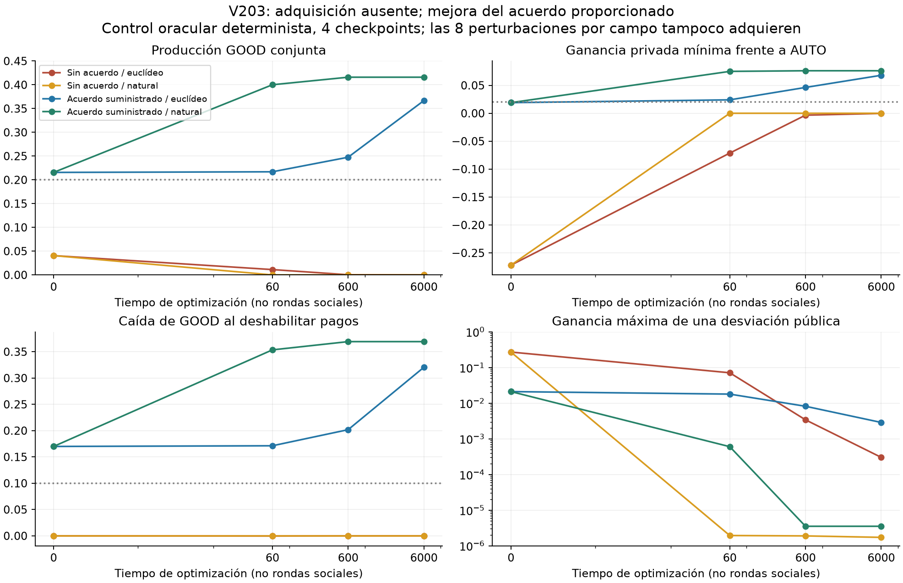

# V203: el gradiente exacto mejora un acuerdo suministrado, pero no lo adquiere desde el entorno ensayado

Registro prospectivo: [a739328](https://github.com/GalexY3/Metodologia-AB/commit/a73932856b9f88d27b166f3d0abc74be3dd154bb), fuentes descargadas y verificadas antes de integrar. Fecha: 16/11/2026. Estado: campaña terminada, adquisición negativa en los puntos especificados. Objetivo general activo. CT2 histórica 61; esta rama sigue sin puntuación; N2=N3=0.

## Pregunta y diseño

V202 no adquirió pagos funcionales desde cero con IQL o REINFORCE privado. Su resultado no separaba una limitación del estimador de una trayectoria desfavorable del gradiente verdadero. V203 elimina el error Monte Carlo y compara dos campos de retorno individual: gradiente euclídeo exacto (EPG) y gradiente precondicionado por el Fisher causal descontado diagonal (NPG). Ambos conocen el modelo y las políticas ajenas: **son controles oraculares, no aprendices de feedback privado**. La tecnología, los roles fijos, la unanimidad, los pagos opcionales y la estructura de información del juego V202 siguen impuestos.

Se integraron 20 trayectorias deterministas: COLD, WARM y ocho perturbaciones Philox de COLD (sd=0,001; semillas 2031600–2031607), con ambos campos. Tiempo de optimización hasta 6000, RK45 rtol=1e−8, atol=1e−10; cuatro repeticiones COLD/WARM con tolerancias diez veces menores. La mezcla exploratoria baja de 0,20 a 0,02. El campo diferencia el retorno de la política mixta con epsilon actual congelado; no diferencia futuras actualizaciones ajenas ni futuros cambios de exploración.

El tiempo de optimización no representa rondas sociales y las unidades EPG/NPG son distintas. No procede inferir una ventaja de velocidad por igualar t. Los puntos de sensibilidad pertenecen al mismo juego: no son mundos independientes, no generan intervalos de confianza ni constituyen validación externa.

## Resultado primario descriptivo

| Inicio / campo | GOOD conjunto nativo, t=6000 | Ganancia privada mínima sobre AUTO | Caída GOOD al retirar pagos | Máxima mejora por desviación pública | Funcional |
|---|---:|---:|---:|---:|---|
| COLD / EPG | 0,0000114925 | −0,000302091 | −0,000001332 | 0,000302091 | No |
| COLD / NPG | 0,00000187837 | −0,00000172210 | 0 | 0,00000172210 | No |
| WARM / EPG | 0,366734531 | 0,067991706 | 0,320430390 | 0,002881511 | Sí |
| WARM / NPG | 0,415950655 | 0,076104555 | 0,369230193 | 0,00000352425 | Sí |

Ninguna de las 16 trayectorias perturbadas adquirió el criterio funcional. GOOD final: EPG, 0,00001147999–0,00001150211; NPG, 0,00000187407–0,00000188058. Total sin acuerdo inicial: **0/18 puntos**. Con acuerdo suministrado: **2/2**. Este cociente no estima una frecuencia poblacional ni refuta otros algoritmos, inicializaciones o juegos.

WARM empieza ya con una regla de pagos y castigo casi completa: GOOD=0,215640440 y ganancia privada mínima=0,018998974. El criterio funcional inicial falla por el umbral de ganancia 0,02. Acreditar la transición binaria como invención de la institución sería incorrecto. V203 muestra una mejora continua importante de esa regla proporcionada; WARM/NPG termina cerca de una mejor respuesta mutua pública, con regret máximo nativo 3,52e−6. Esto concierne a las políticas congeladas sin exploración.

## Mecanismo matemático local

El documento `V203_HISTORY_INVARIANCE_LEMMA.md` demuestra una invariancia bajo los supuestos especificados. Si todas las políticas ignoran inicialmente la historia pública, el valor de Bellman es constante entre historias. La ventaja de pagar es entonces −0,25. En el campo natural, el factor de ocupación se cancela entre el gradiente y el Fisher: la actualización sigue ignorando la historia. Retirar pagos no cambia las decisiones productivas y su efecto sobre GOOD es cero dentro de esa clase invariante.

La integración COLD/NPG conserva esta simetría: dispersión máxima de probabilidades de modo entre historias alcanzables, a lo largo de los 83 checkpoints guardados, **3,18e−13**; pagos, **1,94e−16**. EPG sí diferencia historias (dispersión final de modos 0,4982), pero tampoco adquiere el acuerdo. Las perturbaciones rompen la simetría exacta sin producir adquisición en estos puntos. No se ha demostrado un teorema de imposibilidad para inicializaciones arbitrarias, gradientes estocásticos, otras parametrizaciones o instituciones.

El lema es una deducción local útil para diagnóstico. No se le asigna prioridad original: el teorema de gradiente y la geometría natural son antecedentes establecidos por Sutton y colaboradores y Kakade. La posibilidad de afectar el aprendizaje ajeno está estudiada por LOLA y LIO. No se ha inventado aquí esa clase de mecanismos.

## Auditoría y límites numéricos

- 720 diferencias finitas sin mezcla en la auditoría inicial; error máximo 9,87e−12. Otras 720 comprueban el gradiente de la mezcla actual en epsilon 0, 0,02 y 0,20; máximo 1,47e−11. La reducción de 27 a 15 estados conserva valores en los casos auditados.
- Las cuatro repeticiones de precisión pasan el umbral registrado de 1e−4 en probabilidades finales; la mayor diferencia es **2,31e−8**. No se ajustaron tolerancias a posteriori.
- El mayor logit guardado en valor absoluto fue **12,000260585**, sobrepaso de integración proyectada dentro del margen registrado de 0,001. Las políticas se evalúan con clipping a ±12. No se oculta ese sobrepaso ni se presenta el integrador como una solución analítica.
- JavaScript enumera literalmente señales, acciones, pagos y transiciones, reconstruye la sigmoide y usa iteración de valores sin llamar al operador Python. Comprueba 84 perfiles, 504 magnitudes nativas, 336 valores con exploración y 96 mejores respuestas públicas. Errores máximos: nativo 9,49e−13, comportamiento 9,50e−13, mejores respuestas 9,08e−14. Es implementación independiente en otro lenguaje dentro del mismo programa y autoría; **no es confirmación científica externa**.
- Veinte trayectorias principales y cuatro controles de precisión terminaron; el proceso original cerró con código 0. No se alcanzó el límite de 200.000 evaluaciones de campo por caso. Se conservan estados, resultados, fuentes, RNG inicial y logs.

## Decisión científica

Queda debilitada la explicación «V202 solo fracasó porque REINFORCE estimaba mal el gradiente». La trayectoria del gradiente propio verdadero también fracasa desde el entorno COLD ensayado. El resultado no permite atribuir todo a falta de información pública: V203 dispone del modelo y de las políticas ajenas. Tampoco equivale a un resultado en humanos o a un modelo completo con movilidad, capital endógeno y formación de roles.

Se cierra esta configuración como mecanismo demostrado de adquisición y se preserva el negativo. No se inicia un barrido de tasas para rescatar H1. La siguiente comparación debe cambiar un supuesto causal relevante y enfrentar antecedentes fuertes, especialmente el crédito a través del aprendizaje ajeno y la conservación de costes. El código original de LIO ya incluye una opción de incorporar costes en la cadena: activarla o portarla no sería una novedad nuestra. La adquisición funcional, su estabilidad y una predicción novedosa siguen pendientes; el objetivo completo no está logrado.

Fuentes primarias: [Sutton et al.](https://papers.nips.cc/paper_files/paper/1999/hash/464d828b85b0bed98e80ade0a5c43b0f-Abstract.html), [Kakade](https://papers.neurips.cc/paper_files/paper/2001/hash/4b86abe48d358ecf194c56c69108433e-Abstract.html), [LOLA](https://arxiv.org/abs/1709.04326), [LIO y suplemento](https://proceedings.neurips.cc/paper/2020/hash/ad7ed5d47b9baceb12045a929e7e2f66-Abstract.html), [código LIO, commit 979e297](https://github.com/011235813/lio/tree/979e29723aa9bf18fd63447bb58a2cc27ade6727).
