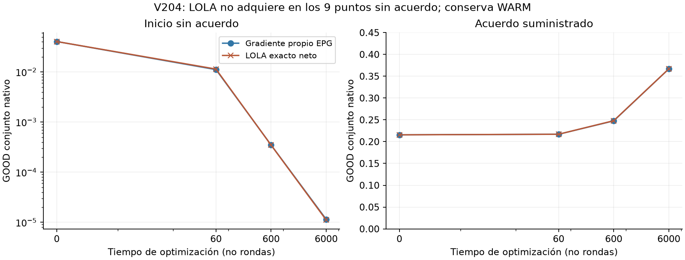
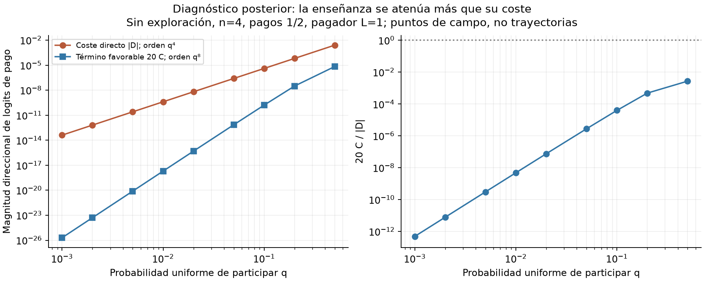

# V204: LOLA neto no adquiere; una identidad cuantifica la atenuación del incentivo

Fecha: 16/11/2026. Registro [f8e9a552](https://github.com/GalexY3/Metodologia-AB/commit/f8e9a55263584cfbd6248917b7c533d71af0a14a), fuentes verificadas por HTTP antes de integrar. H1: **FAIL**. Objetivo global activo; CT2 histórica 61 intacta; nueva rama sin puntuar; N2=N3=0.

## Comparación registrada

V203 había eliminado el error Monte Carlo sin adquirir desde COLD. V204 añade un rival establecido: LOLA-Ex, ecuación 4.4 de Foerster et al., AAMAS 2018. Cada jugador diferencia a través de la actualización ajena prevista; el multiplicador grad_j U_i queda detenido como en el método original. Todos los retornos incluyen íntegramente pagos dados y recibidos. El campo conoce modelo, pérdidas y parámetros ajenos; es oracular, no aprendizaje con recompensa privada realizada.

Se fijó eta=20 para retornos normalizados, equivalente a anticipar un paso de tamaño 1 sobre retornos no normalizados. Diez puntos: COLD, WARM y los ocho JITTER de V203; misma física y mezcla de exploración. RK45 hasta t=6000, rtol=1e−8, atol=1e−10; COLD/WARM repetidos con tolerancias diez veces menores. No se barrieron tasas ni se cambiaron supuestos tras observar resultados.

H1 requería COLD y al menos 6/8 JITTER con funcionalidad V202 y regret público nativo máximo <=0,01. **COLD y los ocho JITTER fallaron.** WARM pasó funcionalidad estable. El control EPG V203 también falló en los mismos nueve puntos sin acuerdo. Son puntos del mismo modelo determinista, no nueve mundos independientes ni una estimación en población humana.

| Inicio / método | GOOD conjunto | Ganancia privada mínima | Caída GOOD sin pagos | Regret público máximo |
|---|---:|---:|---:|---:|
| COLD / EPG V203 | 0,0000114925 | −0,000302091 | −0,000001332 | 0,000302091 |
| COLD / LOLA V204 | 0,0000111493 | −0,000301250 | −0,000001268 | 0,000301250 |
| WARM / EPG V203 | 0,366734531 | 0,067991706 | 0,320430390 | 0,002881511 |
| WARM / LOLA V204 | 0,366876018 | 0,068015912 | 0,320571381 | 0,002874105 |

GOOD final en JITTER LOLA: 0,00001113783–0,00001115793. El acuerdo WARM fue proporcionado: conservarlo o cruzar un umbral no acredita invención institucional. Los roles, la unanimidad y el canal de pago también están programados.

## Auditoría

Las fuentes registradas conservan sus hashes. Los diez flujos y las dos precisiones terminaron sin alcanzar el límite de 5000 llamadas por integración. Proceso original: sesión 32903, PID 28200, terminal código 0; tiempo registrado del bucle 220,1 segundos. BelowNormal, seis CPU lógicos, dos hilos Torch/BLAS. Sin GPU: estas matrices pequeñas no lo justificaban.

La mayor discrepancia de probabilidad final entre tolerancias fue 1,114e−8, inferior a 1e−4. Máximo |logit| guardado 7,1431, sin problemas de proyección. Auditoría previa: 2880 derivadas escalares contrastadas con el evaluador independiente de 27 estados y 36 formas bilineales de Hessianas; errores máximos 3,21e−11 y 1,49e−14. JavaScript contrastó 42 perfiles, 252 magnitudes nativas, 168 valores con exploración y 48 mejores respuestas públicas. Máximas discrepancias 9,50e−13 y 8,94e−14. Son comprobaciones internas, no confirmación científica externa.

## Resultado posterior: identidad de los pagos en el punto uniforme

Después del primer endpoint negativo se descompuso el campo, sin modificar las trayectorias. En el punto en que todos participan con probabilidad q y pagan con probabilidad 1/2, sin exploración, el gradiente propio agregado de los logits de pago es exactamente `D_i=−tau*pi*q^n/4`. La corrección LOLA agregada tiene forma `C_i=(tau/4)*I_i*S(q)*(1−q)^2*q^(2n)`, con I_i determinado por beneficios, riesgo y precisión de la señal del crítico; S(q) es la suma de cuadrados de ocupaciones y también tiene expresión cerrada.

La derivación completa, incluida la versión con exploración, está en `V204_CLOSED_FORM_PAYMENT_GRADIENT.md`. El factor de visita se cancela en ciertos términos por la simetría del recuento de pagos a probabilidad 1/2. Quedan un coste de orden q^n y una corrección de orden q^(2n) cuando q tiende a cero sin exploración. En cuatro agentes: q^4 frente a q^8. La fórmula reproduce 57 componentes del modelo n=4, incluida variación de exploración y pérdidas críticas 0/100, con error relativo máximo **1,79e−13**. No es un ajuste de exponentes a una curva.

En COLD real, probabilidad nativa 1/2 y epsilon=0,20, el término favorable eta*C_i compensa aproximadamente **0,1743%** del coste directo agregado para un pagador L=1. Esto ayuda a diagnosticar por qué este paso anticipado apenas cambia el gradiente de pago. No mide qué porcentaje del fracaso de toda la trayectoria tiene esa causa.

La identidad predice ceros del término LOLA al variar la precisión de señal del crítico: 0,765164734 para pagador L=1 y 0,956829311 para L=7 en esta calibración. No son umbrales de cooperación aprendida: conciernen al signo de una corrección direccional en un punto específico. Falta contrastar esos valores y otros tamaños de grupo con una implementación nueva. El signo de la suma tampoco implica el signo de cada coordenada ni prueba imposibilidad de adquirir dependencia de historias.

La identidad es posterior al negativo, dentro de una parametrización tabular concreta. Su prioridad original no está establecida. La atenuación de gradientes y la sensibilidad de LOLA a la representación tienen antecedentes; [POLA](https://proceedings.neurips.cc/paper_files/paper/2022/hash/a882dab38011264d2ca8dba3cca9faf1-Abstract-Conference.html) aborda esta última y [SOS](https://arxiv.org/abs/1811.08469) trata limitaciones de estabilidad. No se han ejecutado esos rivales aquí ni se ha refutado la clase completa de aprendizaje consciente de oponentes.

## Decisión

Se conserva H1 negativa. No basta afirmar que faltaba cualquier consideración del aprendizaje ajeno: esta implementación exacta de un método conocido ya la incluye y tampoco adquiere en los puntos probados. Tampoco procede declarar imposible la adquisición para todo eta, LIO, SOS, POLA o arquitecturas privadas.

La siguiente prueba de mayor valor es falsar la identidad fuera de los cuatro agentes y la precisión 0,8 usados para derivarla, y revisar si sus predicciones ya están demostradas. Eso puede delimitar un mecanismo matemático útil; todavía no proporciona por sí solo la predicción sociológica novedosa y confirmación independiente exigidas por AB2/3. Se deja una contribución matemática candidata y un control negativo sólido para el TFM, sin nueva acreditación N1, N2 o N3.

Fuentes primarias: [LOLA, artículo completo](https://arxiv.org/pdf/1709.04326), [código de sus autores](https://github.com/alshedivat/lola), [LIO](https://proceedings.neurips.cc/paper/2020/hash/ad7ed5d47b9baceb12045a929e7e2f66-Abstract.html). La auditoría LIO ya ha encontrado su opción de incluir coste en la cadena: no sería una novedad añadirla.
