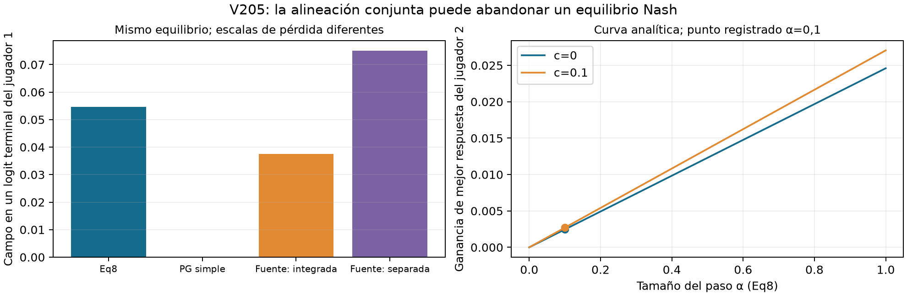
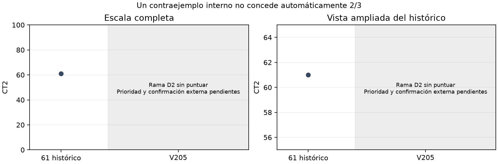

# V205: un contraejemplo a la conservación de Nash con ventajas conjuntas

16/11/2026. La hipótesis registrada se confirma internamente: el operador conjunto de Advantage Alignment puede abandonar un equilibrio Nash aislado y generar una desviación rentable. La copia oficial publicada en ICLR2025 contiene la afirmación auditada. La originalidad del contraejemplo y la confirmación científica externa siguen pendientes; CT2 histórica61 permanece intacta y la rama nueva no se puntúa.

## Evidencia que decide la cuestión

El juego tiene dos jugadores, dos rondas, observación pública completa y políticas privadas normalizadas. El control c=.1 hace relevantes todas las acciones y aísla el equilibrio mixto uniforme. Los valores y todas las mejores respuestas iniciales son cero. Con ventajas exactas conjuntas, la ecuación8 genera βγ^3/4 en cada logit terminal del jugador1; los demás componentes son cero. Tras un paso α, la mejor respuesta del segundo mejora su retorno en γ(1+c)tanh(αβγ^3/8). La prueba algebraica y la enumeración coinciden.

Para γ=.9, β=.3, α=.1, c=.1: campo terminal .054675; ganancia de desviación .0027064057579956335. La desviación es rentable aunque los dos retornos del perfil posterior sigan siendo cero. Mover la política no conserva aquí su condición de Nash.

| Comprobación | Resultado |
|---|---|
| Perfiles literales, deterministas | 320; H1 confirmada en ambos c registrados |
| Auxiliares originales con AA | 96/96 producen movimiento y explotabilidad |
| Controles originales naive | 48/48 estacionarios en tolerancia; error máximo3.73×10^−9 |
| JavaScript separado | PASS; error máximo de mejor respuesta1.25×10^−16 |
| SymPy independiente del simulador | Campo,16 certificados unilaterales, determinante4096c^6 y regret exactos |
| Beta0 o ventaja marginal en uniforme | Campo máximo6.94×10^−18 |

Son identidades y casos computacionales, no réplicas estocásticas. Las96 llamadas AA cruzan pérdidas integrada/separada, proximidad, normalización, GAEλ0/.95/1, float32/64 y c0/.1. Se ejecutan cuerpos originales sin modificarlos sobre nuestra interfaz tabular y critic exacto. No se han reproducido las redes o campañas completas de los autores.

## La causa y su límite

Nash anula las ventajas marginales de las acciones propias del soporte, no todas las ventajas de cada acción conjunta. El producto entre la ventaja ajena conjunta y el score actual puede mantener una covarianza no nula. La fuerza observada existe con la distribución completa y valores exactos: no necesita error de critic o ruido de una muestra finita.

La intervención posterior sustituye solo la ventaja actual del oponente por su marginal exacta, conservando el pasado conjunto y el gradiente privado. En12 perfiles fuera de equilibrio, el término conjunto tiene norma mínima.0239 y el intervenido queda por debajo de2.64×10^−18. La prueba general requiere pesos pasados medibles antes de actuar. No se extiende sin más a retornos GAE pasados que contienen el futuro. Sustituir ventajas conjuntas por marginales cambia el operador, no conserva su esperanza como una reducción de varianza.

## Qué cambia en el TFM

V205 aporta una predicción discriminante y una posible corrección matemática de un antecedente fuerte. Refuerza la necesidad de identificar el campo de aprendizaje y la información utilizada antes de hablar de reciprocidad o estabilidad institucional. No acredita una institución emergente, ni refuta los resultados de bienestar publicados, ni demuestra una ley sociológica. Salir de un equilibrio puede ser útil para cooperar; esa cuestión es distinta de la garantía auditada.

El resultado se construyó analíticamente antes del registro, publicado en c7779edf154a924262ddd60a579d7b9eafab0ba9 y descargado/verificado antes de ejecutar el campo primario. Los resultados originales y fuentes congeladas permanecen intactos. El estado pendiente de JavaScript dentro de SUMMARY.json corresponde a esa etapa primaria; V205_SCIENTIFIC_SYNTHESIS.json incorpora su terminación posterior sin reescribir el original.

La búsqueda de prioridad es acotada. No se ha identificado una corrección idéntica en las búsquedas realizadas; el foro de OpenReview devuelve403. No se considera revisado ni se toma la ausencia en buscadores como prueba de originalidad. No se contactó a autores ni revisores. La réplica en otro lenguaje y la comprobación simbólica son internas.

Documentos: V205_NASH_COUNTEREXAMPLE_NOTE.md contiene la demostración completa; docs/TFM_CAPITULO_VENTAJAS_Y_EQUILIBRIOS_V205.md integra el argumento; REPRODUCE_V205.md y reproduce_v205_fresh.py describen y ejecutan una repetición sin tocar los originales. Se conservan fuentes negativas y controles. El programa amplio sigue activo; la generalización n/kappa de la identidad V204 queda pendiente y no se declara resuelta.

Fuente auditada: [publicación oficial de ICLR2025](https://proceedings.iclr.cc/paper_files/paper/2025/hash/5185aa776fd64ae3b4c6dae1af1066b1-Abstract-Conference.html). Código original fijado en [2065e43](https://github.com/jduquevan/advantage-alignment/tree/2065e43c0c36694965cf4476dc692512e3892dcc).
